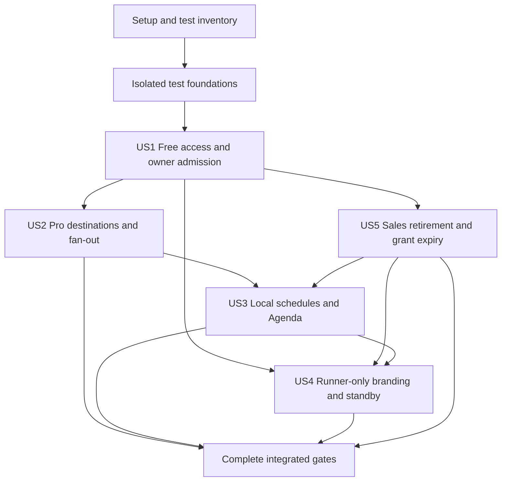

# Tasks: Free Runner and Pro Broadcasting

**Input**: Design documents in `specs/004-runner-free-pro/`.

**Prerequisites**: [plan.md](plan.md), [spec.md](spec.md), [research.md](research.md), [data-model.md](data-model.md), [contracts](contracts/runner-control.md), [test-traceability.md](test-traceability.md), and the active project constitution.

**Tests**: Mandatory. Every planned TDD inventory artifact and every required BDD/ATDD scenario gets a concrete task. All tasks start unchecked; no implementation or product validation is claimed here.

**Organization**: Setup and test-only foundations, then US1/US2/US5 (P1), US3/US4 (P2), then cross-cutting release gates. Within each story, specify all scenarios without executing all failing bindings; add executable tests only for the current cohesive slice and finish its Red/Green/refactor before the next slice.

## Format: `[ID] [P?] [Story] [Suite?] Description`

`[P]` identifies separate-file test-writing lanes that can run concurrently after the same scenario/registry gate. Tasks sharing a file serialize, even within the same slice. `[TDD]`, `[BDD]`, `[ATDD]` are owning suites; an artifact may prove several evidence roles but is never implemented twice. `[GATE]` protects non-product validation/report evidence only. Commands and mutable results remain in the registry, not copied into source mappings.

## Path Conventions

Repository paths are relative to `/home/coder/clipify`. App tests use existing `test/` conventions; runtime tests use `packages/runner/`. Run commands with their registry working directory. Schema source changes belong in `src/db/schema.ts`; never generate/edit `drizzle/` artifacts or enable migration overrides. New test/helper/module paths are planned additions. Existing successful checks are repeated only after relevant changes or unresolved concerns.

## TDD execution binding

Behavior IDs `[A1]` / `[U1]` refer to tdd/test-list.md; existing delivery slice
names A1–E4 are separate identifiers. Every shared task with several behavior
markers remains unchecked until **all** its marked behaviors have valid terminal
states: DONE after Green/refactor, or (for characterizations only) verified
BASELINE or intentionally superseded DROPPED with recorded evidence and reason.
Execute one behavior at a time: one outer example, one inner Red, its smallest
production change, Green and refactor. Existing multi-ID Red/Green tasks are
reusable checkpoints whose lists are inventories, not instructions to write all
future tests at once. Production schema/contract lists describe the final target;
add only fields/rules required by the current intended Red. Revisit shared tasks
per behavior; record each cycle separately and tick only after all markers finish.
References such as “after T050, T051” require those checkpoints to have passed for
the current behavior, not the entire shared task to be checked off. No production
change may precede that behavior’s intended Red. A characterization is captured
and sensitivity-checked before its owning source or policy changes; it is not
attached to a feature Red/Green task. Existing regression markers belong only to
the baseline-retention task and never imply completion of a new-feature artifact.
Existing successful regressions stay DONE without contrived Red. Characterization
rows stay PENDING until actually green against unchanged source, then BASELINE.
Do not interpret the current passing repository baseline as completed feature work.

## Phase 1: Setup (Shared Infrastructure)

**Purpose**: Confirm scope, mandatory evidence and runnable local test commands without changing production behavior.

- [x] T001 [GATE] Confirm active feature/branch and agreed unlimited-hours scope against `specs/004-runner-free-pro/spec.md`, `specs/004-runner-free-pro/plan.md`, `.specify/feature.json` and `.specify/extensions.yml`; record that quota/multiplier work and live billing writes are excluded.
- [x] T002 [GATE] Materialize the complete TDD inventory in `specs/004-runner-free-pro/tdd/test-list.md` from every TDD registry ID, required examples and contract tests; initialize `specs/004-runner-free-pro/tdd/cycle-log.md` with whole-file Red/Green/refactor evidence fields, preserving existing evidence if present.
- [x] T003 [GATE] [U225] [U226] [U227] [U228] Resolve current test commands/environments from `.specify/memory/tdd-profile.md`, `jest.config.cjs`, `packages/runner/jest.config.cjs` and `playwright.config.ts`; retain exact whole-file commands in `specs/004-runner-free-pro/tdd/test-list.md`, excluding live credentials/shared databases. Retain the already-verified regression evidence for U225/U226 in `test/app/actions/runner.test.ts`, U227 in `test/server/billingCatalog.test.ts`, and U228 in `packages/runner/src/__tests__/engine.test.ts` using their exact named tests and recorded baseline results. These are existing regressions, not completion evidence for their associated new-feature registry artifacts; rerun their actual whole files only when source or execution inputs change.
- [x] T004 [GATE] Confirm `specs/004-runner-free-pro/test-traceability.md`, `specs/004-runner-free-pro/defect-log.md` and `specs/004-runner-free-pro/test-summary.md` exist with planned states, single ownership and no fabricated Red/Green/Go; capture entry checkpoint before test/helper additions.

## Phase 2: Foundational (Blocking Test Prerequisites)

**Purpose**: Reuse isolated fixtures and execution adapters. This phase changes test infrastructure only; production schema/services are introduced in their story after intended Red.

- [x] T005 [P] [TDD] Build deterministic Free/Pro/trial/legacy/agency fixtures with owner/team identities and ephemeral signing keys in `test/support/runner/fixtures.ts`; reuse existing PostgreSQL/PGlite builders and do not seed production data.
- [x] T006 [P] [TDD] Build reusable controlled clocks and generated short-clip metadata in `test/support/runner/clock.ts`; allow month/DST/restart/drain boundaries without real sleeps, using existing fake-timer patterns.
- [x] T007 [P] [TDD] Build disposable loopback RTMP receiver/process/media helpers in `test/support/runner/receivers.ts` and package-specific adaptation in `packages/runner/test/support/receivers.ts`; every helper cleans children/ports/temp data and uses no live platform credentials.
- [x] T008 [P] [TDD] Implement shared Gherkin-ID inventory/binding completeness support in `test/support/runner/scenario-inventory.ts` and package adaptation in `packages/runner/test/support/scenario-inventory.ts`, reusing installed Gherkin/Playwright metadata parsing; do not silently skip unbound/duplicate IDs.
- [x] T009 [P] [BDD] Prepare the native workflow adapter in `test/support/mcp/runner-free-pro-probe.ts` and browser fixture extension in `test/bdd/support/runner-free-pro.ts`, reusing existing authorization/DB fixtures; route native features only through the workflows lane, not duplicate browser evidence.
- [x] T010 [GATE] Validate isolated fixture cleanup and owning-suite discovery using `test/support/runner/scenario-inventory.ts`, `scripts/run-coverage-lane.mjs` and `playwright.mcp.config.ts`; protect `specs/004-runner-free-pro/test-traceability.md` ownership and do not execute all future failing scenario bindings. Verify native workflow fixtures run without NODE_V8_COVERAGE or instrumented-server startup in development; keep instrumentation and complete inventory mandatory in the coverage lane.

## Phase 3: User Story 1 — Free manual broadcasting (Priority: P1)

**Goal / Independent Test**: A Free owner registers two devices, manually broadcasts to one destination with unlimited hours, is denied a concurrent second start, can use live fallback and completes manual generated playback at a clip boundary.

**Dependency boundary**: Basic access and concurrency can be validated through dashboard/MCP/runtime fixtures without implementing Pro scheduling or custom standby.

### Scenario specifications (before production implementation)

- [x] T011 [US1] [BDD] [A1] Finalize the approved @BDD-US1-FR001 specification in `specs/004-runner-free-pro/spec.md` for planned executable target `test/bdd/features/mcp-workflows/runner-free-pro.feature`, preserving @US1 and @FR-001 tags: Given an authenticated Free creator; When they register a second device; Then both devices remain registered without a purchase. Keep this declaration in the specification until its slice materializes the feature/binding; record BDD/ATDD equivalence and never add a future unbound executable or skipped scenario.
- [x] T012 [US1] [BDD] [A2] Finalize the approved @BDD-US1-FR002 specification in `specs/004-runner-free-pro/spec.md` for planned executable target `test/bdd/features/mcp-workflows/runner-free-pro.feature`, preserving @US1 and @FR-002 tags: Given a Free owner with one active clip broadcast; When they start live fallback on another device; Then the second start is rejected with an explanation and the first broadcast continues. Keep this declaration in the specification until its slice materializes the feature/binding; record BDD/ATDD equivalence and never add a future unbound executable or skipped scenario.
- [x] T013 [US1] [BDD] [A3] Finalize the approved @BDD-US1-FR003 specification in `specs/004-runner-free-pro/spec.md` for planned executable target `test/bdd/features/mcp-workflows/runner-free-pro.feature`, preserving @US1 and @FR-003 tags: Given a Pro operator managing a Free owner runner with valid control permission; When they attempt a second owner broadcast; Then the Free owner limit still applies. Keep this declaration in the specification until its slice materializes the feature/binding; record BDD/ATDD equivalence and never add a future unbound executable or skipped scenario.
- [x] T014 [US1] [BDD] [A4] Finalize the approved @BDD-US1-FR004 specification in `specs/004-runner-free-pro/spec.md` for planned executable target `packages/runner/test/bdd/runner-free-pro.feature`, preserving @US1 and @FR-004 tags: Given a manual broadcast playing a clip; When the owner requests stop; Then the clip completes and no next clip starts. Keep this declaration in the specification until its slice materializes the feature/binding; record BDD/ATDD equivalence and never add a future unbound executable or skipped scenario.
- [x] T015 [US1] [BDD] [A5] Finalize the approved @BDD-US1-FR005 specification in `specs/004-runner-free-pro/spec.md` for planned executable target `test/bdd/features/runner-free-pro.feature`, preserving @US1 and @FR-005 tags: Given a Free owner configuring a runner; When they select Live fallback; Then manual live forwarding and automatic fallback are available without scheduling. Keep this declaration in the specification until its slice materializes the feature/binding; record BDD/ATDD equivalence and never add a future unbound executable or skipped scenario.
- [x] T016 [US1] [BDD] [A23] Finalize the approved @BDD-US1-EC001 specification in `specs/004-runner-free-pro/spec.md` for planned executable target `test/bdd/features/mcp-workflows/runner-free-pro.feature`, preserving @US1 and @EC-001 tags: Given two devices belonging to one Free owner; When both request start concurrently; Then exactly one broadcast starts and the other receives the limit error. Keep this declaration in the specification until its slice materializes the feature/binding; record BDD/ATDD equivalence and never add a future unbound executable or skipped scenario.
- [x] T017 [US1] [BDD] [A24] Finalize the approved @BDD-US1-EC002 specification in `specs/004-runner-free-pro/spec.md` for planned executable target `test/bdd/features/mcp-workflows/runner-free-pro.feature`, preserving @US1 and @EC-002 tags: Given a Free broadcast whose Runner loses its control connection but continues sending video; When another device requests start; Then the active slot is not silently released and the user sees recovery guidance. Keep this declaration in the specification until its slice materializes the feature/binding; record BDD/ATDD equivalence and never add a future unbound executable or skipped scenario.
- [x] T018 [US1] [BDD] [A25] Finalize the approved @BDD-US1-EC003 specification in `specs/004-runner-free-pro/spec.md` for planned executable target `test/bdd/features/mcp-workflows/runner-free-pro.feature`, preserving @US1 and @EC-003 tags: Given an operator without Runner control permission; When they start edit or stop the runner; Then the operation is rejected without changing the broadcast. Keep this declaration in the specification until its slice materializes the feature/binding; record BDD/ATDD equivalence and never add a future unbound executable or skipped scenario.
- [x] T019 [US1] [ATDD] [A36] Finalize the approved @ATDD-US1-SC001 specification in `specs/004-runner-free-pro/spec.md` for planned executable target `test/atdd/features/mcp-workflows/runner-free-pro.feature`, preserving @US1 and @SC-001 tags: Given the acceptance setup for US1; When the complete referenced story scenarios are exercised; Then free creators can register two devices and complete a manual broadcast without a paid purchase; concurrent starts result in exactly one active broadcast.. Keep this declaration in the specification until its slice materializes the feature/binding; record BDD/ATDD equivalence and never add a future unbound executable or skipped scenario.
- [x] T020 [US1] [BDD] [A41] Finalize the approved @BDD-US1-OPT001 specification in `specs/004-runner-free-pro/spec.md` for planned executable target `test/bdd/features/mcp-workflows/runner-free-pro.feature`, preserving @US1 and @FR-001 tags: Given an owner with Free access; When they register a Runner; Then registration succeeds without a Runner purchase. Keep this declaration in the specification until its slice materializes the feature/binding; record BDD/ATDD equivalence and never add a future unbound executable or skipped scenario.
- [x] T021 [US1] [BDD] [A42] Finalize the approved @BDD-US1-OPT002 specification in `specs/004-runner-free-pro/spec.md` for planned executable target `test/bdd/features/mcp-workflows/runner-free-pro.feature`, preserving @US1 and @FR-001 tags: Given an owner with Pro access; When they register a Runner; Then registration succeeds without a Runner purchase. Keep this declaration in the specification until its slice materializes the feature/binding; record BDD/ATDD equivalence and never add a future unbound executable or skipped scenario.
- [x] T022 [US1] [BDD] [A43] Finalize the approved @BDD-US1-OPT003 specification in `specs/004-runner-free-pro/spec.md` for planned executable target `test/bdd/features/mcp-workflows/runner-free-pro.feature`, preserving @US1 and @FR-001 tags: Given an owner with active legacy Runner grant access; When they register a Runner; Then registration succeeds without a Runner purchase. Keep this declaration in the specification until its slice materializes the feature/binding; record BDD/ATDD equivalence and never add a future unbound executable or skipped scenario.
- [x] T023 [US1] [BDD] [A44] Finalize the approved @BDD-US1-OPT004 specification in `specs/004-runner-free-pro/spec.md` for planned executable target `test/bdd/features/mcp-workflows/runner-free-pro.feature`, preserving @US1 and @FR-001 tags: Given an owner with active agency Runner allocation access; When they register a Runner; Then registration succeeds without a Runner purchase. Keep this declaration in the specification until its slice materializes the feature/binding; record BDD/ATDD equivalence and never add a future unbound executable or skipped scenario.
- [x] T024 [US1] [BDD] [A45] Finalize the approved @BDD-US1-OPT005 specification in `specs/004-runner-free-pro/spec.md` for planned executable target `test/bdd/features/mcp-workflows/runner-free-pro.feature`, preserving @US1 and @FR-001 tags: Given an owner with active Pro trial access; When they register a Runner; Then registration succeeds without a Runner purchase. Keep this declaration in the specification until its slice materializes the feature/binding; record BDD/ATDD equivalence and never add a future unbound executable or skipped scenario.
- [x] T025 [US1] [BDD] [A46] Finalize the approved @BDD-US1-OPT006 specification in `specs/004-runner-free-pro/spec.md` for planned executable target `test/bdd/features/mcp-workflows/runner-free-pro.feature`, preserving @US1 and @FR-002 tags: Given a Free owner already broadcasting in Clip playback; When a second device requests start; Then the request is rejected and the existing output continues. Keep this declaration in the specification until its slice materializes the feature/binding; record BDD/ATDD equivalence and never add a future unbound executable or skipped scenario.
- [x] T026 [US1] [BDD] [A47] Finalize the approved @BDD-US1-OPT007 specification in `specs/004-runner-free-pro/spec.md` for planned executable target `test/bdd/features/mcp-workflows/runner-free-pro.feature`, preserving @US1 and @FR-002 tags: Given a Free owner already broadcasting in Live fallback forwarding live input; When a second device requests start; Then the request is rejected and the existing output continues. Keep this declaration in the specification until its slice materializes the feature/binding; record BDD/ATDD equivalence and never add a future unbound executable or skipped scenario.
- [x] T027 [US1] [BDD] [A48] Finalize the approved @BDD-US1-OPT008 specification in `specs/004-runner-free-pro/spec.md` for planned executable target `test/bdd/features/mcp-workflows/runner-free-pro.feature`, preserving @US1 and @FR-002 tags: Given a Free owner already broadcasting in Live fallback playing clips; When a second device requests start; Then the request is rejected and the existing output continues. Keep this declaration in the specification until its slice materializes the feature/binding; record BDD/ATDD equivalence and never add a future unbound executable or skipped scenario.
- [x] T028 [US1] [BDD] [A49] Finalize the approved @BDD-US1-OPT009 specification in `specs/004-runner-free-pro/spec.md` for planned executable target `test/bdd/features/mcp-workflows/runner-free-pro.feature`, preserving @US1 and @FR-002 tags: Given a Free owner already broadcasting in Live fallback showing standby; When a second device requests start; Then the request is rejected and the existing output continues. Keep this declaration in the specification until its slice materializes the feature/binding; record BDD/ATDD equivalence and never add a future unbound executable or skipped scenario.
- [x] T029 [US1] [BDD] [A122] Finalize the approved @BDD-US1-OPT082 specification in `specs/004-runner-free-pro/spec.md` for planned executable target `test/bdd/features/mcp-workflows/runner-free-pro.feature`, preserving @US1 and @FR-003 tags: Given an operator without the required permission; When they request start; Then the operation is denied without changing resource state. Keep this declaration in the specification until its slice materializes the feature/binding; record BDD/ATDD equivalence and never add a future unbound executable or skipped scenario.
- [x] T030 [US1] [BDD] [A123] Finalize the approved @BDD-US1-OPT083 specification in `specs/004-runner-free-pro/spec.md` for planned executable target `test/bdd/features/mcp-workflows/runner-free-pro.feature`, preserving @US1 and @FR-003 tags: Given an operator without the required permission; When they request stop; Then the operation is denied without changing resource state. Keep this declaration in the specification until its slice materializes the feature/binding; record BDD/ATDD equivalence and never add a future unbound executable or skipped scenario.
- [x] T031 [US1] [BDD] [A124] Finalize the approved @BDD-US1-OPT084 specification in `specs/004-runner-free-pro/spec.md` for planned executable target `test/bdd/features/mcp-workflows/runner-free-pro.feature`, preserving @US1 and @FR-003 tags: Given an operator without the required permission; When they request edit destinations; Then the operation is denied without changing resource state. Keep this declaration in the specification until its slice materializes the feature/binding; record BDD/ATDD equivalence and never add a future unbound executable or skipped scenario.
- [x] T032 [US1] [BDD] [A125] Finalize the approved @BDD-US1-OPT085 specification in `specs/004-runner-free-pro/spec.md` for planned executable target `test/bdd/features/mcp-workflows/runner-free-pro.feature`, preserving @US1 and @FR-003 tags: Given an operator without the required permission; When they request edit schedule; Then the operation is denied without changing resource state. Keep this declaration in the specification until its slice materializes the feature/binding; record BDD/ATDD equivalence and never add a future unbound executable or skipped scenario.
- [x] T033 [US1] [BDD] [A126] Finalize the approved @BDD-US1-OPT086 specification in `specs/004-runner-free-pro/spec.md` for planned executable target `test/bdd/features/mcp-workflows/runner-free-pro.feature`, preserving @US1 and @FR-003 tags: Given an operator without the required permission; When they request edit standby; Then the operation is denied without changing resource state. Keep this declaration in the specification until its slice materializes the feature/binding; record BDD/ATDD equivalence and never add a future unbound executable or skipped scenario.
- [x] T034 [US1] [BDD] [A127] Finalize the approved @BDD-US1-OPT087 specification in `specs/004-runner-free-pro/spec.md` for planned executable target `test/bdd/features/mcp-workflows/runner-free-pro.feature`, preserving @US1 and @FR-002 tags: Given a Free owner whose first start fails before an output is established; When they retry on another device; Then the failed start does not consume the active slot. Keep this declaration in the specification until its slice materializes the feature/binding; record BDD/ATDD equivalence and never add a future unbound executable or skipped scenario.
- [x] T035 [US1] [BDD] [A135] Finalize the approved @BDD-US1-FR023 specification in `specs/004-runner-free-pro/spec.md` for planned executable target `packages/runner/test/bdd/runner-free-pro.feature`, preserving @US1 and @FR-023 tags: Given a Free owner with one active single-destination broadcast; When playback crosses the month boundary after extended streaming; Then playback continues without quota warnings or a usage-driven stop. Keep this declaration in the specification until its slice materializes the feature/binding; record BDD/ATDD equivalence and never add a future unbound executable or skipped scenario.
- [x] T036 [US1] [ATDD] [A136] Finalize the approved @ATDD-US1-SC006 specification in `specs/004-runner-free-pro/spec.md` for planned executable target `test/atdd/features/mcp-workflows/runner-free-pro.feature`, preserving @US1 and @FR-023 tags: Given a Free owner with a long-running broadcast; When another owned device requests a broadcast; Then the second start is denied by concurrency rather than consumed monthly time. Keep this declaration in the specification until its slice materializes the feature/binding; record BDD/ATDD equivalence and never add a future unbound executable or skipped scenario.
- [x] T037 [US1] [GATE] Reconcile every US1 artifact definition/source relationship/scenario example in `specs/004-runner-free-pro/test-traceability.md`; verify all required roles and no sampling gaps, confirm `specs/004-runner-free-pro/defect-log.md` and `specs/004-runner-free-pro/test-summary.md` initialization, and keep unused bindings Planned.

### Behavior Slice A1: Basic access and device registration

Sources: FR-001. Prerequisite: T037 and the preceding slice Green/refactor checkpoint.

- [x] T038 [P] [US1] [BDD] [A1] Materialize only the current-slice @BDD-US1-FR001 scenario in `test/bdd/features/mcp-workflows/runner-free-pro.feature` and its failing binding in `test/bdd/steps/runner-free-pro-workflows.steps.ts` using the shared fixture/probe; assert both devices remain registered without a purchase at its real native workflow boundary. Do not add the next slice's executable cases.
- [x] T039 [US1] [BDD] [A41] Materialize only the current-slice @BDD-US1-OPT001 scenario in `test/bdd/features/mcp-workflows/runner-free-pro.feature` and its failing binding in `test/bdd/steps/runner-free-pro-workflows.steps.ts` using the shared fixture/probe; assert registration succeeds without a Runner purchase at its real native workflow boundary. Do not add the next slice's executable cases.
- [x] T040 [US1] [BDD] [A42] Materialize only the current-slice @BDD-US1-OPT002 scenario in `test/bdd/features/mcp-workflows/runner-free-pro.feature` and its failing binding in `test/bdd/steps/runner-free-pro-workflows.steps.ts` using the shared fixture/probe; assert registration succeeds without a Runner purchase at its real native workflow boundary. Do not add the next slice's executable cases.
- [x] T041 [US1] [BDD] [A43] Materialize only the current-slice @BDD-US1-OPT003 scenario in `test/bdd/features/mcp-workflows/runner-free-pro.feature` and its failing binding in `test/bdd/steps/runner-free-pro-workflows.steps.ts` using the shared fixture/probe; assert registration succeeds without a Runner purchase at its real native workflow boundary. Do not add the next slice's executable cases.
- [x] T042 [US1] [BDD] [A44] Materialize only the current-slice @BDD-US1-OPT004 scenario in `test/bdd/features/mcp-workflows/runner-free-pro.feature` and its failing binding in `test/bdd/steps/runner-free-pro-workflows.steps.ts` using the shared fixture/probe; assert registration succeeds without a Runner purchase at its real native workflow boundary. Do not add the next slice's executable cases.
- [x] T043 [US1] [BDD] [A45] Materialize only the current-slice @BDD-US1-OPT005 scenario in `test/bdd/features/mcp-workflows/runner-free-pro.feature` and its failing binding in `test/bdd/steps/runner-free-pro-workflows.steps.ts` using the shared fixture/probe; assert registration succeeds without a Runner purchase at its real native workflow boundary. Do not add the next slice's executable cases.
- [x] T044 [P] [US1] [TDD] [U1] Add distinct failing test TDD-US1-FR001 in `test/server/runner/admission.test.ts` for Internal admission contract under controlled dependencies: they register a second device; verify both devices remain registered without a purchase. Include validation/rollback/state assertions distinct from the outer boundary. Preserve exact ID and initial-failure intent in `specs/004-runner-free-pro/tdd/test-list.md`; test internal validation/state/rollback contracts rather than duplicating the outer journey.
- [x] T045 [US1] [TDD] [U41] Add distinct failing test TDD-US1-OPT001 in `test/server/runner/admission.test.ts` for Internal admission contract under controlled dependencies: an owner with Free access registers a Runner; verify registration succeeds without a Runner purchase. Include validation/rollback/state assertions distinct from the outer boundary. Preserve exact ID and initial-failure intent in `specs/004-runner-free-pro/tdd/test-list.md`; test internal validation/state/rollback contracts rather than duplicating the outer journey.
- [x] T046 [US1] [TDD] [U42] Add distinct failing test TDD-US1-OPT002 in `test/server/runner/admission.test.ts` for Internal admission contract under controlled dependencies: an owner with Pro access registers a Runner; verify registration succeeds without a Runner purchase. Include validation/rollback/state assertions distinct from the outer boundary. Preserve exact ID and initial-failure intent in `specs/004-runner-free-pro/tdd/test-list.md`; test internal validation/state/rollback contracts rather than duplicating the outer journey.
- [x] T047 [US1] [TDD] [U43] Add distinct failing test TDD-US1-OPT003 in `test/server/runner/admission.test.ts` for Internal admission contract under controlled dependencies: an owner with active legacy Runner grant access registers a Runner; verify registration succeeds without a Runner purchase. Include validation/rollback/state assertions distinct from the outer boundary. Preserve exact ID and initial-failure intent in `specs/004-runner-free-pro/tdd/test-list.md`; test internal validation/state/rollback contracts rather than duplicating the outer journey.
- [x] T048 [US1] [TDD] [U44] Add distinct failing test TDD-US1-OPT004 in `test/server/runner/admission.test.ts` for Internal admission contract under controlled dependencies: an owner with active agency Runner allocation access registers a Runner; verify registration succeeds without a Runner purchase. Include validation/rollback/state assertions distinct from the outer boundary. Preserve exact ID and initial-failure intent in `specs/004-runner-free-pro/tdd/test-list.md`; test internal validation/state/rollback contracts rather than duplicating the outer journey.
- [x] T049 [US1] [TDD] [U45] Add distinct failing test TDD-US1-OPT005 in `test/server/runner/admission.test.ts` for Internal admission contract under controlled dependencies: an owner with active Pro trial access registers a Runner; verify registration succeeds without a Runner purchase. Include validation/rollback/state assertions distinct from the outer boundary. Preserve exact ID and initial-failure intent in `specs/004-runner-free-pro/tdd/test-list.md`; test internal validation/state/rollback contracts rather than duplicating the outer journey.
- [x] T050 [US1] [BDD] [A1] [A41] [A42] [A43] [A44] [A45] Run `bunx bddgen --config playwright.mcp.config.ts && bunx playwright test --config playwright.mcp.config.ts --project=bdd-chromium mcp-workflows/runner-free-pro --workers=1` for current-slice artifacts BDD-US1-FR001, BDD-US1-OPT001, BDD-US1-OPT002, BDD-US1-OPT003, BDD-US1-OPT004, BDD-US1-OPT005; prove intended missing-behavior Red before code (not import/setup/fixture failure), record the whole-file run in `specs/004-runner-free-pro/tdd/cycle-log.md` and update only their registry execution fields in `specs/004-runner-free-pro/test-traceability.md`. Already-working regression cases retain honest Green with no artificial failure.
- [x] T051 [US1] [TDD] [U1] [U41] [U42] [U43] [U44] [U45] Run `bun run test --runInBand --runTestsByPath test/server/runner/admission.test.ts test/app/actions/runner.test.ts test/app/runner/enroll-actions.test.ts --coverage=false` for current-slice artifacts TDD-US1-FR001, TDD-US1-OPT001, TDD-US1-OPT002, TDD-US1-OPT003, TDD-US1-OPT004, TDD-US1-OPT005; prove intended missing-behavior Red before code (not import/setup/fixture failure), record the whole-file run in `specs/004-runner-free-pro/tdd/cycle-log.md` and update only their registry execution fields in `specs/004-runner-free-pro/test-traceability.md`. Already-working regression cases retain honest Green with no artificial failure.
- [x] T762 [US1] [TDD] [U229] Before T052 or any production modification of `src/app/api/runner/heartbeat/route.ts`, capture its current behavior: Current heartbeat rejects missing bearer authentication with 401. Write only the characterization in `test/app/api/runner/heartbeat.test.ts`, run its whole file without coverage against untouched source, then record BASELINE with actual evidence in tdd/cycle-log.md. A failed characterization is not intended feature Red; correct the characterization first. When the approved feature intentionally replaces old policy, record that transition in its normal behavior cycle and retain the old characterization row as DROPPED with its reason. Before accepting BASELINE, prove sensitivity with a deliberate mutant, restore source exactly, and rerun Green; retain commands and results.

- [x] T763 [US1] [TDD] [U230] Before T052 or any production modification of `src/app/api/runner/heartbeat/route.ts`, capture its current behavior: Current heartbeat ignores actual-state IDs not assigned to its device. Write only the characterization in `test/app/api/runner/heartbeat.test.ts`, run its whole file without coverage against untouched source, then record BASELINE with actual evidence in tdd/cycle-log.md. A failed characterization is not intended feature Red; correct the characterization first. When the approved feature intentionally replaces old policy, record that transition in its normal behavior cycle and retain the old characterization row as DROPPED with its reason. Before accepting BASELINE, prove sensitivity with a deliberate mutant, restore source exactly, and rerun Green; retain commands and results.

- [x] T764 [US1] [TDD] [U231] Before T052 or any production modification of `src/app/api/runner/heartbeat/route.ts`, capture its current behavior: Current valid-token Free heartbeat returns entitlement_required before new Free access replaces that policy. Write only the characterization in `test/app/api/runner/heartbeat.test.ts`, run its whole file without coverage against untouched source, then record BASELINE with actual evidence in tdd/cycle-log.md. A failed characterization is not intended feature Red; correct the characterization first. When the approved feature intentionally replaces old policy, record that transition in its normal behavior cycle and retain the old characterization row as DROPPED with its reason. Before accepting BASELINE, prove sensitivity with a deliberate mutant, restore source exactly, and rerun Green; retain commands and results.

- [x] T052 [US1] [A1] [A41] [A42] [A43] [A44] [A45] [U1] [U41] [U42] [U43] [U44] [U45] Implement only the current-slice A1 schema/contract changes in `src/server/runner/capabilities.ts` and, only if persistence is required, `src/db/schema.ts` after T050, T051; leave future-slice fields/normalization to their owning tasks and create no unnecessary persistence for derived capabilities. Exact data-model constraints: `basicAccess=true` for authorized authenticated creators; `runnerPro = effectivePro || activeLegacyRunnerGrant || activeAgencyRunnerAllocation`. `maxActiveBroadcasts=1`, `maxTargets=1`, `scheduling=false`, `customStandby=false`, `attributionRequired=true` on Free; Pro limits are null (no commercial cap), scheduling/custom standby enabled and attribution optional. Monthly usage limit is null for both; no quota/metering tables. Snapshot includes capability revision, evaluatedAt, earliest known paid expiry and source classification, never raw entitlement/customer secrets.
- [x] T053 [US1] [A1] [A41] [A42] [A43] [A44] [A45] [U1] [U41] [U42] [U43] [U44] [U45] Derive basic Runner access from authorized ownership instead of a paid add-on; allow several registered devices and preserve existing enrollment/auth checks. Modify `src/server/runner/capabilities.ts`, `src/app/lib/entitlements.ts`, `src/app/actions/runner.ts`, `src/app/runner/enroll/actions.ts` only after the slice test tasks and expected Red runs T050, T051. Add no generated migration or live billing action.
- [x] T054 [US1] [BDD] [A1] [A41] [A42] [A43] [A44] [A45] Rerun `bunx bddgen --config playwright.mcp.config.ts && bunx playwright test --config playwright.mcp.config.ts --project=bdd-chromium mcp-workflows/runner-free-pro --workers=1` for BDD-US1-FR001, BDD-US1-OPT001, BDD-US1-OPT002, BDD-US1-OPT003, BDD-US1-OPT004, BDD-US1-OPT005 after minimal implementation; confirm current-slice Green and no skipped declared cases, retain outputs in `specs/004-runner-free-pro/tdd/cycle-log.md` and registry evidence in `specs/004-runner-free-pro/test-traceability.md`, and triage unexpected failures in `specs/004-runner-free-pro/defect-log.md`.
- [x] T055 [US1] [TDD] [U1] [U41] [U42] [U43] [U44] [U45] Rerun `bun run test --runInBand --runTestsByPath test/server/runner/admission.test.ts test/app/actions/runner.test.ts test/app/runner/enroll-actions.test.ts --coverage=false` for TDD-US1-FR001, TDD-US1-OPT001, TDD-US1-OPT002, TDD-US1-OPT003, TDD-US1-OPT004, TDD-US1-OPT005 after minimal implementation; confirm current-slice Green and no skipped declared cases, retain outputs in `specs/004-runner-free-pro/tdd/cycle-log.md` and registry evidence in `specs/004-runner-free-pro/test-traceability.md`, and triage unexpected failures in `specs/004-runner-free-pro/defect-log.md`.
- [x] T798 [US1] [GATE] [A1] Before completing delivery slice A1, verify BDD-US1-FR001 is Green through its real owning entry point and linked to A1 in tdd/test-list.md. Reuse the slice’s current-source owning result if unchanged; rerun only when source/inputs changed. Every associated inner behavior must be DONE, an honestly verified retained BASELINE, or an intentionally superseded characterization marked DROPPED with its recorded reason before this gate passes. No duplicate test/binding is created for the acceptance label.

- [x] T838 [US1] [GATE] [A41] Before completing delivery slice A1, verify BDD-US1-OPT001 is Green through its real owning entry point and linked to A41 in tdd/test-list.md. Reuse the slice’s current-source owning result if unchanged; rerun only when source/inputs changed. Every associated inner behavior must be DONE, an honestly verified retained BASELINE, or an intentionally superseded characterization marked DROPPED with its recorded reason before this gate passes. No duplicate test/binding is created for the acceptance label.

- [x] T839 [US1] [GATE] [A42] Before completing delivery slice A1, verify BDD-US1-OPT002 is Green through its real owning entry point and linked to A42 in tdd/test-list.md. Reuse the slice’s current-source owning result if unchanged; rerun only when source/inputs changed. Every associated inner behavior must be DONE, an honestly verified retained BASELINE, or an intentionally superseded characterization marked DROPPED with its recorded reason before this gate passes. No duplicate test/binding is created for the acceptance label.

- [x] T840 [US1] [GATE] [A43] Before completing delivery slice A1, verify BDD-US1-OPT003 is Green through its real owning entry point and linked to A43 in tdd/test-list.md. Reuse the slice’s current-source owning result if unchanged; rerun only when source/inputs changed. Every associated inner behavior must be DONE, an honestly verified retained BASELINE, or an intentionally superseded characterization marked DROPPED with its recorded reason before this gate passes. No duplicate test/binding is created for the acceptance label.

- [x] T841 [US1] [GATE] [A44] Before completing delivery slice A1, verify BDD-US1-OPT004 is Green through its real owning entry point and linked to A44 in tdd/test-list.md. Reuse the slice’s current-source owning result if unchanged; rerun only when source/inputs changed. Every associated inner behavior must be DONE, an honestly verified retained BASELINE, or an intentionally superseded characterization marked DROPPED with its recorded reason before this gate passes. No duplicate test/binding is created for the acceptance label.

- [x] T842 [US1] [GATE] [A45] Before completing delivery slice A1, verify BDD-US1-OPT005 is Green through its real owning entry point and linked to A45 in tdd/test-list.md. Reuse the slice’s current-source owning result if unchanged; rerun only when source/inputs changed. Every associated inner behavior must be DONE, an honestly verified retained BASELINE, or an intentionally superseded characterization marked DROPPED with its recorded reason before this gate passes. No duplicate test/binding is created for the acceptance label.

- [x] T056 [US1] [A1] [A41] [A42] [A43] [A44] [A45] [U1] [U41] [U42] [U43] [U44] [U45] Refactor only this slice in `src/server/runner/capabilities.ts`, `src/app/lib/entitlements.ts`, `src/app/actions/runner.ts` while rerunning the same whole-file/owning scenario commands from T054, T055; keep all completed-slice evidence Green and record the checkpoint in `specs/004-runner-free-pro/tdd/cycle-log.md` before adding the next slice tests.
- [x] T661 [US1] [GATE] [A1] [A41] [A42] [A43] [A44] [A45] [U1] [U41] [U42] [U43] [U44] [U45] Validate completed slice A1 before the next slice: run complete affected app/package suites, relevant owning browser/runtime scenarios and applicable coverage/static/security/build checks from `specs/004-runner-free-pro/plan.md`; retain current-source evidence in `specs/004-runner-free-pro/test-traceability.md`, triage failures in `specs/004-runner-free-pro/defect-log.md`, and block progression on failure. Reuse unchanged successful evidence only when source and execution inputs are identical.

Checkpoint prerequisite: T661 must pass before this next slice.

### Behavior Slice A2: Trusted owner, team permissions and protocol admission

Sources: EC-003. Prerequisite: T037 and the preceding slice Green/refactor checkpoint.

- [x] T057 [P] [US1] [BDD] [A25] Materialize only the current-slice @BDD-US1-EC003 scenario in `test/bdd/features/mcp-workflows/runner-free-pro.feature` and its failing binding in `test/bdd/steps/runner-free-pro-workflows.steps.ts` using the shared fixture/probe; assert the operation is rejected without changing the broadcast at its real native workflow boundary. Do not add the next slice's executable cases.
- [x] T058 [P] [US1] [TDD] [U140] [U243] [U242] [U241] [U240] [U204] [U205] Add distinct failing test TDD-US1-CON004 in `test/app/api/runner/heartbeat.test.ts` for Assigned-session filtering; token/protocol/signature failure; old-client update-required; heartbeat rate limiting and safe responses. Preserve exact ID and initial-failure intent in `specs/004-runner-free-pro/tdd/test-list.md`; test internal validation/state/rollback contracts rather than duplicating the outer journey.
- [x] T059 [P] [US1] [TDD] [U25] Add distinct failing test TDD-US1-EC003 in `test/server/runner/admission.test.ts` for Internal admission contract under controlled dependencies: they start edit or stop the runner; verify the operation is rejected without changing the broadcast. Include validation/rollback/state assertions distinct from the outer boundary. Preserve exact ID and initial-failure intent in `specs/004-runner-free-pro/tdd/test-list.md`; test internal validation/state/rollback contracts rather than duplicating the outer journey.
- [x] T060 [US1] [BDD] [A25] Run `bunx bddgen --config playwright.mcp.config.ts && bunx playwright test --config playwright.mcp.config.ts --project=bdd-chromium mcp-workflows/runner-free-pro --workers=1` for current-slice artifacts BDD-US1-EC003; prove intended missing-behavior Red before code (not import/setup/fixture failure), record the whole-file run in `specs/004-runner-free-pro/tdd/cycle-log.md` and update only their registry execution fields in `specs/004-runner-free-pro/test-traceability.md`. Already-working regression cases retain honest Green with no artificial failure.
- [x] T061 [US1] [TDD] [U25] Run `bun run test --runInBand --runTestsByPath test/server/runner/admission.test.ts --coverage=false` for current-slice artifacts TDD-US1-EC003; prove intended missing-behavior Red before code (not import/setup/fixture failure), record the whole-file run in `specs/004-runner-free-pro/tdd/cycle-log.md` and update only their registry execution fields in `specs/004-runner-free-pro/test-traceability.md`. Already-working regression cases retain honest Green with no artificial failure.
- [x] T062 [US1] [TDD] [U140] [U243] [U242] [U241] [U240] [U204] [U205] Run `bun run test --runInBand --runTestsByPath test/app/api/runner/heartbeat.test.ts --coverage=false` for current-slice artifacts TDD-US1-CON004; prove intended missing-behavior Red before code (not import/setup/fixture failure), record the whole-file run in `specs/004-runner-free-pro/tdd/cycle-log.md` and update only their registry execution fields in `specs/004-runner-free-pro/test-traceability.md`. Already-working regression cases retain honest Green with no artificial failure.
- [x] T775 [US1] [TDD] [U204] Before T063, add one example case under existing artifact TDD-US1-CON004: The twelfth heartbeat within the 60s window is admitted. Use `test/app/api/runner/heartbeat.test.ts` and the owning whole-file command; prove intended Red for this behavior, implement only its necessary change through the shared slice task, then record Green/refactor before advancing. Do not add a second owner or duplicate acceptance test.

- [x] T776 [US1] [TDD] [U205] Before T063, add one example case under existing artifact TDD-US1-CON004: The thirteenth heartbeat within the 60s window is rejected with 429. Use `test/app/api/runner/heartbeat.test.ts` and the owning whole-file command; prove intended Red for this behavior, implement only its necessary change through the shared slice task, then record Green/refactor before advancing. Do not add a second owner or duplicate acceptance test.

- [x] T981 [US1] [TDD] [U240] Before T063, add the atomic case U240 under existing artifact TDD-US1-CON004: An invalid device token returns 401 without changing runtime state. Use the existing owning whole-file command and planned path in tdd/test-list.md; record intended Red before its smallest production change, then Green/refactor. This expands the existing contract binding, not a duplicate acceptance owner.

- [x] T982 [US1] [TDD] [U241] Before T063, add the atomic case U241 under existing artifact TDD-US1-CON004: An unsupported protocol returns update-required before new-policy starts. Use the existing owning whole-file command and planned path in tdd/test-list.md; record intended Red before its smallest production change, then Green/refactor. This expands the existing contract binding, not a duplicate acceptance owner.

- [x] T983 [US1] [TDD] [U242] Before T063, add the atomic case U242 under existing artifact TDD-US1-CON004: A forged signed execution bundle cannot authorize a start. Use the existing owning whole-file command and planned path in tdd/test-list.md; record intended Red before its smallest production change, then Green/refactor. This expands the existing contract binding, not a duplicate acceptance owner.

- [x] T984 [US1] [TDD] [U243] Before T063, add the atomic case U243 under existing artifact TDD-US1-CON004: Heartbeat responses expose only assignments for the authenticated device. Use the existing owning whole-file command and planned path in tdd/test-list.md; record intended Red before its smallest production change, then Green/refactor. This expands the existing contract binding, not a duplicate acceptance owner.

- [x] T063 [US1] [A25] [U25] [U140] [U243] [U242] [U241] [U240] [U204] [U205] Implement only the current-slice A2 schema/contract changes in `src/server/runner/capabilities.ts` and, only if persistence is required, `src/db/schema.ts` after T060, T061, T062; leave future-slice fields/normalization to their owning tasks and create no unnecessary persistence for derived capabilities. Exact data-model constraints: Keep id, ownerId, credential, configurationRevision, health and lastHeartbeat. Add negotiated protocolVersion and capability list/lastAcknowledgedConfigRevision if persisted telemetry needs them. Device health is not proof of broadcasting inactivity. Pro supports multiple devices; one live-fallback source per installation avoids existing fixed-port proxy collisions.
- [x] T064 [US1] [A25] [U25] [U140] [U243] [U242] [U241] [U240] [U204] [U205] Use the resource owner for limits; keep team permissions; add v2 capability negotiation and safe assigned-session observations with12requests/min heartbeat protection. Old clients receive explicit update-required before new-policy output. Test signed resource/generation identity using ephemeral keys. Modify `src/server/runner/capabilities.ts`, `src/server/resources/workflow.ts`, `src/auth/authorize-operation.ts`, `src/app/api/runner/heartbeat/route.ts`, `packages/runner/src/index.ts` only after the slice test tasks and expected Red runs T060, T061, T062. Add no generated migration or live billing action.
- [x] T065 [US1] [BDD] [A25] Rerun `bunx bddgen --config playwright.mcp.config.ts && bunx playwright test --config playwright.mcp.config.ts --project=bdd-chromium mcp-workflows/runner-free-pro --workers=1` for BDD-US1-EC003 after minimal implementation; confirm current-slice Green and no skipped declared cases, retain outputs in `specs/004-runner-free-pro/tdd/cycle-log.md` and registry evidence in `specs/004-runner-free-pro/test-traceability.md`, and triage unexpected failures in `specs/004-runner-free-pro/defect-log.md`.
- [x] T066 [US1] [TDD] [U25] Rerun `bun run test --runInBand --runTestsByPath test/server/runner/admission.test.ts --coverage=false` for TDD-US1-EC003 after minimal implementation; confirm current-slice Green and no skipped declared cases, retain outputs in `specs/004-runner-free-pro/tdd/cycle-log.md` and registry evidence in `specs/004-runner-free-pro/test-traceability.md`, and triage unexpected failures in `specs/004-runner-free-pro/defect-log.md`.
- [x] T067 [US1] [TDD] [U140] [U243] [U242] [U241] [U240] [U204] [U205] Rerun `bun run test --runInBand --runTestsByPath test/app/api/runner/heartbeat.test.ts --coverage=false` for TDD-US1-CON004 after minimal implementation; confirm current-slice Green and no skipped declared cases, retain outputs in `specs/004-runner-free-pro/tdd/cycle-log.md` and registry evidence in `specs/004-runner-free-pro/test-traceability.md`, and triage unexpected failures in `specs/004-runner-free-pro/defect-log.md`.
- [x] T822 [US1] [GATE] [A25] Before completing delivery slice A2, verify BDD-US1-EC003 is Green through its real owning entry point and linked to A25 in tdd/test-list.md. Reuse the slice’s current-source owning result if unchanged; rerun only when source/inputs changed. Every associated inner behavior must be DONE, an honestly verified retained BASELINE, or an intentionally superseded characterization marked DROPPED with its recorded reason before this gate passes. No duplicate test/binding is created for the acceptance label.

- [x] T068 [US1] [A25] [U25] [U140] [U243] [U242] [U241] [U240] [U204] [U205] Refactor only this slice in `src/server/runner/capabilities.ts`, `src/server/resources/workflow.ts`, `src/auth/authorize-operation.ts` while rerunning the same whole-file/owning scenario commands from T065, T066, T067; keep all completed-slice evidence Green and record the checkpoint in `specs/004-runner-free-pro/tdd/cycle-log.md` before adding the next slice tests.
- [x] T662 [US1] [GATE] [A25] [U25] [U140] [U243] [U242] [U241] [U240] [U204] [U205] Validate completed slice A2 before the next slice: run complete affected app/package suites, relevant owning browser/runtime scenarios and applicable coverage/static/security/build checks from `specs/004-runner-free-pro/plan.md`; retain current-source evidence in `specs/004-runner-free-pro/test-traceability.md`, triage failures in `specs/004-runner-free-pro/defect-log.md`, and block progression on failure. Reuse unchanged successful evidence only when source and execution inputs are identical.

Checkpoint prerequisite: T662 must pass before this next slice.

### Behavior Slice A3: Single owner-wide active broadcast

Sources: EC-001, FR-002, FR-003. Prerequisite: T037 and the preceding slice Green/refactor checkpoint.

- [x] T069 [P] [US1] [BDD] [A23] Materialize only the current-slice @BDD-US1-EC001 scenario in `test/bdd/features/mcp-workflows/runner-free-pro.feature` and its failing binding in `test/bdd/steps/runner-free-pro-workflows.steps.ts` using the shared fixture/probe; assert exactly one broadcast starts and the other receives the limit error at its real native workflow boundary. Do not add the next slice's executable cases.
- [x] T070 [US1] [BDD] [A2] Materialize only the current-slice @BDD-US1-FR002 scenario in `test/bdd/features/mcp-workflows/runner-free-pro.feature` and its failing binding in `test/bdd/steps/runner-free-pro-workflows.steps.ts` using the shared fixture/probe; assert the second start is rejected with an explanation and the first broadcast continues at its real native workflow boundary. Do not add the next slice's executable cases.
- [x] T071 [US1] [BDD] [A3] Materialize only the current-slice @BDD-US1-FR003 scenario in `test/bdd/features/mcp-workflows/runner-free-pro.feature` and its failing binding in `test/bdd/steps/runner-free-pro-workflows.steps.ts` using the shared fixture/probe; assert the Free owner limit still applies at its real native workflow boundary. Do not add the next slice's executable cases.
- [x] T072 [US1] [BDD] [A46] Materialize only the current-slice @BDD-US1-OPT006 scenario in `test/bdd/features/mcp-workflows/runner-free-pro.feature` and its failing binding in `test/bdd/steps/runner-free-pro-workflows.steps.ts` using the shared fixture/probe; assert the request is rejected and the existing output continues at its real native workflow boundary. Do not add the next slice's executable cases.
- [x] T073 [US1] [BDD] [A47] Materialize only the current-slice @BDD-US1-OPT007 scenario in `test/bdd/features/mcp-workflows/runner-free-pro.feature` and its failing binding in `test/bdd/steps/runner-free-pro-workflows.steps.ts` using the shared fixture/probe; assert the request is rejected and the existing output continues at its real native workflow boundary. Do not add the next slice's executable cases.
- [x] T074 [US1] [BDD] [A48] Materialize only the current-slice @BDD-US1-OPT008 scenario in `test/bdd/features/mcp-workflows/runner-free-pro.feature` and its failing binding in `test/bdd/steps/runner-free-pro-workflows.steps.ts` using the shared fixture/probe; assert the request is rejected and the existing output continues at its real native workflow boundary. Do not add the next slice's executable cases.
- [x] T075 [US1] [BDD] [A49] Materialize only the current-slice @BDD-US1-OPT009 scenario in `test/bdd/features/mcp-workflows/runner-free-pro.feature` and its failing binding in `test/bdd/steps/runner-free-pro-workflows.steps.ts` using the shared fixture/probe; assert the request is rejected and the existing output continues at its real native workflow boundary. Do not add the next slice's executable cases.
- [x] T076 [US1] [BDD] [A122] Materialize only the current-slice @BDD-US1-OPT082 scenario in `test/bdd/features/mcp-workflows/runner-free-pro.feature` and its failing binding in `test/bdd/steps/runner-free-pro-workflows.steps.ts` using the shared fixture/probe; assert the operation is denied without changing resource state at its real native workflow boundary. Do not add the next slice's executable cases.
- [x] T077 [US1] [BDD] [A123] Materialize only the current-slice @BDD-US1-OPT083 scenario in `test/bdd/features/mcp-workflows/runner-free-pro.feature` and its failing binding in `test/bdd/steps/runner-free-pro-workflows.steps.ts` using the shared fixture/probe; assert the operation is denied without changing resource state at its real native workflow boundary. Do not add the next slice's executable cases.
- [x] T078 [US1] [BDD] [A124] Materialize only the current-slice @BDD-US1-OPT084 scenario in `test/bdd/features/mcp-workflows/runner-free-pro.feature` and its failing binding in `test/bdd/steps/runner-free-pro-workflows.steps.ts` using the shared fixture/probe; assert the operation is denied without changing resource state at its real native workflow boundary. Do not add the next slice's executable cases.
- [x] T081 [US1] [BDD] [A127] Materialize only the current-slice @BDD-US1-OPT087 scenario in `test/bdd/features/mcp-workflows/runner-free-pro.feature` and its failing binding in `test/bdd/steps/runner-free-pro-workflows.steps.ts` using the shared fixture/probe; assert the failed start does not consume the active slot at its real native workflow boundary. Do not add the next slice's executable cases.
- [x] T082 [P] [US1] [TDD] [U137] Add distinct failing test TDD-US1-CON001 in `test/server/runner/admission.test.ts` for Owner lock serializes racing dashboard/MCP starts in real isolated PostgreSQL; one committed reservation. Preserve exact ID and initial-failure intent in `specs/004-runner-free-pro/tdd/test-list.md`; test internal validation/state/rollback contracts rather than duplicating the outer journey.
- [x] T083 [US1] [TDD] [U23] Add distinct failing test TDD-US1-EC001 in `test/server/runner/admission.test.ts` for Internal admission contract under controlled dependencies: both request start concurrently; verify exactly one broadcast starts and the other receives the limit error. Include validation/rollback/state assertions distinct from the outer boundary. Preserve exact ID and initial-failure intent in `specs/004-runner-free-pro/tdd/test-list.md`; test internal validation/state/rollback contracts rather than duplicating the outer journey.
- [x] T084 [US1] [TDD] [U2] Add distinct failing test TDD-US1-FR002 in `test/server/runner/admission.test.ts` for Internal admission contract under controlled dependencies: they start live fallback on another device; verify the second start is rejected with an explanation and the first broadcast continues. Include validation/rollback/state assertions distinct from the outer boundary. Preserve exact ID and initial-failure intent in `specs/004-runner-free-pro/tdd/test-list.md`; test internal validation/state/rollback contracts rather than duplicating the outer journey.
- [x] T085 [US1] [TDD] [U3] Add distinct failing test TDD-US1-FR003 in `test/server/runner/admission.test.ts` for Internal admission contract under controlled dependencies: they attempt a second owner broadcast; verify the Free owner limit still applies. Include validation/rollback/state assertions distinct from the outer boundary. Preserve exact ID and initial-failure intent in `specs/004-runner-free-pro/tdd/test-list.md`; test internal validation/state/rollback contracts rather than duplicating the outer journey.
- [x] T086 [US1] [TDD] [U46] Add distinct failing test TDD-US1-OPT006 in `test/server/runner/admission.test.ts` for Internal admission contract under controlled dependencies: a second device requests start; verify the request is rejected and the existing output continues. Include validation/rollback/state assertions distinct from the outer boundary. Preserve exact ID and initial-failure intent in `specs/004-runner-free-pro/tdd/test-list.md`; test internal validation/state/rollback contracts rather than duplicating the outer journey.
- [x] T087 [US1] [TDD] [U47] Add distinct failing test TDD-US1-OPT007 in `test/server/runner/admission.test.ts` for Internal admission contract under controlled dependencies: a second device requests start; verify the request is rejected and the existing output continues. Include validation/rollback/state assertions distinct from the outer boundary. Preserve exact ID and initial-failure intent in `specs/004-runner-free-pro/tdd/test-list.md`; test internal validation/state/rollback contracts rather than duplicating the outer journey.
- [x] T088 [US1] [TDD] [U48] Add distinct failing test TDD-US1-OPT008 in `test/server/runner/admission.test.ts` for Internal admission contract under controlled dependencies: a second device requests start; verify the request is rejected and the existing output continues. Include validation/rollback/state assertions distinct from the outer boundary. Preserve exact ID and initial-failure intent in `specs/004-runner-free-pro/tdd/test-list.md`; test internal validation/state/rollback contracts rather than duplicating the outer journey.
- [x] T089 [US1] [TDD] [U49] Add distinct failing test TDD-US1-OPT009 in `test/server/runner/admission.test.ts` for Internal admission contract under controlled dependencies: a second device requests start; verify the request is rejected and the existing output continues. Include validation/rollback/state assertions distinct from the outer boundary. Preserve exact ID and initial-failure intent in `specs/004-runner-free-pro/tdd/test-list.md`; test internal validation/state/rollback contracts rather than duplicating the outer journey.
- [x] T090 [US1] [TDD] [U122] Add distinct failing test TDD-US1-OPT082 in `test/server/runner/admission.test.ts` for Internal admission contract under controlled dependencies: they request start; verify the operation is denied without changing resource state. Include validation/rollback/state assertions distinct from the outer boundary. Preserve exact ID and initial-failure intent in `specs/004-runner-free-pro/tdd/test-list.md`; test internal validation/state/rollback contracts rather than duplicating the outer journey.
- [x] T091 [US1] [TDD] [U123] Add distinct failing test TDD-US1-OPT083 in `test/server/runner/admission.test.ts` for Internal admission contract under controlled dependencies: they request stop; verify the operation is denied without changing resource state. Include validation/rollback/state assertions distinct from the outer boundary. Preserve exact ID and initial-failure intent in `specs/004-runner-free-pro/tdd/test-list.md`; test internal validation/state/rollback contracts rather than duplicating the outer journey.
- [x] T092 [US1] [TDD] [U124] Add distinct failing test TDD-US1-OPT084 in `test/server/runner/admission.test.ts` for Internal admission contract under controlled dependencies: they request edit destinations; verify the operation is denied without changing resource state. Include validation/rollback/state assertions distinct from the outer boundary. Preserve exact ID and initial-failure intent in `specs/004-runner-free-pro/tdd/test-list.md`; test internal validation/state/rollback contracts rather than duplicating the outer journey.
- [x] T095 [US1] [TDD] [U127] Add distinct failing test TDD-US1-OPT087 in `test/server/runner/admission.test.ts` for Internal admission contract under controlled dependencies: they retry on another device; verify the failed start does not consume the active slot. Include validation/rollback/state assertions distinct from the outer boundary. Preserve exact ID and initial-failure intent in `specs/004-runner-free-pro/tdd/test-list.md`; test internal validation/state/rollback contracts rather than duplicating the outer journey.
- [x] T096 [US1] [BDD] [A2] [A3] [A23] [A46] [A47] [A48] [A49] [A122] [A123] [A124] [A127] Run `bunx bddgen --config playwright.mcp.config.ts && bunx playwright test --config playwright.mcp.config.ts --project=bdd-chromium mcp-workflows/runner-free-pro --workers=1` for current-slice artifacts BDD-US1-FR002, BDD-US1-FR003, BDD-US1-EC001, BDD-US1-OPT006, BDD-US1-OPT007, BDD-US1-OPT008, BDD-US1-OPT009, BDD-US1-OPT082, BDD-US1-OPT083, BDD-US1-OPT084, BDD-US1-OPT087; prove intended missing-behavior Red before code (not import/setup/fixture failure), record the whole-file run in `specs/004-runner-free-pro/tdd/cycle-log.md` and update only their registry execution fields in `specs/004-runner-free-pro/test-traceability.md`. Already-working regression cases retain honest Green with no artificial failure.
- [x] T097 [US1] [TDD] [U2] [U3] [U23] [U46] [U47] [U48] [U49] [U122] [U123] [U124] [U127] [U137] Run `bun run test --runInBand --runTestsByPath test/server/runner/admission.test.ts --coverage=false` for current-slice artifacts TDD-US1-FR002, TDD-US1-FR003, TDD-US1-EC001, TDD-US1-OPT006, TDD-US1-OPT007, TDD-US1-OPT008, TDD-US1-OPT009, TDD-US1-OPT082, TDD-US1-OPT083, TDD-US1-OPT084, TDD-US1-OPT087, TDD-US1-CON001; prove intended missing-behavior Red before code (not import/setup/fixture failure), record the whole-file run in `specs/004-runner-free-pro/tdd/cycle-log.md` and update only their registry execution fields in `specs/004-runner-free-pro/test-traceability.md`. Already-working regression cases retain honest Green with no artificial failure.
- [x] T098 [US1] [A2] [A3] [A23] [A46] [A47] [A48] [A49] [A122] [A123] [A124] [A127] [U2] [U3] [U23] [U46] [U47] [U48] [U49] [U122] [U123] [U124] [U127] [U137] Implement only the current-slice A3 schema/contract changes in `src/db/schema.ts` after T096, T097; leave future-slice fields/normalization to their owning tasks and create no unnecessary persistence for derived capabilities. Exact data-model constraints: `runner_broadcast_admissions`: id, ownerId, runnerId reference retained nullable on device deletion, sessionId reference retained nullable on session deletion, executionGeneration (unique scoped attempt), occurrenceId nullable, state (`reserved|starting|active|draining|uncertain|stopped|failed_before_output`), dispatchedAt, startedAt, lastObservedAt, stoppedAt, configurationRevision, benefitsAtStart (safe JSON), scheduledEnd nullable, transition policy, terminalReason. Stable owner/admission/generation remain after device/session unlink or deletion while uncertain. Transactions lock owner first, then benefits/resource rows in stable ID order. Count nonterminal admissions across all owner devices, including Free standby/live input. Reserve and commit before dispatch; matching retry reuses its admission. Matching output-closed evidence or failed-before-output frees occupancy; for supported leased Free executions only, expiration of the final signed lease plus its bounded drain and safety margin also releases occupancy. Never derive this from `runner.status=offline`. Pro may have multiple rows; on downgrade new admission requires no nonterminal rows and a one-target configuration; existing rows are grandfathered until normal terminal state. Signed permits bind owner, device, session, generation and allowed targets; they cannot authorize a different installation/session.
- [x] T099 [US1] [A2] [A3] [A23] [A46] [A47] [A48] [A49] [A122] [A123] [A124] [A127] [U2] [U3] [U23] [U46] [U47] [U48] [U49] [U122] [U123] [U124] [U127] [U137] Reserve a generation-bound admission under one owner lock through dashboard and MCP control entries; reject a second nonterminal Free admission, retain the current scalar single-target contract, reuse an existing same-session reservation inside the shared service, and preserve desired/actual distinction. This slice reserves without dispatch. Public retry/replay behavior is owned by A4 U238/T104/T109, and negotiated signed lease dispatch/terminal reconciliation by A4; Free output stays disabled until that checkpoint passes. Modify `src/db/schema.ts`, `src/server/runner/admission.ts`, `src/app/actions/runner.ts`, `src/server/resources/runners.ts`, `src/app/api/runner/heartbeat/route.ts` only after the slice test tasks and expected Red runs T096, T097. Add no generated migration or live billing action.
- [x] T100 [US1] [BDD] [A2] [A3] [A23] [A46] [A47] [A48] [A49] [A122] [A123] [A124] [A127] Rerun `bunx bddgen --config playwright.mcp.config.ts && bunx playwright test --config playwright.mcp.config.ts --project=bdd-chromium mcp-workflows/runner-free-pro --workers=1` for BDD-US1-FR002, BDD-US1-FR003, BDD-US1-EC001, BDD-US1-OPT006, BDD-US1-OPT007, BDD-US1-OPT008, BDD-US1-OPT009, BDD-US1-OPT082, BDD-US1-OPT083, BDD-US1-OPT084, BDD-US1-OPT087 after minimal implementation; confirm current-slice Green and no skipped declared cases, retain outputs in `specs/004-runner-free-pro/tdd/cycle-log.md` and registry evidence in `specs/004-runner-free-pro/test-traceability.md`, and triage unexpected failures in `specs/004-runner-free-pro/defect-log.md`.
- [x] T101 [US1] [TDD] [U2] [U3] [U23] [U46] [U47] [U48] [U49] [U122] [U123] [U124] [U127] [U137] Rerun `bun run test --runInBand --runTestsByPath test/server/runner/admission.test.ts --coverage=false` for TDD-US1-FR002, TDD-US1-FR003, TDD-US1-EC001, TDD-US1-OPT006, TDD-US1-OPT007, TDD-US1-OPT008, TDD-US1-OPT009, TDD-US1-OPT082, TDD-US1-OPT083, TDD-US1-OPT084, TDD-US1-OPT087, TDD-US1-CON001 after minimal implementation; confirm current-slice Green and no skipped declared cases, retain outputs in `specs/004-runner-free-pro/tdd/cycle-log.md` and registry evidence in `specs/004-runner-free-pro/test-traceability.md`, and triage unexpected failures in `specs/004-runner-free-pro/defect-log.md`.
- [x] T799 [US1] [GATE] [A2] Before completing delivery slice A3, verify BDD-US1-FR002 is Green through its real owning entry point and linked to A2 in tdd/test-list.md. Reuse the slice’s current-source owning result if unchanged; rerun only when source/inputs changed. Every associated inner behavior must be DONE, an honestly verified retained BASELINE, or an intentionally superseded characterization marked DROPPED with its recorded reason before this gate passes. No duplicate test/binding is created for the acceptance label.

- [x] T800 [US1] [GATE] [A3] Before completing delivery slice A3, verify BDD-US1-FR003 is Green through its real owning entry point and linked to A3 in tdd/test-list.md. Reuse the slice’s current-source owning result if unchanged; rerun only when source/inputs changed. Every associated inner behavior must be DONE, an honestly verified retained BASELINE, or an intentionally superseded characterization marked DROPPED with its recorded reason before this gate passes. No duplicate test/binding is created for the acceptance label.

- [x] T820 [US1] [GATE] [A23] Before completing delivery slice A3, verify BDD-US1-EC001 is Green through its real owning entry point and linked to A23 in tdd/test-list.md. Reuse the slice’s current-source owning result if unchanged; rerun only when source/inputs changed. Every associated inner behavior must be DONE, an honestly verified retained BASELINE, or an intentionally superseded characterization marked DROPPED with its recorded reason before this gate passes. No duplicate test/binding is created for the acceptance label.

- [x] T843 [US1] [GATE] [A46] Before completing delivery slice A3, verify BDD-US1-OPT006 is Green through its real owning entry point and linked to A46 in tdd/test-list.md. Reuse the slice’s current-source owning result if unchanged; rerun only when source/inputs changed. Every associated inner behavior must be DONE, an honestly verified retained BASELINE, or an intentionally superseded characterization marked DROPPED with its recorded reason before this gate passes. No duplicate test/binding is created for the acceptance label.

- [x] T844 [US1] [GATE] [A47] Before completing delivery slice A3, verify BDD-US1-OPT007 is Green through its real owning entry point and linked to A47 in tdd/test-list.md. Reuse the slice’s current-source owning result if unchanged; rerun only when source/inputs changed. Every associated inner behavior must be DONE, an honestly verified retained BASELINE, or an intentionally superseded characterization marked DROPPED with its recorded reason before this gate passes. No duplicate test/binding is created for the acceptance label.

- [x] T845 [US1] [GATE] [A48] Before completing delivery slice A3, verify BDD-US1-OPT008 is Green through its real owning entry point and linked to A48 in tdd/test-list.md. Reuse the slice’s current-source owning result if unchanged; rerun only when source/inputs changed. Every associated inner behavior must be DONE, an honestly verified retained BASELINE, or an intentionally superseded characterization marked DROPPED with its recorded reason before this gate passes. No duplicate test/binding is created for the acceptance label.

- [x] T846 [US1] [GATE] [A49] Before completing delivery slice A3, verify BDD-US1-OPT009 is Green through its real owning entry point and linked to A49 in tdd/test-list.md. Reuse the slice’s current-source owning result if unchanged; rerun only when source/inputs changed. Every associated inner behavior must be DONE, an honestly verified retained BASELINE, or an intentionally superseded characterization marked DROPPED with its recorded reason before this gate passes. No duplicate test/binding is created for the acceptance label.

- [x] T919 [US1] [GATE] [A122] Before completing delivery slice A3, verify BDD-US1-OPT082 is Green through its real owning entry point and linked to A122 in tdd/test-list.md. Reuse the slice’s current-source owning result if unchanged; rerun only when source/inputs changed. Every associated inner behavior must be DONE, an honestly verified retained BASELINE, or an intentionally superseded characterization marked DROPPED with its recorded reason before this gate passes. No duplicate test/binding is created for the acceptance label.

- [x] T920 [US1] [GATE] [A123] Before completing delivery slice A3, verify BDD-US1-OPT083 is Green through its real owning entry point and linked to A123 in tdd/test-list.md. Reuse the slice’s current-source owning result if unchanged; rerun only when source/inputs changed. Every associated inner behavior must be DONE, an honestly verified retained BASELINE, or an intentionally superseded characterization marked DROPPED with its recorded reason before this gate passes. No duplicate test/binding is created for the acceptance label.

- [x] T921 [US1] [GATE] [A124] Before completing delivery slice A3, verify BDD-US1-OPT084 is Green through its real owning entry point and linked to A124 in tdd/test-list.md. Reuse the slice’s current-source owning result if unchanged; rerun only when source/inputs changed. Every associated inner behavior must be DONE, an honestly verified retained BASELINE, or an intentionally superseded characterization marked DROPPED with its recorded reason before this gate passes. No duplicate test/binding is created for the acceptance label.

- [x] T924 [US1] [GATE] [A127] Before completing delivery slice A3, verify BDD-US1-OPT087 is Green through its real owning entry point and linked to A127 in tdd/test-list.md. Reuse the slice’s current-source owning result if unchanged; rerun only when source/inputs changed. Every associated inner behavior must be DONE, an honestly verified retained BASELINE, or an intentionally superseded characterization marked DROPPED with its recorded reason before this gate passes. No duplicate test/binding is created for the acceptance label.

- [x] T102 [US1] [A2] [A3] [A23] [A46] [A47] [A48] [A49] [A122] [A123] [A124] [A127] [U2] [U3] [U23] [U46] [U47] [U48] [U49] [U122] [U123] [U124] [U127] [U137] Refactor only this slice in `src/db/schema.ts`, `src/server/runner/admission.ts`, `src/app/actions/runner.ts` while rerunning the same whole-file/owning scenario commands from T100, T101; keep all completed-slice evidence Green and record the checkpoint in `specs/004-runner-free-pro/tdd/cycle-log.md` before adding the next slice tests.
- [x] T663 [US1] [GATE] [A2] [A3] [A23] [A46] [A47] [A48] [A49] [A122] [A123] [A124] [A127] [U2] [U3] [U23] [U46] [U47] [U48] [U49] [U122] [U123] [U124] [U127] [U137] Validate completed slice A3 before the next slice: run complete affected app/package suites, relevant owning browser/runtime scenarios and applicable coverage/static/security/build checks from `specs/004-runner-free-pro/plan.md`; retain current-source evidence in `specs/004-runner-free-pro/test-traceability.md`, triage failures in `specs/004-runner-free-pro/defect-log.md`, and block progression on failure. Reuse unchanged successful evidence only when source and execution inputs are identical.

Checkpoint prerequisite: T663 must pass before this next slice.

### Behavior Slice A4: Uncertain/offline admission and safe recovery

Sources: EC-002. Prerequisite: T037 and the preceding slice Green/refactor checkpoint.

- [x] T103 [P] [US1] [BDD] [A24] Materialize only the current-slice @BDD-US1-EC002 scenario in `test/bdd/features/mcp-workflows/runner-free-pro.feature` and its failing binding in `test/bdd/steps/runner-free-pro-workflows.steps.ts` using the shared fixture/probe; assert the active slot is not silently released and the user sees recovery guidance at its real native workflow boundary. Do not add the next slice's executable cases.
- [x] T104 [P] [US1] [TDD] [U138] [U238] [U237] [U236] Add distinct failing test TDD-US1-CON002 in `test/server/runner/admission.test.ts` for Never-dispatched cancellation versus dispatched lost ACK; stale/future generation rejected; duplicate retry reuses reservation. Preserve exact ID and initial-failure intent in `specs/004-runner-free-pro/tdd/test-list.md`; test internal validation/state/rollback contracts rather than duplicating the outer journey.
- [x] T105 [US1] [TDD] [U139] [U239] [U203] Add distinct failing test TDD-US1-CON003 in `test/server/runner/admission.test.ts` for Delete/unlink retains a generation-bound tombstone and terminal-only credential; matching stopped ACK releases after all outputs close, or supported Free lease expiry plus bounded drain permits recovery. Preserve exact ID and initial-failure intent in `specs/004-runner-free-pro/tdd/test-list.md`; test internal validation/state/rollback contracts rather than duplicating the outer journey.
- [x] T106 [US1] [TDD] [U24] Add distinct failing test TDD-US1-EC002 in `test/server/runner/admission.test.ts` for Internal admission contract under controlled dependencies: another device requests start; verify the active slot is not silently released and the user sees recovery guidance. Include validation/rollback/state assertions distinct from the outer boundary. Preserve exact ID and initial-failure intent in `specs/004-runner-free-pro/tdd/test-list.md`; test internal validation/state/rollback contracts rather than duplicating the outer journey.
- [x] T107 [US1] [BDD] [A24] Run `bunx bddgen --config playwright.mcp.config.ts && bunx playwright test --config playwright.mcp.config.ts --project=bdd-chromium mcp-workflows/runner-free-pro --workers=1` for current-slice artifacts BDD-US1-EC002; prove intended missing-behavior Red before code (not import/setup/fixture failure), record the whole-file run in `specs/004-runner-free-pro/tdd/cycle-log.md` and update only their registry execution fields in `specs/004-runner-free-pro/test-traceability.md`. Already-working regression cases retain honest Green with no artificial failure.
- [x] T108 [US1] [TDD] [U24] [U138] [U238] [U237] [U236] [U139] [U239] [U203] Run `bun run test --runInBand --runTestsByPath test/server/runner/admission.test.ts --coverage=false` for current-slice artifacts TDD-US1-EC002, TDD-US1-CON002, TDD-US1-CON003; prove intended missing-behavior Red before code (not import/setup/fixture failure), record the whole-file run in `specs/004-runner-free-pro/tdd/cycle-log.md` and update only their registry execution fields in `specs/004-runner-free-pro/test-traceability.md`. Already-working regression cases retain honest Green with no artificial failure.
- [x] T749 [US1] [BDD] [TDD] [A167] [A168] [A169] [U183] [U184] [U185] [U196] [U197] [U198] [U199] [U200] [U201] [U202] Before T109, materialize and bind BDD-US1-DEC001, TDD-US1-DEC001, BDD-US1-DEC002, TDD-US1-DEC002, BDD-US1-DEC003, TDD-US1-DEC003 using the registry paths and exact reconciled examples in spec.md. Run the whole owning feature without coverage (`bunx bddgen --config playwright.mcp.config.ts && bunx playwright test --config playwright.mcp.config.ts --project=bdd-chromium mcp-workflows/runner-free-pro --workers=1`) and the whole internal file (`bun run test --runInBand --runTestsByPath test/server/runner/admission.test.ts --coverage=false`); prove intended Red before this slice production, record cycle-log.md and registry evidence. Add explicit server/Runner clock, race, mutation and boundary assertions without duplicating the outer journey.
- [x] T765 [US1] [TDD] [U232] Before T109 or any production modification of `src/app/lib/runnerScheduler.ts`, capture its current behavior: Current scheduler preserves online status at the exact 30s heartbeat cutoff. Write only the characterization in `test/app/lib/runnerScheduler.test.ts`, run its whole file without coverage against untouched source, then record BASELINE with actual evidence in tdd/cycle-log.md. A failed characterization is not intended feature Red; correct the characterization first. When the approved feature intentionally replaces old policy, record that transition in its normal behavior cycle and retain the old characterization row as DROPPED with its reason. Before accepting BASELINE, prove sensitivity with a deliberate mutant, restore source exactly, and rerun Green; retain commands and results.

- [x] T766 [US1] [TDD] [U233] Before T109 or any production modification of `src/app/lib/runnerScheduler.ts`, capture its current behavior: Current scheduler marks stale health offline after the 30s cutoff. Write only the characterization in `test/app/lib/runnerScheduler.test.ts`, run its whole file without coverage against untouched source, then record BASELINE with actual evidence in tdd/cycle-log.md. A failed characterization is not intended feature Red; correct the characterization first. When the approved feature intentionally replaces old policy, record that transition in its normal behavior cycle and retain the old characterization row as DROPPED with its reason. Before accepting BASELINE, prove sensitivity with a deliberate mutant, restore source exactly, and rerun Green; retain commands and results.

- [x] T767 [US1] [TDD] [U196] Before T109, add one example case under existing artifact TDD-US1-DEC001: At lease expiry minus 1ms the official client remains active. Use the existing `test/app/lib/runnerExecutionLease.test.ts` shared-code owner and `packages/runner/src/__tests__/execution-runtime.test.ts` native-controller integration owner (same artifact ID); prove intended Red for this behavior, implement only its necessary change through the shared slice task, then record Green/refactor before advancing. Do not add a second owner or duplicate acceptance test.

- [x] T768 [US1] [TDD] [U197] Before T109, add one example case under existing artifact TDD-US1-DEC001: At lease expiry exactly the official client enters irreversible drain. Use the existing `test/app/lib/runnerExecutionLease.test.ts` shared-code owner and `packages/runner/src/__tests__/execution-runtime.test.ts` native-controller integration owner (same artifact ID); prove intended Red for this behavior, implement only its necessary change through the shared slice task, then record Green/refactor before advancing. Do not add a second owner or duplicate acceptance test.

- [x] T769 [US1] [TDD] [U198] Before T109, add one example case under existing artifact TDD-US1-DEC001: At final lease expiry plus 305s minus 1ms the Free slot remains occupied. Use `test/server/runner/admission.test.ts` and the owning whole-file command; prove intended Red for this behavior, implement only its necessary change through the shared slice task, then record Green/refactor before advancing. Do not add a second owner or duplicate acceptance test.

- [x] T770 [US1] [TDD] [U199] Before T109, add one example case under existing artifact TDD-US1-DEC001: At final lease expiry plus 305s exactly an expired supported Free claim can be released. Use `test/server/runner/admission.test.ts` and the owning whole-file command; prove intended Red for this behavior, implement only its necessary change through the shared slice task, then record Green/refactor before advancing. Do not add a second owner or duplicate acceptance test.

- [x] T771 [US1] [TDD] [U200] Before T109, add one example case under existing artifact TDD-US1-DEC002: A revoked-device terminal credential can acknowledge only its matching output-closed generation. Use `test/server/runner/admission.test.ts` and the owning whole-file command; prove intended Red for this behavior, implement only its necessary change through the shared slice task, then record Green/refactor before advancing. Do not add a second owner or duplicate acceptance test.

- [x] T772 [US1] [TDD] [U201] Before T109, add one example case under existing artifact TDD-US1-DEC002: A revoked-device terminal credential cannot fetch assignments or renew a lease. Use `test/server/runner/admission.test.ts` and the owning whole-file command; prove intended Red for this behavior, implement only its necessary change through the shared slice task, then record Green/refactor before advancing. Do not add a second owner or duplicate acceptance test.

- [x] T773 [US1] [TDD] [U202] Before T109, add one example case under existing artifact TDD-US1-DEC003: Restarting offline cannot renew an expired Free lease. Use the existing `test/app/lib/runnerExecutionLease.test.ts` shared-code owner and `packages/runner/src/__tests__/execution-runtime.test.ts` native-controller integration owner (same artifact ID); prove intended Red for this behavior, implement only its necessary change through the shared slice task, then record Green/refactor before advancing. Do not add a second owner or duplicate acceptance test.

- [x] T774 [US1] [TDD] [U203] Before T109, add one example case under existing artifact TDD-US1-CON003: A non-leased legacy execution is not released by heartbeat age or the new lease timeout. Use `test/server/runner/admission.test.ts` and the owning whole-file command; prove intended Red for this behavior, implement only its necessary change through the shared slice task, then record Green/refactor before advancing. Do not add a second owner or duplicate acceptance test.

- [x] T977 [US1] [TDD] [U236] Before T109, add the atomic case U236 under existing artifact TDD-US1-CON002: A dispatched execution with a lost acknowledgment retains occupancy. Use the existing owning whole-file command and planned path in tdd/test-list.md; record intended Red before its smallest production change, then Green/refactor. This expands the existing contract binding, not a duplicate acceptance owner.

- [x] T978 [US1] [TDD] [U237] Before T109, add the atomic case U237 under existing artifact TDD-US1-CON002: A stale generation cannot mutate a newer admission. Use the existing owning whole-file command and planned path in tdd/test-list.md; record intended Red before its smallest production change, then Green/refactor. This expands the existing contract binding, not a duplicate acceptance owner.

- [x] T979 [US1] [TDD] [U238] Before T109, add the atomic case U238 under existing artifact TDD-US1-CON002: An idempotent retry returns the same admission. Use the existing owning whole-file command and planned path in tdd/test-list.md; record intended Red before its smallest production change, then Green/refactor. This expands the existing contract binding, not a duplicate acceptance owner.

- [x] T980 [US1] [TDD] [U239] Before T109, add the atomic case U239 under existing artifact TDD-US1-CON003: A matching terminal acknowledgment releases only its own execution. Use the existing owning whole-file command and planned path in tdd/test-list.md; record intended Red before its smallest production change, then Green/refactor. This expands the existing contract binding, not a duplicate acceptance owner.

- [x] T109 [US1] [A24] [A167] [A168] [A169] [U24] [U138] [U238] [U237] [U236] [U139] [U239] [U183] [U184] [U185] [U196] [U197] [U198] [U199] [U200] [U201] [U202] [U203] Implement renewable Free signed leases, monotonic local expiry/drain, persisted deadline+305s recovery and generation-bound terminal-only acknowledgment after unlink/delete/revocation. Retain tombstones and distinguish never-dispatched cancellation from uncertain dispatched starts. Ordinary heartbeat with a revoked token stays unauthorized; terminal authentication permits only matching closed-output ACK. Explain the Free connectivity requirement; no unconditional force-release. Modify `src/server/runner/admission.ts`, `src/app/lib/runnerScheduler.ts`, `src/app/actions/runner.ts`, `src/server/resources/runners.ts`, `packages/runner/src/execution-journal.ts` only after the slice test tasks and expected Red runs T107, T108. Add no generated migration or live billing action. Additional mandatory prerequisite: T749; implement all reconciled contract behaviors assigned to this slice; T750 must pass before refactor.
- [x] T750 [US1] [GATE] [A24] [A167] [A168] [A169] [U24] [U138] [U238] [U237] [U236] [U139] [U239] [U183] [U184] [U185] [U196] [U197] [U198] [U199] [U200] [U201] [U202] [U203] After T109 and before slice refactor/completion, rerun the same no-coverage commands from T749 for BDD-US1-DEC001, TDD-US1-DEC001, BDD-US1-DEC002, TDD-US1-DEC002, BDD-US1-DEC003, TDD-US1-DEC003 and record Green with no missing/skipped cases. Triaging failures blocks progression; retain full coverage at the existing slice/story gates.

- [x] T110 [US1] [BDD] [A24] Rerun `bunx bddgen --config playwright.mcp.config.ts && bunx playwright test --config playwright.mcp.config.ts --project=bdd-chromium mcp-workflows/runner-free-pro --workers=1` for BDD-US1-EC002 after minimal implementation; confirm current-slice Green and no skipped declared cases, retain outputs in `specs/004-runner-free-pro/tdd/cycle-log.md` and registry evidence in `specs/004-runner-free-pro/test-traceability.md`, and triage unexpected failures in `specs/004-runner-free-pro/defect-log.md`.
- [x] T111 [US1] [TDD] [U24] [U138] [U238] [U237] [U236] [U139] [U239] [U203] Rerun `bun run test --runInBand --runTestsByPath test/server/runner/admission.test.ts --coverage=false` for TDD-US1-EC002, TDD-US1-CON002, TDD-US1-CON003 after minimal implementation; confirm current-slice Green and no skipped declared cases, retain outputs in `specs/004-runner-free-pro/tdd/cycle-log.md` and registry evidence in `specs/004-runner-free-pro/test-traceability.md`, and triage unexpected failures in `specs/004-runner-free-pro/defect-log.md`.
- [x] T821 [US1] [GATE] [A24] Before completing delivery slice A4, verify BDD-US1-EC002 is Green through its real owning entry point and linked to A24 in tdd/test-list.md. Reuse the slice’s current-source owning result if unchanged; rerun only when source/inputs changed. Every associated inner behavior must be DONE, an honestly verified retained BASELINE, or an intentionally superseded characterization marked DROPPED with its recorded reason before this gate passes. No duplicate test/binding is created for the acceptance label.

- [x] T964 [US1] [GATE] [A167] Before completing delivery slice A4, verify BDD-US1-DEC001 is Green through its real owning entry point and linked to A167 in tdd/test-list.md. Reuse the slice’s current-source owning result if unchanged; rerun only when source/inputs changed. Every associated inner behavior must be DONE, an honestly verified retained BASELINE, or an intentionally superseded characterization marked DROPPED with its recorded reason before this gate passes. No duplicate test/binding is created for the acceptance label.

- [x] T965 [US1] [GATE] [A168] Before completing delivery slice A4, verify BDD-US1-DEC002 is Green through its real owning entry point and linked to A168 in tdd/test-list.md. Reuse the slice’s current-source owning result if unchanged; rerun only when source/inputs changed. Every associated inner behavior must be DONE, an honestly verified retained BASELINE, or an intentionally superseded characterization marked DROPPED with its recorded reason before this gate passes. No duplicate test/binding is created for the acceptance label.

- [x] T966 [US1] [GATE] [A169] Before completing delivery slice A4, verify BDD-US1-DEC003 is Green through its real owning entry point and linked to A169 in tdd/test-list.md. Reuse the slice’s current-source owning result if unchanged; rerun only when source/inputs changed. Every associated inner behavior must be DONE, an honestly verified retained BASELINE, or an intentionally superseded characterization marked DROPPED with its recorded reason before this gate passes. No duplicate test/binding is created for the acceptance label.

- [x] T112 [US1] [A24] [A167] [A168] [A169] [U24] [U138] [U238] [U237] [U236] [U139] [U239] [U183] [U184] [U185] [U196] [U197] [U198] [U199] [U200] [U201] [U202] [U203] Refactor only this slice in `src/server/runner/admission.ts`, `src/app/lib/runnerScheduler.ts`, `src/app/actions/runner.ts` while rerunning the same whole-file/owning scenario commands from T110, T111; keep all completed-slice evidence Green and record the checkpoint in `specs/004-runner-free-pro/tdd/cycle-log.md` before adding the next slice tests.
- [x] T664 [US1] [GATE] [A24] [A167] [A168] [A169] [U24] [U138] [U238] [U237] [U236] [U139] [U239] [U183] [U184] [U185] [U196] [U197] [U198] [U199] [U200] [U201] [U202] [U203] Validate completed slice A4 before the next slice: run complete affected app/package suites, relevant owning browser/runtime scenarios and applicable coverage/static/security/build checks from `specs/004-runner-free-pro/plan.md`; retain current-source evidence in `specs/004-runner-free-pro/test-traceability.md`, triage failures in `specs/004-runner-free-pro/defect-log.md`, and block progression on failure. Reuse unchanged successful evidence only when source and execution inputs are identical.

Shared native prerequisite: A4 server lease/control behaviors must be Green before materializing A5's current graceful-drain behavior. A4 native expiry wiring depends on that primitive; T664 remains mandatory at the joint A4/A5 completion checkpoint before A6.

### Behavior Slice A5: Manual graceful stop and emergency interruption

Sources: FR-004. Prerequisite: T037 and A4 server lease/control behavior Green/refactor checkpoint. T113–T120 supply the shared native drain prerequisite for A4; they may execute before A4 native expiry/journal integration. Finish each current Red/Green/refactor cycle before adding the next behavior. A4 and A5 remain incomplete until T664 and T665 both pass against the final combined source; identical owning full-suite/coverage/static/build evidence may satisfy both gates under existing source/input identity rules. No test, threshold, source mapping, or runtime scenario is waived.

- [x] T113 [P] [US1] [BDD] [A4] Materialize only the current-slice @BDD-US1-FR004 scenario in `packages/runner/test/bdd/runner-free-pro.feature` and its failing binding in `packages/runner/test/bdd/runner-drain-regression.test.ts` using the shared fixture/probe; assert the clip completes and no next clip starts at its real runtime boundary. Do not add the next slice's executable cases.
- [x] T114 [P] [US1] [TDD] [U4] Add distinct failing test TDD-US1-FR004 in `packages/runner/src/__tests__/drain.test.ts` for Internal drain contract under controlled dependencies: the owner requests stop; verify the clip completes and no next clip starts. Include validation/rollback/state assertions distinct from the outer boundary. Preserve exact ID and initial-failure intent in `specs/004-runner-free-pro/tdd/test-list.md`; test internal validation/state/rollback contracts rather than duplicating the outer journey.
- [x] T115 [US1] [BDD] [A4] Run `(cwd packages/runner) bun run test --runTestsByPath test/bdd/runner-drain-regression.test.ts --coverage=false` for current-slice artifacts BDD-US1-FR004; prove intended missing-behavior Red before code (not import/setup/fixture failure), record the whole-file run in `specs/004-runner-free-pro/tdd/cycle-log.md` and update only their registry execution fields in `specs/004-runner-free-pro/test-traceability.md`. Already-working regression cases retain honest Green with no artificial failure.
- [x] T116 [US1] [TDD] [U4] Run `(cwd packages/runner) bun run test --runTestsByPath src/__tests__/drain.test.ts --coverage=false` for current-slice artifacts TDD-US1-FR004; prove intended missing-behavior Red before code (not import/setup/fixture failure), record the whole-file run in `specs/004-runner-free-pro/tdd/cycle-log.md` and update only their registry execution fields in `specs/004-runner-free-pro/test-traceability.md`. Already-working regression cases retain honest Green with no artificial failure.
- [x] T117 [US1] [A4] [U4] Add generation-correlated drain that stops next-clip advancement/prefetch/crossfade before completing the current clip and closing outputs; no-current-clip closes promptly. Keep explicit stop_now; live forwarding has no generated-clip boundary. Persist terminal acknowledgment before freeing occupancy. Modify `packages/runner/src/engine.ts`, `packages/runner/src/presentation.ts`, `src/app/components/overlayPlayer.tsx`, `src/app/actions/runner.ts` only after the slice test tasks and expected Red runs T115, T116. Add no generated migration or live billing action.
- [x] T118 [US1] [BDD] [A4] Rerun `(cwd packages/runner) bun run test --runTestsByPath test/bdd/runner-drain-regression.test.ts --coverage=false` for BDD-US1-FR004 after minimal implementation; confirm current-slice Green and no skipped declared cases, retain outputs in `specs/004-runner-free-pro/tdd/cycle-log.md` and registry evidence in `specs/004-runner-free-pro/test-traceability.md`, and triage unexpected failures in `specs/004-runner-free-pro/defect-log.md`.
- [x] T119 [US1] [TDD] [U4] Rerun `(cwd packages/runner) bun run test --runTestsByPath src/__tests__/drain.test.ts --coverage=false` for TDD-US1-FR004 after minimal implementation; confirm current-slice Green and no skipped declared cases, retain outputs in `specs/004-runner-free-pro/tdd/cycle-log.md` and registry evidence in `specs/004-runner-free-pro/test-traceability.md`, and triage unexpected failures in `specs/004-runner-free-pro/defect-log.md`.
- [x] T801 [US1] [GATE] [A4] Before completing delivery slice A5, verify BDD-US1-FR004 is Green through its real owning entry point and linked to A4 in tdd/test-list.md. Reuse the slice’s current-source owning result if unchanged; rerun only when source/inputs changed. Every associated inner behavior must be DONE, an honestly verified retained BASELINE, or an intentionally superseded characterization marked DROPPED with its recorded reason before this gate passes. No duplicate test/binding is created for the acceptance label.

- [x] T120 [US1] [A4] [U4] Refactor only this slice in `packages/runner/src/engine.ts`, `packages/runner/src/presentation.ts`, `src/app/components/overlayPlayer.tsx` while rerunning the same whole-file/owning scenario commands from T118, T119; keep all completed-slice evidence Green and record the checkpoint in `specs/004-runner-free-pro/tdd/cycle-log.md` before adding the next slice tests.
- [x] T665 [US1] [GATE] [A4] [U4] Validate completed slice A5 before the next slice: run complete affected app/package suites, relevant owning browser/runtime scenarios and applicable coverage/static/security/build checks from `specs/004-runner-free-pro/plan.md`; retain current-source evidence in `specs/004-runner-free-pro/test-traceability.md`, triage failures in `specs/004-runner-free-pro/defect-log.md`, and block progression on failure. Reuse unchanged successful evidence only when source and execution inputs are identical.

Checkpoint prerequisite: T665 must pass before this next slice.

### Behavior Slice A6: Clear manual behavior labels and live fallback

Sources: FR-005. Prerequisite: T037 and the preceding slice Green/refactor checkpoint.

- [x] T121 [P] [US1] [BDD] [A5] Materialize only the current-slice @BDD-US1-FR005 scenario in `test/bdd/features/runner-free-pro.feature` and its failing binding in `test/bdd/steps/runner-free-pro.steps.ts` using the shared fixture/probe; assert manual live forwarding and automatic fallback are available without scheduling at its real browser boundary. Do not add the next slice's executable cases.
- [x] T122 [P] [US1] [TDD] [U5] Add distinct failing test TDD-US1-FR005 in `test/server/runner/manual-configuration.test.ts` for Internal admission contract under controlled dependencies: they select Live fallback; verify manual live forwarding and automatic fallback are available without scheduling. Include validation/rollback/state assertions distinct from the outer boundary. Preserve exact ID and initial-failure intent in `specs/004-runner-free-pro/tdd/test-list.md`; test internal validation/state/rollback contracts rather than duplicating the outer journey.
- [x] T123 [US1] [BDD] [A5] Run `bun run test:e2e:build && bunx bddgen && bunx playwright test --config playwright.config.ts --project=bdd-chromium '/bdd/runner-free-pro.feature.spec.js$' --workers=1` for current-slice artifacts BDD-US1-FR005; prove intended missing-behavior Red before code (not import/setup/fixture failure), record the whole-file run in `specs/004-runner-free-pro/tdd/cycle-log.md` and update only their registry execution fields in `specs/004-runner-free-pro/test-traceability.md`. Already-working regression cases retain honest Green with no artificial failure.
- [x] T124 [US1] [TDD] [U5] Run `bun run test --runInBand --runTestsByPath test/server/runner/manual-configuration.test.ts --coverage=false` for current-slice artifacts TDD-US1-FR005; prove intended missing-behavior Red before code (not import/setup/fixture failure), record the whole-file run in `specs/004-runner-free-pro/tdd/cycle-log.md` and update only their registry execution fields in `specs/004-runner-free-pro/test-traceability.md`. Already-working regression cases retain honest Green with no artificial failure.
- [x] T125 [US1] [A5] [U5] Implement only the current-slice A6 schema/contract changes in `src/app/dashboard/runners/[id]/page.tsx` and, only if persistence is required, `src/db/schema.ts` after T123, T124; leave future-slice fields/normalization to their owning tasks and create no unnecessary persistence for derived capabilities. Exact data-model constraints: Keep existing session id, ownerId, runnerId, overlayId, mode, configurationRevision, desired/actual state, resolution/fps. Add controlMode (`manual|scheduled`), brandingProfileId and automationPausedAt/revision. Keep existing mode enum (`24/7|failsafe`) and translate UI names. One active execution per session; commands reference a generation. Existing `rtmpUrl` / `encryptedStreamKey` remain as legacy read-through source during transition; new destinations are authoritative once a session is normalized. Normalize legacy scalar target into a single named destination on first authorized mutation, transactionally and idempotently. Do not read and rewrite all production rows from planning scripts.
- [x] T126 [US1] [A5] [U5] Show Clip playback / Live fallback and separate Manual / Scheduled control without renaming stored modes. Free manual fallback stays available; scheduling is clip-only. Preserve one independent live ingest per installation to avoid fixed-port collisions. Modify `src/app/dashboard/runners/[id]/page.tsx`, `src/app/lib/types.ts`, `src/server/runner/capabilities.ts`, `packages/runner/src/engine.ts` only after the slice test tasks and expected Red runs T123, T124. Add no generated migration or live billing action.
- [x] T127 [US1] [BDD] [A5] Rerun `bun run test:e2e:build && bunx bddgen && bunx playwright test --config playwright.config.ts --project=bdd-chromium '/bdd/runner-free-pro.feature.spec.js$' --workers=1` for BDD-US1-FR005 after minimal implementation; confirm current-slice Green and no skipped declared cases, retain outputs in `specs/004-runner-free-pro/tdd/cycle-log.md` and registry evidence in `specs/004-runner-free-pro/test-traceability.md`, and triage unexpected failures in `specs/004-runner-free-pro/defect-log.md`.
- [x] T128 [US1] [TDD] [U5] Rerun `bun run test --runInBand --runTestsByPath test/server/runner/manual-configuration.test.ts --coverage=false` for TDD-US1-FR005 after minimal implementation; confirm current-slice Green and no skipped declared cases, retain outputs in `specs/004-runner-free-pro/tdd/cycle-log.md` and registry evidence in `specs/004-runner-free-pro/test-traceability.md`, and triage unexpected failures in `specs/004-runner-free-pro/defect-log.md`.
- [x] T802 [US1] [GATE] [A5] Before completing delivery slice A6, verify BDD-US1-FR005 is Green through its real owning entry point and linked to A5 in tdd/test-list.md. Reuse the slice’s current-source owning result if unchanged; rerun only when source/inputs changed. Every associated inner behavior must be DONE, an honestly verified retained BASELINE, or an intentionally superseded characterization marked DROPPED with its recorded reason before this gate passes. No duplicate test/binding is created for the acceptance label.

- [x] T129 [US1] [A5] [U5] Refactor only this slice in `src/app/dashboard/runners/[id]/page.tsx`, `src/app/lib/types.ts`, `src/server/runner/capabilities.ts` while rerunning the same whole-file/owning scenario commands from T127, T128; keep all completed-slice evidence Green and record the checkpoint in `specs/004-runner-free-pro/tdd/cycle-log.md` before adding the next slice tests.
- [x] T666 [US1] [GATE] [A5] [U5] Validate completed slice A6 before the next slice: run complete affected app/package suites, relevant owning browser/runtime scenarios and applicable coverage/static/security/build checks from `specs/004-runner-free-pro/plan.md`; retain current-source evidence in `specs/004-runner-free-pro/test-traceability.md`, triage failures in `specs/004-runner-free-pro/defect-log.md`, and block progression on failure. Reuse unchanged successful evidence only when source and execution inputs are identical.

Checkpoint prerequisite: T666 must pass before this next slice.

### Behavior Slice A7: Unlimited hours and end-to-end Free boundary

Sources: FR-023, SC-001, SC-006. Prerequisite: T037 and the preceding slice Green/refactor checkpoint.

- [x] T679 [US1] [TDD] [A36] [U182] Add native acceptance-routing inventory tests in `test/mcp/unit/runner-native-routing.test.ts`: ATDD-US1-SC001 is discovered once under atdd-chromium in the native workflow lane, ordinary browser shards exclude native ATDD features, existing native BDD remains owned once, and missing/duplicate inventory fails. Routing artifact: TDD-US1-ROUTE001.
- [x] T680 [US1] [TDD] [U182] Run the whole `test/mcp/unit/runner-native-routing.test.ts` without coverage; prove intended routing Red and record evidence in `specs/004-runner-free-pro/tdd/cycle-log.md` before changing runner configuration. Routing artifact: TDD-US1-ROUTE001.
- [x] T681 [US1] [GATE] [A36] [A135] [A136] [U36] [U135] [U136] [U182] After the routing test Red, implement native ATDD collection and browser exclusion in `scripts/run-mcp-workflow-coverage.mjs`, `playwright.mcp.config.ts`, `playwright.config.ts` and any owning inventory fingerprints; preserve ATDD-US1-SC001 and collect each native scenario once, without lowering coverage gates.
- [x] T682 [US1] [TDD] [U182] Rerun whole `test/mcp/unit/runner-native-routing.test.ts` without coverage and confirm native BDD/ATDD inventory discovery; record Green in `specs/004-runner-free-pro/test-traceability.md` before running the US1 acceptance slice. Routing artifact: TDD-US1-ROUTE001.
- [x] T130 [P] [US1] [ATDD] [A36] Materialize only the current-slice @ATDD-US1-SC001 scenario in `test/atdd/features/mcp-workflows/runner-free-pro.feature` and its failing binding in `test/atdd/steps/runner-free-pro-workflows.steps.ts` using the shared fixture/probe; assert free creators can register two devices and complete a manual broadcast without a paid purchase; concurrent starts result in exactly one active broadcast. at its real native workflow boundary. Do not add the next slice's executable cases.
- [x] T131 [P] [US1] [ATDD] [A136] Materialize only the current-slice @ATDD-US1-SC006 scenario in `test/atdd/features/mcp-workflows/runner-free-pro.feature` and its failing binding in `test/atdd/steps/runner-free-pro-workflows.steps.ts` using the shared fixture/probe; assert the second start is denied by concurrency rather than consumed monthly time at its real native MCP admission boundary. Do not add the next slice's executable cases.
- [x] T132 [P] [US1] [BDD] [A135] Materialize only the current-slice @BDD-US1-FR023 scenario in `packages/runner/test/bdd/runner-free-pro.feature` and its failing binding in `packages/runner/test/bdd/runner-drain-regression.test.ts` using the shared fixture/probe; assert playback continues without quota warnings or a usage-driven stop at its real runtime boundary. Do not add the next slice's executable cases.
- [x] T133 [P] [US1] [TDD] [U135] Add distinct failing test TDD-US1-FR023 in `packages/runner/src/__tests__/execution-runtime.test.ts` for Internal execution lifecycle contract under controlled dependencies: playback crosses the month boundary after extended streaming; verify playback continues without quota warnings or a usage-driven stop. Include validation/rollback/state assertions distinct from the outer boundary. Preserve exact ID and initial-failure intent in `specs/004-runner-free-pro/tdd/test-list.md`; test internal validation/state/rollback contracts rather than duplicating the outer journey.
- [x] T134 [P] [US1] [TDD] [U36] Add distinct failing test TDD-US1-SC001 in `test/server/runner/admission-acceptance.test.ts` for Internal admission contract under controlled dependencies: the complete referenced story scenarios are exercised; verify free creators can register two devices and complete a manual broadcast without a paid purchase; concurrent starts result in exactly one active broadcast.. Include validation/rollback/state assertions distinct from the outer boundary. Preserve exact ID and initial-failure intent in `specs/004-runner-free-pro/tdd/test-list.md`; test internal validation/state/rollback contracts rather than duplicating the outer journey.
- [x] T135 [US1] [TDD] [U136] Add distinct failing test TDD-US1-SC006 in `test/server/runner/admission-acceptance.test.ts` for Internal admission contract under controlled dependencies: another owned device requests a broadcast; verify the second start is denied by concurrency rather than consumed monthly time. Include validation/rollback/state assertions distinct from the outer boundary. Preserve exact ID and initial-failure intent in `specs/004-runner-free-pro/tdd/test-list.md`; test internal validation/state/rollback contracts rather than duplicating the outer journey.
- [x] T136 [US1] [ATDD] [A36] Run `bunx bddgen --config playwright.mcp.config.ts && bunx playwright test --config playwright.mcp.config.ts --project=atdd-chromium mcp-workflows/runner-free-pro --workers=1` for current-slice artifacts ATDD-US1-SC001; prove intended missing-behavior Red before code (not import/setup/fixture failure), record the whole-file run in `specs/004-runner-free-pro/tdd/cycle-log.md` and update only their registry execution fields in `specs/004-runner-free-pro/test-traceability.md`. Already-working regression cases retain honest Green with no artificial failure.
- [x] T137 [US1] [TDD] [U36] [U136] Run `bun run test --runInBand --runTestsByPath test/server/runner/admission-acceptance.test.ts --coverage=false` for current-slice artifacts TDD-US1-SC001, TDD-US1-SC006; prove intended missing-behavior Red before code (not import/setup/fixture failure), record the whole-file run in `specs/004-runner-free-pro/tdd/cycle-log.md` and update only their registry execution fields in `specs/004-runner-free-pro/test-traceability.md`. Already-working regression cases retain honest Green with no artificial failure.
- [x] T138 [US1] [BDD] [A135] Run `(cwd packages/runner) bun run test --runTestsByPath test/bdd/runner-drain-regression.test.ts --coverage=false` for current-slice artifacts BDD-US1-FR023; prove intended missing-behavior Red before code (not import/setup/fixture failure), record the whole-file run in `specs/004-runner-free-pro/tdd/cycle-log.md` and update only their registry execution fields in `specs/004-runner-free-pro/test-traceability.md`. Already-working regression cases retain honest Green with no artificial failure.
- [x] T139 [US1] [TDD] [U135] Run `(cwd packages/runner) bun run test --runTestsByPath src/__tests__/execution-runtime.test.ts --coverage=false` for current-slice artifacts TDD-US1-FR023; prove intended missing-behavior Red before code (not import/setup/fixture failure), record the whole-file run in `specs/004-runner-free-pro/tdd/cycle-log.md` and update only their registry execution fields in `specs/004-runner-free-pro/test-traceability.md`. Already-working regression cases retain honest Green with no artificial failure.
- [x] T140 [US1] [ATDD] [A136] Run `bunx bddgen --config playwright.mcp.config.ts && bunx playwright test --config playwright.mcp.config.ts --project=atdd-chromium mcp-workflows/runner-free-pro --workers=1` for current-slice artifacts ATDD-US1-SC006; prove intended missing-behavior Red before code (not import/setup/fixture failure), record the whole-file run in `specs/004-runner-free-pro/tdd/cycle-log.md` and update only their registry execution fields in `specs/004-runner-free-pro/test-traceability.md`. Already-working regression cases retain honest Green with no artificial failure.
- [x] T141 [US1] [A36] [A135] [A136] [U36] [U135] [U136] [U182] Ensure no monthly time quota, fallback multiplier, consumption ledger or month-rollover stop is added; exercise long-running manual playback while owner concurrency and target limits remain effective. Modify `src/server/runner/capabilities.ts`, `src/server/runner/admission.ts`, `packages/runner/src/engine.ts` only after the slice test tasks and expected Red runs T136, T137, T138, T139, T140. Add no generated migration or live billing action.
- [x] T142 [US1] [ATDD] [A36] Rerun `bunx bddgen --config playwright.mcp.config.ts && bunx playwright test --config playwright.mcp.config.ts --project=atdd-chromium mcp-workflows/runner-free-pro --workers=1` for ATDD-US1-SC001 after minimal implementation; confirm current-slice Green and no skipped declared cases, retain outputs in `specs/004-runner-free-pro/tdd/cycle-log.md` and registry evidence in `specs/004-runner-free-pro/test-traceability.md`, and triage unexpected failures in `specs/004-runner-free-pro/defect-log.md`.
- [x] T143 [US1] [TDD] [U36] [U136] Rerun `bun run test --runInBand --runTestsByPath test/server/runner/admission-acceptance.test.ts --coverage=false` for TDD-US1-SC001, TDD-US1-SC006 after minimal implementation; confirm current-slice Green and no skipped declared cases, retain outputs in `specs/004-runner-free-pro/tdd/cycle-log.md` and registry evidence in `specs/004-runner-free-pro/test-traceability.md`, and triage unexpected failures in `specs/004-runner-free-pro/defect-log.md`.
- [x] T144 [US1] [BDD] [A135] Rerun `(cwd packages/runner) bun run test --runTestsByPath test/bdd/runner-drain-regression.test.ts --coverage=false` for BDD-US1-FR023 after minimal implementation; confirm current-slice Green and no skipped declared cases, retain outputs in `specs/004-runner-free-pro/tdd/cycle-log.md` and registry evidence in `specs/004-runner-free-pro/test-traceability.md`, and triage unexpected failures in `specs/004-runner-free-pro/defect-log.md`.
- [x] T145 [US1] [TDD] [U135] Rerun `(cwd packages/runner) bun run test --runTestsByPath src/__tests__/execution-runtime.test.ts --coverage=false` for TDD-US1-FR023 after minimal implementation; confirm current-slice Green and no skipped declared cases, retain outputs in `specs/004-runner-free-pro/tdd/cycle-log.md` and registry evidence in `specs/004-runner-free-pro/test-traceability.md`, and triage unexpected failures in `specs/004-runner-free-pro/defect-log.md`.
- [x] T146 [US1] [ATDD] [A136] Rerun `bunx bddgen --config playwright.mcp.config.ts && bunx playwright test --config playwright.mcp.config.ts --project=atdd-chromium mcp-workflows/runner-free-pro --workers=1` for ATDD-US1-SC006 after minimal implementation; confirm current-slice Green and no skipped declared cases, retain outputs in `specs/004-runner-free-pro/tdd/cycle-log.md` and registry evidence in `specs/004-runner-free-pro/test-traceability.md`, and triage unexpected failures in `specs/004-runner-free-pro/defect-log.md`.
- [x] T833 [US1] [GATE] [A36] Before completing delivery slice A7, verify ATDD-US1-SC001 is Green through its real owning entry point and linked to A36 in tdd/test-list.md. Reuse the slice’s current-source owning result if unchanged; rerun only when source/inputs changed. Every associated inner behavior must be DONE, an honestly verified retained BASELINE, or an intentionally superseded characterization marked DROPPED with its recorded reason before this gate passes. No duplicate test/binding is created for the acceptance label.

- [x] T932 [US1] [GATE] [A135] Before completing delivery slice A7, verify BDD-US1-FR023 is Green through its real owning entry point and linked to A135 in tdd/test-list.md. Reuse the slice’s current-source owning result if unchanged; rerun only when source/inputs changed. Every associated inner behavior must be DONE, an honestly verified retained BASELINE, or an intentionally superseded characterization marked DROPPED with its recorded reason before this gate passes. No duplicate test/binding is created for the acceptance label.

- [x] T933 [US1] [GATE] [A136] Before completing delivery slice A7, verify ATDD-US1-SC006 is Green through its real owning entry point and linked to A136 in tdd/test-list.md. Reuse the slice’s current-source owning result if unchanged; rerun only when source/inputs changed. Every associated inner behavior must be DONE, an honestly verified retained BASELINE, or an intentionally superseded characterization marked DROPPED with its recorded reason before this gate passes. No duplicate test/binding is created for the acceptance label.

- [x] T147 [US1] [A36] [A135] [A136] [U36] [U135] [U136] [U182] Refactor only this slice in `src/server/runner/capabilities.ts`, `src/server/runner/admission.ts`, `packages/runner/src/engine.ts` while rerunning the same whole-file/owning scenario commands from T142, T143, T144, T145, T146; keep all completed-slice evidence Green and record the checkpoint in `specs/004-runner-free-pro/tdd/cycle-log.md` before adding the next slice tests.

### US1 Completion

- [x] T148 [US1] [GATE] Run all complete affected app/package suites and every owning US1 native/browser/runtime scenario; protect all mapped TDD/BDD/ATDD evidence using commands in `specs/004-runner-free-pro/plan.md` and registry, without another copy of native workflow execution.
- [x] T149 [US1] [GATE] Run all applicable required US1 coverage, lint/format, type, security, build/native-smoke and browser checks declared in `specs/004-runner-free-pro/plan.md`; keep existing thresholds and exact coverage inventory and retain CI evidence. Remaining not-yet-built story evidence stays Planned, never silently passes.
- [x] T150 [US1] [GATE] Update completed US1 registry artifacts once and actual gate results in `specs/004-runner-free-pro/test-traceability.md`; reconcile source/scenario mappings without copying mutable result state into relationship tables.
- [x] T151 [US1] [GATE] Triage/verify unexpected US1 failures and release-impact decisions in `specs/004-runner-free-pro/defect-log.md`; require scoped human approval for any deferred High/Critical issue or coverage exception.
- [x] T152 [US1] [GATE] Update `specs/004-runner-free-pro/test-summary.md` with US1 executed totals, coverage/traceability, defects, limitations and evidence, then review story reports against registry; retain No-Go until all required integrated evidence is Green.

## Phase 4: User Story 2 — Pro multistreaming (Priority: P1)

**Goal / Independent Test**: A Pro owner selects YouTube/Twitch/custom targets from one Runner; local receivers receive the same content, a failed target recovers independently, and separate devices can broadcast concurrently.

**Dependency boundary**: Use native target fixtures after US1 admission/capabilities; no schedule/branding editor is required.

### Scenario specifications (before production implementation)

- [x] T153 [US2] [BDD] [A6] Finalize the approved @BDD-US2-FR006 specification in `specs/004-runner-free-pro/spec.md` for planned executable target `test/bdd/features/mcp-workflows/runner-free-pro.feature`, preserving @US2 and @FR-006 tags: Given a Pro owner with saved destinations; When they select YouTube and Twitch and start playback; Then the same content is broadcast to both at the same time. Keep this declaration in the specification until its slice materializes the feature/binding; record BDD/ATDD equivalence and never add a future unbound executable or skipped scenario.
- [x] T154 [US2] [BDD] [A7] Finalize the approved @BDD-US2-FR007 specification in `specs/004-runner-free-pro/spec.md` for planned executable target `test/bdd/features/mcp-workflows/runner-free-pro.feature`, preserving @US2 and @FR-007 tags: Given a Pro owner broadcasting on one device; When they start an independent broadcast on another; Then both broadcasts run. Keep this declaration in the specification until its slice materializes the feature/binding; record BDD/ATDD equivalence and never add a future unbound executable or skipped scenario.
- [x] T155 [US2] [BDD] [A8] Finalize the approved @BDD-US2-FR008 specification in `specs/004-runner-free-pro/spec.md` for planned executable target `packages/runner/test/bdd/runner-free-pro.feature`, preserving @US2 and @FR-008 tags: Given a Pro broadcast with two connected outputs; When one destination disconnects; Then the other continues and the failed destination shows retrying status. Keep this declaration in the specification until its slice materializes the feature/binding; record BDD/ATDD equivalence and never add a future unbound executable or skipped scenario.
- [x] T156 [US2] [BDD] [A9] Finalize the approved @BDD-US2-FR009 specification in `specs/004-runner-free-pro/spec.md` for planned executable target `test/bdd/features/mcp-workflows/runner-free-pro.feature`, preserving @US2 and @FR-009 tags: Given a saved destination with a protected stream key; When the creator reopens its editor; Then the stored key is masked and replacement and clear actions are available. Keep this declaration in the specification until its slice materializes the feature/binding; record BDD/ATDD equivalence and never add a future unbound executable or skipped scenario.
- [x] T157 [US2] [BDD] [A26] Finalize the approved @BDD-US2-EC004 specification in `specs/004-runner-free-pro/spec.md` for planned executable target `test/bdd/features/mcp-workflows/runner-free-pro.feature`, preserving @US2 and @EC-004 tags: Given a creator editing destination choices; When they enter an invalid URL a required empty key or the same target twice; Then validation blocks saving or starting and preserves existing valid settings. Keep this declaration in the specification until its slice materializes the feature/binding; record BDD/ATDD equivalence and never add a future unbound executable or skipped scenario.
- [x] T158 [US2] [BDD] [A27] Finalize the approved @BDD-US2-EC005 specification in `specs/004-runner-free-pro/spec.md` for planned executable target `packages/runner/test/bdd/runner-free-pro.feature`, preserving @US2 and @EC-005 tags: Given a broadcast whose every destination is unavailable; When retries cannot connect; Then failed status is visible and healthy retry behavior does not create duplicate outputs. Keep this declaration in the specification until its slice materializes the feature/binding; record BDD/ATDD equivalence and never add a future unbound executable or skipped scenario.
- [x] T159 [US2] [ATDD] [A37] Finalize the approved @ATDD-US2-SC002 specification in `specs/004-runner-free-pro/spec.md` for planned executable target `packages/runner/test/atdd/runner-free-pro.feature`, preserving @US2 and @SC-002 tags: Given the acceptance setup for US2; When the complete referenced story scenarios are exercised; Then a Pro broadcast delivers the same content to YouTube, Twitch and a custom RTMP receiver simultaneously in the acceptance environment; losing one receiver does not interrupt the others.. Keep this declaration in the specification until its slice materializes the feature/binding; record BDD/ATDD equivalence and never add a future unbound executable or skipped scenario.
- [x] T160 [US2] [BDD] [A50] Finalize the approved @BDD-US2-OPT010 specification in `specs/004-runner-free-pro/spec.md` for planned executable target `test/bdd/features/mcp-workflows/runner-free-pro.feature`, preserving @US2 and @FR-006 tags: Given a Pro owner selecting only YouTube; When they start their broadcast; Then the selected YouTube destination receives the content. Keep this declaration in the specification until its slice materializes the feature/binding; record BDD/ATDD equivalence and never add a future unbound executable or skipped scenario.
- [x] T161 [US2] [BDD] [A51] Finalize the approved @BDD-US2-OPT011 specification in `specs/004-runner-free-pro/spec.md` for planned executable target `test/bdd/features/mcp-workflows/runner-free-pro.feature`, preserving @US2 and @FR-006 tags: Given a Pro owner selecting only Twitch; When they start their broadcast; Then the selected Twitch destination receives the content. Keep this declaration in the specification until its slice materializes the feature/binding; record BDD/ATDD equivalence and never add a future unbound executable or skipped scenario.
- [x] T162 [US2] [BDD] [A52] Finalize the approved @BDD-US2-OPT012 specification in `specs/004-runner-free-pro/spec.md` for planned executable target `test/bdd/features/mcp-workflows/runner-free-pro.feature`, preserving @US2 and @FR-006 tags: Given a Pro owner selecting only custom RTMP; When they start their broadcast; Then the selected custom RTMP destination receives the content. Keep this declaration in the specification until its slice materializes the feature/binding; record BDD/ATDD equivalence and never add a future unbound executable or skipped scenario.
- [x] T163 [US2] [BDD] [A53] Finalize the approved @BDD-US2-OPT013 specification in `specs/004-runner-free-pro/spec.md` for planned executable target `test/bdd/features/mcp-workflows/runner-free-pro.feature`, preserving @US2 and @FR-009 tags: Given a creator with previously valid destination settings; When they submit a invalid RTMP address; Then the invalid submission is rejected and previous settings and protected keys remain unchanged. Keep this declaration in the specification until its slice materializes the feature/binding; record BDD/ATDD equivalence and never add a future unbound executable or skipped scenario.
- [x] T164 [US2] [BDD] [A54] Finalize the approved @BDD-US2-OPT014 specification in `specs/004-runner-free-pro/spec.md` for planned executable target `test/bdd/features/mcp-workflows/runner-free-pro.feature`, preserving @US2 and @FR-009 tags: Given a creator with previously valid destination settings; When they submit a missing required YouTube key; Then the invalid submission is rejected and previous settings and protected keys remain unchanged. Keep this declaration in the specification until its slice materializes the feature/binding; record BDD/ATDD equivalence and never add a future unbound executable or skipped scenario.
- [x] T165 [US2] [BDD] [A55] Finalize the approved @BDD-US2-OPT015 specification in `specs/004-runner-free-pro/spec.md` for planned executable target `test/bdd/features/mcp-workflows/runner-free-pro.feature`, preserving @US2 and @FR-009 tags: Given a creator with previously valid destination settings; When they submit a missing required Twitch key; Then the invalid submission is rejected and previous settings and protected keys remain unchanged. Keep this declaration in the specification until its slice materializes the feature/binding; record BDD/ATDD equivalence and never add a future unbound executable or skipped scenario.
- [x] T166 [US2] [BDD] [A56] Finalize the approved @BDD-US2-OPT016 specification in `specs/004-runner-free-pro/spec.md` for planned executable target `test/bdd/features/mcp-workflows/runner-free-pro.feature`, preserving @US2 and @FR-009 tags: Given a creator with previously valid destination settings; When they submit a duplicate destination; Then the invalid submission is rejected and previous settings and protected keys remain unchanged. Keep this declaration in the specification until its slice materializes the feature/binding; record BDD/ATDD equivalence and never add a future unbound executable or skipped scenario.
- [x] T167 [US2] [BDD] [A57] Finalize the approved @BDD-US2-OPT017 specification in `specs/004-runner-free-pro/spec.md` for planned executable target `test/bdd/features/mcp-workflows/runner-free-pro.feature`, preserving @US2 and @FR-009 tags: Given a destination with a stored key; When the authorized creator chooses keep; Then the original protected credential remains. Keep this declaration in the specification until its slice materializes the feature/binding; record BDD/ATDD equivalence and never add a future unbound executable or skipped scenario.
- [x] T168 [US2] [BDD] [A58] Finalize the approved @BDD-US2-OPT018 specification in `specs/004-runner-free-pro/spec.md` for planned executable target `test/bdd/features/mcp-workflows/runner-free-pro.feature`, preserving @US2 and @FR-009 tags: Given a destination with a stored key; When the authorized creator chooses replace; Then the new protected credential replaces the old one. Keep this declaration in the specification until its slice materializes the feature/binding; record BDD/ATDD equivalence and never add a future unbound executable or skipped scenario.
- [x] T169 [US2] [BDD] [A59] Finalize the approved @BDD-US2-OPT019 specification in `specs/004-runner-free-pro/spec.md` for planned executable target `test/bdd/features/mcp-workflows/runner-free-pro.feature`, preserving @US2 and @FR-009 tags: Given a destination with a stored key; When the authorized creator chooses clear; Then the credential is removed and targets requiring a key cannot start. Keep this declaration in the specification until its slice materializes the feature/binding; record BDD/ATDD equivalence and never add a future unbound executable or skipped scenario.
- [x] T170 [US2] [BDD] [A132] Finalize the approved @BDD-US2-OPT092 specification in `specs/004-runner-free-pro/spec.md` for planned executable target `packages/runner/test/bdd/runner-free-pro.feature`, preserving @US2 and @FR-008 tags: Given a two-destination broadcast; When a disconnected target successfully reconnects; Then only that output rejoins and the healthy destination never restarts. Keep this declaration in the specification until its slice materializes the feature/binding; record BDD/ATDD equivalence and never add a future unbound executable or skipped scenario.
- [x] T171 [US2] [GATE] Reconcile every US2 artifact definition/source relationship/scenario example in `specs/004-runner-free-pro/test-traceability.md`; verify all required roles and no sampling gaps, confirm `specs/004-runner-free-pro/defect-log.md` and `specs/004-runner-free-pro/test-summary.md` initialization, and keep unused bindings Planned.

### Behavior Slice B1: Named destinations and credential lifecycle

Sources: EC-004, FR-009. Prerequisite: T171 and the preceding slice Green/refactor checkpoint.

- [x] T172 [P] [US2] [BDD] [A26] Materialize only the current-slice @BDD-US2-EC004 scenario in `test/bdd/features/mcp-workflows/runner-destinations.feature` and its failing binding in `test/bdd/steps/runner-destinations-workflows.steps.ts` using the shared fixture/probe; assert validation blocks saving or starting and preserves existing valid settings at its real native workflow boundary. Do not add the next slice's executable cases.
- [x] T173 [US2] [BDD] [A9] Materialize only the current-slice @BDD-US2-FR009 scenario in `test/bdd/features/mcp-workflows/runner-destinations.feature` and its failing binding in `test/bdd/steps/runner-destinations-workflows.steps.ts` using the shared fixture/probe; assert the stored key is masked and replacement and clear actions are available at its real native workflow boundary. Do not add the next slice's executable cases.
- [x] T174 [US2] [BDD] [A53] Materialize only the current-slice @BDD-US2-OPT013 scenario in `test/bdd/features/mcp-workflows/runner-destinations.feature` and its failing binding in `test/bdd/steps/runner-destinations-workflows.steps.ts` using the shared fixture/probe; assert the invalid submission is rejected and previous settings and protected keys remain unchanged at its real native workflow boundary. Do not add the next slice's executable cases.
- [x] T175 [US2] [BDD] [A54] Materialize only the current-slice @BDD-US2-OPT014 scenario in `test/bdd/features/mcp-workflows/runner-destinations.feature` and its failing binding in `test/bdd/steps/runner-destinations-workflows.steps.ts` using the shared fixture/probe; assert the invalid submission is rejected and previous settings and protected keys remain unchanged at its real native workflow boundary. Do not add the next slice's executable cases.
- [x] T176 [US2] [BDD] [A55] Materialize only the current-slice @BDD-US2-OPT015 scenario in `test/bdd/features/mcp-workflows/runner-destinations.feature` and its failing binding in `test/bdd/steps/runner-destinations-workflows.steps.ts` using the shared fixture/probe; assert the invalid submission is rejected and previous settings and protected keys remain unchanged at its real native workflow boundary. Do not add the next slice's executable cases.
- [x] T177 [US2] [BDD] [A56] Materialize only the current-slice @BDD-US2-OPT016 scenario in `test/bdd/features/mcp-workflows/runner-destinations.feature` and its failing binding in `test/bdd/steps/runner-destinations-workflows.steps.ts` using the shared fixture/probe; assert the invalid submission is rejected and previous settings and protected keys remain unchanged at its real native workflow boundary. Do not add the next slice's executable cases.
- [x] T178 [US2] [BDD] [A57] Materialize only the current-slice @BDD-US2-OPT017 scenario in `test/bdd/features/mcp-workflows/runner-destinations.feature` and its failing binding in `test/bdd/steps/runner-destinations-workflows.steps.ts` using the shared fixture/probe; assert the original protected credential remains at its real native workflow boundary. Do not add the next slice's executable cases.
- [x] T179 [US2] [BDD] [A58] Materialize only the current-slice @BDD-US2-OPT018 scenario in `test/bdd/features/mcp-workflows/runner-destinations.feature` and its failing binding in `test/bdd/steps/runner-destinations-workflows.steps.ts` using the shared fixture/probe; assert the new protected credential replaces the old one at its real native workflow boundary. Do not add the next slice's executable cases.
- [x] T180 [US2] [BDD] [A59] Materialize only the current-slice @BDD-US2-OPT019 scenario in `test/bdd/features/mcp-workflows/runner-destinations.feature` and its failing binding in `test/bdd/steps/runner-destinations-workflows.steps.ts` using the shared fixture/probe; assert the credential is removed and targets requiring a key cannot start at its real native workflow boundary. Do not add the next slice's executable cases.
- [x] T181 [P] [US2] [TDD] [U141] [U248] [U247] [U246] [U245] [U244] [U235] Add distinct failing test TDD-US2-CON005 in `test/server/runner/destination-editor.test.ts` for Credential encrypt/decrypt boundary, keep/replace/clear, redaction of log/FFmpeg error strings, owner mismatch, transaction rollback. Preserve exact ID and initial-failure intent in `specs/004-runner-free-pro/tdd/test-list.md`; test internal validation/state/rollback contracts rather than duplicating the outer journey.
- [x] T182 [US2] [TDD] [U26] Add distinct failing test TDD-US2-EC004 in `test/server/runner/destination-editor.test.ts` for Internal destinations contract under controlled dependencies: they enter an invalid URL a required empty key or the same target twice; verify validation blocks saving or starting and preserves existing valid settings. Include validation/rollback/state assertions distinct from the outer boundary. Preserve exact ID and initial-failure intent in `specs/004-runner-free-pro/tdd/test-list.md`; test internal validation/state/rollback contracts rather than duplicating the outer journey.
- [x] T183 [US2] [TDD] [U9] Add distinct failing test TDD-US2-FR009 in `test/server/runner/destination-editor.test.ts` for Internal destinations contract under controlled dependencies: the creator reopens its editor; verify the stored key is masked and replacement and clear actions are available. Include validation/rollback/state assertions distinct from the outer boundary. Preserve exact ID and initial-failure intent in `specs/004-runner-free-pro/tdd/test-list.md`; test internal validation/state/rollback contracts rather than duplicating the outer journey.
- [x] T184 [US2] [TDD] [U53] Add distinct failing test TDD-US2-OPT013 in `test/server/runner/destination-editor.test.ts` for Internal destinations contract under controlled dependencies: they submit a invalid RTMP address; verify the invalid submission is rejected and previous settings and protected keys remain unchanged. Include validation/rollback/state assertions distinct from the outer boundary. Preserve exact ID and initial-failure intent in `specs/004-runner-free-pro/tdd/test-list.md`; test internal validation/state/rollback contracts rather than duplicating the outer journey.
- [x] T185 [US2] [TDD] [U54] Add distinct failing test TDD-US2-OPT014 in `test/server/runner/destination-editor.test.ts` for Internal destinations contract under controlled dependencies: they submit a missing required YouTube key; verify the invalid submission is rejected and previous settings and protected keys remain unchanged. Include validation/rollback/state assertions distinct from the outer boundary. Preserve exact ID and initial-failure intent in `specs/004-runner-free-pro/tdd/test-list.md`; test internal validation/state/rollback contracts rather than duplicating the outer journey.
- [x] T186 [US2] [TDD] [U55] Add distinct failing test TDD-US2-OPT015 in `test/server/runner/destination-editor.test.ts` for Internal destinations contract under controlled dependencies: they submit a missing required Twitch key; verify the invalid submission is rejected and previous settings and protected keys remain unchanged. Include validation/rollback/state assertions distinct from the outer boundary. Preserve exact ID and initial-failure intent in `specs/004-runner-free-pro/tdd/test-list.md`; test internal validation/state/rollback contracts rather than duplicating the outer journey.
- [x] T187 [US2] [TDD] [U56] Add distinct failing test TDD-US2-OPT016 in `test/server/runner/destination-editor.test.ts` for Internal destinations contract under controlled dependencies: they submit a duplicate destination; verify the invalid submission is rejected and previous settings and protected keys remain unchanged. Include validation/rollback/state assertions distinct from the outer boundary. Preserve exact ID and initial-failure intent in `specs/004-runner-free-pro/tdd/test-list.md`; test internal validation/state/rollback contracts rather than duplicating the outer journey.
- [x] T188 [US2] [TDD] [U57] Add distinct failing test TDD-US2-OPT017 in `test/server/runner/destination-editor.test.ts` for Internal destinations contract under controlled dependencies: the authorized creator chooses keep; verify the original protected credential remains. Include validation/rollback/state assertions distinct from the outer boundary. Preserve exact ID and initial-failure intent in `specs/004-runner-free-pro/tdd/test-list.md`; test internal validation/state/rollback contracts rather than duplicating the outer journey.
- [x] T189 [US2] [TDD] [U58] Add distinct failing test TDD-US2-OPT018 in `test/server/runner/destination-editor.test.ts` for Internal destinations contract under controlled dependencies: the authorized creator chooses replace; verify the new protected credential replaces the old one. Include validation/rollback/state assertions distinct from the outer boundary. Preserve exact ID and initial-failure intent in `specs/004-runner-free-pro/tdd/test-list.md`; test internal validation/state/rollback contracts rather than duplicating the outer journey.
- [x] T190 [US2] [TDD] [U59] Add distinct failing test TDD-US2-OPT019 in `test/server/runner/destination-editor.test.ts` for Internal destinations contract under controlled dependencies: the authorized creator chooses clear; verify the credential is removed and targets requiring a key cannot start. Include validation/rollback/state assertions distinct from the outer boundary. Preserve exact ID and initial-failure intent in `specs/004-runner-free-pro/tdd/test-list.md`; test internal validation/state/rollback contracts rather than duplicating the outer journey.
- [x] T683 [US2] [BDD] [A137] Materialize @BDD-US2-BND001 in `test/bdd/features/runner-boundaries.feature` and bind it in `test/bdd/steps/runner-boundaries.steps.ts` for destination name length=0, expecting rejected; add no future unbound scenarios. Record shared BDD/ATDD equivalence in `specs/004-runner-free-pro/test-traceability.md`.
- [x] T684 [US2] [TDD] [U152] Add failing TDD-US2-BND001 in `test/server/runner/destination-editor.test.ts` for destination name length=0, expecting rejected, with all other bounds valid and persistence unchanged on rejection; retain initial failure intent in `specs/004-runner-free-pro/tdd/test-list.md`.
- [x] T685 [US2] [BDD] [A138] Materialize @BDD-US2-BND002 in `test/bdd/features/runner-boundaries.feature` and bind it in `test/bdd/steps/runner-boundaries.steps.ts` for destination name length=1, expecting accepted; add no future unbound scenarios. Record shared BDD/ATDD equivalence in `specs/004-runner-free-pro/test-traceability.md`.
- [x] T686 [US2] [TDD] [U153] Add failing TDD-US2-BND002 in `test/server/runner/destination-editor.test.ts` for destination name length=1, expecting accepted, with all other bounds valid and persistence unchanged on rejection; retain initial failure intent in `specs/004-runner-free-pro/tdd/test-list.md`.
- [x] T687 [US2] [BDD] [A139] Materialize @BDD-US2-BND003 in `test/bdd/features/runner-boundaries.feature` and bind it in `test/bdd/steps/runner-boundaries.steps.ts` for destination name length=80, expecting accepted; add no future unbound scenarios. Record shared BDD/ATDD equivalence in `specs/004-runner-free-pro/test-traceability.md`.
- [x] T688 [US2] [TDD] [U154] Add failing TDD-US2-BND003 in `test/server/runner/destination-editor.test.ts` for destination name length=80, expecting accepted, with all other bounds valid and persistence unchanged on rejection; retain initial failure intent in `specs/004-runner-free-pro/tdd/test-list.md`.
- [x] T689 [US2] [BDD] [A140] Materialize @BDD-US2-BND004 in `test/bdd/features/runner-boundaries.feature` and bind it in `test/bdd/steps/runner-boundaries.steps.ts` for destination name length=81, expecting rejected; add no future unbound scenarios. Record shared BDD/ATDD equivalence in `specs/004-runner-free-pro/test-traceability.md`.
- [x] T690 [US2] [TDD] [U155] Add failing TDD-US2-BND004 in `test/server/runner/destination-editor.test.ts` for destination name length=81, expecting rejected, with all other bounds valid and persistence unchanged on rejection; retain initial failure intent in `specs/004-runner-free-pro/tdd/test-list.md`.
- [x] T743 [US2] [TDD] [A137] [A138] [A139] [A140] [U152] [U153] [U154] [U155] Run every new B1 boundary binding and complete owning Jest files `test/server/runner/destination-editor.test.ts` without coverage, plus owning BDD browser command; prove intended Red for new missing validations and record honest existing Green for retained cases in `specs/004-runner-free-pro/tdd/cycle-log.md` and registry. The existing B1 production tasks depend on this checkpoint.
- [x] T191 [US2] [BDD] [A9] [A26] [A53] [A54] [A55] [A56] [A57] [A58] [A59] Run `bunx bddgen --config playwright.mcp.config.ts && bunx playwright test --config playwright.mcp.config.ts --project=bdd-chromium mcp-workflows/runner-destinations --workers=1` for current-slice artifacts BDD-US2-FR009, BDD-US2-EC004, BDD-US2-OPT013, BDD-US2-OPT014, BDD-US2-OPT015, BDD-US2-OPT016, BDD-US2-OPT017, BDD-US2-OPT018, BDD-US2-OPT019; prove intended missing-behavior Red before code (not import/setup/fixture failure), record the whole-file run in `specs/004-runner-free-pro/tdd/cycle-log.md` and update only their registry execution fields in `specs/004-runner-free-pro/test-traceability.md`. Already-working regression cases retain honest Green with no artificial failure.
- [x] T192 [US2] [TDD] [U9] [U26] [U53] [U54] [U55] [U56] [U57] [U58] [U59] [U141] [U248] [U247] [U246] [U245] [U244] [U235] Run `bun run test --runInBand --runTestsByPath test/server/runner/destination-editor.test.ts --coverage=false` for current-slice artifacts TDD-US2-FR009, TDD-US2-EC004, TDD-US2-OPT013, TDD-US2-OPT014, TDD-US2-OPT015, TDD-US2-OPT016, TDD-US2-OPT017, TDD-US2-OPT018, TDD-US2-OPT019, TDD-US2-CON005; prove intended missing-behavior Red before code (not import/setup/fixture failure), record the whole-file run in `specs/004-runner-free-pro/tdd/cycle-log.md` and update only their registry execution fields in `specs/004-runner-free-pro/test-traceability.md`. Already-working regression cases retain honest Green with no artificial failure.
- [x] T797 [US2] [TDD] [U235] Before T193, add one property case under existing artifact TDD-US2-CON005: For arbitrary foreign owner IDs, credential reads are denied without exposing the stored key. Use `test/server/runner/destination-editor.test.ts` and the owning whole-file command; prove intended Red for this behavior, implement only its necessary change through the shared slice task, then record Green/refactor before advancing. Do not add a second owner or duplicate acceptance test.

- [x] T985 [US2] [TDD] [U244] Before T193, add the atomic case U244 under existing artifact TDD-US2-CON005: Keeping a destination credential retains its current key. Use the existing owning whole-file command and planned path in tdd/test-list.md; record intended Red before its smallest production change, then Green/refactor. This expands the existing contract binding, not a duplicate acceptance owner.

- [x] T986 [US2] [TDD] [U245] Before T193, add the atomic case U245 under existing artifact TDD-US2-CON005: Replacing a destination credential changes only the authorized record. Use the existing owning whole-file command and planned path in tdd/test-list.md; record intended Red before its smallest production change, then Green/refactor. This expands the existing contract binding, not a duplicate acceptance owner.

- [x] T987 [US2] [TDD] [U246] Before T193, add the atomic case U246 under existing artifact TDD-US2-CON005: Clearing a destination credential blocks starts requiring that key. Use the existing owning whole-file command and planned path in tdd/test-list.md; record intended Red before its smallest production change, then Green/refactor. This expands the existing contract binding, not a duplicate acceptance owner.

- [x] T988 [US2] [TDD] [U247] Before T193, add the atomic case U247 under existing artifact TDD-US2-CON005: FFmpeg error sanitization removes credential-bearing URLs. Use the actual native diagnostic owner `packages/runner/src/__tests__/engine.test.ts` and package command `bun run test --runTestsByPath src/__tests__/engine.test.ts --coverage=false`; record intended Red before its smallest production change, then Green/refactor. This expands the existing contract binding, not a duplicate acceptance owner.

- [x] T989 [US2] [TDD] [U248] Before T193, add the atomic case U248 under existing artifact TDD-US2-CON005: A failed destination transaction preserves the prior saved configuration. Use the existing owning whole-file command and planned path in tdd/test-list.md; record intended Red before its smallest production change, then Green/refactor. This expands the existing contract binding, not a duplicate acceptance owner.

- [x] T193 [US2] [A9] [A26] [A53] [A54] [A55] [A56] [A57] [A58] [A59] [A137] [A138] [A139] [A140] [U9] [U26] [U53] [U54] [U55] [U56] [U57] [U58] [U59] [U141] [U248] [U247] [U246] [U245] [U244] [U152] [U153] [U154] [U155] [U235] Implement only the current-slice B1 schema/contract changes in `src/db/schema.ts` after T191, T192; leave future-slice fields/normalization to their owning tasks and create no unnecessary persistence for derived capabilities. Exact data-model constraints: `runner_destinations`: id, ownerId, optional runnerId (visible scope), name (1–80 characters), provider (`youtube|twitch|custom`), rtmpUrl, encryptedStreamKey, credentialRevision, configurationRevision, createdAt, updatedAt. Validate RTMP/RTMPS scheme and destination syntax; no browser-supplied owner. Custom targets may deliberately use local/private addresses on the user's PC; do not server-fetch the URL or forward the server's network to it. No full URL-with-key in output/logs. `stream_session_destinations`: sessionId, destinationId, ownerId, position; unique session+destination. Ordered selection IDs are presentation only; compare normalized sets for adjacency. Deny cross-owner selection; enforce Free target count at save and admission. Limit name/payload/URL sizes as input bounds rather than sales caps. Credential removal preserves metadata but blocks starts that require keys. Additional prerequisite: boundary Red checkpoint T743; validate every explicit BND example before Green.
- [x] T194 [US2] [A9] [A26] [A53] [A54] [A55] [A56] [A57] [A58] [A59] [A137] [A138] [A139] [A140] [U9] [U26] [U53] [U54] [U55] [U56] [U57] [U58] [U59] [U141] [U248] [U247] [U246] [U245] [U244] [U152] [U153] [U154] [U155] [U235] Implement owner-scoped named target CRUD, protected keep/replace/clear credentials, duplicate/cross-owner/invalid validation and safe projections/logs. Preserve RTMP local/private destinations on the user PC, never connect from the server. Normalize legacy scalar targets lazily/idempotently. Reject referenced target deletion until explicit reference removal. Modify `src/db/schema.ts`, `src/server/runner/destinations.ts`, `src/app/lib/encryption.ts`, `src/app/actions/runner.ts`, `src/app/dashboard/runners/[id]/page.tsx`, `packages/runner/src/storage.ts` only after the slice test tasks and expected Red runs T191, T192. Add no generated migration or live billing action. Additional prerequisite: boundary Red checkpoint T743; validate every explicit BND example before Green.
- [x] T195 [US2] [BDD] [A9] [A26] [A53] [A54] [A55] [A56] [A57] [A58] [A59] Rerun `bunx bddgen --config playwright.mcp.config.ts && bunx playwright test --config playwright.mcp.config.ts --project=bdd-chromium mcp-workflows/runner-destinations --workers=1` for BDD-US2-FR009, BDD-US2-EC004, BDD-US2-OPT013, BDD-US2-OPT014, BDD-US2-OPT015, BDD-US2-OPT016, BDD-US2-OPT017, BDD-US2-OPT018, BDD-US2-OPT019 after minimal implementation; confirm current-slice Green and no skipped declared cases, retain outputs in `specs/004-runner-free-pro/tdd/cycle-log.md` and registry evidence in `specs/004-runner-free-pro/test-traceability.md`, and triage unexpected failures in `specs/004-runner-free-pro/defect-log.md`.
- [x] T196 [US2] [TDD] [U9] [U26] [U53] [U54] [U55] [U56] [U57] [U58] [U59] [U141] [U248] [U247] [U246] [U245] [U244] [U235] Rerun `bun run test --runInBand --runTestsByPath test/server/runner/destination-editor.test.ts --coverage=false` for TDD-US2-FR009, TDD-US2-EC004, TDD-US2-OPT013, TDD-US2-OPT014, TDD-US2-OPT015, TDD-US2-OPT016, TDD-US2-OPT017, TDD-US2-OPT018, TDD-US2-OPT019, TDD-US2-CON005 after minimal implementation; confirm current-slice Green and no skipped declared cases, retain outputs in `specs/004-runner-free-pro/tdd/cycle-log.md` and registry evidence in `specs/004-runner-free-pro/test-traceability.md`, and triage unexpected failures in `specs/004-runner-free-pro/defect-log.md`.
- [x] T744 [US2] [TDD] [A137] [A138] [A139] [A140] [U152] [U153] [U154] [U155] After existing B1 minimal production tasks, rerun all added boundary cases and whole owning files; require no skipped cases, persistence preservation and BDD/TDD Green before refactor, updating `specs/004-runner-free-pro/test-traceability.md` and `specs/004-runner-free-pro/tdd/cycle-log.md`.
- [x] T806 [US2] [GATE] [A9] Before completing delivery slice B1, verify BDD-US2-FR009 is Green through its real owning entry point and linked to A9 in tdd/test-list.md. Reuse the slice’s current-source owning result if unchanged; rerun only when source/inputs changed. Every associated inner behavior must be DONE, an honestly verified retained BASELINE, or an intentionally superseded characterization marked DROPPED with its recorded reason before this gate passes. No duplicate test/binding is created for the acceptance label.

- [x] T823 [US2] [GATE] [A26] Before completing delivery slice B1, verify BDD-US2-EC004 is Green through its real owning entry point and linked to A26 in tdd/test-list.md. Reuse the slice’s current-source owning result if unchanged; rerun only when source/inputs changed. Every associated inner behavior must be DONE, an honestly verified retained BASELINE, or an intentionally superseded characterization marked DROPPED with its recorded reason before this gate passes. No duplicate test/binding is created for the acceptance label.

- [x] T850 [US2] [GATE] [A53] Before completing delivery slice B1, verify BDD-US2-OPT013 is Green through its real owning entry point and linked to A53 in tdd/test-list.md. Reuse the slice’s current-source owning result if unchanged; rerun only when source/inputs changed. Every associated inner behavior must be DONE, an honestly verified retained BASELINE, or an intentionally superseded characterization marked DROPPED with its recorded reason before this gate passes. No duplicate test/binding is created for the acceptance label.

- [x] T851 [US2] [GATE] [A54] Before completing delivery slice B1, verify BDD-US2-OPT014 is Green through its real owning entry point and linked to A54 in tdd/test-list.md. Reuse the slice’s current-source owning result if unchanged; rerun only when source/inputs changed. Every associated inner behavior must be DONE, an honestly verified retained BASELINE, or an intentionally superseded characterization marked DROPPED with its recorded reason before this gate passes. No duplicate test/binding is created for the acceptance label.

- [x] T852 [US2] [GATE] [A55] Before completing delivery slice B1, verify BDD-US2-OPT015 is Green through its real owning entry point and linked to A55 in tdd/test-list.md. Reuse the slice’s current-source owning result if unchanged; rerun only when source/inputs changed. Every associated inner behavior must be DONE, an honestly verified retained BASELINE, or an intentionally superseded characterization marked DROPPED with its recorded reason before this gate passes. No duplicate test/binding is created for the acceptance label.

- [x] T853 [US2] [GATE] [A56] Before completing delivery slice B1, verify BDD-US2-OPT016 is Green through its real owning entry point and linked to A56 in tdd/test-list.md. Reuse the slice’s current-source owning result if unchanged; rerun only when source/inputs changed. Every associated inner behavior must be DONE, an honestly verified retained BASELINE, or an intentionally superseded characterization marked DROPPED with its recorded reason before this gate passes. No duplicate test/binding is created for the acceptance label.

- [x] T854 [US2] [GATE] [A57] Before completing delivery slice B1, verify BDD-US2-OPT017 is Green through its real owning entry point and linked to A57 in tdd/test-list.md. Reuse the slice’s current-source owning result if unchanged; rerun only when source/inputs changed. Every associated inner behavior must be DONE, an honestly verified retained BASELINE, or an intentionally superseded characterization marked DROPPED with its recorded reason before this gate passes. No duplicate test/binding is created for the acceptance label.

- [x] T855 [US2] [GATE] [A58] Before completing delivery slice B1, verify BDD-US2-OPT018 is Green through its real owning entry point and linked to A58 in tdd/test-list.md. Reuse the slice’s current-source owning result if unchanged; rerun only when source/inputs changed. Every associated inner behavior must be DONE, an honestly verified retained BASELINE, or an intentionally superseded characterization marked DROPPED with its recorded reason before this gate passes. No duplicate test/binding is created for the acceptance label.

- [x] T856 [US2] [GATE] [A59] Before completing delivery slice B1, verify BDD-US2-OPT019 is Green through its real owning entry point and linked to A59 in tdd/test-list.md. Reuse the slice’s current-source owning result if unchanged; rerun only when source/inputs changed. Every associated inner behavior must be DONE, an honestly verified retained BASELINE, or an intentionally superseded characterization marked DROPPED with its recorded reason before this gate passes. No duplicate test/binding is created for the acceptance label.

- [x] T934 [US2] [GATE] [A137] Before completing delivery slice B1, verify BDD-US2-BND001 is Green through its real owning entry point and linked to A137 in tdd/test-list.md. Reuse the slice’s current-source owning result if unchanged; rerun only when source/inputs changed. Every associated inner behavior must be DONE, an honestly verified retained BASELINE, or an intentionally superseded characterization marked DROPPED with its recorded reason before this gate passes. No duplicate test/binding is created for the acceptance label.

- [x] T935 [US2] [GATE] [A138] Before completing delivery slice B1, verify BDD-US2-BND002 is Green through its real owning entry point and linked to A138 in tdd/test-list.md. Reuse the slice’s current-source owning result if unchanged; rerun only when source/inputs changed. Every associated inner behavior must be DONE, an honestly verified retained BASELINE, or an intentionally superseded characterization marked DROPPED with its recorded reason before this gate passes. No duplicate test/binding is created for the acceptance label.

- [x] T936 [US2] [GATE] [A139] Before completing delivery slice B1, verify BDD-US2-BND003 is Green through its real owning entry point and linked to A139 in tdd/test-list.md. Reuse the slice’s current-source owning result if unchanged; rerun only when source/inputs changed. Every associated inner behavior must be DONE, an honestly verified retained BASELINE, or an intentionally superseded characterization marked DROPPED with its recorded reason before this gate passes. No duplicate test/binding is created for the acceptance label.

- [x] T937 [US2] [GATE] [A140] Before completing delivery slice B1, verify BDD-US2-BND004 is Green through its real owning entry point and linked to A140 in tdd/test-list.md. Reuse the slice’s current-source owning result if unchanged; rerun only when source/inputs changed. Every associated inner behavior must be DONE, an honestly verified retained BASELINE, or an intentionally superseded characterization marked DROPPED with its recorded reason before this gate passes. No duplicate test/binding is created for the acceptance label.

- [x] T197 [US2] [A9] [A26] [A53] [A54] [A55] [A56] [A57] [A58] [A59] [A137] [A138] [A139] [A140] [U9] [U26] [U53] [U54] [U55] [U56] [U57] [U58] [U59] [U141] [U248] [U247] [U246] [U245] [U244] [U152] [U153] [U154] [U155] [U235] Refactor only this slice in `src/db/schema.ts`, `src/server/runner/destinations.ts`, `src/app/lib/encryption.ts` while rerunning the same whole-file/owning scenario commands from T195, T196; keep all completed-slice evidence Green and record the checkpoint in `specs/004-runner-free-pro/tdd/cycle-log.md` before adding the next slice tests.
- [x] T667 [US2] [GATE] [A9] [A26] [A53] [A54] [A55] [A56] [A57] [A58] [A59] [A137] [A138] [A139] [A140] [U9] [U26] [U53] [U54] [U55] [U56] [U57] [U58] [U59] [U141] [U248] [U247] [U246] [U245] [U244] [U152] [U153] [U154] [U155] [U235] Validate completed slice B1 before the next slice: run complete affected app/package suites, relevant owning browser/runtime scenarios and applicable coverage/static/security/build checks from `specs/004-runner-free-pro/plan.md`; retain current-source evidence in `specs/004-runner-free-pro/test-traceability.md`, triage failures in `specs/004-runner-free-pro/defect-log.md`, and block progression on failure. Reuse unchanged successful evidence only when source and execution inputs are identical.

Checkpoint prerequisite: T667 must pass before this next slice.

### Behavior Slice B2: Pro simultaneous targets and independent devices

Sources: FR-006, FR-007. Prerequisite: T171 and the preceding slice Green/refactor checkpoint.

- [x] T198 [P] [US2] [BDD] [A6] Materialize only the current-slice @BDD-US2-FR006 scenario in `test/bdd/features/mcp-workflows/runner-multistream.feature` and its failing binding in `test/bdd/steps/runner-multistream-workflows.steps.ts` using the shared fixture/probe; assert the same content is broadcast to both at the same time at its real native workflow boundary. Do not add the next slice's executable cases.
- [x] T199 [US2] [BDD] [A7] Materialize only the current-slice @BDD-US2-FR007 scenario in `test/bdd/features/mcp-workflows/runner-multistream.feature` and its failing binding in `test/bdd/steps/runner-multistream-workflows.steps.ts` using the shared fixture/probe; assert both broadcasts run at its real native workflow boundary. Do not add the next slice's executable cases.
- [x] T200 [US2] [BDD] [A50] Materialize only the current-slice @BDD-US2-OPT010 scenario in `test/bdd/features/mcp-workflows/runner-multistream.feature` and its failing binding in `test/bdd/steps/runner-multistream-workflows.steps.ts` using the shared fixture/probe; assert the selected YouTube destination receives the content at its real native workflow boundary. Do not add the next slice's executable cases.
- [x] T201 [US2] [BDD] [A51] Materialize only the current-slice @BDD-US2-OPT011 scenario in `test/bdd/features/mcp-workflows/runner-multistream.feature` and its failing binding in `test/bdd/steps/runner-multistream-workflows.steps.ts` using the shared fixture/probe; assert the selected Twitch destination receives the content at its real native workflow boundary. Do not add the next slice's executable cases.
- [x] T202 [US2] [BDD] [A52] Materialize only the current-slice @BDD-US2-OPT012 scenario in `test/bdd/features/mcp-workflows/runner-multistream.feature` and its failing binding in `test/bdd/steps/runner-multistream-workflows.steps.ts` using the shared fixture/probe; assert the selected custom RTMP destination receives the content at its real native workflow boundary. Do not add the next slice's executable cases.
- [x] T203 [P] [US2] [TDD] [U6] Add distinct failing test TDD-US2-FR006 in `test/server/runner/destinations.test.ts` for Internal destinations contract under controlled dependencies: they select YouTube and Twitch and start playback; verify the same content is broadcast to both at the same time. Include validation/rollback/state assertions distinct from the outer boundary. Preserve exact ID and initial-failure intent in `specs/004-runner-free-pro/tdd/test-list.md`; test internal validation/state/rollback contracts rather than duplicating the outer journey.
- [x] T204 [US2] [TDD] [U7] Add distinct failing test TDD-US2-FR007 in `test/server/runner/destinations.test.ts` for Internal destinations contract under controlled dependencies: they start an independent broadcast on another; verify both broadcasts run. Include validation/rollback/state assertions distinct from the outer boundary. Preserve exact ID and initial-failure intent in `specs/004-runner-free-pro/tdd/test-list.md`; test internal validation/state/rollback contracts rather than duplicating the outer journey.
- [x] T205 [US2] [TDD] [U50] Add distinct failing test TDD-US2-OPT010 in `test/server/runner/destinations.test.ts` for Internal destinations contract under controlled dependencies: they start their broadcast; verify the selected YouTube destination receives the content. Include validation/rollback/state assertions distinct from the outer boundary. Preserve exact ID and initial-failure intent in `specs/004-runner-free-pro/tdd/test-list.md`; test internal validation/state/rollback contracts rather than duplicating the outer journey.
- [x] T206 [US2] [TDD] [U51] Add distinct failing test TDD-US2-OPT011 in `test/server/runner/destinations.test.ts` for Internal destinations contract under controlled dependencies: they start their broadcast; verify the selected Twitch destination receives the content. Include validation/rollback/state assertions distinct from the outer boundary. Preserve exact ID and initial-failure intent in `specs/004-runner-free-pro/tdd/test-list.md`; test internal validation/state/rollback contracts rather than duplicating the outer journey.
- [x] T207 [US2] [TDD] [U52] Add distinct failing test TDD-US2-OPT012 in `test/server/runner/destinations.test.ts` for Internal destinations contract under controlled dependencies: they start their broadcast; verify the selected custom RTMP destination receives the content. Include validation/rollback/state assertions distinct from the outer boundary. Preserve exact ID and initial-failure intent in `specs/004-runner-free-pro/tdd/test-list.md`; test internal validation/state/rollback contracts rather than duplicating the outer journey.
- [x] T208 [US2] [BDD] [A6] [A7] [A50] [A51] [A52] Run `bunx bddgen --config playwright.mcp.config.ts && bunx playwright test --config playwright.mcp.config.ts --project=bdd-chromium mcp-workflows/runner-multistream --workers=1` for current-slice artifacts BDD-US2-FR006, BDD-US2-FR007, BDD-US2-OPT010, BDD-US2-OPT011, BDD-US2-OPT012; prove intended missing-behavior Red before code (not import/setup/fixture failure), record the whole-file run in `specs/004-runner-free-pro/tdd/cycle-log.md` and update only their registry execution fields in `specs/004-runner-free-pro/test-traceability.md`. Already-working regression cases retain honest Green with no artificial failure.
- [x] T209 [US2] [TDD] [U6] [U7] [U50] [U51] [U52] Run `bun run test --runInBand --runTestsByPath test/server/runner/destinations.test.ts --coverage=false` for current-slice artifacts TDD-US2-FR006, TDD-US2-FR007, TDD-US2-OPT010, TDD-US2-OPT011, TDD-US2-OPT012; prove intended missing-behavior Red before code (not import/setup/fixture failure), record the whole-file run in `specs/004-runner-free-pro/tdd/cycle-log.md` and update only their registry execution fields in `specs/004-runner-free-pro/test-traceability.md`. Already-working regression cases retain honest Green with no artificial failure.
- [x] T210 [US2] [A6] [A7] [A50] [A51] [A52] [U6] [U7] [U50] [U51] [U52] Allow Pro multiple destination IDs per admission and independent broadcasts across devices; deliver one shared compatible capture/H264-AAC encode using a shared encoded MPEG-TS pipe and independent bounded FIFO stream-copy sinks. Keep live stream-copy when compatible and one-target Free enforcement. No per-target quality encodes or commercial Pro count cap. Modify `src/server/runner/admission.ts`, `src/app/api/runner/heartbeat/route.ts`, `src/server/mcp/workflows/schemas.ts`, `src/server/mcp/workflows/catalogue.ts`, `src/app/dashboard/runners/[id]/page.tsx`, `packages/runner/src/output.ts`, `packages/runner/src/engine.ts` only after the slice test tasks and expected Red runs T208, T209. Add no generated migration or live billing action.
- [x] T211 [US2] [BDD] [A6] [A7] [A50] [A51] [A52] Rerun `bunx bddgen --config playwright.mcp.config.ts && bunx playwright test --config playwright.mcp.config.ts --project=bdd-chromium mcp-workflows/runner-multistream --workers=1` for BDD-US2-FR006, BDD-US2-FR007, BDD-US2-OPT010, BDD-US2-OPT011, BDD-US2-OPT012 after minimal implementation; confirm current-slice Green and no skipped declared cases, retain outputs in `specs/004-runner-free-pro/tdd/cycle-log.md` and registry evidence in `specs/004-runner-free-pro/test-traceability.md`, and triage unexpected failures in `specs/004-runner-free-pro/defect-log.md`.
- [x] T212 [US2] [TDD] [U6] [U7] [U50] [U51] [U52] Rerun `bun run test --runInBand --runTestsByPath test/server/runner/destinations.test.ts --coverage=false` for TDD-US2-FR006, TDD-US2-FR007, TDD-US2-OPT010, TDD-US2-OPT011, TDD-US2-OPT012 after minimal implementation; confirm current-slice Green and no skipped declared cases, retain outputs in `specs/004-runner-free-pro/tdd/cycle-log.md` and registry evidence in `specs/004-runner-free-pro/test-traceability.md`, and triage unexpected failures in `specs/004-runner-free-pro/defect-log.md`.
- [x] T803 [US2] [GATE] [A6] Before completing delivery slice B2, verify BDD-US2-FR006 is Green through its real owning entry point and linked to A6 in tdd/test-list.md. Reuse the slice’s current-source owning result if unchanged; rerun only when source/inputs changed. Every associated inner behavior must be DONE, an honestly verified retained BASELINE, or an intentionally superseded characterization marked DROPPED with its recorded reason before this gate passes. No duplicate test/binding is created for the acceptance label.

- [x] T804 [US2] [GATE] [A7] Before completing delivery slice B2, verify BDD-US2-FR007 is Green through its real owning entry point and linked to A7 in tdd/test-list.md. Reuse the slice’s current-source owning result if unchanged; rerun only when source/inputs changed. Every associated inner behavior must be DONE, an honestly verified retained BASELINE, or an intentionally superseded characterization marked DROPPED with its recorded reason before this gate passes. No duplicate test/binding is created for the acceptance label.

- [x] T847 [US2] [GATE] [A50] Before completing delivery slice B2, verify BDD-US2-OPT010 is Green through its real owning entry point and linked to A50 in tdd/test-list.md. Reuse the slice’s current-source owning result if unchanged; rerun only when source/inputs changed. Every associated inner behavior must be DONE, an honestly verified retained BASELINE, or an intentionally superseded characterization marked DROPPED with its recorded reason before this gate passes. No duplicate test/binding is created for the acceptance label.

- [x] T848 [US2] [GATE] [A51] Before completing delivery slice B2, verify BDD-US2-OPT011 is Green through its real owning entry point and linked to A51 in tdd/test-list.md. Reuse the slice’s current-source owning result if unchanged; rerun only when source/inputs changed. Every associated inner behavior must be DONE, an honestly verified retained BASELINE, or an intentionally superseded characterization marked DROPPED with its recorded reason before this gate passes. No duplicate test/binding is created for the acceptance label.

- [x] T849 [US2] [GATE] [A52] Before completing delivery slice B2, verify BDD-US2-OPT012 is Green through its real owning entry point and linked to A52 in tdd/test-list.md. Reuse the slice’s current-source owning result if unchanged; rerun only when source/inputs changed. Every associated inner behavior must be DONE, an honestly verified retained BASELINE, or an intentionally superseded characterization marked DROPPED with its recorded reason before this gate passes. No duplicate test/binding is created for the acceptance label.

- [x] T213 [US2] [A6] [A7] [A50] [A51] [A52] [U6] [U7] [U50] [U51] [U52] Refactor only this slice in `src/server/runner/admission.ts`, `src/app/api/runner/heartbeat/route.ts`, `src/server/mcp/workflows/schemas.ts` while rerunning the same whole-file/owning scenario commands from T211, T212; keep all completed-slice evidence Green and record the checkpoint in `specs/004-runner-free-pro/tdd/cycle-log.md` before adding the next slice tests.
- [x] T668 [US2] [GATE] [A6] [A7] [A50] [A51] [A52] [U6] [U7] [U50] [U51] [U52] Validate completed slice B2 before the next slice: run complete affected app/package suites, relevant owning browser/runtime scenarios and applicable coverage/static/security/build checks from `specs/004-runner-free-pro/plan.md`; retain current-source evidence in `specs/004-runner-free-pro/test-traceability.md`, triage failures in `specs/004-runner-free-pro/defect-log.md`, and block progression on failure. Reuse unchanged successful evidence only when source and execution inputs are identical.

Checkpoint prerequisite: T668 must pass before this next slice.

### Behavior Slice B3: Independent output recovery and real receiver acceptance

Sources: EC-005, FR-008, SC-002. Prerequisite: T171 and the preceding slice Green/refactor checkpoint.

- [x] T214 [P] [US2] [ATDD] [A37] Materialize only the current-slice @ATDD-US2-SC002 scenario in `packages/runner/test/atdd/runner-free-pro.feature` and its failing binding in `packages/runner/test/output.integration.test.ts` using the shared fixture/probe; assert a Pro broadcast delivers the same content to YouTube, Twitch and a custom RTMP receiver simultaneously in the acceptance environment; losing one receiver does not interrupt the others. at its real runtime boundary. Do not add the next slice's executable cases.
- [x] T215 [P] [US2] [BDD] [A27] Materialize only the current-slice @BDD-US2-EC005 scenario in `packages/runner/test/bdd/runner-free-pro.feature` and its failing binding in `packages/runner/test/bdd/runner-free-pro.test.ts` using the shared fixture/probe; assert failed status is visible and healthy retry behavior does not create duplicate outputs at its real runtime boundary. Do not add the next slice's executable cases.
- [x] T216 [US2] [BDD] [A8] Materialize only the current-slice @BDD-US2-FR008 scenario in `packages/runner/test/bdd/runner-free-pro.feature` and its failing binding in `packages/runner/test/bdd/runner-free-pro.test.ts` using the shared fixture/probe; assert the other continues and the failed destination shows retrying status at its real runtime boundary. Do not add the next slice's executable cases.
- [x] T217 [US2] [BDD] [A132] Materialize only the current-slice @BDD-US2-OPT092 scenario in `packages/runner/test/bdd/runner-free-pro.feature` and its failing binding in `packages/runner/test/bdd/runner-free-pro.test.ts` using the shared fixture/probe; assert only that output rejoins and the healthy destination never restarts at its real runtime boundary. Do not add the next slice's executable cases.
- [x] T218 [P] [US2] [TDD] [U142] [U251] [U250] [U249] Add distinct failing test TDD-US2-CON006 in `packages/runner/src/__tests__/output.test.ts` for Literal destination argv safety (including tee-special characters), bounded FIFO/recovery options, no shell invocation, independent target status, stop prevents retry. Preserve exact ID and initial-failure intent in `specs/004-runner-free-pro/tdd/test-list.md`; test internal validation/state/rollback contracts rather than duplicating the outer journey.
- [x] T219 [P] [US2] [TDD] [U143] [U253] [U252] Add distinct failing test TDD-US2-CON007 in `packages/runner/test/output.integration.test.ts` for Real shipped FFmpeg sends media to three loopback receivers; reconnect one while others continuously receive; native cleanup. Preserve exact ID and initial-failure intent in `specs/004-runner-free-pro/tdd/test-list.md`; test internal validation/state/rollback contracts rather than duplicating the outer journey.
- [x] T220 [US2] [TDD] [U27] Add distinct failing test TDD-US2-EC005 in `packages/runner/src/__tests__/output.test.ts` for Internal output contract under controlled dependencies: retries cannot connect; verify failed status is visible and healthy retry behavior does not create duplicate outputs. Include validation/rollback/state assertions distinct from the outer boundary. Preserve exact ID and initial-failure intent in `specs/004-runner-free-pro/tdd/test-list.md`; test internal validation/state/rollback contracts rather than duplicating the outer journey.
- [x] T221 [US2] [TDD] [U8] Add distinct failing test TDD-US2-FR008 in `packages/runner/src/__tests__/output.test.ts` for Internal output contract under controlled dependencies: one destination disconnects; verify the other continues and the failed destination shows retrying status. Include validation/rollback/state assertions distinct from the outer boundary. Preserve exact ID and initial-failure intent in `specs/004-runner-free-pro/tdd/test-list.md`; test internal validation/state/rollback contracts rather than duplicating the outer journey.
- [x] T222 [US2] [TDD] [U132] Add distinct failing test TDD-US2-OPT092 in `packages/runner/src/__tests__/output.test.ts` for Internal output contract under controlled dependencies: a disconnected target successfully reconnects; verify only that output rejoins and the healthy destination never restarts. Include validation/rollback/state assertions distinct from the outer boundary. Preserve exact ID and initial-failure intent in `specs/004-runner-free-pro/tdd/test-list.md`; test internal validation/state/rollback contracts rather than duplicating the outer journey.
- [x] T223 [US2] [TDD] [U37] Add distinct failing test TDD-US2-SC002 in `packages/runner/src/__tests__/output.test.ts` for Internal output contract under controlled dependencies: the complete referenced story scenarios are exercised; verify a Pro broadcast delivers the same content to YouTube, Twitch and a custom RTMP receiver simultaneously in the acceptance environment; losing one receiver does not interrupt the others.. Include validation/rollback/state assertions distinct from the outer boundary. Preserve exact ID and initial-failure intent in `specs/004-runner-free-pro/tdd/test-list.md`; test internal validation/state/rollback contracts rather than duplicating the outer journey.
- [x] T224 [US2] [BDD] [A8] [A27] [A132] Run `(cwd packages/runner) bun run test --runTestsByPath test/bdd/runner-free-pro.test.ts --coverage=false` for current-slice artifacts BDD-US2-FR008, BDD-US2-EC005, BDD-US2-OPT092; prove intended missing-behavior Red before code (not import/setup/fixture failure), record the whole-file run in `specs/004-runner-free-pro/tdd/cycle-log.md` and update only their registry execution fields in `specs/004-runner-free-pro/test-traceability.md`. Already-working regression cases retain honest Green with no artificial failure.
- [x] T225 [US2] [TDD] [U8] [U27] [U37] [U132] [U142] [U251] [U250] [U249] Run `(cwd packages/runner) bun run test --runTestsByPath src/__tests__/output.test.ts --coverage=false` for current-slice artifacts TDD-US2-FR008, TDD-US2-EC005, TDD-US2-SC002, TDD-US2-OPT092, TDD-US2-CON006; prove intended missing-behavior Red before code (not import/setup/fixture failure), record the whole-file run in `specs/004-runner-free-pro/tdd/cycle-log.md` and update only their registry execution fields in `specs/004-runner-free-pro/test-traceability.md`. Already-working regression cases retain honest Green with no artificial failure.
- [x] T226 [US2] [ATDD] [A37] Run `(cwd packages/runner) bun run test --runTestsByPath test/output.integration.test.ts --coverage=false` for current-slice artifacts ATDD-US2-SC002; prove intended missing-behavior Red before code (not import/setup/fixture failure), record the whole-file run in `specs/004-runner-free-pro/tdd/cycle-log.md` and update only their registry execution fields in `specs/004-runner-free-pro/test-traceability.md`. Already-working regression cases retain honest Green with no artificial failure.
- [x] T227 [US2] [TDD] [U143] [U253] [U252] Run `(cwd packages/runner) bun run test --runTestsByPath test/output.integration.test.ts --coverage=false` for current-slice artifacts TDD-US2-CON007; prove intended missing-behavior Red before code (not import/setup/fixture failure), record the whole-file run in `specs/004-runner-free-pro/tdd/cycle-log.md` and update only their registry execution fields in `specs/004-runner-free-pro/test-traceability.md`. Already-working regression cases retain honest Green with no artificial failure.
- [x] T990 [US2] [TDD] [U249] Before T228, add the atomic case U249 under existing artifact TDD-US2-CON006: A failed target enters its own bounded FIFO recovery queue. Use the existing owning whole-file command and planned path in tdd/test-list.md; record intended Red before its smallest production change, then Green/refactor. This expands the existing contract binding, not a duplicate acceptance owner.

- [x] T991 [US2] [TDD] [U250] Before T228, add the atomic case U250 under existing artifact TDD-US2-CON006: A target retry cannot reopen output after its generation is stopped. Use the existing owning whole-file command and planned path in tdd/test-list.md; record intended Red before its smallest production change, then Green/refactor. This expands the existing contract binding, not a duplicate acceptance owner.

- [x] T992 [US2] [TDD] [U251] Before T228, add the atomic case U251 under existing artifact TDD-US2-CON006: One target failure leaves another target’s state unchanged. Use the existing owning whole-file command and planned path in tdd/test-list.md; record intended Red before its smallest production change, then Green/refactor. This expands the existing contract binding, not a duplicate acceptance owner.

- [x] T993 [US2] [TDD] [U252] Before T228, add the atomic case U252 under existing artifact TDD-US2-CON007: A recovered receiver resumes without interrupting the healthy receivers. Use the existing owning whole-file command and planned path in tdd/test-list.md; record intended Red before its smallest production change, then Green/refactor. This expands the existing contract binding, not a duplicate acceptance owner.

- [x] T994 [US2] [TDD] [U253] Before T228, add the atomic case U253 under existing artifact TDD-US2-CON007: Terminal cleanup leaves no owned receiver socket or child process. Use the existing owning whole-file command and planned path in tdd/test-list.md; record intended Red before its smallest production change, then Green/refactor. This expands the existing contract binding, not a duplicate acceptance owner.

- [x] T228 [US2] [A8] [A27] [A37] [A132] [U8] [U27] [U37] [U132] [U142] [U251] [U250] [U249] [U143] [U253] [U252] Configure bounded per-target FIFO buffering/recovery, overflow handling and keyframe restart; report target-specific state rather than aggregate process liveness. Recover a failed receiver without restarting healthy outputs; stop prevents retries, all-failed state is explicit and secrets are redacted. Modify `packages/runner/src/output.ts`, `packages/runner/src/engine.ts`, `packages/runner/src/index.ts`, `src/app/api/runner/heartbeat/route.ts`, `src/app/dashboard/runners/[id]/page.tsx` only after the slice test tasks and expected Red runs T224, T225, T226, T227. Add no generated migration or live billing action.
- [x] T229 [US2] [BDD] [A8] [A27] [A132] Rerun `(cwd packages/runner) bun run test --runTestsByPath test/bdd/runner-free-pro.test.ts --coverage=false` for BDD-US2-FR008, BDD-US2-EC005, BDD-US2-OPT092 after minimal implementation; confirm current-slice Green and no skipped declared cases, retain outputs in `specs/004-runner-free-pro/tdd/cycle-log.md` and registry evidence in `specs/004-runner-free-pro/test-traceability.md`, and triage unexpected failures in `specs/004-runner-free-pro/defect-log.md`.
- [x] T230 [US2] [TDD] [U8] [U27] [U37] [U132] [U142] [U251] [U250] [U249] Rerun `(cwd packages/runner) bun run test --runTestsByPath src/__tests__/output.test.ts --coverage=false` for TDD-US2-FR008, TDD-US2-EC005, TDD-US2-SC002, TDD-US2-OPT092, TDD-US2-CON006 after minimal implementation; confirm current-slice Green and no skipped declared cases, retain outputs in `specs/004-runner-free-pro/tdd/cycle-log.md` and registry evidence in `specs/004-runner-free-pro/test-traceability.md`, and triage unexpected failures in `specs/004-runner-free-pro/defect-log.md`.
- [x] T231 [US2] [ATDD] [A37] Rerun `(cwd packages/runner) bun run test --runTestsByPath test/output.integration.test.ts --coverage=false` for ATDD-US2-SC002 after minimal implementation; confirm current-slice Green and no skipped declared cases, retain outputs in `specs/004-runner-free-pro/tdd/cycle-log.md` and registry evidence in `specs/004-runner-free-pro/test-traceability.md`, and triage unexpected failures in `specs/004-runner-free-pro/defect-log.md`.
- [x] T232 [US2] [TDD] [U143] [U253] [U252] Rerun `(cwd packages/runner) bun run test --runTestsByPath test/output.integration.test.ts --coverage=false` for TDD-US2-CON007 after minimal implementation; confirm current-slice Green and no skipped declared cases, retain outputs in `specs/004-runner-free-pro/tdd/cycle-log.md` and registry evidence in `specs/004-runner-free-pro/test-traceability.md`, and triage unexpected failures in `specs/004-runner-free-pro/defect-log.md`.
- [x] T805 [US2] [GATE] [A8] Before completing delivery slice B3, verify BDD-US2-FR008 is Green through its real owning entry point and linked to A8 in tdd/test-list.md. Reuse the slice’s current-source owning result if unchanged; rerun only when source/inputs changed. Every associated inner behavior must be DONE, an honestly verified retained BASELINE, or an intentionally superseded characterization marked DROPPED with its recorded reason before this gate passes. No duplicate test/binding is created for the acceptance label.

- [x] T824 [US2] [GATE] [A27] Before completing delivery slice B3, verify BDD-US2-EC005 is Green through its real owning entry point and linked to A27 in tdd/test-list.md. Reuse the slice’s current-source owning result if unchanged; rerun only when source/inputs changed. Every associated inner behavior must be DONE, an honestly verified retained BASELINE, or an intentionally superseded characterization marked DROPPED with its recorded reason before this gate passes. No duplicate test/binding is created for the acceptance label.

- [x] T834 [US2] [GATE] [A37] Before completing delivery slice B3, verify ATDD-US2-SC002 is Green through its real owning entry point and linked to A37 in tdd/test-list.md. Reuse the slice’s current-source owning result if unchanged; rerun only when source/inputs changed. Every associated inner behavior must be DONE, an honestly verified retained BASELINE, or an intentionally superseded characterization marked DROPPED with its recorded reason before this gate passes. No duplicate test/binding is created for the acceptance label.

- [x] T929 [US2] [GATE] [A132] Before completing delivery slice B3, verify BDD-US2-OPT092 is Green through its real owning entry point and linked to A132 in tdd/test-list.md. Reuse the slice’s current-source owning result if unchanged; rerun only when source/inputs changed. Every associated inner behavior must be DONE, an honestly verified retained BASELINE, or an intentionally superseded characterization marked DROPPED with its recorded reason before this gate passes. No duplicate test/binding is created for the acceptance label.

- [x] T233 [US2] [A8] [A27] [A37] [A132] [U8] [U27] [U37] [U132] [U142] [U251] [U250] [U249] [U143] [U253] [U252] Refactor only this slice in `packages/runner/src/output.ts`, `packages/runner/src/engine.ts`, `packages/runner/src/index.ts` while rerunning the same whole-file/owning scenario commands from T229, T230, T231, T232; keep all completed-slice evidence Green and record the checkpoint in `specs/004-runner-free-pro/tdd/cycle-log.md` before adding the next slice tests.

### US2 Completion

- [x] T234 [US2] [GATE] Run all complete affected app/package suites and every owning US2 native/browser/runtime scenario; protect all mapped TDD/BDD/ATDD evidence using commands in `specs/004-runner-free-pro/plan.md` and registry, without another copy of native workflow execution.
- [x] T235 [US2] [GATE] Run all applicable required US2 coverage, lint/format, type, security, build/native-smoke and browser checks declared in `specs/004-runner-free-pro/plan.md`; keep existing thresholds and exact coverage inventory and retain CI evidence. Remaining not-yet-built story evidence stays Planned, never silently passes.
- [x] T236 [US2] [GATE] Update completed US2 registry artifacts once and actual gate results in `specs/004-runner-free-pro/test-traceability.md`; reconcile source/scenario mappings without copying mutable result state into relationship tables.
- [x] T237 [US2] [GATE] Triage/verify unexpected US2 failures and release-impact decisions in `specs/004-runner-free-pro/defect-log.md`; require scoped human approval for any deferred High/Critical issue or coverage exception.
- [x] T238 [US2] [GATE] Update `specs/004-runner-free-pro/test-summary.md` with US2 executed totals, coverage/traceability, defects, limitations and evidence, then review story reports against registry; retain No-Go until all required integrated evidence is Green.

## Phase 5: User Story 5 — Clear plans and entitlement transitions (Priority: P1)

**Goal / Independent Test**: New Runner purchase/increase paths reject before Stripe writes; scoped active grants give only Runner benefits; expiry retains settings and drains active broadcasts while disabling future paid starts.

**Dependency boundary**: Use mocked billing and controlled benefit times after US1; validate capability/presentation policy separately from later visual rendering.

### Scenario specifications (before production implementation)

- [x] T239 [US5] [BDD] [A20] Finalize the approved @BDD-US5-FR020 specification in `specs/004-runner-free-pro/spec.md` for planned executable target `test/bdd/features/runner-free-pro.feature`, preserving @US5 and @FR-020 tags: Given a creator viewing pricing and checkout; When they choose Runner; Then Runner is described as included and no standalone Runner purchase is offered. Keep this declaration in the specification until its slice materializes the feature/binding; record BDD/ATDD equivalence and never add a future unbound executable or skipped scenario.
- [x] T240 [US5] [BDD] [A21] Finalize the approved @BDD-US5-FR021 specification in `specs/004-runner-free-pro/spec.md` for planned executable target `test/bdd/features/mcp-workflows/runner-free-pro.feature`, preserving @US5 and @FR-021 tags: Given a Free creator with a valid legacy Runner grant; When they schedule a broadcast; Then Runner Pro functionality works without unrelated Pro access. Keep this declaration in the specification until its slice materializes the feature/binding; record BDD/ATDD equivalence and never add a future unbound executable or skipped scenario.
- [x] T241 [US5] [BDD] [A22] Finalize the approved @BDD-US5-FR022 specification in `specs/004-runner-free-pro/spec.md` for planned executable target `test/bdd/features/mcp-workflows/runner-free-pro.feature`, preserving @US5 and @FR-022 tags: Given a scheduled Pro broadcast active at entitlement expiry; When the entitlement expires; Then it completes its current window gracefully and future paid starts are disabled. Keep this declaration in the specification until its slice materializes the feature/binding; record BDD/ATDD equivalence and never add a future unbound executable or skipped scenario.
- [x] T242 [US5] [BDD] [A35] Finalize the approved @BDD-US5-EC013 specification in `specs/004-runner-free-pro/spec.md` for planned executable target `test/bdd/features/mcp-workflows/runner-free-pro.feature`, preserving @US5 and @EC-013 tags: Given a Pro owner with several broadcasts; When Pro expires; Then existing broadcasts drain under the transition rule and no new broadcast starts until Free limits can be satisfied. Keep this declaration in the specification until its slice materializes the feature/binding; record BDD/ATDD equivalence and never add a future unbound executable or skipped scenario.
- [x] T243 [US5] [ATDD] [A40] Finalize the approved @ATDD-US5-SC005 specification in `specs/004-runner-free-pro/spec.md` for planned executable target `test/atdd/features/runner-free-pro.feature`, preserving @US5 and @SC-005 tags: Given the acceptance setup for US5; When the complete referenced story scenarios are exercised; Then no new standalone Runner purchase is available; legacy grants and expiry follow the specified scope without deleting saved configuration.. Keep this declaration in the specification until its slice materializes the feature/binding; record BDD/ATDD equivalence and never add a future unbound executable or skipped scenario.
- [x] T244 [US5] [BDD] [A104] Finalize the approved @BDD-US5-OPT064 specification in `specs/004-runner-free-pro/spec.md` for planned executable target `test/bdd/features/runner-free-pro.feature`, preserving @US5 and @FR-020 tags: Given a creator at public pricing; When they inspect or attempt the standalone Runner purchase; Then no new Runner product can be purchased and included Free access is clear. Keep this declaration in the specification until its slice materializes the feature/binding; record BDD/ATDD equivalence and never add a future unbound executable or skipped scenario.
- [x] T245 [US5] [BDD] [A105] Finalize the approved @BDD-US5-OPT065 specification in `specs/004-runner-free-pro/spec.md` for planned executable target `test/bdd/features/runner-free-pro.feature`, preserving @US5 and @FR-020 tags: Given a creator at checkout entry point; When they inspect or attempt the standalone Runner purchase; Then no new Runner product can be purchased and included Free access is clear. Keep this declaration in the specification until its slice materializes the feature/binding; record BDD/ATDD equivalence and never add a future unbound executable or skipped scenario.
- [x] T246 [US5] [BDD] [A106] Finalize the approved @BDD-US5-OPT066 specification in `specs/004-runner-free-pro/spec.md` for planned executable target `test/bdd/features/runner-free-pro.feature`, preserving @US5 and @FR-020 tags: Given a creator at billing controls; When they inspect or attempt the standalone Runner purchase; Then no new Runner product can be purchased and included Free access is clear. Keep this declaration in the specification until its slice materializes the feature/binding; record BDD/ATDD equivalence and never add a future unbound executable or skipped scenario.
- [x] T247 [US5] [BDD] [A107] Finalize the approved @BDD-US5-OPT067 specification in `specs/004-runner-free-pro/spec.md` for planned executable target `test/bdd/features/runner-free-pro.feature`, preserving @US5 and @FR-020 tags: Given a creator at Runner onboarding; When they inspect or attempt the standalone Runner purchase; Then no new Runner product can be purchased and included Free access is clear. Keep this declaration in the specification until its slice materializes the feature/binding; record BDD/ATDD equivalence and never add a future unbound executable or skipped scenario.
- [x] T248 [US5] [BDD] [A108] Finalize the approved @BDD-US5-OPT068 specification in `specs/004-runner-free-pro/spec.md` for planned executable target `test/bdd/features/mcp-workflows/runner-free-pro.feature`, preserving @US5 and @FR-021 tags: Given a Free owner with active Runner grant; When they request a Pro Runner capability; Then the capability is available without unrelated Pro access. Keep this declaration in the specification until its slice materializes the feature/binding; record BDD/ATDD equivalence and never add a future unbound executable or skipped scenario.
- [x] T249 [US5] [BDD] [A109] Finalize the approved @BDD-US5-OPT069 specification in `specs/004-runner-free-pro/spec.md` for planned executable target `test/bdd/features/mcp-workflows/runner-free-pro.feature`, preserving @US5 and @FR-021 tags: Given a Free owner with expired Runner grant; When they request a Pro Runner capability; Then the capability is denied without unrelated Pro access. Keep this declaration in the specification until its slice materializes the feature/binding; record BDD/ATDD equivalence and never add a future unbound executable or skipped scenario.
- [x] T250 [US5] [BDD] [A110] Finalize the approved @BDD-US5-OPT070 specification in `specs/004-runner-free-pro/spec.md` for planned executable target `test/bdd/features/mcp-workflows/runner-free-pro.feature`, preserving @US5 and @FR-021 tags: Given a Free owner with revoked Runner grant; When they request a Pro Runner capability; Then the capability is denied without unrelated Pro access. Keep this declaration in the specification until its slice materializes the feature/binding; record BDD/ATDD equivalence and never add a future unbound executable or skipped scenario.
- [x] T251 [US5] [BDD] [A111] Finalize the approved @BDD-US5-OPT071 specification in `specs/004-runner-free-pro/spec.md` for planned executable target `test/bdd/features/mcp-workflows/runner-free-pro.feature`, preserving @US5 and @FR-021 tags: Given a Free owner with active agency Runner allocation; When they request a Pro Runner capability; Then the capability is available without unrelated Pro access. Keep this declaration in the specification until its slice materializes the feature/binding; record BDD/ATDD equivalence and never add a future unbound executable or skipped scenario.
- [x] T252 [US5] [BDD] [A112] Finalize the approved @BDD-US5-OPT072 specification in `specs/004-runner-free-pro/spec.md` for planned executable target `test/bdd/features/mcp-workflows/runner-free-pro.feature`, preserving @US5 and @FR-021 tags: Given a Free owner with ended agency Runner allocation; When they request a Pro Runner capability; Then the capability is denied without unrelated Pro access. Keep this declaration in the specification until its slice materializes the feature/binding; record BDD/ATDD equivalence and never add a future unbound executable or skipped scenario.
- [x] T253 [US5] [BDD] [A113] Finalize the approved @BDD-US5-OPT073 specification in `specs/004-runner-free-pro/spec.md` for planned executable target `test/bdd/features/mcp-workflows/runner-free-pro.feature`, preserving @US5 and @FR-022 tags: Given a Pro owner with 0 active broadcasts and saved paid settings; When their Pro entitlement expires; Then configuration remains saved and new paid starts are disabled; existing sessions finish under the transition rule. Keep this declaration in the specification until its slice materializes the feature/binding; record BDD/ATDD equivalence and never add a future unbound executable or skipped scenario.
- [x] T254 [US5] [BDD] [A114] Finalize the approved @BDD-US5-OPT074 specification in `specs/004-runner-free-pro/spec.md` for planned executable target `test/bdd/features/mcp-workflows/runner-free-pro.feature`, preserving @US5 and @FR-022 tags: Given a Pro owner with 1 active broadcasts and saved paid settings; When their Pro entitlement expires; Then configuration remains saved and new paid starts are disabled; existing sessions finish under the transition rule. Keep this declaration in the specification until its slice materializes the feature/binding; record BDD/ATDD equivalence and never add a future unbound executable or skipped scenario.
- [x] T255 [US5] [BDD] [A115] Finalize the approved @BDD-US5-OPT075 specification in `specs/004-runner-free-pro/spec.md` for planned executable target `test/bdd/features/mcp-workflows/runner-free-pro.feature`, preserving @US5 and @FR-022 tags: Given a Pro owner with 2 active broadcasts and saved paid settings; When their Pro entitlement expires; Then configuration remains saved and new paid starts are disabled; existing sessions finish under the transition rule. Keep this declaration in the specification until its slice materializes the feature/binding; record BDD/ATDD equivalence and never add a future unbound executable or skipped scenario.
- [x] T256 [US5] [GATE] Reconcile every US5 artifact definition/source relationship/scenario example in `specs/004-runner-free-pro/test-traceability.md`; verify all required roles and no sampling gaps, confirm `specs/004-runner-free-pro/defect-log.md` and `specs/004-runner-free-pro/test-summary.md` initialization, and keep unused bindings Planned.

### Behavior Slice C1: Retire new Runner purchases without deleting history

Sources: FR-020. Prerequisite: T256 and the preceding slice Green/refactor checkpoint.

- [x] T257 [P] [US5] [BDD] [A20] Materialize only the current-slice @BDD-US5-FR020 scenario in `test/bdd/features/runner-commercial.feature` and its failing binding in `test/bdd/steps/runner-commercial.steps.ts` using the shared fixture/probe; assert Runner is described as included and no standalone Runner purchase is offered at its real browser boundary. Do not add the next slice's executable cases.
- [x] T258 [US5] [BDD] [A104] Materialize only the current-slice @BDD-US5-OPT064 scenario in `test/bdd/features/runner-commercial.feature` and its failing binding in `test/bdd/steps/runner-commercial.steps.ts` using the shared fixture/probe; assert no new Runner product can be purchased and included Free access is clear at its real browser boundary. Do not add the next slice's executable cases.
- [x] T259 [US5] [BDD] [A105] Materialize only the current-slice @BDD-US5-OPT065 scenario in `test/bdd/features/runner-commercial.feature` and its failing binding in `test/bdd/steps/runner-commercial.steps.ts` using the shared fixture/probe; assert no new Runner product can be purchased and included Free access is clear at its real browser boundary. Do not add the next slice's executable cases.
- [x] T260 [US5] [BDD] [A106] Materialize only the current-slice @BDD-US5-OPT066 scenario in `test/bdd/features/runner-commercial.feature` and its failing binding in `test/bdd/steps/runner-commercial.steps.ts` using the shared fixture/probe; assert no new Runner product can be purchased and included Free access is clear at its real browser boundary. Do not add the next slice's executable cases.
- [x] T261 [US5] [BDD] [A107] Materialize only the current-slice @BDD-US5-OPT067 scenario in `test/bdd/features/runner-commercial.feature` and its failing binding in `test/bdd/steps/runner-commercial.steps.ts` using the shared fixture/probe; assert no new Runner product can be purchased and included Free access is clear at its real browser boundary. Do not add the next slice's executable cases.
- [x] T262 [P] [US5] [TDD] [U150] [U274] [U273] Add distinct failing test TDD-US5-CON014 in `test/server/runner/commercial.test.ts` for Checkout query/action/intent and agency increases reject Runner before Stripe writes; historical price/webhook decode retained. Preserve exact ID and initial-failure intent in `specs/004-runner-free-pro/tdd/test-list.md`; test internal validation/state/rollback contracts rather than duplicating the outer journey.
- [x] T263 [US5] [TDD] [U20] Add distinct failing test TDD-US5-FR020 in `test/server/runner/commercial.test.ts` for Internal commercial contract under controlled dependencies: they choose Runner; verify Runner is described as included and no standalone Runner purchase is offered. Include validation/rollback/state assertions distinct from the outer boundary. Preserve exact ID and initial-failure intent in `specs/004-runner-free-pro/tdd/test-list.md`; test internal validation/state/rollback contracts rather than duplicating the outer journey.
- [x] T264 [US5] [TDD] [U104] Add distinct failing test TDD-US5-OPT064 in `test/server/runner/commercial.test.ts` for Internal commercial contract under controlled dependencies: they inspect or attempt the standalone Runner purchase; verify no new Runner product can be purchased and included Free access is clear. Include validation/rollback/state assertions distinct from the outer boundary. Preserve exact ID and initial-failure intent in `specs/004-runner-free-pro/tdd/test-list.md`; test internal validation/state/rollback contracts rather than duplicating the outer journey.
- [x] T265 [US5] [TDD] [U105] Add distinct failing test TDD-US5-OPT065 in `test/server/runner/commercial.test.ts` for Internal commercial contract under controlled dependencies: they inspect or attempt the standalone Runner purchase; verify no new Runner product can be purchased and included Free access is clear. Include validation/rollback/state assertions distinct from the outer boundary. Preserve exact ID and initial-failure intent in `specs/004-runner-free-pro/tdd/test-list.md`; test internal validation/state/rollback contracts rather than duplicating the outer journey.
- [x] T266 [US5] [TDD] [U106] Add distinct failing test TDD-US5-OPT066 in `test/server/runner/commercial.test.ts` for Internal commercial contract under controlled dependencies: they inspect or attempt the standalone Runner purchase; verify no new Runner product can be purchased and included Free access is clear. Include validation/rollback/state assertions distinct from the outer boundary. Preserve exact ID and initial-failure intent in `specs/004-runner-free-pro/tdd/test-list.md`; test internal validation/state/rollback contracts rather than duplicating the outer journey.
- [x] T267 [US5] [TDD] [U107] Add distinct failing test TDD-US5-OPT067 in `test/server/runner/commercial.test.ts` for Internal commercial contract under controlled dependencies: they inspect or attempt the standalone Runner purchase; verify no new Runner product can be purchased and included Free access is clear. Include validation/rollback/state assertions distinct from the outer boundary. Preserve exact ID and initial-failure intent in `specs/004-runner-free-pro/tdd/test-list.md`; test internal validation/state/rollback contracts rather than duplicating the outer journey.
- [x] T268 [US5] [BDD] [A20] [A104] [A105] [A106] [A107] Run `bunx playwright test --config playwright.config.ts --project=bdd-chromium /bdd/runner-commercial.feature.spec.js$ --workers=1` for current-slice artifacts BDD-US5-FR020, BDD-US5-OPT064, BDD-US5-OPT065, BDD-US5-OPT066, BDD-US5-OPT067; prove intended missing-behavior Red before code (not import/setup/fixture failure), record the whole-file run in `specs/004-runner-free-pro/tdd/cycle-log.md` and update only their registry execution fields in `specs/004-runner-free-pro/test-traceability.md`. Already-working regression cases retain honest Green with no artificial failure.
- [x] T269 [US5] [TDD] [U20] [U104] [U105] [U106] [U107] [U150] [U274] [U273] Run `bun run test --runInBand --runTestsByPath test/server/runner/commercial.test.ts --coverage=false` for current-slice artifacts TDD-US5-FR020, TDD-US5-OPT064, TDD-US5-OPT065, TDD-US5-OPT066, TDD-US5-OPT067, TDD-US5-CON014; prove intended missing-behavior Red before code (not import/setup/fixture failure), record the whole-file run in `specs/004-runner-free-pro/tdd/cycle-log.md` and update only their registry execution fields in `specs/004-runner-free-pro/test-traceability.md`. Already-working regression cases retain honest Green with no artificial failure.
- [x] T759 [US5] [BDD] [TDD] [A179] [U195] Before T270, materialize and bind BDD-US5-DEC013, TDD-US5-DEC013 using the registry paths and exact reconciled examples in spec.md. Run the whole owning feature without coverage (`bunx playwright test --config playwright.config.ts --project=bdd-chromium /bdd/runner-commercial.feature.spec.js$ --workers=1`) and the whole internal file (`bun run test --runInBand --runTestsByPath test/server/runner/commercial.test.ts --coverage=false`); prove intended Red before this slice production, record cycle-log.md and registry evidence. Add explicit server/Runner clock, race, mutation and boundary assertions without duplicating the outer journey.
- [x] T1014 [US5] [TDD] [U273] Before T270, add the atomic case U273 under existing artifact TDD-US5-CON014: An agency Runner-seat increase is rejected before any Stripe write. Use the existing owning whole-file command and planned path in tdd/test-list.md; record intended Red before its smallest production change, then Green/refactor. This expands the existing contract binding, not a duplicate acceptance owner.

- [x] T1015 [US5] [TDD] [U274] Before T270, add the atomic case U274 under existing artifact TDD-US5-CON014: Historical Runner webhook price identifiers remain decodable. Use the existing owning whole-file command and planned path in tdd/test-list.md; record intended Red before its smallest production change, then Green/refactor. This expands the existing contract binding, not a duplicate acceptance owner.

- [x] T270 [US5] [A20] [A104] [A105] [A106] [A107] [A179] [U20] [U104] [U105] [U106] [U107] [U150] [U274] [U273] [U195] Reject Runner purchase/increase paths before Stripe writes; remove new-product sales controls and copy, preserve historical identifiers/prices/webhooks/reconciliation and ordinary existing-seat decreases. Keep existing Pro checkout and SDK/API versions; no live commercial mutation. Modify `src/app/actions/subscription.ts`, `src/app/checkout/start/route.ts`, `src/app/lib/billingCatalog.ts`, `src/server/billing.ts`, `src/app/payment/webhook/route.ts`, `src/server/agencies/billing.ts`, `src/server/agencies/billing-sync.ts`, `src/app/pricing/page.tsx`, `src/app/components/Pricing/index.tsx`, `src/app/dashboard/settings/billing-panel.tsx` only after the slice test tasks and expected Red runs T268, T269. Add no generated migration or live billing action. Additional mandatory prerequisite: T759; implement all reconciled contract behaviors assigned to this slice; T760 must pass before refactor.
- [x] T761 [US5] [A20] [A104] [A105] [A106] [A107] [A179] [U20] [U104] [U105] [U106] [U107] [U150] [U274] [U273] [U195] Update existing pricing-catalog.ts/comparison.tsx, pricing/setup and feature copy, src/app/llms.txt/llms.txt and src/app/llms-full.txt/llms-full.txt with Free + Pro at current prices, grouped Runner benefits, unlimited hours, local execution/connectivity and legacy continuity. Use existing HeroUI styling and responsive reviewable layouts; preserve historical price/product identifiers and send no email. Run the US5 decision parity evidence after edits and present desktop/mobile UI for review before final gate T655.

- [x] T760 [US5] [GATE] [A20] [A104] [A105] [A106] [A107] [A179] [U20] [U104] [U105] [U106] [U107] [U150] [U274] [U273] [U195] After T270 and T761 and before slice refactor/completion, rerun the same no-coverage commands from T759 for BDD-US5-DEC013, TDD-US5-DEC013 and record Green with no missing/skipped cases. Triaging failures blocks progression; retain full coverage at the existing slice/story gates.

- [x] T271 [US5] [BDD] [A20] [A104] [A105] [A106] [A107] Rerun `bunx playwright test --config playwright.config.ts --project=bdd-chromium /bdd/runner-commercial.feature.spec.js$ --workers=1` for BDD-US5-FR020, BDD-US5-OPT064, BDD-US5-OPT065, BDD-US5-OPT066, BDD-US5-OPT067 after minimal implementation; confirm current-slice Green and no skipped declared cases, retain outputs in `specs/004-runner-free-pro/tdd/cycle-log.md` and registry evidence in `specs/004-runner-free-pro/test-traceability.md`, and triage unexpected failures in `specs/004-runner-free-pro/defect-log.md`.
- [x] T272 [US5] [TDD] [U20] [U104] [U105] [U106] [U107] [U150] [U274] [U273] Rerun `bun run test --runInBand --runTestsByPath test/server/runner/commercial.test.ts --coverage=false` for TDD-US5-FR020, TDD-US5-OPT064, TDD-US5-OPT065, TDD-US5-OPT066, TDD-US5-OPT067, TDD-US5-CON014 after minimal implementation; confirm current-slice Green and no skipped declared cases, retain outputs in `specs/004-runner-free-pro/tdd/cycle-log.md` and registry evidence in `specs/004-runner-free-pro/test-traceability.md`, and triage unexpected failures in `specs/004-runner-free-pro/defect-log.md`.
- [x] T817 [US5] [GATE] [A20] Before completing delivery slice C1, verify BDD-US5-FR020 is Green through its real owning entry point and linked to A20 in tdd/test-list.md. Reuse the slice’s current-source owning result if unchanged; rerun only when source/inputs changed. Every associated inner behavior must be DONE, an honestly verified retained BASELINE, or an intentionally superseded characterization marked DROPPED with its recorded reason before this gate passes. No duplicate test/binding is created for the acceptance label.

- [x] T901 [US5] [GATE] [A104] Before completing delivery slice C1, verify BDD-US5-OPT064 is Green through its real owning entry point and linked to A104 in tdd/test-list.md. Reuse the slice’s current-source owning result if unchanged; rerun only when source/inputs changed. Every associated inner behavior must be DONE, an honestly verified retained BASELINE, or an intentionally superseded characterization marked DROPPED with its recorded reason before this gate passes. No duplicate test/binding is created for the acceptance label.

- [x] T902 [US5] [GATE] [A105] Before completing delivery slice C1, verify BDD-US5-OPT065 is Green through its real owning entry point and linked to A105 in tdd/test-list.md. Reuse the slice’s current-source owning result if unchanged; rerun only when source/inputs changed. Every associated inner behavior must be DONE, an honestly verified retained BASELINE, or an intentionally superseded characterization marked DROPPED with its recorded reason before this gate passes. No duplicate test/binding is created for the acceptance label.

- [x] T903 [US5] [GATE] [A106] Before completing delivery slice C1, verify BDD-US5-OPT066 is Green through its real owning entry point and linked to A106 in tdd/test-list.md. Reuse the slice’s current-source owning result if unchanged; rerun only when source/inputs changed. Every associated inner behavior must be DONE, an honestly verified retained BASELINE, or an intentionally superseded characterization marked DROPPED with its recorded reason before this gate passes. No duplicate test/binding is created for the acceptance label.

- [x] T904 [US5] [GATE] [A107] Before completing delivery slice C1, verify BDD-US5-OPT067 is Green through its real owning entry point and linked to A107 in tdd/test-list.md. Reuse the slice’s current-source owning result if unchanged; rerun only when source/inputs changed. Every associated inner behavior must be DONE, an honestly verified retained BASELINE, or an intentionally superseded characterization marked DROPPED with its recorded reason before this gate passes. No duplicate test/binding is created for the acceptance label.

- [x] T976 [US5] [GATE] [A179] Before completing delivery slice C1, verify BDD-US5-DEC013 is Green through its real owning entry point and linked to A179 in tdd/test-list.md. Reuse the slice’s current-source owning result if unchanged; rerun only when source/inputs changed. Every associated inner behavior must be DONE, an honestly verified retained BASELINE, or an intentionally superseded characterization marked DROPPED with its recorded reason before this gate passes. No duplicate test/binding is created for the acceptance label.

- [x] T273 [US5] [A20] [A104] [A105] [A106] [A107] [A179] [U20] [U104] [U105] [U106] [U107] [U150] [U274] [U273] [U195] Refactor only this slice in `src/app/actions/subscription.ts`, `src/app/checkout/start/route.ts`, `src/app/lib/billingCatalog.ts` while rerunning the same whole-file/owning scenario commands from T271, T272; keep all completed-slice evidence Green and record the checkpoint in `specs/004-runner-free-pro/tdd/cycle-log.md` before adding the next slice tests.
- [x] T669 [US5] [GATE] [A20] [A104] [A105] [A106] [A107] [A179] [U20] [U104] [U105] [U106] [U107] [U150] [U274] [U273] [U195] Validate completed slice C1 before the next slice: run complete affected app/package suites, relevant owning browser/runtime scenarios and applicable coverage/static/security/build checks from `specs/004-runner-free-pro/plan.md`; retain current-source evidence in `specs/004-runner-free-pro/test-traceability.md`, triage failures in `specs/004-runner-free-pro/defect-log.md`, and block progression on failure. Reuse unchanged successful evidence only when source and execution inputs are identical.

Checkpoint prerequisite: T669 must pass before this next slice.

### Behavior Slice C2: Preserve scoped Runner grants and benefit parity

Sources: FR-021. Prerequisite: T256 and the preceding slice Green/refactor checkpoint.

- [x] T274 [P] [US5] [BDD] [A21] Materialize only the current-slice @BDD-US5-FR021 scenario in `test/bdd/features/mcp-workflows/runner-commercial-access.feature` and its failing binding in `test/bdd/steps/runner-commercial-access.steps.ts` using the shared fixture/probe; assert Runner Pro functionality works without unrelated Pro access at its real native workflow boundary. Do not add the next slice's executable cases.
- [x] T275 [US5] [BDD] [A108] Materialize only the current-slice @BDD-US5-OPT068 scenario in `test/bdd/features/mcp-workflows/runner-commercial-access.feature` and its failing binding in `test/bdd/steps/runner-commercial-access.steps.ts` using the shared fixture/probe; assert the capability is available without unrelated Pro access at its real native workflow boundary. Do not add the next slice's executable cases.
- [x] T276 [US5] [BDD] [A109] Materialize only the current-slice @BDD-US5-OPT069 scenario in `test/bdd/features/mcp-workflows/runner-commercial-access.feature` and its failing binding in `test/bdd/steps/runner-commercial-access.steps.ts` using the shared fixture/probe; assert the capability is denied without unrelated Pro access at its real native workflow boundary. Do not add the next slice's executable cases.
- [x] T277 [US5] [BDD] [A110] Materialize only the current-slice @BDD-US5-OPT070 scenario in `test/bdd/features/mcp-workflows/runner-commercial-access.feature` and its failing binding in `test/bdd/steps/runner-commercial-access.steps.ts` using the shared fixture/probe; assert the capability is denied without unrelated Pro access at its real native workflow boundary. Do not add the next slice's executable cases.
- [x] T278 [US5] [BDD] [A111] Materialize only the current-slice @BDD-US5-OPT071 scenario in `test/bdd/features/mcp-workflows/runner-commercial-access.feature` and its failing binding in `test/bdd/steps/runner-commercial-access.steps.ts` using the shared fixture/probe; assert the capability is available without unrelated Pro access at its real native workflow boundary. Do not add the next slice's executable cases.
- [x] T279 [US5] [BDD] [A112] Materialize only the current-slice @BDD-US5-OPT072 scenario in `test/bdd/features/mcp-workflows/runner-commercial-access.feature` and its failing binding in `test/bdd/steps/runner-commercial-access.steps.ts` using the shared fixture/probe; assert the capability is denied without unrelated Pro access at its real native workflow boundary. Do not add the next slice's executable cases.
- [x] T280 [P] [US5] [TDD] [U21] Add distinct failing test TDD-US5-FR021 in `test/server/runner/commercial.test.ts` for Internal commercial contract under controlled dependencies: they schedule a broadcast; verify Runner Pro functionality works without unrelated Pro access. Include validation/rollback/state assertions distinct from the outer boundary. Preserve exact ID and initial-failure intent in `specs/004-runner-free-pro/tdd/test-list.md`; test internal validation/state/rollback contracts rather than duplicating the outer journey.
- [x] T281 [US5] [TDD] [U108] Add distinct failing test TDD-US5-OPT068 in `test/server/runner/commercial.test.ts` for Internal commercial contract under controlled dependencies: they request a Pro Runner capability; verify the capability is available without unrelated Pro access. Include validation/rollback/state assertions distinct from the outer boundary. Preserve exact ID and initial-failure intent in `specs/004-runner-free-pro/tdd/test-list.md`; test internal validation/state/rollback contracts rather than duplicating the outer journey.
- [x] T282 [US5] [TDD] [U109] Add distinct failing test TDD-US5-OPT069 in `test/server/runner/commercial.test.ts` for Internal commercial contract under controlled dependencies: they request a Pro Runner capability; verify the capability is denied without unrelated Pro access. Include validation/rollback/state assertions distinct from the outer boundary. Preserve exact ID and initial-failure intent in `specs/004-runner-free-pro/tdd/test-list.md`; test internal validation/state/rollback contracts rather than duplicating the outer journey.
- [x] T283 [US5] [TDD] [U110] Add distinct failing test TDD-US5-OPT070 in `test/server/runner/commercial.test.ts` for Internal commercial contract under controlled dependencies: they request a Pro Runner capability; verify the capability is denied without unrelated Pro access. Include validation/rollback/state assertions distinct from the outer boundary. Preserve exact ID and initial-failure intent in `specs/004-runner-free-pro/tdd/test-list.md`; test internal validation/state/rollback contracts rather than duplicating the outer journey.
- [x] T284 [US5] [TDD] [U111] Add distinct failing test TDD-US5-OPT071 in `test/server/runner/commercial.test.ts` for Internal commercial contract under controlled dependencies: they request a Pro Runner capability; verify the capability is available without unrelated Pro access. Include validation/rollback/state assertions distinct from the outer boundary. Preserve exact ID and initial-failure intent in `specs/004-runner-free-pro/tdd/test-list.md`; test internal validation/state/rollback contracts rather than duplicating the outer journey.
- [x] T285 [US5] [TDD] [U112] Add distinct failing test TDD-US5-OPT072 in `test/server/runner/commercial.test.ts` for Internal commercial contract under controlled dependencies: they request a Pro Runner capability; verify the capability is denied without unrelated Pro access. Include validation/rollback/state assertions distinct from the outer boundary. Preserve exact ID and initial-failure intent in `specs/004-runner-free-pro/tdd/test-list.md`; test internal validation/state/rollback contracts rather than duplicating the outer journey.
- [x] T286 [US5] [BDD] [A21] [A108] [A109] [A110] [A111] [A112] Run `bunx bddgen --config playwright.mcp.config.ts && bunx playwright test --config playwright.mcp.config.ts --project=bdd-chromium mcp-workflows/runner-commercial-access --workers=1` for current-slice artifacts BDD-US5-FR021, BDD-US5-OPT068, BDD-US5-OPT069, BDD-US5-OPT070, BDD-US5-OPT071, BDD-US5-OPT072; prove intended missing-behavior Red before code (not import/setup/fixture failure), record the whole-file run in `specs/004-runner-free-pro/tdd/cycle-log.md` and update only their registry execution fields in `specs/004-runner-free-pro/test-traceability.md`. Already-working regression cases retain honest Green with no artificial failure.
- [x] T287 [US5] [TDD] [U21] [U108] [U109] [U110] [U111] [U112] Run `bun run test --runInBand --runTestsByPath test/server/runner/commercial.test.ts --coverage=false` for current-slice artifacts TDD-US5-FR021, TDD-US5-OPT068, TDD-US5-OPT069, TDD-US5-OPT070, TDD-US5-OPT071, TDD-US5-OPT072; prove intended missing-behavior Red before code (not import/setup/fixture failure), record the whole-file run in `specs/004-runner-free-pro/tdd/cycle-log.md` and update only their registry execution fields in `specs/004-runner-free-pro/test-traceability.md`. Already-working regression cases retain honest Green with no artificial failure.
- [x] T288 [US5] [A21] [A108] [A109] [A110] [A111] [A112] [U21] [U108] [U109] [U110] [U111] [U112] Make individual and batch capability resolution use effective Pro/trial/grant/agency creator access or active scoped Runner grants/agency allocations; preserve lifetime/revocation and never award unrelated Pro. Keep the reported two recipients without inventing a subscription migration. Modify `src/server/runner/capabilities.ts`, `src/app/lib/entitlements.ts`, `src/server/entitlements.ts`, `src/server/resources/workflow.ts` only after the slice test tasks and expected Red runs T286, T287. Add no generated migration or live billing action.
- [x] T289 [US5] [BDD] [A21] [A108] [A109] [A110] [A111] [A112] Rerun `bunx bddgen --config playwright.mcp.config.ts && bunx playwright test --config playwright.mcp.config.ts --project=bdd-chromium mcp-workflows/runner-commercial-access --workers=1` for BDD-US5-FR021, BDD-US5-OPT068, BDD-US5-OPT069, BDD-US5-OPT070, BDD-US5-OPT071, BDD-US5-OPT072 after minimal implementation; confirm current-slice Green and no skipped declared cases, retain outputs in `specs/004-runner-free-pro/tdd/cycle-log.md` and registry evidence in `specs/004-runner-free-pro/test-traceability.md`, and triage unexpected failures in `specs/004-runner-free-pro/defect-log.md`.
- [x] T290 [US5] [TDD] [U21] [U108] [U109] [U110] [U111] [U112] Rerun `bun run test --runInBand --runTestsByPath test/server/runner/commercial.test.ts --coverage=false` for TDD-US5-FR021, TDD-US5-OPT068, TDD-US5-OPT069, TDD-US5-OPT070, TDD-US5-OPT071, TDD-US5-OPT072 after minimal implementation; confirm current-slice Green and no skipped declared cases, retain outputs in `specs/004-runner-free-pro/tdd/cycle-log.md` and registry evidence in `specs/004-runner-free-pro/test-traceability.md`, and triage unexpected failures in `specs/004-runner-free-pro/defect-log.md`.
- [x] T818 [US5] [GATE] [A21] Before completing delivery slice C2, verify BDD-US5-FR021 is Green through its real owning entry point and linked to A21 in tdd/test-list.md. Reuse the slice’s current-source owning result if unchanged; rerun only when source/inputs changed. Every associated inner behavior must be DONE, an honestly verified retained BASELINE, or an intentionally superseded characterization marked DROPPED with its recorded reason before this gate passes. No duplicate test/binding is created for the acceptance label.

- [x] T905 [US5] [GATE] [A108] Before completing delivery slice C2, verify BDD-US5-OPT068 is Green through its real owning entry point and linked to A108 in tdd/test-list.md. Reuse the slice’s current-source owning result if unchanged; rerun only when source/inputs changed. Every associated inner behavior must be DONE, an honestly verified retained BASELINE, or an intentionally superseded characterization marked DROPPED with its recorded reason before this gate passes. No duplicate test/binding is created for the acceptance label.

- [x] T906 [US5] [GATE] [A109] Before completing delivery slice C2, verify BDD-US5-OPT069 is Green through its real owning entry point and linked to A109 in tdd/test-list.md. Reuse the slice’s current-source owning result if unchanged; rerun only when source/inputs changed. Every associated inner behavior must be DONE, an honestly verified retained BASELINE, or an intentionally superseded characterization marked DROPPED with its recorded reason before this gate passes. No duplicate test/binding is created for the acceptance label.

- [x] T907 [US5] [GATE] [A110] Before completing delivery slice C2, verify BDD-US5-OPT070 is Green through its real owning entry point and linked to A110 in tdd/test-list.md. Reuse the slice’s current-source owning result if unchanged; rerun only when source/inputs changed. Every associated inner behavior must be DONE, an honestly verified retained BASELINE, or an intentionally superseded characterization marked DROPPED with its recorded reason before this gate passes. No duplicate test/binding is created for the acceptance label.

- [x] T908 [US5] [GATE] [A111] Before completing delivery slice C2, verify BDD-US5-OPT071 is Green through its real owning entry point and linked to A111 in tdd/test-list.md. Reuse the slice’s current-source owning result if unchanged; rerun only when source/inputs changed. Every associated inner behavior must be DONE, an honestly verified retained BASELINE, or an intentionally superseded characterization marked DROPPED with its recorded reason before this gate passes. No duplicate test/binding is created for the acceptance label.

- [x] T909 [US5] [GATE] [A112] Before completing delivery slice C2, verify BDD-US5-OPT072 is Green through its real owning entry point and linked to A112 in tdd/test-list.md. Reuse the slice’s current-source owning result if unchanged; rerun only when source/inputs changed. Every associated inner behavior must be DONE, an honestly verified retained BASELINE, or an intentionally superseded characterization marked DROPPED with its recorded reason before this gate passes. No duplicate test/binding is created for the acceptance label.

- [x] T291 [US5] [A21] [A108] [A109] [A110] [A111] [A112] [U21] [U108] [U109] [U110] [U111] [U112] Refactor only this slice in `src/server/runner/capabilities.ts`, `src/app/lib/entitlements.ts`, `src/server/entitlements.ts` while rerunning the same whole-file/owning scenario commands from T289, T290; keep all completed-slice evidence Green and record the checkpoint in `specs/004-runner-free-pro/tdd/cycle-log.md` before adding the next slice tests.
- [x] T670 [US5] [GATE] [A21] [A108] [A109] [A110] [A111] [A112] [U21] [U108] [U109] [U110] [U111] [U112] Validate completed slice C2 before the next slice: run complete affected app/package suites, relevant owning browser/runtime scenarios and applicable coverage/static/security/build checks from `specs/004-runner-free-pro/plan.md`; retain current-source evidence in `specs/004-runner-free-pro/test-traceability.md`, triage failures in `specs/004-runner-free-pro/defect-log.md`, and block progression on failure. Reuse unchanged successful evidence only when source and execution inputs are identical.

Checkpoint prerequisite: T670 must pass before this next slice.

### Behavior Slice C3: Expiry grandfathering and release-facing commercial acceptance

Sources: EC-013, FR-022, SC-005. Prerequisite: T256 and the preceding slice Green/refactor checkpoint.

- [x] T292 [P] [US5] [ATDD] [A40] Materialize only the current-slice @ATDD-US5-SC005 scenario in `test/atdd/features/runner-free-pro.feature` and its failing binding in `test/atdd/steps/runner-free-pro.steps.ts` using the shared fixture/probe; assert no new standalone Runner purchase is available; legacy grants and expiry follow the specified scope without deleting saved configuration. at its real browser boundary. Do not add the next slice's executable cases.
- [x] T293 [P] [US5] [BDD] [A35] Materialize only the current-slice @BDD-US5-EC013 scenario in `test/bdd/features/mcp-workflows/runner-commercial-transitions.feature` and its failing binding in `test/bdd/steps/runner-commercial-transitions.steps.ts` using the shared fixture/probe; assert existing broadcasts drain under the transition rule and no new broadcast starts until Free limits can be satisfied at its real native workflow boundary. Do not add the next slice's executable cases.
- [x] T294 [US5] [BDD] [A22] Materialize only the current-slice @BDD-US5-FR022 scenario in `test/bdd/features/mcp-workflows/runner-commercial-transitions.feature` and its failing binding in `test/bdd/steps/runner-commercial-transitions.steps.ts` using the shared fixture/probe; assert it completes its current window gracefully and future paid starts are disabled at its real native workflow boundary. Do not add the next slice's executable cases.
- [x] T295 [US5] [BDD] [A113] Materialize only the current-slice @BDD-US5-OPT073 scenario in `test/bdd/features/mcp-workflows/runner-commercial-transitions.feature` and its failing binding in `test/bdd/steps/runner-commercial-transitions.steps.ts` using the shared fixture/probe; assert configuration remains saved and new paid starts are disabled; existing sessions finish under the transition rule at its real native workflow boundary. Do not add the next slice's executable cases.
- [x] T296 [US5] [BDD] [A114] Materialize only the current-slice @BDD-US5-OPT074 scenario in `test/bdd/features/mcp-workflows/runner-commercial-transitions.feature` and its failing binding in `test/bdd/steps/runner-commercial-transitions.steps.ts` using the shared fixture/probe; assert configuration remains saved and new paid starts are disabled; existing sessions finish under the transition rule at its real native workflow boundary. Do not add the next slice's executable cases.
- [x] T297 [US5] [BDD] [A115] Materialize only the current-slice @BDD-US5-OPT075 scenario in `test/bdd/features/mcp-workflows/runner-commercial-transitions.feature` and its failing binding in `test/bdd/steps/runner-commercial-transitions.steps.ts` using the shared fixture/probe; assert configuration remains saved and new paid starts are disabled; existing sessions finish under the transition rule at its real native workflow boundary. Do not add the next slice's executable cases.
- [x] T298 [P] [US5] [TDD] [U151] [U277] [U276] [U275] Add distinct failing test TDD-US5-CON015 in `test/server/runner/capabilities.test.ts` for Individual/batch benefit parity; Pro/trial/legacy/agency active/expired/revoked; grandfather snapshot prevents new paid starts while preserving active output. Preserve exact ID and initial-failure intent in `specs/004-runner-free-pro/tdd/test-list.md`; test internal validation/state/rollback contracts rather than duplicating the outer journey.
- [x] T299 [P] [US5] [TDD] [U35] Add distinct failing test TDD-US5-EC013 in `test/server/runner/commercial-transitions.test.ts` for Internal commercial contract under controlled dependencies: Pro expires; verify existing broadcasts drain under the transition rule and no new broadcast starts until Free limits can be satisfied. Include validation/rollback/state assertions distinct from the outer boundary. Preserve exact ID and initial-failure intent in `specs/004-runner-free-pro/tdd/test-list.md`; test internal validation/state/rollback contracts rather than duplicating the outer journey.
- [x] T300 [US5] [TDD] [U22] Add distinct failing test TDD-US5-FR022 in `test/server/runner/commercial-transitions.test.ts` for Internal commercial contract under controlled dependencies: the entitlement expires; verify it completes its current window gracefully and future paid starts are disabled. Include validation/rollback/state assertions distinct from the outer boundary. Preserve exact ID and initial-failure intent in `specs/004-runner-free-pro/tdd/test-list.md`; test internal validation/state/rollback contracts rather than duplicating the outer journey.
- [x] T301 [US5] [TDD] [U113] Add distinct failing test TDD-US5-OPT073 in `test/server/runner/commercial-transitions.test.ts` for Internal commercial contract under controlled dependencies: their Pro entitlement expires; verify configuration remains saved and new paid starts are disabled; existing sessions finish under the transition rule. Include validation/rollback/state assertions distinct from the outer boundary. Preserve exact ID and initial-failure intent in `specs/004-runner-free-pro/tdd/test-list.md`; test internal validation/state/rollback contracts rather than duplicating the outer journey.
- [x] T302 [US5] [TDD] [U114] Add distinct failing test TDD-US5-OPT074 in `test/server/runner/commercial-transitions.test.ts` for Internal commercial contract under controlled dependencies: their Pro entitlement expires; verify configuration remains saved and new paid starts are disabled; existing sessions finish under the transition rule. Include validation/rollback/state assertions distinct from the outer boundary. Preserve exact ID and initial-failure intent in `specs/004-runner-free-pro/tdd/test-list.md`; test internal validation/state/rollback contracts rather than duplicating the outer journey.
- [x] T303 [US5] [TDD] [U115] Add distinct failing test TDD-US5-OPT075 in `test/server/runner/commercial-transitions.test.ts` for Internal commercial contract under controlled dependencies: their Pro entitlement expires; verify configuration remains saved and new paid starts are disabled; existing sessions finish under the transition rule. Include validation/rollback/state assertions distinct from the outer boundary. Preserve exact ID and initial-failure intent in `specs/004-runner-free-pro/tdd/test-list.md`; test internal validation/state/rollback contracts rather than duplicating the outer journey.
- [x] T304 [US5] [TDD] [U40] Add distinct failing test TDD-US5-SC005 in `test/server/runner/commercial-transitions.test.ts` for Internal commercial contract under controlled dependencies: the complete referenced story scenarios are exercised; verify no new standalone Runner purchase is available; legacy grants and expiry follow the specified scope without deleting saved configuration.. Include validation/rollback/state assertions distinct from the outer boundary. Preserve exact ID and initial-failure intent in `specs/004-runner-free-pro/tdd/test-list.md`; test internal validation/state/rollback contracts rather than duplicating the outer journey.
- [x] T305 [US5] [BDD] [A22] [A35] [A113] [A114] [A115] Run `bunx bddgen --config playwright.mcp.config.ts && bunx playwright test --config playwright.mcp.config.ts --project=bdd-chromium mcp-workflows/runner-commercial-transitions --workers=1` for current-slice artifacts BDD-US5-FR022, BDD-US5-EC013, BDD-US5-OPT073, BDD-US5-OPT074, BDD-US5-OPT075; prove intended missing-behavior Red before code (not import/setup/fixture failure), record the whole-file run in `specs/004-runner-free-pro/tdd/cycle-log.md` and update only their registry execution fields in `specs/004-runner-free-pro/test-traceability.md`. Already-working regression cases retain honest Green with no artificial failure.
- [x] T306 [US5] [TDD] [U22] [U35] [U40] [U113] [U114] [U115] Run `bun run test --runInBand --runTestsByPath test/server/runner/commercial-transitions.test.ts --coverage=false` for current-slice artifacts TDD-US5-FR022, TDD-US5-EC013, TDD-US5-SC005, TDD-US5-OPT073, TDD-US5-OPT074, TDD-US5-OPT075; prove intended missing-behavior Red before code (not import/setup/fixture failure), record the whole-file run in `specs/004-runner-free-pro/tdd/cycle-log.md` and update only their registry execution fields in `specs/004-runner-free-pro/test-traceability.md`. Already-working regression cases retain honest Green with no artificial failure.
- [x] T307 [US5] [ATDD] [A40] Run `bun run test:atdd` for current-slice artifacts ATDD-US5-SC005; prove intended missing-behavior Red before code (not import/setup/fixture failure), record the whole-file run in `specs/004-runner-free-pro/tdd/cycle-log.md` and update only their registry execution fields in `specs/004-runner-free-pro/test-traceability.md`. Already-working regression cases retain honest Green with no artificial failure.
- [x] T308 [US5] [TDD] [U151] [U277] [U276] [U275] Run `bun run test --runInBand --runTestsByPath test/server/runner/capabilities.test.ts test/server/runner/capability-policy.test.ts --coverage=false` for current-slice artifacts TDD-US5-CON015; prove intended missing-behavior Red before code (not import/setup/fixture failure), record the whole-file run in `specs/004-runner-free-pro/tdd/cycle-log.md` and update only their registry execution fields in `specs/004-runner-free-pro/test-traceability.md`. Already-working regression cases retain honest Green with no artificial failure.
- [x] T1016 [US5] [TDD] [U275] Before T309, add the atomic case U275 under existing artifact TDD-US5-CON015: A scoped Runner grant does not elevate unrelated Pro capabilities. Use the existing owning whole-file command and planned path in tdd/test-list.md; record intended Red before its smallest production change, then Green/refactor. This expands the existing contract binding, not a duplicate acceptance owner.

- [x] T1017 [US5] [TDD] [U276] Before T309, add the atomic case U276 under existing artifact TDD-US5-CON015: Known paid expiry blocks new paid starts. Use the existing owning whole-file command and planned path in tdd/test-list.md; record intended Red before its smallest production change, then Green/refactor. This expands the existing contract binding, not a duplicate acceptance owner.

- [x] T1018 [US5] [TDD] [U277] Before T309, add the atomic case U277 under existing artifact TDD-US5-CON015: A captured active execution retains its agreed expiry transition. Use the existing owning whole-file command and planned path in tdd/test-list.md; record intended Red before its smallest production change, then Green/refactor. This expands the existing contract binding, not a duplicate acceptance owner.

- [x] T309 [US5] [A22] [A35] [A40] [A113] [A114] [A115] [U22] [U35] [U40] [U113] [U114] [U115] [U151] [U277] [U276] [U275] Replace blanket suspension with capability-aware expiry: retain settings, block future scheduled starts/new paid admissions/added targets, restore baseline presentation flags, and grandfather active scheduled windows/manual sessions until normal close. After drain enforce one Free owner broadcast/target; renewed benefits do not duplicate starts. Modify `src/server/runner/capabilities.ts`, `src/server/runner/admission.ts`, `src/app/lib/entitlements.ts`, `src/app/api/runner/heartbeat/route.ts`, `packages/runner/src/index.ts`, `packages/runner/src/schedule.ts`, `src/app/dashboard/runners/[id]/page.tsx` only after the slice test tasks and expected Red runs T305, T306, T307, T308. Add no generated migration or live billing action.
- [x] T310 [US5] [BDD] [A22] [A35] [A113] [A114] [A115] Rerun `bunx bddgen --config playwright.mcp.config.ts && bunx playwright test --config playwright.mcp.config.ts --project=bdd-chromium mcp-workflows/runner-commercial-transitions --workers=1` for BDD-US5-FR022, BDD-US5-EC013, BDD-US5-OPT073, BDD-US5-OPT074, BDD-US5-OPT075 after minimal implementation; confirm current-slice Green and no skipped declared cases, retain outputs in `specs/004-runner-free-pro/tdd/cycle-log.md` and registry evidence in `specs/004-runner-free-pro/test-traceability.md`, and triage unexpected failures in `specs/004-runner-free-pro/defect-log.md`.
- [x] T311 [US5] [TDD] [U22] [U35] [U40] [U113] [U114] [U115] Rerun `bun run test --runInBand --runTestsByPath test/server/runner/commercial-transitions.test.ts --coverage=false` for TDD-US5-FR022, TDD-US5-EC013, TDD-US5-SC005, TDD-US5-OPT073, TDD-US5-OPT074, TDD-US5-OPT075 after minimal implementation; confirm current-slice Green and no skipped declared cases, retain outputs in `specs/004-runner-free-pro/tdd/cycle-log.md` and registry evidence in `specs/004-runner-free-pro/test-traceability.md`, and triage unexpected failures in `specs/004-runner-free-pro/defect-log.md`.
- [x] T312 [US5] [ATDD] [A40] Rerun `bun run test:atdd` for ATDD-US5-SC005 after minimal implementation; confirm current-slice Green and no skipped declared cases, retain outputs in `specs/004-runner-free-pro/tdd/cycle-log.md` and registry evidence in `specs/004-runner-free-pro/test-traceability.md`, and triage unexpected failures in `specs/004-runner-free-pro/defect-log.md`.
- [x] T313 [US5] [TDD] [U151] [U277] [U276] [U275] Rerun `bun run test --runInBand --runTestsByPath test/server/runner/capabilities.test.ts test/server/runner/capability-policy.test.ts --coverage=false` for TDD-US5-CON015 after minimal implementation; confirm current-slice Green and no skipped declared cases, retain outputs in `specs/004-runner-free-pro/tdd/cycle-log.md` and registry evidence in `specs/004-runner-free-pro/test-traceability.md`, and triage unexpected failures in `specs/004-runner-free-pro/defect-log.md`.
- [x] T819 [US5] [GATE] [A22] Before completing delivery slice C3, verify BDD-US5-FR022 is Green through its real owning entry point and linked to A22 in tdd/test-list.md. Reuse the slice’s current-source owning result if unchanged; rerun only when source/inputs changed. Every associated inner behavior must be DONE, an honestly verified retained BASELINE, or an intentionally superseded characterization marked DROPPED with its recorded reason before this gate passes. No duplicate test/binding is created for the acceptance label.

- [x] T832 [US5] [GATE] [A35] Before completing delivery slice C3, verify BDD-US5-EC013 is Green through its real owning entry point and linked to A35 in tdd/test-list.md. Reuse the slice’s current-source owning result if unchanged; rerun only when source/inputs changed. Every associated inner behavior must be DONE, an honestly verified retained BASELINE, or an intentionally superseded characterization marked DROPPED with its recorded reason before this gate passes. No duplicate test/binding is created for the acceptance label.

- [x] T837 [US5] [GATE] [A40] Before completing delivery slice C3, verify ATDD-US5-SC005 is Green through its real owning entry point and linked to A40 in tdd/test-list.md. Reuse the slice’s current-source owning result if unchanged; rerun only when source/inputs changed. Every associated inner behavior must be DONE, an honestly verified retained BASELINE, or an intentionally superseded characterization marked DROPPED with its recorded reason before this gate passes. No duplicate test/binding is created for the acceptance label.

- [x] T910 [US5] [GATE] [A113] Before completing delivery slice C3, verify BDD-US5-OPT073 is Green through its real owning entry point and linked to A113 in tdd/test-list.md. Reuse the slice’s current-source owning result if unchanged; rerun only when source/inputs changed. Every associated inner behavior must be DONE, an honestly verified retained BASELINE, or an intentionally superseded characterization marked DROPPED with its recorded reason before this gate passes. No duplicate test/binding is created for the acceptance label.

- [x] T911 [US5] [GATE] [A114] Before completing delivery slice C3, verify BDD-US5-OPT074 is Green through its real owning entry point and linked to A114 in tdd/test-list.md. Reuse the slice’s current-source owning result if unchanged; rerun only when source/inputs changed. Every associated inner behavior must be DONE, an honestly verified retained BASELINE, or an intentionally superseded characterization marked DROPPED with its recorded reason before this gate passes. No duplicate test/binding is created for the acceptance label.

- [x] T912 [US5] [GATE] [A115] Before completing delivery slice C3, verify BDD-US5-OPT075 is Green through its real owning entry point and linked to A115 in tdd/test-list.md. Reuse the slice’s current-source owning result if unchanged; rerun only when source/inputs changed. Every associated inner behavior must be DONE, an honestly verified retained BASELINE, or an intentionally superseded characterization marked DROPPED with its recorded reason before this gate passes. No duplicate test/binding is created for the acceptance label.

- [x] T314 [US5] [A22] [A35] [A40] [A113] [A114] [A115] [U22] [U35] [U40] [U113] [U114] [U115] [U151] [U277] [U276] [U275] Refactor only this slice in `src/server/runner/capabilities.ts`, `src/server/runner/admission.ts`, `src/app/lib/entitlements.ts` while rerunning the same whole-file/owning scenario commands from T310, T311, T312, T313; keep all completed-slice evidence Green and record the checkpoint in `specs/004-runner-free-pro/tdd/cycle-log.md` before adding the next slice tests.

### US5 Completion

- [x] T315 [US5] [GATE] Run all complete affected app/package suites and every owning US5 native/browser/runtime scenario; protect all mapped TDD/BDD/ATDD evidence using commands in `specs/004-runner-free-pro/plan.md` and registry, without another copy of native workflow execution.
- [x] T316 [US5] [GATE] Run all applicable required US5 coverage, lint/format, type, security, build/native-smoke and browser checks declared in `specs/004-runner-free-pro/plan.md`; keep existing thresholds and exact coverage inventory and retain CI evidence. Remaining not-yet-built story evidence stays Planned, never silently passes.
- [x] T317 [US5] [GATE] Update completed US5 registry artifacts once and actual gate results in `specs/004-runner-free-pro/test-traceability.md`; reconcile source/scenario mappings without copying mutable result state into relationship tables.
- [x] T318 [US5] [GATE] Triage/verify unexpected US5 failures and release-impact decisions in `specs/004-runner-free-pro/defect-log.md`; require scoped human approval for any deferred High/Critical issue or coverage exception.
- [x] T319 [US5] [GATE] Update `specs/004-runner-free-pro/test-summary.md` with US5 executed totals, coverage/traceability, defects, limitations and evidence, then review story reports against registry; retain No-Go until all required integrated evidence is Green.

## Phase 6: User Story 3 — Scheduled clip playback (Priority: P2)

**Goal / Independent Test**: A Pro owner creates/moves/resizes a one-time/weekly Agenda event, reloads it, and a cached local event starts within30s, ends after the playing clip, and resumes/skips correctly after restart.

**Dependency boundary**: Use a seeded source/target set after US1/US2/US5; standby customization is not required to execute schedules.

### Scenario specifications (before production implementation)

- [x] T320 [US3] [BDD] [A10] Finalize the approved @BDD-US3-FR010 specification in `specs/004-runner-free-pro/spec.md` for planned executable target `test/bdd/features/runner-free-pro.feature`, preserving @US3 and @FR-010 tags: Given a Pro owner viewing the week planner; When they create a broadcast from 18:00 to 20:00; Then the event appears with editable times and equivalent form controls. Keep this declaration in the specification until its slice materializes the feature/binding; record BDD/ATDD equivalence and never add a future unbound executable or skipped scenario.
- [x] T321 [US3] [BDD] [A11] Finalize the approved @BDD-US3-FR011 specification in `specs/004-runner-free-pro/spec.md` for planned executable target `test/bdd/features/runner-free-pro.feature`, preserving @US3 and @FR-011 tags: Given a Pro owner editing a weekly broadcast; When they save its timezone source and destinations and reload; Then all choices are preserved. Keep this declaration in the specification until its slice materializes the feature/binding; record BDD/ATDD equivalence and never add a future unbound executable or skipped scenario.
- [x] T322 [US3] [BDD] [A12] Finalize the approved @BDD-US3-FR012 specification in `specs/004-runner-free-pro/spec.md` for planned executable target `packages/runner/test/bdd/runner-free-pro.feature`, preserving @US3 and @FR-012 tags: Given a running local Runner with a cached event; When the control connection disconnects before its start; Then the event starts locally and its end is still honored. Keep this declaration in the specification until its slice materializes the feature/binding; record BDD/ATDD equivalence and never add a future unbound executable or skipped scenario.
- [x] T323 [US3] [BDD] [A13] Finalize the approved @BDD-US3-FR013 specification in `specs/004-runner-free-pro/spec.md` for planned executable target `packages/runner/test/bdd/runner-free-pro.feature`, preserving @US3 and @FR-013 tags: Given a scheduled broadcast ending at 22:00 with a clip ending at 22:01; When the clock reaches 22:00; Then the clip completes at 22:01 and then outputs stop. Keep this declaration in the specification until its slice materializes the feature/binding; record BDD/ATDD equivalence and never add a future unbound executable or skipped scenario.
- [x] T324 [US3] [BDD] [A14] Finalize the approved @BDD-US3-FR014 specification in `specs/004-runner-free-pro/spec.md` for planned executable target `packages/runner/test/bdd/runner-free-pro.feature`, preserving @US3 and @FR-014 tags: Given two adjacent events using different destinations; When the first event reaches its end mid-clip; Then the next starts after clip completion only if its window remains active. Keep this declaration in the specification until its slice materializes the feature/binding; record BDD/ATDD equivalence and never add a future unbound executable or skipped scenario.
- [x] T325 [US3] [BDD] [A15] Finalize the approved @BDD-US3-FR015 specification in `specs/004-runner-free-pro/spec.md` for planned executable target `packages/runner/test/bdd/runner-free-pro.feature`, preserving @US3 and @FR-015 tags: Given a Runner restarted halfway through a scheduled event; When it restores cached schedules; Then it resumes the remaining window once. Keep this declaration in the specification until its slice materializes the feature/binding; record BDD/ATDD equivalence and never add a future unbound executable or skipped scenario.
- [x] T326 [US3] [BDD] [A28] Finalize the approved @BDD-US3-EC006 specification in `specs/004-runner-free-pro/spec.md` for planned executable target `test/bdd/features/runner-free-pro.feature`, preserving @US3 and @EC-006 tags: Given an event with end before start or a missing source destination or timezone; When the creator saves it; Then a specific validation error appears and no event is activated. Keep this declaration in the specification until its slice materializes the feature/binding; record BDD/ATDD equivalence and never add a future unbound executable or skipped scenario.
- [x] T327 [US3] [BDD] [A29] Finalize the approved @BDD-US3-EC007 specification in `specs/004-runner-free-pro/spec.md` for planned executable target `packages/runner/test/bdd/runner-free-pro.feature`, preserving @US3 and @EC-007 tags: Given a weekly event at a nonexistent spring-forward local time; When that occurrence is evaluated; Then it is skipped with a visible explanation and later occurrences retain their local time. Keep this declaration in the specification until its slice materializes the feature/binding; record BDD/ATDD equivalence and never add a future unbound executable or skipped scenario.
- [x] T328 [US3] [BDD] [A30] Finalize the approved @BDD-US3-EC008 specification in `specs/004-runner-free-pro/spec.md` for planned executable target `packages/runner/test/bdd/runner-free-pro.feature`, preserving @US3 and @EC-008 tags: Given a weekly event at a repeated fall-back local time; When that date is evaluated; Then the event runs once at the first occurrence. Keep this declaration in the specification until its slice materializes the feature/binding; record BDD/ATDD equivalence and never add a future unbound executable or skipped scenario.
- [x] T329 [US3] [BDD] [A31] Finalize the approved @BDD-US3-EC009 specification in `specs/004-runner-free-pro/spec.md` for planned executable target `packages/runner/test/bdd/runner-free-pro.feature`, preserving @US3 and @EC-009 tags: Given a scheduled event ending during stuck playback; When no playback progress occurs for 60 seconds after end or playback exceeds five minutes after end; Then the Runner stops safely and reports the playback timeout. Keep this declaration in the specification until its slice materializes the feature/binding; record BDD/ATDD equivalence and never add a future unbound executable or skipped scenario.
- [x] T330 [US3] [BDD] [A32] Finalize the approved @BDD-US3-EC010 specification in `specs/004-runner-free-pro/spec.md` for planned executable target `packages/runner/test/bdd/runner-free-pro.feature`, preserving @US3 and @EC-010 tags: Given an active scheduled event; When the owner stops it or pauses automation; Then the event is not automatically restarted for that occurrence. Keep this declaration in the specification until its slice materializes the feature/binding; record BDD/ATDD equivalence and never add a future unbound executable or skipped scenario.
- [x] T331 [US3] [BDD] [A33] Finalize the approved @BDD-US3-EC011 specification in `specs/004-runner-free-pro/spec.md` for planned executable target `test/bdd/features/runner-free-pro.feature`, preserving @US3 and @EC-011 tags: Given an existing saved event; When a changed event fails to save; Then the UI reports failure and the previous saved event remains authoritative. Keep this declaration in the specification until its slice materializes the feature/binding; record BDD/ATDD equivalence and never add a future unbound executable or skipped scenario.
- [x] T332 [US3] [ATDD] [A38] Finalize the approved @ATDD-US3-SC003 specification in `specs/004-runner-free-pro/spec.md` for planned executable target `packages/runner/test/atdd/runner-free-pro.feature`, preserving @US3 and @SC-003 tags: Given the acceptance setup for US3; When the complete referenced story scenarios are exercised; Then a cached scheduled event starts within 30 seconds of its start on an awake connected-output Runner; end occurs at the current clip boundary with no next clip queued.. Keep this declaration in the specification until its slice materializes the feature/binding; record BDD/ATDD equivalence and never add a future unbound executable or skipped scenario.
- [x] T333 [US3] [BDD] [A60] Finalize the approved @BDD-US3-OPT020 specification in `specs/004-runner-free-pro/spec.md` for planned executable target `test/bdd/features/runner-free-pro.feature`, preserving @US3 and @FR-010 tags: Given a Pro owner with a valid week schedule; When they create an event using pointer planner; Then the create operation persists and the visible schedule reflects it. Keep this declaration in the specification until its slice materializes the feature/binding; record BDD/ATDD equivalence and never add a future unbound executable or skipped scenario.
- [x] T334 [US3] [BDD] [A61] Finalize the approved @BDD-US3-OPT021 specification in `specs/004-runner-free-pro/spec.md` for planned executable target `test/bdd/features/runner-free-pro.feature`, preserving @US3 and @FR-010 tags: Given a Pro owner with a valid week schedule; When they create an event using keyboard and form/list controls; Then the create operation persists and the visible schedule reflects it. Keep this declaration in the specification until its slice materializes the feature/binding; record BDD/ATDD equivalence and never add a future unbound executable or skipped scenario.
- [x] T335 [US3] [BDD] [A62] Finalize the approved @BDD-US3-OPT022 specification in `specs/004-runner-free-pro/spec.md` for planned executable target `test/bdd/features/runner-free-pro.feature`, preserving @US3 and @FR-010 tags: Given a Pro owner with a valid week schedule; When they move an event using pointer planner; Then the move operation persists and the visible schedule reflects it. Keep this declaration in the specification until its slice materializes the feature/binding; record BDD/ATDD equivalence and never add a future unbound executable or skipped scenario.
- [x] T336 [US3] [BDD] [A63] Finalize the approved @BDD-US3-OPT023 specification in `specs/004-runner-free-pro/spec.md` for planned executable target `test/bdd/features/runner-free-pro.feature`, preserving @US3 and @FR-010 tags: Given a Pro owner with a valid week schedule; When they move an event using keyboard and form/list controls; Then the move operation persists and the visible schedule reflects it. Keep this declaration in the specification until its slice materializes the feature/binding; record BDD/ATDD equivalence and never add a future unbound executable or skipped scenario.
- [x] T337 [US3] [BDD] [A64] Finalize the approved @BDD-US3-OPT024 specification in `specs/004-runner-free-pro/spec.md` for planned executable target `test/bdd/features/runner-free-pro.feature`, preserving @US3 and @FR-010 tags: Given a Pro owner with a valid week schedule; When they resize an event using pointer planner; Then the resize operation persists and the visible schedule reflects it. Keep this declaration in the specification until its slice materializes the feature/binding; record BDD/ATDD equivalence and never add a future unbound executable or skipped scenario.
- [x] T338 [US3] [BDD] [A65] Finalize the approved @BDD-US3-OPT025 specification in `specs/004-runner-free-pro/spec.md` for planned executable target `test/bdd/features/runner-free-pro.feature`, preserving @US3 and @FR-010 tags: Given a Pro owner with a valid week schedule; When they resize an event using keyboard and form/list controls; Then the resize operation persists and the visible schedule reflects it. Keep this declaration in the specification until its slice materializes the feature/binding; record BDD/ATDD equivalence and never add a future unbound executable or skipped scenario.
- [x] T339 [US3] [BDD] [A66] Finalize the approved @BDD-US3-OPT026 specification in `specs/004-runner-free-pro/spec.md` for planned executable target `test/bdd/features/runner-free-pro.feature`, preserving @US3 and @FR-010 tags: Given a Pro owner with a valid week schedule; When they edit an event using pointer planner; Then the edit operation persists and the visible schedule reflects it. Keep this declaration in the specification until its slice materializes the feature/binding; record BDD/ATDD equivalence and never add a future unbound executable or skipped scenario.
- [x] T340 [US3] [BDD] [A67] Finalize the approved @BDD-US3-OPT027 specification in `specs/004-runner-free-pro/spec.md` for planned executable target `test/bdd/features/runner-free-pro.feature`, preserving @US3 and @FR-010 tags: Given a Pro owner with a valid week schedule; When they edit an event using keyboard and form/list controls; Then the edit operation persists and the visible schedule reflects it. Keep this declaration in the specification until its slice materializes the feature/binding; record BDD/ATDD equivalence and never add a future unbound executable or skipped scenario.
- [x] T341 [US3] [BDD] [A68] Finalize the approved @BDD-US3-OPT028 specification in `specs/004-runner-free-pro/spec.md` for planned executable target `test/bdd/features/runner-free-pro.feature`, preserving @US3 and @FR-010 tags: Given a Pro owner with a valid week schedule; When they delete an event using pointer planner; Then the delete operation persists and the visible schedule reflects it. Keep this declaration in the specification until its slice materializes the feature/binding; record BDD/ATDD equivalence and never add a future unbound executable or skipped scenario.
- [x] T342 [US3] [BDD] [A69] Finalize the approved @BDD-US3-OPT029 specification in `specs/004-runner-free-pro/spec.md` for planned executable target `test/bdd/features/runner-free-pro.feature`, preserving @US3 and @FR-010 tags: Given a Pro owner with a valid week schedule; When they delete an event using keyboard and form/list controls; Then the delete operation persists and the visible schedule reflects it. Keep this declaration in the specification until its slice materializes the feature/binding; record BDD/ATDD equivalence and never add a future unbound executable or skipped scenario.
- [x] T343 [US3] [BDD] [A70] Finalize the approved @BDD-US3-OPT030 specification in `specs/004-runner-free-pro/spec.md` for planned executable target `test/bdd/features/runner-free-pro.feature`, preserving @US3 and @FR-011 tags: Given a saved one-time event with timezone source and selected destinations; When the owner reloads and the event becomes due; Then its choices persist and it runs at the intended occurrence. Keep this declaration in the specification until its slice materializes the feature/binding; record BDD/ATDD equivalence and never add a future unbound executable or skipped scenario.
- [x] T344 [US3] [BDD] [A71] Finalize the approved @BDD-US3-OPT031 specification in `specs/004-runner-free-pro/spec.md` for planned executable target `test/bdd/features/runner-free-pro.feature`, preserving @US3 and @FR-011 tags: Given a saved weekly event with timezone source and selected destinations; When the owner reloads and the event becomes due; Then its choices persist and it runs at the intended occurrence. Keep this declaration in the specification until its slice materializes the feature/binding; record BDD/ATDD equivalence and never add a future unbound executable or skipped scenario.
- [x] T345 [US3] [BDD] [A72] Finalize the approved @BDD-US3-OPT032 specification in `specs/004-runner-free-pro/spec.md` for planned executable target `test/bdd/features/runner-free-pro.feature`, preserving @US3 and @FR-011 tags: Given an existing valid schedule; When the creator submits an event with end before start; Then saving is rejected with an explanation and the previous schedule remains authoritative. Keep this declaration in the specification until its slice materializes the feature/binding; record BDD/ATDD equivalence and never add a future unbound executable or skipped scenario.
- [x] T346 [US3] [BDD] [A73] Finalize the approved @BDD-US3-OPT033 specification in `specs/004-runner-free-pro/spec.md` for planned executable target `test/bdd/features/runner-free-pro.feature`, preserving @US3 and @FR-011 tags: Given an existing valid schedule; When the creator submits an event with end equal to start; Then saving is rejected with an explanation and the previous schedule remains authoritative. Keep this declaration in the specification until its slice materializes the feature/binding; record BDD/ATDD equivalence and never add a future unbound executable or skipped scenario.
- [x] T347 [US3] [BDD] [A74] Finalize the approved @BDD-US3-OPT034 specification in `specs/004-runner-free-pro/spec.md` for planned executable target `test/bdd/features/runner-free-pro.feature`, preserving @US3 and @FR-011 tags: Given an existing valid schedule; When the creator submits an event with missing source; Then saving is rejected with an explanation and the previous schedule remains authoritative. Keep this declaration in the specification until its slice materializes the feature/binding; record BDD/ATDD equivalence and never add a future unbound executable or skipped scenario.
- [x] T348 [US3] [BDD] [A75] Finalize the approved @BDD-US3-OPT035 specification in `specs/004-runner-free-pro/spec.md` for planned executable target `test/bdd/features/runner-free-pro.feature`, preserving @US3 and @FR-011 tags: Given an existing valid schedule; When the creator submits an event with missing destination; Then saving is rejected with an explanation and the previous schedule remains authoritative. Keep this declaration in the specification until its slice materializes the feature/binding; record BDD/ATDD equivalence and never add a future unbound executable or skipped scenario.
- [x] T349 [US3] [BDD] [A76] Finalize the approved @BDD-US3-OPT036 specification in `specs/004-runner-free-pro/spec.md` for planned executable target `test/bdd/features/runner-free-pro.feature`, preserving @US3 and @FR-011 tags: Given an existing valid schedule; When the creator submits an event with invalid timezone; Then saving is rejected with an explanation and the previous schedule remains authoritative. Keep this declaration in the specification until its slice materializes the feature/binding; record BDD/ATDD equivalence and never add a future unbound executable or skipped scenario.
- [x] T350 [US3] [BDD] [A77] Finalize the approved @BDD-US3-OPT037 specification in `specs/004-runner-free-pro/spec.md` for planned executable target `packages/runner/test/bdd/runner-free-pro.feature`, preserving @US3 and @FR-014 tags: Given an existing valid schedule; When the creator submits an event with overlap with an existing event; Then saving is rejected with an explanation and the previous schedule remains authoritative. Keep this declaration in the specification until its slice materializes the feature/binding; record BDD/ATDD equivalence and never add a future unbound executable or skipped scenario.
- [x] T351 [US3] [BDD] [A78] Finalize the approved @BDD-US3-OPT038 specification in `specs/004-runner-free-pro/spec.md` for planned executable target `packages/runner/test/bdd/runner-free-pro.feature`, preserving @US3 and @FR-013 tags: Given an event where clip ends before scheduled end; When the end boundary is evaluated; Then another clip may start before the event end. Keep this declaration in the specification until its slice materializes the feature/binding; record BDD/ATDD equivalence and never add a future unbound executable or skipped scenario.
- [x] T352 [US3] [BDD] [A79] Finalize the approved @BDD-US3-OPT039 specification in `specs/004-runner-free-pro/spec.md` for planned executable target `packages/runner/test/bdd/runner-free-pro.feature`, preserving @US3 and @FR-013 tags: Given an event where clip ends exactly at scheduled end; When the end boundary is evaluated; Then the broadcast stops without starting another clip. Keep this declaration in the specification until its slice materializes the feature/binding; record BDD/ATDD equivalence and never add a future unbound executable or skipped scenario.
- [x] T353 [US3] [BDD] [A80] Finalize the approved @BDD-US3-OPT040 specification in `specs/004-runner-free-pro/spec.md` for planned executable target `packages/runner/test/bdd/runner-free-pro.feature`, preserving @US3 and @FR-013 tags: Given an event where clip ends after scheduled end; When the end boundary is evaluated; Then the broadcast stops at that clip end without starting another clip. Keep this declaration in the specification until its slice materializes the feature/binding; record BDD/ATDD equivalence and never add a future unbound executable or skipped scenario.
- [x] T354 [US3] [BDD] [A81] Finalize the approved @BDD-US3-OPT041 specification in `specs/004-runner-free-pro/spec.md` for planned executable target `packages/runner/test/bdd/runner-free-pro.feature`, preserving @US3 and @FR-013 tags: Given an event where no clip is playing at scheduled end; When the end boundary is evaluated; Then the broadcast stops at scheduled end. Keep this declaration in the specification until its slice materializes the feature/binding; record BDD/ATDD equivalence and never add a future unbound executable or skipped scenario.
- [x] T355 [US3] [BDD] [A82] Finalize the approved @BDD-US3-OPT042 specification in `specs/004-runner-free-pro/spec.md` for planned executable target `packages/runner/test/bdd/runner-free-pro.feature`, preserving @US3 and @FR-015 tags: Given Runner was offline before an event and returns within its window; When the Runner reconciles its event state; Then the remaining window starts once. Keep this declaration in the specification until its slice materializes the feature/binding; record BDD/ATDD equivalence and never add a future unbound executable or skipped scenario.
- [x] T356 [US3] [BDD] [A83] Finalize the approved @BDD-US3-OPT043 specification in `specs/004-runner-free-pro/spec.md` for planned executable target `packages/runner/test/bdd/runner-free-pro.feature`, preserving @US3 and @FR-015 tags: Given Runner returns after an event has ended; When the Runner reconciles its event state; Then that event is skipped. Keep this declaration in the specification until its slice materializes the feature/binding; record BDD/ATDD equivalence and never add a future unbound executable or skipped scenario.
- [x] T357 [US3] [BDD] [A84] Finalize the approved @BDD-US3-OPT044 specification in `specs/004-runner-free-pro/spec.md` for planned executable target `packages/runner/test/bdd/runner-free-pro.feature`, preserving @US3 and @FR-015 tags: Given control connection fails during a cached event; When the Runner reconciles its event state; Then local playback and end handling continue. Keep this declaration in the specification until its slice materializes the feature/binding; record BDD/ATDD equivalence and never add a future unbound executable or skipped scenario.
- [x] T358 [US3] [BDD] [A85] Finalize the approved @BDD-US3-OPT045 specification in `specs/004-runner-free-pro/spec.md` for planned executable target `packages/runner/test/bdd/runner-free-pro.feature`, preserving @US3 and @FR-015 tags: Given Runner restarts while a scheduled event is active; When the Runner reconciles its event state; Then the remaining window resumes once. Keep this declaration in the specification until its slice materializes the feature/binding; record BDD/ATDD equivalence and never add a future unbound executable or skipped scenario.
- [x] T359 [US3] [BDD] [A86] Finalize the approved @BDD-US3-OPT046 specification in `specs/004-runner-free-pro/spec.md` for planned executable target `packages/runner/test/bdd/runner-free-pro.feature`, preserving @US3 and @FR-014 tags: Given adjacent events with identical source and destinations; When the first event ends during a clip; Then playback remains continuous without reconnecting. Keep this declaration in the specification until its slice materializes the feature/binding; record BDD/ATDD equivalence and never add a future unbound executable or skipped scenario.
- [x] T360 [US3] [BDD] [A87] Finalize the approved @BDD-US3-OPT047 specification in `specs/004-runner-free-pro/spec.md` for planned executable target `packages/runner/test/bdd/runner-free-pro.feature`, preserving @US3 and @FR-014 tags: Given adjacent events with different source; When the first event ends during a clip; Then the next source starts after clip completion if its window is active. Keep this declaration in the specification until its slice materializes the feature/binding; record BDD/ATDD equivalence and never add a future unbound executable or skipped scenario.
- [x] T361 [US3] [BDD] [A88] Finalize the approved @BDD-US3-OPT048 specification in `specs/004-runner-free-pro/spec.md` for planned executable target `packages/runner/test/bdd/runner-free-pro.feature`, preserving @US3 and @FR-014 tags: Given adjacent events with different destinations; When the first event ends during a clip; Then the next target set starts after clip completion if its window is active. Keep this declaration in the specification until its slice materializes the feature/binding; record BDD/ATDD equivalence and never add a future unbound executable or skipped scenario.
- [x] T362 [US3] [BDD] [A89] Finalize the approved @BDD-US3-OPT049 specification in `specs/004-runner-free-pro/spec.md` for planned executable target `packages/runner/test/bdd/runner-free-pro.feature`, preserving @US3 and @FR-014 tags: Given adjacent events with next event already ended during overrun; When the first event ends during a clip; Then the expired event is skipped. Keep this declaration in the specification until its slice materializes the feature/binding; record BDD/ATDD equivalence and never add a future unbound executable or skipped scenario.
- [x] T363 [US3] [BDD] [A116] Finalize the approved @BDD-US3-OPT076 specification in `specs/004-runner-free-pro/spec.md` for planned executable target `packages/runner/test/bdd/runner-free-pro.feature`, preserving @US3 and @FR-013 tags: Given an ending event with no playback progress for 60 seconds after event end; When the timeout is reached; Then the broadcast stops safely and shows a playback timeout. Keep this declaration in the specification until its slice materializes the feature/binding; record BDD/ATDD equivalence and never add a future unbound executable or skipped scenario.
- [x] T364 [US3] [BDD] [A117] Finalize the approved @BDD-US3-OPT077 specification in `specs/004-runner-free-pro/spec.md` for planned executable target `packages/runner/test/bdd/runner-free-pro.feature`, preserving @US3 and @FR-013 tags: Given an ending event with five minutes of playback overrun after event end; When the timeout is reached; Then the broadcast stops safely and shows a playback timeout. Keep this declaration in the specification until its slice materializes the feature/binding; record BDD/ATDD equivalence and never add a future unbound executable or skipped scenario.
- [x] T365 [US3] [BDD] [A128] Finalize the approved @BDD-US3-OPT088 specification in `specs/004-runner-free-pro/spec.md` for planned executable target `packages/runner/test/bdd/runner-free-pro.feature`, preserving @US3 and @FR-015 tags: Given an active scheduled event; When the owner pauses automation; Then scheduled control pauses and the UI explains the current broadcast state. Keep this declaration in the specification until its slice materializes the feature/binding; record BDD/ATDD equivalence and never add a future unbound executable or skipped scenario.
- [x] T366 [US3] [BDD] [A129] Finalize the approved @BDD-US3-OPT089 specification in `specs/004-runner-free-pro/spec.md` for planned executable target `packages/runner/test/bdd/runner-free-pro.feature`, preserving @US3 and @FR-015 tags: Given a manually stopped scheduled occurrence; When the next recurring occurrence begins; Then automation can start the new occurrence without restarting the stopped one. Keep this declaration in the specification until its slice materializes the feature/binding; record BDD/ATDD equivalence and never add a future unbound executable or skipped scenario.
- [x] T367 [US3] [BDD] [A130] Finalize the approved @BDD-US3-OPT090 specification in `specs/004-runner-free-pro/spec.md` for planned executable target `test/bdd/features/runner-free-pro.feature`, preserving @US3 and @FR-011 tags: Given a saved event crossing midnight in its declared timezone; When its start and end are evaluated; Then the event runs across the date boundary at the saved local times. Keep this declaration in the specification until its slice materializes the feature/binding; record BDD/ATDD equivalence and never add a future unbound executable or skipped scenario.
- [x] T368 [US3] [BDD] [A131] Finalize the approved @BDD-US3-OPT091 specification in `specs/004-runner-free-pro/spec.md` for planned executable target `test/bdd/features/runner-free-pro.feature`, preserving @US3 and @FR-011 tags: Given a saved recurring event; When the creator changes its timezone; Then future occurrences follow the new timezone without duplicate current occurrence starts. Keep this declaration in the specification until its slice materializes the feature/binding; record BDD/ATDD equivalence and never add a future unbound executable or skipped scenario.
- [x] T369 [US3] [GATE] Reconcile every US3 artifact definition/source relationship/scenario example in `specs/004-runner-free-pro/test-traceability.md`; verify all required roles and no sampling gaps, confirm `specs/004-runner-free-pro/defect-log.md` and `specs/004-runner-free-pro/test-summary.md` initialization, and keep unused bindings Planned.

### Behavior Slice D1: Schedule persistence, time validation and recurrence

Sources: EC-006, EC-007, EC-008, EC-011, FR-011. Prerequisite: T369 and the preceding slice Green/refactor checkpoint.

Cross-feature permission contract moved here from A3 because this slice introduces its actual edit entry. Both roles remain mandatory; unchanged source IDs and denial/rollback criteria. Run the retained native whole-feature command and owning internal whole-file suite before and after production changes; record expected Red or honest retained Green, refactor, and require these artifacts Green at this slice’s final gate. No requirement or final gate is waived.

- [x] T079 [US1] [BDD] [A125] Materialize only the current-slice @BDD-US1-OPT085 scenario in `test/bdd/features/mcp-workflows/runner-free-pro.feature` and its failing binding in `test/bdd/steps/runner-free-pro-workflows.steps.ts` using the shared fixture/probe; assert the operation is denied without changing resource state at its real native workflow boundary. Do not add the next slice's executable cases. Execute in D1 against the actual authenticated Server Action; required denial is not established by a missing MCP tool or an unrelated command.
- [x] T093 [US1] [TDD] [U125] Add distinct failing test TDD-US1-OPT085 in `test/server/runner/schedules.test.ts` for Internal admission contract under controlled dependencies: they request edit schedule; verify the operation is denied without changing resource state. Include validation/rollback/state assertions distinct from the outer boundary. Preserve exact ID and initial-failure intent in `specs/004-runner-free-pro/tdd/test-list.md`; test internal validation/state/rollback contracts rather than duplicating the outer journey. Owning delivery slice D1; run that whole-file internal suite without coverage for each cycle.
- [x] T922 [US1] [GATE] [A125] Before completing delivery slice D1, verify BDD-US1-OPT085 is Green through its real owning entry point and linked to A125 in tdd/test-list.md. Reuse the slice’s current-source owning result if unchanged; rerun only when source/inputs changed. Every associated inner behavior must be DONE, an honestly verified retained BASELINE, or an intentionally superseded characterization marked DROPPED with its recorded reason before this gate passes. No duplicate test/binding is created for the acceptance label.

- [x] T370 [P] [US3] [BDD] [A28] Materialize only the current-slice @BDD-US3-EC006 scenario in `test/bdd/features/runner-free-pro.feature` and its failing binding in `test/bdd/steps/runner-free-pro.steps.ts` using the shared fixture/probe; assert a specific validation error appears and no event is activated at its real browser boundary. Do not add the next slice's executable cases.
- [x] T371 [P] [US3] [BDD] [A29] Materialize only the current-slice @BDD-US3-EC007 scenario in `packages/runner/test/bdd/runner-free-pro.feature` and its failing binding in `packages/runner/test/bdd/runner-free-pro.test.ts` using the shared fixture/probe; assert it is skipped with a visible explanation and later occurrences retain their local time at its real runtime boundary. Do not add the next slice's executable cases.
- [x] T372 [US3] [BDD] [A30] Materialize only the current-slice @BDD-US3-EC008 scenario in `packages/runner/test/bdd/runner-free-pro.feature` and its failing binding in `packages/runner/test/bdd/runner-free-pro.test.ts` using the shared fixture/probe; assert the event runs once at the first occurrence at its real runtime boundary. Do not add the next slice's executable cases.
- [x] T373 [US3] [BDD] [A33] Materialize only the current-slice @BDD-US3-EC011 scenario in `test/bdd/features/runner-free-pro.feature` and its failing binding in `test/bdd/steps/runner-free-pro.steps.ts` using the shared fixture/probe; assert the UI reports failure and the previous saved event remains authoritative at its real browser boundary. Do not add the next slice's executable cases.
- [x] T374 [US3] [BDD] [A11] Materialize only the current-slice @BDD-US3-FR011 scenario in `test/bdd/features/runner-free-pro.feature` and its failing binding in `test/bdd/steps/runner-free-pro.steps.ts` using the shared fixture/probe; assert all choices are preserved at its real browser boundary. Do not add the next slice's executable cases.
- [x] T375 [US3] [BDD] [A70] Materialize only the current-slice @BDD-US3-OPT030 scenario in `test/bdd/features/runner-free-pro.feature` and its failing binding in `test/bdd/steps/runner-free-pro.steps.ts` using the shared fixture/probe; assert its choices persist and it runs at the intended occurrence at its real browser boundary. Do not add the next slice's executable cases.
- [x] T376 [US3] [BDD] [A71] Materialize only the current-slice @BDD-US3-OPT031 scenario in `test/bdd/features/runner-free-pro.feature` and its failing binding in `test/bdd/steps/runner-free-pro.steps.ts` using the shared fixture/probe; assert its choices persist and it runs at the intended occurrence at its real browser boundary. Do not add the next slice's executable cases.
- [x] T377 [US3] [BDD] [A72] Materialize only the current-slice @BDD-US3-OPT032 scenario in `test/bdd/features/runner-free-pro.feature` and its failing binding in `test/bdd/steps/runner-free-pro.steps.ts` using the shared fixture/probe; assert saving is rejected with an explanation and the previous schedule remains authoritative at its real browser boundary. Do not add the next slice's executable cases.
- [x] T378 [US3] [BDD] [A73] Materialize only the current-slice @BDD-US3-OPT033 scenario in `test/bdd/features/runner-free-pro.feature` and its failing binding in `test/bdd/steps/runner-free-pro.steps.ts` using the shared fixture/probe; assert saving is rejected with an explanation and the previous schedule remains authoritative at its real browser boundary. Do not add the next slice's executable cases.
- [x] T379 [US3] [BDD] [A74] Materialize only the current-slice @BDD-US3-OPT034 scenario in `test/bdd/features/runner-free-pro.feature` and its failing binding in `test/bdd/steps/runner-free-pro.steps.ts` using the shared fixture/probe; assert saving is rejected with an explanation and the previous schedule remains authoritative at its real browser boundary. Do not add the next slice's executable cases.
- [x] T380 [US3] [BDD] [A75] Materialize only the current-slice @BDD-US3-OPT035 scenario in `test/bdd/features/runner-free-pro.feature` and its failing binding in `test/bdd/steps/runner-free-pro.steps.ts` using the shared fixture/probe; assert saving is rejected with an explanation and the previous schedule remains authoritative at its real browser boundary. Do not add the next slice's executable cases.
- [x] T381 [US3] [BDD] [A76] Materialize only the current-slice @BDD-US3-OPT036 scenario in `test/bdd/features/runner-free-pro.feature` and its failing binding in `test/bdd/steps/runner-free-pro.steps.ts` using the shared fixture/probe; assert saving is rejected with an explanation and the previous schedule remains authoritative at its real browser boundary. Do not add the next slice's executable cases.
- [x] T382 [US3] [BDD] [A130] Materialize only the current-slice @BDD-US3-OPT090 scenario in `test/bdd/features/runner-free-pro.feature` and its failing binding in `test/bdd/steps/runner-free-pro.steps.ts` using the shared fixture/probe; assert the event runs across the date boundary at the saved local times at its real browser boundary. Do not add the next slice's executable cases.
- [x] T383 [US3] [BDD] [A131] Materialize only the current-slice @BDD-US3-OPT091 scenario in `test/bdd/features/runner-free-pro.feature` and its failing binding in `test/bdd/steps/runner-free-pro.steps.ts` using the shared fixture/probe; assert future occurrences follow the new timezone without duplicate current occurrence starts at its real browser boundary. Do not add the next slice's executable cases.
- [x] T384 [P] [US3] [TDD] [U145] [U260] [U259] [U258] [U217] [U218] [U219] [U220] Add distinct failing test TDD-US3-CON009 in `test/server/runner/schedules.test.ts` for Timezone adapter preserves wall-clock recurrence, skipped gap and first repeated instant; full-week/midnight overlap checks. Preserve exact ID and initial-failure intent in `specs/004-runner-free-pro/tdd/test-list.md`; test internal validation/state/rollback contracts rather than duplicating the outer journey.
- [x] T385 [US3] [TDD] [U28] Add distinct failing test TDD-US3-EC006 in `test/server/runner/schedules.test.ts` for Internal schedules contract under controlled dependencies: the creator saves it; verify a specific validation error appears and no event is activated. Include validation/rollback/state assertions distinct from the outer boundary. Preserve exact ID and initial-failure intent in `specs/004-runner-free-pro/tdd/test-list.md`; test internal validation/state/rollback contracts rather than duplicating the outer journey.
- [x] T386 [P] [US3] [TDD] [U29] Add distinct failing test TDD-US3-EC007 in `packages/runner/src/__tests__/schedule.test.ts` for Internal schedule contract under controlled dependencies: that occurrence is evaluated; verify it is skipped with a visible explanation and later occurrences retain their local time. Include validation/rollback/state assertions distinct from the outer boundary. Preserve exact ID and initial-failure intent in `specs/004-runner-free-pro/tdd/test-list.md`; test internal validation/state/rollback contracts rather than duplicating the outer journey.
- [x] T387 [US3] [TDD] [U30] Add distinct failing test TDD-US3-EC008 in `packages/runner/src/__tests__/schedule.test.ts` for Internal schedule contract under controlled dependencies: that date is evaluated; verify the event runs once at the first occurrence. Include validation/rollback/state assertions distinct from the outer boundary. Preserve exact ID and initial-failure intent in `specs/004-runner-free-pro/tdd/test-list.md`; test internal validation/state/rollback contracts rather than duplicating the outer journey.
- [x] T388 [US3] [TDD] [U33] Add distinct failing test TDD-US3-EC011 in `test/server/runner/schedules.test.ts` for Internal schedules contract under controlled dependencies: a changed event fails to save; verify the UI reports failure and the previous saved event remains authoritative. Include validation/rollback/state assertions distinct from the outer boundary. Preserve exact ID and initial-failure intent in `specs/004-runner-free-pro/tdd/test-list.md`; test internal validation/state/rollback contracts rather than duplicating the outer journey.
- [x] T389 [US3] [TDD] [U11] Add distinct failing test TDD-US3-FR011 in `test/server/runner/schedules.test.ts` for Internal schedules contract under controlled dependencies: they save its timezone source and destinations and reload; verify all choices are preserved. Include validation/rollback/state assertions distinct from the outer boundary. Preserve exact ID and initial-failure intent in `specs/004-runner-free-pro/tdd/test-list.md`; test internal validation/state/rollback contracts rather than duplicating the outer journey.
- [x] T390 [US3] [TDD] [U70] Add distinct failing test TDD-US3-OPT030 in `test/server/runner/schedules.test.ts` for Internal schedules contract under controlled dependencies: the owner reloads and the event becomes due; verify its choices persist and it runs at the intended occurrence. Include validation/rollback/state assertions distinct from the outer boundary. Preserve exact ID and initial-failure intent in `specs/004-runner-free-pro/tdd/test-list.md`; test internal validation/state/rollback contracts rather than duplicating the outer journey.
- [x] T391 [US3] [TDD] [U71] Add distinct failing test TDD-US3-OPT031 in `test/server/runner/schedules.test.ts` for Internal schedules contract under controlled dependencies: the owner reloads and the event becomes due; verify its choices persist and it runs at the intended occurrence. Include validation/rollback/state assertions distinct from the outer boundary. Preserve exact ID and initial-failure intent in `specs/004-runner-free-pro/tdd/test-list.md`; test internal validation/state/rollback contracts rather than duplicating the outer journey.
- [x] T392 [US3] [TDD] [U72] Add distinct failing test TDD-US3-OPT032 in `test/server/runner/schedules.test.ts` for Internal schedules contract under controlled dependencies: the creator submits an event with end before start; verify saving is rejected with an explanation and the previous schedule remains authoritative. Include validation/rollback/state assertions distinct from the outer boundary. Preserve exact ID and initial-failure intent in `specs/004-runner-free-pro/tdd/test-list.md`; test internal validation/state/rollback contracts rather than duplicating the outer journey.
- [x] T393 [US3] [TDD] [U73] Add distinct failing test TDD-US3-OPT033 in `test/server/runner/schedules.test.ts` for Internal schedules contract under controlled dependencies: the creator submits an event with end equal to start; verify saving is rejected with an explanation and the previous schedule remains authoritative. Include validation/rollback/state assertions distinct from the outer boundary. Preserve exact ID and initial-failure intent in `specs/004-runner-free-pro/tdd/test-list.md`; test internal validation/state/rollback contracts rather than duplicating the outer journey.
- [x] T394 [US3] [TDD] [U74] Add distinct failing test TDD-US3-OPT034 in `test/server/runner/schedules.test.ts` for Internal schedules contract under controlled dependencies: the creator submits an event with missing source; verify saving is rejected with an explanation and the previous schedule remains authoritative. Include validation/rollback/state assertions distinct from the outer boundary. Preserve exact ID and initial-failure intent in `specs/004-runner-free-pro/tdd/test-list.md`; test internal validation/state/rollback contracts rather than duplicating the outer journey.
- [x] T395 [US3] [TDD] [U75] Add distinct failing test TDD-US3-OPT035 in `test/server/runner/schedules.test.ts` for Internal schedules contract under controlled dependencies: the creator submits an event with missing destination; verify saving is rejected with an explanation and the previous schedule remains authoritative. Include validation/rollback/state assertions distinct from the outer boundary. Preserve exact ID and initial-failure intent in `specs/004-runner-free-pro/tdd/test-list.md`; test internal validation/state/rollback contracts rather than duplicating the outer journey.
- [x] T396 [US3] [TDD] [U76] Add distinct failing test TDD-US3-OPT036 in `test/server/runner/schedules.test.ts` for Internal schedules contract under controlled dependencies: the creator submits an event with invalid timezone; verify saving is rejected with an explanation and the previous schedule remains authoritative. Include validation/rollback/state assertions distinct from the outer boundary. Preserve exact ID and initial-failure intent in `specs/004-runner-free-pro/tdd/test-list.md`; test internal validation/state/rollback contracts rather than duplicating the outer journey.
- [x] T397 [US3] [TDD] [U130] Add distinct failing test TDD-US3-OPT090 in `test/server/runner/schedules.test.ts` for Internal schedules contract under controlled dependencies: its start and end are evaluated; verify the event runs across the date boundary at the saved local times. Include validation/rollback/state assertions distinct from the outer boundary. Preserve exact ID and initial-failure intent in `specs/004-runner-free-pro/tdd/test-list.md`; test internal validation/state/rollback contracts rather than duplicating the outer journey.
- [x] T398 [US3] [TDD] [U131] Add distinct failing test TDD-US3-OPT091 in `test/server/runner/schedules.test.ts` for Internal schedules contract under controlled dependencies: the creator changes its timezone; verify future occurrences follow the new timezone without duplicate current occurrence starts. Include validation/rollback/state assertions distinct from the outer boundary. Preserve exact ID and initial-failure intent in `specs/004-runner-free-pro/tdd/test-list.md`; test internal validation/state/rollback contracts rather than duplicating the outer journey.
- [x] T691 [US3] [BDD] [A141] Materialize @BDD-US3-BND005 in `test/bdd/features/runner-boundaries.feature` and bind it in `test/bdd/steps/runner-boundaries.steps.ts` for event title length=0, expecting rejected; add no future unbound scenarios. Record shared BDD/ATDD equivalence in `specs/004-runner-free-pro/test-traceability.md`.
- [x] T692 [US3] [TDD] [U156] Add failing TDD-US3-BND005 in `test/server/runner/schedules.test.ts` for event title length=0, expecting rejected, with all other bounds valid and persistence unchanged on rejection; retain initial failure intent in `specs/004-runner-free-pro/tdd/test-list.md`.
- [x] T693 [US3] [BDD] [A142] Materialize @BDD-US3-BND006 in `test/bdd/features/runner-boundaries.feature` and bind it in `test/bdd/steps/runner-boundaries.steps.ts` for event title length=1, expecting accepted; add no future unbound scenarios. Record shared BDD/ATDD equivalence in `specs/004-runner-free-pro/test-traceability.md`.
- [x] T694 [US3] [TDD] [U157] Add failing TDD-US3-BND006 in `test/server/runner/schedules.test.ts` for event title length=1, expecting accepted, with all other bounds valid and persistence unchanged on rejection; retain initial failure intent in `specs/004-runner-free-pro/tdd/test-list.md`.
- [x] T695 [US3] [BDD] [A143] Materialize @BDD-US3-BND007 in `test/bdd/features/runner-boundaries.feature` and bind it in `test/bdd/steps/runner-boundaries.steps.ts` for event title length=80, expecting accepted; add no future unbound scenarios. Record shared BDD/ATDD equivalence in `specs/004-runner-free-pro/test-traceability.md`.
- [x] T696 [US3] [TDD] [U158] Add failing TDD-US3-BND007 in `test/server/runner/schedules.test.ts` for event title length=80, expecting accepted, with all other bounds valid and persistence unchanged on rejection; retain initial failure intent in `specs/004-runner-free-pro/tdd/test-list.md`.
- [x] T697 [US3] [BDD] [A144] Materialize @BDD-US3-BND008 in `test/bdd/features/runner-boundaries.feature` and bind it in `test/bdd/steps/runner-boundaries.steps.ts` for event title length=81, expecting rejected; add no future unbound scenarios. Record shared BDD/ATDD equivalence in `specs/004-runner-free-pro/test-traceability.md`.
- [x] T698 [US3] [TDD] [U159] Add failing TDD-US3-BND008 in `test/server/runner/schedules.test.ts` for event title length=81, expecting rejected, with all other bounds valid and persistence unchanged on rejection; retain initial failure intent in `specs/004-runner-free-pro/tdd/test-list.md`.
- [x] T699 [US3] [BDD] [A145] Materialize @BDD-US3-BND009 in `test/bdd/features/runner-boundaries.feature` and bind it in `test/bdd/steps/runner-boundaries.steps.ts` for elapsed schedule duration in a timezone without DST at this date=0, expecting rejected; add no future unbound scenarios. Record shared BDD/ATDD equivalence in `specs/004-runner-free-pro/test-traceability.md`.
- [x] T700 [US3] [TDD] [U160] Add failing TDD-US3-BND009 in `test/server/runner/schedules.test.ts` for elapsed schedule duration in a timezone without DST at this date=0, expecting rejected, with all other bounds valid and persistence unchanged on rejection; retain initial failure intent in `specs/004-runner-free-pro/tdd/test-list.md`.
- [x] T701 [US3] [BDD] [A146] Materialize @BDD-US3-BND010 in `test/bdd/features/runner-boundaries.feature` and bind it in `test/bdd/steps/runner-boundaries.steps.ts` for elapsed schedule duration in a timezone without DST at this date=24 hours, expecting accepted; add no future unbound scenarios. Record shared BDD/ATDD equivalence in `specs/004-runner-free-pro/test-traceability.md`.
- [x] T702 [US3] [TDD] [U161] Add failing TDD-US3-BND010 in `test/server/runner/schedules.test.ts` for elapsed schedule duration in a timezone without DST at this date=24 hours, expecting accepted, with all other bounds valid and persistence unchanged on rejection; retain initial failure intent in `specs/004-runner-free-pro/tdd/test-list.md`.
- [x] T703 [US3] [BDD] [A147] Materialize @BDD-US3-BND011 in `test/bdd/features/runner-boundaries.feature` and bind it in `test/bdd/steps/runner-boundaries.steps.ts` for elapsed schedule duration in a timezone without DST at this date=24 hours plus one minute, expecting accepted; add no future unbound scenarios. Record shared BDD/ATDD equivalence in `specs/004-runner-free-pro/test-traceability.md`.
- [x] T704 [US3] [TDD] [U162] Add failing TDD-US3-BND011 in `test/server/runner/schedules.test.ts` for elapsed schedule duration in a timezone without DST at this date=24 hours plus one minute, expecting accepted, with all other bounds valid and persistence unchanged on rejection; retain initial failure intent in `specs/004-runner-free-pro/tdd/test-list.md`.
- [x] T745 [US3] [TDD] [A141] [A142] [A143] [A144] [A145] [A146] [A147] [U156] [U157] [U158] [U159] [U160] [U161] [U162] Run every new D1 boundary binding and complete owning Jest files `test/server/runner/schedules.test.ts` without coverage, plus owning BDD browser command; prove intended Red for new missing validations and record honest existing Green for retained cases in `specs/004-runner-free-pro/tdd/cycle-log.md` and registry. The existing D1 production tasks depend on this checkpoint.
- [x] T399 [US3] [BDD] [A11] [A28] [A33] [A70] [A71] [A72] [A73] [A74] [A75] [A76] [A130] [A131] Run `bun run test:bdd` for current-slice artifacts BDD-US3-FR011, BDD-US3-EC006, BDD-US3-EC011, BDD-US3-OPT030, BDD-US3-OPT031, BDD-US3-OPT032, BDD-US3-OPT033, BDD-US3-OPT034, BDD-US3-OPT035, BDD-US3-OPT036, BDD-US3-OPT090, BDD-US3-OPT091; prove intended missing-behavior Red before code (not import/setup/fixture failure), record the whole-file run in `specs/004-runner-free-pro/tdd/cycle-log.md` and update only their registry execution fields in `specs/004-runner-free-pro/test-traceability.md`. Already-working regression cases retain honest Green with no artificial failure.
- [x] T400 [US3] [TDD] [U11] [U28] [U33] [U70] [U71] [U72] [U73] [U74] [U75] [U76] [U130] [U131] [U145] [U260] [U259] [U258] [U217] [U218] [U219] [U220] Run `bun run test --runInBand --runTestsByPath test/server/runner/schedules.test.ts --coverage=false` for current-slice artifacts TDD-US3-FR011, TDD-US3-EC006, TDD-US3-EC011, TDD-US3-OPT030, TDD-US3-OPT031, TDD-US3-OPT032, TDD-US3-OPT033, TDD-US3-OPT034, TDD-US3-OPT035, TDD-US3-OPT036, TDD-US3-OPT090, TDD-US3-OPT091, TDD-US3-CON009; prove intended missing-behavior Red before code (not import/setup/fixture failure), record the whole-file run in `specs/004-runner-free-pro/tdd/cycle-log.md` and update only their registry execution fields in `specs/004-runner-free-pro/test-traceability.md`. Already-working regression cases retain honest Green with no artificial failure.
- [x] T401 [US3] [BDD] [A29] [A30] Run `(cwd packages/runner) bun run test --runTestsByPath test/bdd/runner-free-pro.test.ts --coverage=false` for current-slice artifacts BDD-US3-EC007, BDD-US3-EC008; prove intended missing-behavior Red before code (not import/setup/fixture failure), record the whole-file run in `specs/004-runner-free-pro/tdd/cycle-log.md` and update only their registry execution fields in `specs/004-runner-free-pro/test-traceability.md`. Already-working regression cases retain honest Green with no artificial failure.
- [x] T402 [US3] [TDD] [U29] [U30] Run `(cwd packages/runner) bun run test --runTestsByPath src/__tests__/schedule.test.ts --coverage=false` for current-slice artifacts TDD-US3-EC007, TDD-US3-EC008; prove intended missing-behavior Red before code (not import/setup/fixture failure), record the whole-file run in `specs/004-runner-free-pro/tdd/cycle-log.md` and update only their registry execution fields in `specs/004-runner-free-pro/test-traceability.md`. Already-working regression cases retain honest Green with no artificial failure.
- [x] T751 [US3] [BDD] [TDD] [A170] [A171] [A172] [U186] [U187] [U188] [U234] Before T403 and T404, materialize and bind BDD-US3-DEC004, TDD-US3-DEC004, BDD-US3-DEC005, TDD-US3-DEC005, BDD-US3-DEC006, TDD-US3-DEC006 using the registry paths and exact reconciled examples in spec.md. Run the whole owning feature without coverage (`bun run test:bdd`) and the whole internal file (`bun run test --runInBand --runTestsByPath test/server/runner/schedules.test.ts --coverage=false`); prove intended Red before this slice production, record cycle-log.md and registry evidence. Add explicit server/Runner clock, race, mutation and boundary assertions without duplicating the outer journey.

- [x] T788 [US3] [TDD] [U217] Before T403, add one example case under existing artifact TDD-US3-CON009: A weekly endDayOffset of -1 is rejected without changing the saved event. Use `test/server/runner/schedules.test.ts` and the owning whole-file command; prove intended Red for this behavior, implement only its necessary change through the shared slice task, then record Green/refactor before advancing. Do not add a second owner or duplicate acceptance test.

- [x] T789 [US3] [TDD] [U218] Before T403, add one example case under existing artifact TDD-US3-CON009: A weekly endDayOffset of 0 accepts a positive same-day interval. Use `test/server/runner/schedules.test.ts` and the owning whole-file command; prove intended Red for this behavior, implement only its necessary change through the shared slice task, then record Green/refactor before advancing. Do not add a second owner or duplicate acceptance test.

- [x] T790 [US3] [TDD] [U219] Before T403, add one example case under existing artifact TDD-US3-CON009: A weekly endDayOffset of 7 accepts exactly adjacent weekly boundaries. Use `test/server/runner/schedules.test.ts` and the owning whole-file command; prove intended Red for this behavior, implement only its necessary change through the shared slice task, then record Green/refactor before advancing. Do not add a second owner or duplicate acceptance test.

- [x] T791 [US3] [TDD] [U220] Before T403, add one example case under existing artifact TDD-US3-CON009: A weekly endDayOffset of 8 is rejected as self-overlap. Use `test/server/runner/schedules.test.ts` and the owning whole-file command; prove intended Red for this behavior, implement only its necessary change through the shared slice task, then record Green/refactor before advancing. Do not add a second owner or duplicate acceptance test.

- [x] T796 [US3] [TDD] [U234] Before T403, add one property case under existing artifact TDD-US3-DEC004: For arbitrary configuration revisions, a persisted recurrence anchor keeps the same occurrence identity and suppression marker. Use `test/server/runner/schedules.test.ts` and the owning whole-file command; prove intended Red for this behavior, implement only its necessary change through the shared slice task, then record Green/refactor before advancing. Do not add a second owner or duplicate acceptance test.

- [x] T999 [US3] [TDD] [U258] Before T403, add the atomic case U258 under existing artifact TDD-US3-CON009: A spring-forward boundary gap skips that occurrence. Use the existing owning whole-file command and planned path in tdd/test-list.md; record intended Red before its smallest production change, then Green/refactor. This expands the existing contract binding, not a duplicate acceptance owner.

- [x] T1000 [US3] [TDD] [U259] Before T403, add the atomic case U259 under existing artifact TDD-US3-CON009: A repeated fall-back boundary resolves to its first instant only. Use the existing owning whole-file command and planned path in tdd/test-list.md; record intended Red before its smallest production change, then Green/refactor. This expands the existing contract binding, not a duplicate acceptance owner.

- [x] T1001 [US3] [TDD] [U260] Before T403, add the atomic case U260 under existing artifact TDD-US3-CON009: An adjacent-date overlap on one Runner is rejected. Use the existing owning whole-file command and planned path in tdd/test-list.md; record intended Red before its smallest production change, then Green/refactor. This expands the existing contract binding, not a duplicate acceptance owner.

- [x] T403 [US3] [A11] [A28] [A29] [A30] [A33] [A70] [A71] [A72] [A73] [A74] [A75] [A76] [A130] [A131] [A141] [A142] [A143] [A144] [A145] [A146] [A147] [A170] [A171] [A172] [U11] [U28] [U29] [U30] [U33] [U70] [U71] [U72] [U73] [U74] [U75] [U76] [U130] [U131] [U145] [U260] [U259] [U258] [U156] [U157] [U158] [U159] [U160] [U161] [U162] [U186] [U187] [U188] [U217] [U218] [U219] [U220] [U234] Implement only the current-slice D1 schema/contract changes in `src/db/schema.ts` after T399, T400, T401, T402; leave future-slice fields/normalization to their owning tasks and create no unnecessary persistence for derived capabilities. Exact data-model constraints: `runner_schedule_events`: id, ownerId, runnerId, sessionId, title (1–80), timezone (IANA), recurrence (`once|weekly`), localStartDate/localEndDate for once, weekdays for weekly, localStartTime/localEndTime, endDayOffset for weekly, enabled, configurationRevision, createdAt, updatedAt. A separate `runner_schedule_event_destinations` join records selected targets; source is owned overlay/session configuration. One-time absolute execution bounds are derived from timezone-aware local values. Use half-open intervals [start,end). Reject zero/negative duration, missing references, invalid timezone and any overlap on one Runner, including adjacent-date/weekly conflicts. All-day windows use local midnight to the next local midnight (23, 24 or 25 elapsed hours). Timed events may cross days and weeks; no 24-hour duration cap. Weekly endDayOffset is 0–7 and each positive occurrence must end no later than its next weekly recurrence. Changing configuration increments revision and replaces future cached occurrences only after persisted save succeeds. Server generates occurrences over rolling seven-day horizon: eventId, occurrenceId (`eventId + recurrenceAnchor` (independent of configuration revision)), startUtc, endUtc, offset/disambiguation, source revision, target IDs, benefit validity, signature. DST gap at either boundary skips that occurrence with reason; repeated local time picks the first instant. Duplicate occurrence identity is persisted locally to prevent replay. Adjacent equal source/target events can share active execution; retain each occurrence membership so suppression and ending remain correct. Additional prerequisite: boundary Red checkpoint T745; validate every explicit BND example before Green. T751 is mandatory before any of this task’s schedule identity, date or schema changes.
- [x] T404 [US3] [A11] [A28] [A29] [A30] [A33] [A70] [A71] [A72] [A73] [A74] [A75] [A76] [A130] [A131] [A141] [A142] [A143] [A144] [A145] [A146] [A147] [A170] [A171] [A172] [U11] [U28] [U29] [U30] [U33] [U70] [U71] [U72] [U73] [U74] [U75] [U76] [U130] [U131] [U145] [U260] [U259] [U258] [U156] [U157] [U158] [U159] [U160] [U161] [U162] [U186] [U187] [U188] [U217] [U218] [U219] [U220] [U234] Persist owner-scoped one-time/weekly events and selected targets/source with IANA timezone and optimistic revisions. Validate zero/negative/missing/unauthorized/overlapping windows transactionally, preserve previous state on failed saves, support midnight crossing, skip DST gaps and use first repeated instant. Expand versioned signed occurrences over seven days and declare the installed date library directly before its first production import. Modify `src/db/schema.ts`, `src/server/runner/schedules.ts`, `src/app/actions/runner.ts`, `src/server/mcp/workflows/schemas.ts`, `src/server/mcp/workflows/catalogue.ts`, `package.json` only after the slice test tasks and expected Red runs T399, T400, T401, T402. Add no generated migration or live billing action. Additional prerequisite: boundary Red checkpoint T745; validate every explicit BND example before Green. Additional mandatory prerequisite: T751; implement all reconciled contract behaviors assigned to this slice; T752 must pass before refactor. T751 is mandatory before any of this task’s schedule identity, date or schema changes.
- [x] T752 [US3] [GATE] [A11] [A28] [A29] [A30] [A33] [A70] [A71] [A72] [A73] [A74] [A75] [A76] [A130] [A131] [A141] [A142] [A143] [A144] [A145] [A146] [A147] [A170] [A171] [A172] [U11] [U28] [U29] [U30] [U33] [U70] [U71] [U72] [U73] [U74] [U75] [U76] [U130] [U131] [U145] [U260] [U259] [U258] [U156] [U157] [U158] [U159] [U160] [U161] [U162] [U186] [U187] [U188] [U217] [U218] [U219] [U220] [U234] After T404 and before slice refactor/completion, rerun the same no-coverage commands from T751 for BDD-US3-DEC004, TDD-US3-DEC004, BDD-US3-DEC005, TDD-US3-DEC005, BDD-US3-DEC006, TDD-US3-DEC006 and record Green with no missing/skipped cases. Triaging failures blocks progression; retain full coverage at the existing slice/story gates.

- [x] T405 [US3] [BDD] [A11] [A28] [A33] [A70] [A71] [A72] [A73] [A74] [A75] [A76] [A130] [A131] Rerun `bun run test:bdd` for BDD-US3-FR011, BDD-US3-EC006, BDD-US3-EC011, BDD-US3-OPT030, BDD-US3-OPT031, BDD-US3-OPT032, BDD-US3-OPT033, BDD-US3-OPT034, BDD-US3-OPT035, BDD-US3-OPT036, BDD-US3-OPT090, BDD-US3-OPT091 after minimal implementation; confirm current-slice Green and no skipped declared cases, retain outputs in `specs/004-runner-free-pro/tdd/cycle-log.md` and registry evidence in `specs/004-runner-free-pro/test-traceability.md`, and triage unexpected failures in `specs/004-runner-free-pro/defect-log.md`.
- [x] T406 [US3] [TDD] [U11] [U28] [U33] [U70] [U71] [U72] [U73] [U74] [U75] [U76] [U130] [U131] [U145] [U260] [U259] [U258] [U217] [U218] [U219] [U220] Rerun `bun run test --runInBand --runTestsByPath test/server/runner/schedules.test.ts --coverage=false` for TDD-US3-FR011, TDD-US3-EC006, TDD-US3-EC011, TDD-US3-OPT030, TDD-US3-OPT031, TDD-US3-OPT032, TDD-US3-OPT033, TDD-US3-OPT034, TDD-US3-OPT035, TDD-US3-OPT036, TDD-US3-OPT090, TDD-US3-OPT091, TDD-US3-CON009 after minimal implementation; confirm current-slice Green and no skipped declared cases, retain outputs in `specs/004-runner-free-pro/tdd/cycle-log.md` and registry evidence in `specs/004-runner-free-pro/test-traceability.md`, and triage unexpected failures in `specs/004-runner-free-pro/defect-log.md`.
- [x] T407 [US3] [BDD] [A29] [A30] Rerun `(cwd packages/runner) bun run test --runTestsByPath test/bdd/runner-free-pro.test.ts --coverage=false` for BDD-US3-EC007, BDD-US3-EC008 after minimal implementation; confirm current-slice Green and no skipped declared cases, retain outputs in `specs/004-runner-free-pro/tdd/cycle-log.md` and registry evidence in `specs/004-runner-free-pro/test-traceability.md`, and triage unexpected failures in `specs/004-runner-free-pro/defect-log.md`.
- [x] T408 [US3] [TDD] [U29] [U30] Rerun `(cwd packages/runner) bun run test --runTestsByPath src/__tests__/schedule.test.ts --coverage=false` for TDD-US3-EC007, TDD-US3-EC008 after minimal implementation; confirm current-slice Green and no skipped declared cases, retain outputs in `specs/004-runner-free-pro/tdd/cycle-log.md` and registry evidence in `specs/004-runner-free-pro/test-traceability.md`, and triage unexpected failures in `specs/004-runner-free-pro/defect-log.md`.
- [x] T746 [US3] [TDD] [A141] [A142] [A143] [A144] [A145] [A146] [A147] [U156] [U157] [U158] [U159] [U160] [U161] [U162] After existing D1 minimal production tasks, rerun all added boundary cases and whole owning files; require no skipped cases, persistence preservation and BDD/TDD Green before refactor, updating `specs/004-runner-free-pro/test-traceability.md` and `specs/004-runner-free-pro/tdd/cycle-log.md`.
- [x] T808 [US3] [GATE] [A11] Before completing delivery slice D1, verify BDD-US3-FR011 is Green through its real owning entry point and linked to A11 in tdd/test-list.md. Reuse the slice’s current-source owning result if unchanged; rerun only when source/inputs changed. Every associated inner behavior must be DONE, an honestly verified retained BASELINE, or an intentionally superseded characterization marked DROPPED with its recorded reason before this gate passes. No duplicate test/binding is created for the acceptance label.

- [x] T825 [US3] [GATE] [A28] Before completing delivery slice D1, verify BDD-US3-EC006 is Green through its real owning entry point and linked to A28 in tdd/test-list.md. Reuse the slice’s current-source owning result if unchanged; rerun only when source/inputs changed. Every associated inner behavior must be DONE, an honestly verified retained BASELINE, or an intentionally superseded characterization marked DROPPED with its recorded reason before this gate passes. No duplicate test/binding is created for the acceptance label.

- [x] T826 [US3] [GATE] [A29] Before completing delivery slice D1, verify BDD-US3-EC007 is Green through its real owning entry point and linked to A29 in tdd/test-list.md. Reuse the slice’s current-source owning result if unchanged; rerun only when source/inputs changed. Every associated inner behavior must be DONE, an honestly verified retained BASELINE, or an intentionally superseded characterization marked DROPPED with its recorded reason before this gate passes. No duplicate test/binding is created for the acceptance label.

- [x] T827 [US3] [GATE] [A30] Before completing delivery slice D1, verify BDD-US3-EC008 is Green through its real owning entry point and linked to A30 in tdd/test-list.md. Reuse the slice’s current-source owning result if unchanged; rerun only when source/inputs changed. Every associated inner behavior must be DONE, an honestly verified retained BASELINE, or an intentionally superseded characterization marked DROPPED with its recorded reason before this gate passes. No duplicate test/binding is created for the acceptance label.

- [x] T830 [US3] [GATE] [A33] Before completing delivery slice D1, verify BDD-US3-EC011 is Green through its real owning entry point and linked to A33 in tdd/test-list.md. Reuse the slice’s current-source owning result if unchanged; rerun only when source/inputs changed. Every associated inner behavior must be DONE, an honestly verified retained BASELINE, or an intentionally superseded characterization marked DROPPED with its recorded reason before this gate passes. No duplicate test/binding is created for the acceptance label.

- [x] T867 [US3] [GATE] [A70] Before completing delivery slice D1, verify BDD-US3-OPT030 is Green through its real owning entry point and linked to A70 in tdd/test-list.md. Reuse the slice’s current-source owning result if unchanged; rerun only when source/inputs changed. Every associated inner behavior must be DONE, an honestly verified retained BASELINE, or an intentionally superseded characterization marked DROPPED with its recorded reason before this gate passes. No duplicate test/binding is created for the acceptance label.

- [x] T868 [US3] [GATE] [A71] Before completing delivery slice D1, verify BDD-US3-OPT031 is Green through its real owning entry point and linked to A71 in tdd/test-list.md. Reuse the slice’s current-source owning result if unchanged; rerun only when source/inputs changed. Every associated inner behavior must be DONE, an honestly verified retained BASELINE, or an intentionally superseded characterization marked DROPPED with its recorded reason before this gate passes. No duplicate test/binding is created for the acceptance label.

- [x] T869 [US3] [GATE] [A72] Before completing delivery slice D1, verify BDD-US3-OPT032 is Green through its real owning entry point and linked to A72 in tdd/test-list.md. Reuse the slice’s current-source owning result if unchanged; rerun only when source/inputs changed. Every associated inner behavior must be DONE, an honestly verified retained BASELINE, or an intentionally superseded characterization marked DROPPED with its recorded reason before this gate passes. No duplicate test/binding is created for the acceptance label.

- [x] T870 [US3] [GATE] [A73] Before completing delivery slice D1, verify BDD-US3-OPT033 is Green through its real owning entry point and linked to A73 in tdd/test-list.md. Reuse the slice’s current-source owning result if unchanged; rerun only when source/inputs changed. Every associated inner behavior must be DONE, an honestly verified retained BASELINE, or an intentionally superseded characterization marked DROPPED with its recorded reason before this gate passes. No duplicate test/binding is created for the acceptance label.

- [x] T871 [US3] [GATE] [A74] Before completing delivery slice D1, verify BDD-US3-OPT034 is Green through its real owning entry point and linked to A74 in tdd/test-list.md. Reuse the slice’s current-source owning result if unchanged; rerun only when source/inputs changed. Every associated inner behavior must be DONE, an honestly verified retained BASELINE, or an intentionally superseded characterization marked DROPPED with its recorded reason before this gate passes. No duplicate test/binding is created for the acceptance label.

- [x] T872 [US3] [GATE] [A75] Before completing delivery slice D1, verify BDD-US3-OPT035 is Green through its real owning entry point and linked to A75 in tdd/test-list.md. Reuse the slice’s current-source owning result if unchanged; rerun only when source/inputs changed. Every associated inner behavior must be DONE, an honestly verified retained BASELINE, or an intentionally superseded characterization marked DROPPED with its recorded reason before this gate passes. No duplicate test/binding is created for the acceptance label.

- [x] T873 [US3] [GATE] [A76] Before completing delivery slice D1, verify BDD-US3-OPT036 is Green through its real owning entry point and linked to A76 in tdd/test-list.md. Reuse the slice’s current-source owning result if unchanged; rerun only when source/inputs changed. Every associated inner behavior must be DONE, an honestly verified retained BASELINE, or an intentionally superseded characterization marked DROPPED with its recorded reason before this gate passes. No duplicate test/binding is created for the acceptance label.

- [x] T927 [US3] [GATE] [A130] Before completing delivery slice D1, verify BDD-US3-OPT090 is Green through its real owning entry point and linked to A130 in tdd/test-list.md. Reuse the slice’s current-source owning result if unchanged; rerun only when source/inputs changed. Every associated inner behavior must be DONE, an honestly verified retained BASELINE, or an intentionally superseded characterization marked DROPPED with its recorded reason before this gate passes. No duplicate test/binding is created for the acceptance label.

- [x] T928 [US3] [GATE] [A131] Before completing delivery slice D1, verify BDD-US3-OPT091 is Green through its real owning entry point and linked to A131 in tdd/test-list.md. Reuse the slice’s current-source owning result if unchanged; rerun only when source/inputs changed. Every associated inner behavior must be DONE, an honestly verified retained BASELINE, or an intentionally superseded characterization marked DROPPED with its recorded reason before this gate passes. No duplicate test/binding is created for the acceptance label.

- [x] T938 [US3] [GATE] [A141] Before completing delivery slice D1, verify BDD-US3-BND005 is Green through its real owning entry point and linked to A141 in tdd/test-list.md. Reuse the slice’s current-source owning result if unchanged; rerun only when source/inputs changed. Every associated inner behavior must be DONE, an honestly verified retained BASELINE, or an intentionally superseded characterization marked DROPPED with its recorded reason before this gate passes. No duplicate test/binding is created for the acceptance label.

- [x] T939 [US3] [GATE] [A142] Before completing delivery slice D1, verify BDD-US3-BND006 is Green through its real owning entry point and linked to A142 in tdd/test-list.md. Reuse the slice’s current-source owning result if unchanged; rerun only when source/inputs changed. Every associated inner behavior must be DONE, an honestly verified retained BASELINE, or an intentionally superseded characterization marked DROPPED with its recorded reason before this gate passes. No duplicate test/binding is created for the acceptance label.

- [x] T940 [US3] [GATE] [A143] Before completing delivery slice D1, verify BDD-US3-BND007 is Green through its real owning entry point and linked to A143 in tdd/test-list.md. Reuse the slice’s current-source owning result if unchanged; rerun only when source/inputs changed. Every associated inner behavior must be DONE, an honestly verified retained BASELINE, or an intentionally superseded characterization marked DROPPED with its recorded reason before this gate passes. No duplicate test/binding is created for the acceptance label.

- [x] T941 [US3] [GATE] [A144] Before completing delivery slice D1, verify BDD-US3-BND008 is Green through its real owning entry point and linked to A144 in tdd/test-list.md. Reuse the slice’s current-source owning result if unchanged; rerun only when source/inputs changed. Every associated inner behavior must be DONE, an honestly verified retained BASELINE, or an intentionally superseded characterization marked DROPPED with its recorded reason before this gate passes. No duplicate test/binding is created for the acceptance label.

- [x] T942 [US3] [GATE] [A145] Before completing delivery slice D1, verify BDD-US3-BND009 is Green through its real owning entry point and linked to A145 in tdd/test-list.md. Reuse the slice’s current-source owning result if unchanged; rerun only when source/inputs changed. Every associated inner behavior must be DONE, an honestly verified retained BASELINE, or an intentionally superseded characterization marked DROPPED with its recorded reason before this gate passes. No duplicate test/binding is created for the acceptance label.

- [x] T943 [US3] [GATE] [A146] Before completing delivery slice D1, verify BDD-US3-BND010 is Green through its real owning entry point and linked to A146 in tdd/test-list.md. Reuse the slice’s current-source owning result if unchanged; rerun only when source/inputs changed. Every associated inner behavior must be DONE, an honestly verified retained BASELINE, or an intentionally superseded characterization marked DROPPED with its recorded reason before this gate passes. No duplicate test/binding is created for the acceptance label.

- [x] T944 [US3] [GATE] [A147] Before completing delivery slice D1, verify BDD-US3-BND011 is Green through its real owning entry point and linked to A147 in tdd/test-list.md. Reuse the slice’s current-source owning result if unchanged; rerun only when source/inputs changed. Every associated inner behavior must be DONE, an honestly verified retained BASELINE, or an intentionally superseded characterization marked DROPPED with its recorded reason before this gate passes. No duplicate test/binding is created for the acceptance label.

- [x] T967 [US3] [GATE] [A170] Before completing delivery slice D1, verify BDD-US3-DEC004 is Green through its real owning entry point and linked to A170 in tdd/test-list.md. Reuse the slice’s current-source owning result if unchanged; rerun only when source/inputs changed. Every associated inner behavior must be DONE, an honestly verified retained BASELINE, or an intentionally superseded characterization marked DROPPED with its recorded reason before this gate passes. No duplicate test/binding is created for the acceptance label.

- [x] T968 [US3] [GATE] [A171] Before completing delivery slice D1, verify BDD-US3-DEC005 is Green through its real owning entry point and linked to A171 in tdd/test-list.md. Reuse the slice’s current-source owning result if unchanged; rerun only when source/inputs changed. Every associated inner behavior must be DONE, an honestly verified retained BASELINE, or an intentionally superseded characterization marked DROPPED with its recorded reason before this gate passes. No duplicate test/binding is created for the acceptance label.

- [x] T969 [US3] [GATE] [A172] Before completing delivery slice D1, verify BDD-US3-DEC006 is Green through its real owning entry point and linked to A172 in tdd/test-list.md. Reuse the slice’s current-source owning result if unchanged; rerun only when source/inputs changed. Every associated inner behavior must be DONE, an honestly verified retained BASELINE, or an intentionally superseded characterization marked DROPPED with its recorded reason before this gate passes. No duplicate test/binding is created for the acceptance label.

- [x] T409 [US3] [A11] [A28] [A29] [A30] [A33] [A70] [A71] [A72] [A73] [A74] [A75] [A76] [A130] [A131] [A141] [A142] [A143] [A144] [A145] [A146] [A147] [A170] [A171] [A172] [U11] [U28] [U29] [U30] [U33] [U70] [U71] [U72] [U73] [U74] [U75] [U76] [U130] [U131] [U145] [U260] [U259] [U258] [U156] [U157] [U158] [U159] [U160] [U161] [U162] [U186] [U187] [U188] [U217] [U218] [U219] [U220] [U234] Refactor only this slice in `src/db/schema.ts`, `src/server/runner/schedules.ts`, `src/app/actions/runner.ts` while rerunning the same whole-file/owning scenario commands from T405, T406, T407, T408; keep all completed-slice evidence Green and record the checkpoint in `specs/004-runner-free-pro/tdd/cycle-log.md` before adding the next slice tests.
- [x] T671 [US3] [GATE] [A11] [A28] [A29] [A30] [A33] [A70] [A71] [A72] [A73] [A74] [A75] [A76] [A130] [A131] [A141] [A142] [A143] [A144] [A145] [A146] [A147] [A170] [A171] [A172] [U11] [U28] [U29] [U30] [U33] [U70] [U71] [U72] [U73] [U74] [U75] [U76] [U130] [U131] [U145] [U260] [U259] [U258] [U156] [U157] [U158] [U159] [U160] [U161] [U162] [U186] [U187] [U188] [U217] [U218] [U219] [U220] [U234] Validate completed slice D1 before the next slice: run complete affected app/package suites, relevant owning browser/runtime scenarios and applicable coverage/static/security/build checks from `specs/004-runner-free-pro/plan.md`; retain current-source evidence in `specs/004-runner-free-pro/test-traceability.md`, triage failures in `specs/004-runner-free-pro/defect-log.md`, and block progression on failure. Reuse unchanged successful evidence only when source and execution inputs are identical.

Checkpoint prerequisite: T671 must pass before this next slice.

### Behavior Slice D2: Agenda create/move/resize and accessible editor

Sources: FR-010. Prerequisite: T369 and the preceding slice Green/refactor checkpoint.

- [x] T410 [P] [US3] [BDD] [A10] Materialize only the current-slice @BDD-US3-FR010 scenario in `test/bdd/features/runner-free-pro.feature` and its failing binding in `test/bdd/steps/runner-free-pro.steps.ts` using the shared fixture/probe; assert the event appears with editable times and equivalent form controls at its real browser boundary. Do not add the next slice's executable cases.
- [x] T411 [US3] [BDD] [A60] Materialize only the current-slice @BDD-US3-OPT020 scenario in `test/bdd/features/runner-free-pro.feature` and its failing binding in `test/bdd/steps/runner-free-pro.steps.ts` using the shared fixture/probe; assert the create operation persists and the visible schedule reflects it at its real browser boundary. Do not add the next slice's executable cases.
- [x] T412 [US3] [BDD] [A61] Materialize only the current-slice @BDD-US3-OPT021 scenario in `test/bdd/features/runner-free-pro.feature` and its failing binding in `test/bdd/steps/runner-free-pro.steps.ts` using the shared fixture/probe; assert the create operation persists and the visible schedule reflects it at its real browser boundary. Do not add the next slice's executable cases.
- [x] T413 [US3] [BDD] [A62] Materialize only the current-slice @BDD-US3-OPT022 scenario in `test/bdd/features/runner-free-pro.feature` and its failing binding in `test/bdd/steps/runner-free-pro.steps.ts` using the shared fixture/probe; assert the move operation persists and the visible schedule reflects it at its real browser boundary. Do not add the next slice's executable cases.
- [x] T414 [US3] [BDD] [A63] Materialize only the current-slice @BDD-US3-OPT023 scenario in `test/bdd/features/runner-free-pro.feature` and its failing binding in `test/bdd/steps/runner-free-pro.steps.ts` using the shared fixture/probe; assert the move operation persists and the visible schedule reflects it at its real browser boundary. Do not add the next slice's executable cases.
- [x] T415 [US3] [BDD] [A64] Materialize only the current-slice @BDD-US3-OPT024 scenario in `test/bdd/features/runner-free-pro.feature` and its failing binding in `test/bdd/steps/runner-free-pro.steps.ts` using the shared fixture/probe; assert the resize operation persists and the visible schedule reflects it at its real browser boundary. Do not add the next slice's executable cases.
- [x] T416 [US3] [BDD] [A65] Materialize only the current-slice @BDD-US3-OPT025 scenario in `test/bdd/features/runner-free-pro.feature` and its failing binding in `test/bdd/steps/runner-free-pro.steps.ts` using the shared fixture/probe; assert the resize operation persists and the visible schedule reflects it at its real browser boundary. Do not add the next slice's executable cases.
- [x] T417 [US3] [BDD] [A66] Materialize only the current-slice @BDD-US3-OPT026 scenario in `test/bdd/features/runner-free-pro.feature` and its failing binding in `test/bdd/steps/runner-free-pro.steps.ts` using the shared fixture/probe; assert the edit operation persists and the visible schedule reflects it at its real browser boundary. Do not add the next slice's executable cases.
- [x] T418 [US3] [BDD] [A67] Materialize only the current-slice @BDD-US3-OPT027 scenario in `test/bdd/features/runner-free-pro.feature` and its failing binding in `test/bdd/steps/runner-free-pro.steps.ts` using the shared fixture/probe; assert the edit operation persists and the visible schedule reflects it at its real browser boundary. Do not add the next slice's executable cases.
- [x] T419 [US3] [BDD] [A68] Materialize only the current-slice @BDD-US3-OPT028 scenario in `test/bdd/features/runner-free-pro.feature` and its failing binding in `test/bdd/steps/runner-free-pro.steps.ts` using the shared fixture/probe; assert the delete operation persists and the visible schedule reflects it at its real browser boundary. Do not add the next slice's executable cases.
- [x] T420 [US3] [BDD] [A69] Materialize only the current-slice @BDD-US3-OPT029 scenario in `test/bdd/features/runner-free-pro.feature` and its failing binding in `test/bdd/steps/runner-free-pro.steps.ts` using the shared fixture/probe; assert the delete operation persists and the visible schedule reflects it at its real browser boundary. Do not add the next slice's executable cases.
- [x] T421 [P] [US3] [TDD] [U10] Add distinct failing test TDD-US3-FR010 in `test/server/runner/schedules.test.ts` for Internal schedules contract under controlled dependencies: they create a broadcast from 18:00 to 20:00; verify the event appears with editable times and equivalent form controls. Include validation/rollback/state assertions distinct from the outer boundary. Preserve exact ID and initial-failure intent in `specs/004-runner-free-pro/tdd/test-list.md`; test internal validation/state/rollback contracts rather than duplicating the outer journey.
- [x] T422 [US3] [TDD] [U60] Add distinct failing test TDD-US3-OPT020 in `test/server/runner/schedules.test.ts` for Internal schedules contract under controlled dependencies: they create an event using pointer planner; verify the create operation persists and the visible schedule reflects it. Include validation/rollback/state assertions distinct from the outer boundary. Preserve exact ID and initial-failure intent in `specs/004-runner-free-pro/tdd/test-list.md`; test internal validation/state/rollback contracts rather than duplicating the outer journey.
- [x] T423 [US3] [TDD] [U61] Add distinct failing test TDD-US3-OPT021 in `test/server/runner/schedules.test.ts` for Internal schedules contract under controlled dependencies: they create an event using keyboard and form/list controls; verify the create operation persists and the visible schedule reflects it. Include validation/rollback/state assertions distinct from the outer boundary. Preserve exact ID and initial-failure intent in `specs/004-runner-free-pro/tdd/test-list.md`; test internal validation/state/rollback contracts rather than duplicating the outer journey.
- [x] T424 [US3] [TDD] [U62] Add distinct failing test TDD-US3-OPT022 in `test/server/runner/schedules.test.ts` for Internal schedules contract under controlled dependencies: they move an event using pointer planner; verify the move operation persists and the visible schedule reflects it. Include validation/rollback/state assertions distinct from the outer boundary. Preserve exact ID and initial-failure intent in `specs/004-runner-free-pro/tdd/test-list.md`; test internal validation/state/rollback contracts rather than duplicating the outer journey.
- [x] T425 [US3] [TDD] [U63] Add distinct failing test TDD-US3-OPT023 in `test/server/runner/schedules.test.ts` for Internal schedules contract under controlled dependencies: they move an event using keyboard and form/list controls; verify the move operation persists and the visible schedule reflects it. Include validation/rollback/state assertions distinct from the outer boundary. Preserve exact ID and initial-failure intent in `specs/004-runner-free-pro/tdd/test-list.md`; test internal validation/state/rollback contracts rather than duplicating the outer journey.
- [x] T426 [US3] [TDD] [U64] Add distinct failing test TDD-US3-OPT024 in `test/server/runner/schedules.test.ts` for Internal schedules contract under controlled dependencies: they resize an event using pointer planner; verify the resize operation persists and the visible schedule reflects it. Include validation/rollback/state assertions distinct from the outer boundary. Preserve exact ID and initial-failure intent in `specs/004-runner-free-pro/tdd/test-list.md`; test internal validation/state/rollback contracts rather than duplicating the outer journey.
- [x] T427 [US3] [TDD] [U65] Add distinct failing test TDD-US3-OPT025 in `test/server/runner/schedules.test.ts` for Internal schedules contract under controlled dependencies: they resize an event using keyboard and form/list controls; verify the resize operation persists and the visible schedule reflects it. Include validation/rollback/state assertions distinct from the outer boundary. Preserve exact ID and initial-failure intent in `specs/004-runner-free-pro/tdd/test-list.md`; test internal validation/state/rollback contracts rather than duplicating the outer journey.
- [x] T428 [US3] [TDD] [U66] Add distinct failing test TDD-US3-OPT026 in `test/server/runner/schedules.test.ts` for Internal schedules contract under controlled dependencies: they edit an event using pointer planner; verify the edit operation persists and the visible schedule reflects it. Include validation/rollback/state assertions distinct from the outer boundary. Preserve exact ID and initial-failure intent in `specs/004-runner-free-pro/tdd/test-list.md`; test internal validation/state/rollback contracts rather than duplicating the outer journey.
- [x] T429 [US3] [TDD] [U67] Add distinct failing test TDD-US3-OPT027 in `test/server/runner/schedules.test.ts` for Internal schedules contract under controlled dependencies: they edit an event using keyboard and form/list controls; verify the edit operation persists and the visible schedule reflects it. Include validation/rollback/state assertions distinct from the outer boundary. Preserve exact ID and initial-failure intent in `specs/004-runner-free-pro/tdd/test-list.md`; test internal validation/state/rollback contracts rather than duplicating the outer journey.
- [x] T430 [US3] [TDD] [U68] Add distinct failing test TDD-US3-OPT028 in `test/server/runner/schedules.test.ts` for Internal schedules contract under controlled dependencies: they delete an event using pointer planner; verify the delete operation persists and the visible schedule reflects it. Include validation/rollback/state assertions distinct from the outer boundary. Preserve exact ID and initial-failure intent in `specs/004-runner-free-pro/tdd/test-list.md`; test internal validation/state/rollback contracts rather than duplicating the outer journey.
- [x] T431 [US3] [TDD] [U69] Add distinct failing test TDD-US3-OPT029 in `test/server/runner/schedules.test.ts` for Internal schedules contract under controlled dependencies: they delete an event using keyboard and form/list controls; verify the delete operation persists and the visible schedule reflects it. Include validation/rollback/state assertions distinct from the outer boundary. Preserve exact ID and initial-failure intent in `specs/004-runner-free-pro/tdd/test-list.md`; test internal validation/state/rollback contracts rather than duplicating the outer journey.
- [x] T432 [US3] [BDD] [A10] [A60] [A61] [A62] [A63] [A64] [A65] [A66] [A67] [A68] [A69] Run `bun run test:bdd` for current-slice artifacts BDD-US3-FR010, BDD-US3-OPT020, BDD-US3-OPT021, BDD-US3-OPT022, BDD-US3-OPT023, BDD-US3-OPT024, BDD-US3-OPT025, BDD-US3-OPT026, BDD-US3-OPT027, BDD-US3-OPT028, BDD-US3-OPT029; prove intended missing-behavior Red before code (not import/setup/fixture failure), record the whole-file run in `specs/004-runner-free-pro/tdd/cycle-log.md` and update only their registry execution fields in `specs/004-runner-free-pro/test-traceability.md`. Already-working regression cases retain honest Green with no artificial failure.
- [x] T433 [US3] [TDD] [U10] [U60] [U61] [U62] [U63] [U64] [U65] [U66] [U67] [U68] [U69] Run `bun run test --runInBand --runTestsByPath test/server/runner/schedules.test.ts --coverage=false` for current-slice artifacts TDD-US3-FR010, TDD-US3-OPT020, TDD-US3-OPT021, TDD-US3-OPT022, TDD-US3-OPT023, TDD-US3-OPT024, TDD-US3-OPT025, TDD-US3-OPT026, TDD-US3-OPT027, TDD-US3-OPT028, TDD-US3-OPT029; prove intended missing-behavior Red before code (not import/setup/fixture failure), record the whole-file run in `specs/004-runner-free-pro/tdd/cycle-log.md` and update only their registry execution fields in `specs/004-runner-free-pro/test-traceability.md`. Already-working regression cases retain honest Green with no artificial failure.
- [x] T753 [US3] [BDD] [TDD] [A173] [A174] [A175] [U189] [U190] [U191] [U210] [U211] [U212] [U213] [U214] Before T434, materialize and bind BDD-US3-DEC007, TDD-US3-DEC007, BDD-US3-DEC008, TDD-US3-DEC008, BDD-US3-DEC009, TDD-US3-DEC009 using the registry paths and exact reconciled examples in spec.md. Run the whole owning feature without coverage (`bun run test:bdd`) and the whole internal file (`bun run test --runInBand --runTestsByPath test/server/runner/schedules.test.ts --coverage=false`); prove intended Red before this slice production, record cycle-log.md and registry evidence. Add explicit server/Runner clock, race, mutation and boundary assertions without duplicating the outer journey.
- [x] T781 [US3] [TDD] [U210] Before T434, add one example case under existing artifact TDD-US3-DEC008: Resume at original end minus 1ms is permitted only after the prior generation is terminal. Use `test/server/runner/schedules.test.ts` and the owning whole-file command; prove intended Red for this behavior, implement only its necessary change through the shared slice task, then record Green/refactor before advancing. Do not add a second owner or duplicate acceptance test.

- [x] T782 [US3] [TDD] [U211] Before T434, add one example case under existing artifact TDD-US3-DEC008: Resume at original end exactly is rejected without reopening output. Use `test/server/runner/schedules.test.ts` and the owning whole-file command; prove intended Red for this behavior, implement only its necessary change through the shared slice task, then record Green/refactor before advancing. Do not add a second owner or duplicate acceptance test.

- [x] T783 [US3] [TDD] [U212] Before T434, add one example case under existing artifact TDD-US3-DEC007: At activation minus 1ms an otherwise valid edit is allowed. Use `test/server/runner/schedules.test.ts` and the owning whole-file command; prove intended Red for this behavior, implement only its necessary change through the shared slice task, then record Green/refactor before advancing. Do not add a second owner or duplicate acceptance test.

- [x] T784 [US3] [TDD] [U213] Before T434, add one example case under existing artifact TDD-US3-DEC007: At activation exactly edits affecting the captured occurrence are rejected with ACTIVE_OCCURRENCE_LOCKED. Use `test/server/runner/schedules.test.ts` and the owning whole-file command; prove intended Red for this behavior, implement only its necessary change through the shared slice task, then record Green/refactor before advancing. Do not add a second owner or duplicate acceptance test.

- [x] T785 [US3] [TDD] [U214] Before T434, add one example case under existing artifact TDD-US3-DEC007: After original end an occurrence still draining remains locked until terminal. Use `test/server/runner/schedules.test.ts` and the owning whole-file command; prove intended Red for this behavior, implement only its necessary change through the shared slice task, then record Green/refactor before advancing. Do not add a second owner or duplicate acceptance test.

- [x] T434 [US3] [A10] [A60] [A61] [A62] [A63] [A64] [A65] [A66] [A67] [A68] [A69] [A173] [A174] [A175] [U10] [U60] [U61] [U62] [U63] [U64] [U65] [U66] [U67] [U68] [U69] [U189] [U190] [U191] [U210] [U211] [U212] [U213] [U214] Use installed HeroUI Pro Agenda/useAgenda in desktop week and mobile day view with multi-day timed display segments mapped to one logical event, stable callback IDs and server-enforced active occurrence locks; explicit date/time editor supports end dates across weeks. Use a full-day grid and create/move/resize/select/delete callbacks; add dialog/form/list and keyboard equivalents. Convert CalendarDateTime explicitly at timezone boundary, expose title/dates/weekdays/source/targets, roll back failed optimistic changes. Declare installed date library directly where imported. Modify `src/app/components/runner/SchedulePlanner.tsx`, `src/app/components/runner/ScheduleEventEditor.tsx`, `src/app/dashboard/runners/[id]/page.tsx`, `package.json`, `packages/runner/package.json` only after the slice test tasks and expected Red runs T432, T433. Add no generated migration or live billing action. Additional mandatory prerequisite: T753; implement all reconciled contract behaviors assigned to this slice; T754 must pass before refactor.
- [x] T754 [US3] [GATE] [A10] [A60] [A61] [A62] [A63] [A64] [A65] [A66] [A67] [A68] [A69] [A173] [A174] [A175] [U10] [U60] [U61] [U62] [U63] [U64] [U65] [U66] [U67] [U68] [U69] [U189] [U190] [U191] [U210] [U211] [U212] [U213] [U214] After T434 and before slice refactor/completion, rerun the same no-coverage commands from T753 for BDD-US3-DEC007, TDD-US3-DEC007, BDD-US3-DEC008, TDD-US3-DEC008, BDD-US3-DEC009, TDD-US3-DEC009 and record Green with no missing/skipped cases. Triaging failures blocks progression; retain full coverage at the existing slice/story gates.

- [x] T435 [US3] [BDD] [A10] [A60] [A61] [A62] [A63] [A64] [A65] [A66] [A67] [A68] [A69] Rerun `bun run test:bdd` for BDD-US3-FR010, BDD-US3-OPT020, BDD-US3-OPT021, BDD-US3-OPT022, BDD-US3-OPT023, BDD-US3-OPT024, BDD-US3-OPT025, BDD-US3-OPT026, BDD-US3-OPT027, BDD-US3-OPT028, BDD-US3-OPT029 after minimal implementation; confirm current-slice Green and no skipped declared cases, retain outputs in `specs/004-runner-free-pro/tdd/cycle-log.md` and registry evidence in `specs/004-runner-free-pro/test-traceability.md`, and triage unexpected failures in `specs/004-runner-free-pro/defect-log.md`.
- [x] T436 [US3] [TDD] [U10] [U60] [U61] [U62] [U63] [U64] [U65] [U66] [U67] [U68] [U69] Rerun `bun run test --runInBand --runTestsByPath test/server/runner/schedules.test.ts --coverage=false` for TDD-US3-FR010, TDD-US3-OPT020, TDD-US3-OPT021, TDD-US3-OPT022, TDD-US3-OPT023, TDD-US3-OPT024, TDD-US3-OPT025, TDD-US3-OPT026, TDD-US3-OPT027, TDD-US3-OPT028, TDD-US3-OPT029 after minimal implementation; confirm current-slice Green and no skipped declared cases, retain outputs in `specs/004-runner-free-pro/tdd/cycle-log.md` and registry evidence in `specs/004-runner-free-pro/test-traceability.md`, and triage unexpected failures in `specs/004-runner-free-pro/defect-log.md`.
- [x] T807 [US3] [GATE] [A10] Before completing delivery slice D2, verify BDD-US3-FR010 is Green through its real owning entry point and linked to A10 in tdd/test-list.md. Reuse the slice’s current-source owning result if unchanged; rerun only when source/inputs changed. Every associated inner behavior must be DONE, an honestly verified retained BASELINE, or an intentionally superseded characterization marked DROPPED with its recorded reason before this gate passes. No duplicate test/binding is created for the acceptance label.

- [x] T857 [US3] [GATE] [A60] Before completing delivery slice D2, verify BDD-US3-OPT020 is Green through its real owning entry point and linked to A60 in tdd/test-list.md. Reuse the slice’s current-source owning result if unchanged; rerun only when source/inputs changed. Every associated inner behavior must be DONE, an honestly verified retained BASELINE, or an intentionally superseded characterization marked DROPPED with its recorded reason before this gate passes. No duplicate test/binding is created for the acceptance label.

- [x] T858 [US3] [GATE] [A61] Before completing delivery slice D2, verify BDD-US3-OPT021 is Green through its real owning entry point and linked to A61 in tdd/test-list.md. Reuse the slice’s current-source owning result if unchanged; rerun only when source/inputs changed. Every associated inner behavior must be DONE, an honestly verified retained BASELINE, or an intentionally superseded characterization marked DROPPED with its recorded reason before this gate passes. No duplicate test/binding is created for the acceptance label.

- [x] T859 [US3] [GATE] [A62] Before completing delivery slice D2, verify BDD-US3-OPT022 is Green through its real owning entry point and linked to A62 in tdd/test-list.md. Reuse the slice’s current-source owning result if unchanged; rerun only when source/inputs changed. Every associated inner behavior must be DONE, an honestly verified retained BASELINE, or an intentionally superseded characterization marked DROPPED with its recorded reason before this gate passes. No duplicate test/binding is created for the acceptance label.

- [x] T860 [US3] [GATE] [A63] Before completing delivery slice D2, verify BDD-US3-OPT023 is Green through its real owning entry point and linked to A63 in tdd/test-list.md. Reuse the slice’s current-source owning result if unchanged; rerun only when source/inputs changed. Every associated inner behavior must be DONE, an honestly verified retained BASELINE, or an intentionally superseded characterization marked DROPPED with its recorded reason before this gate passes. No duplicate test/binding is created for the acceptance label.

- [x] T861 [US3] [GATE] [A64] Before completing delivery slice D2, verify BDD-US3-OPT024 is Green through its real owning entry point and linked to A64 in tdd/test-list.md. Reuse the slice’s current-source owning result if unchanged; rerun only when source/inputs changed. Every associated inner behavior must be DONE, an honestly verified retained BASELINE, or an intentionally superseded characterization marked DROPPED with its recorded reason before this gate passes. No duplicate test/binding is created for the acceptance label.

- [x] T862 [US3] [GATE] [A65] Before completing delivery slice D2, verify BDD-US3-OPT025 is Green through its real owning entry point and linked to A65 in tdd/test-list.md. Reuse the slice’s current-source owning result if unchanged; rerun only when source/inputs changed. Every associated inner behavior must be DONE, an honestly verified retained BASELINE, or an intentionally superseded characterization marked DROPPED with its recorded reason before this gate passes. No duplicate test/binding is created for the acceptance label.

- [x] T863 [US3] [GATE] [A66] Before completing delivery slice D2, verify BDD-US3-OPT026 is Green through its real owning entry point and linked to A66 in tdd/test-list.md. Reuse the slice’s current-source owning result if unchanged; rerun only when source/inputs changed. Every associated inner behavior must be DONE, an honestly verified retained BASELINE, or an intentionally superseded characterization marked DROPPED with its recorded reason before this gate passes. No duplicate test/binding is created for the acceptance label.

- [x] T864 [US3] [GATE] [A67] Before completing delivery slice D2, verify BDD-US3-OPT027 is Green through its real owning entry point and linked to A67 in tdd/test-list.md. Reuse the slice’s current-source owning result if unchanged; rerun only when source/inputs changed. Every associated inner behavior must be DONE, an honestly verified retained BASELINE, or an intentionally superseded characterization marked DROPPED with its recorded reason before this gate passes. No duplicate test/binding is created for the acceptance label.

- [x] T865 [US3] [GATE] [A68] Before completing delivery slice D2, verify BDD-US3-OPT028 is Green through its real owning entry point and linked to A68 in tdd/test-list.md. Reuse the slice’s current-source owning result if unchanged; rerun only when source/inputs changed. Every associated inner behavior must be DONE, an honestly verified retained BASELINE, or an intentionally superseded characterization marked DROPPED with its recorded reason before this gate passes. No duplicate test/binding is created for the acceptance label.

- [x] T866 [US3] [GATE] [A69] Before completing delivery slice D2, verify BDD-US3-OPT029 is Green through its real owning entry point and linked to A69 in tdd/test-list.md. Reuse the slice’s current-source owning result if unchanged; rerun only when source/inputs changed. Every associated inner behavior must be DONE, an honestly verified retained BASELINE, or an intentionally superseded characterization marked DROPPED with its recorded reason before this gate passes. No duplicate test/binding is created for the acceptance label.

- [x] T970 [US3] [GATE] [A173] Before completing delivery slice D2, verify BDD-US3-DEC007 is Green through its real owning entry point and linked to A173 in tdd/test-list.md. Reuse the slice’s current-source owning result if unchanged; rerun only when source/inputs changed. Every associated inner behavior must be DONE, an honestly verified retained BASELINE, or an intentionally superseded characterization marked DROPPED with its recorded reason before this gate passes. No duplicate test/binding is created for the acceptance label.

- [x] T971 [US3] [GATE] [A174] Before completing delivery slice D2, verify BDD-US3-DEC008 is Green through its real owning entry point and linked to A174 in tdd/test-list.md. Reuse the slice’s current-source owning result if unchanged; rerun only when source/inputs changed. Every associated inner behavior must be DONE, an honestly verified retained BASELINE, or an intentionally superseded characterization marked DROPPED with its recorded reason before this gate passes. No duplicate test/binding is created for the acceptance label.

- [x] T972 [US3] [GATE] [A175] Before completing delivery slice D2, verify BDD-US3-DEC009 is Green through its real owning entry point and linked to A175 in tdd/test-list.md. Reuse the slice’s current-source owning result if unchanged; rerun only when source/inputs changed. Every associated inner behavior must be DONE, an honestly verified retained BASELINE, or an intentionally superseded characterization marked DROPPED with its recorded reason before this gate passes. No duplicate test/binding is created for the acceptance label.

- [x] T437 [US3] [A10] [A60] [A61] [A62] [A63] [A64] [A65] [A66] [A67] [A68] [A69] [A173] [A174] [A175] [U10] [U60] [U61] [U62] [U63] [U64] [U65] [U66] [U67] [U68] [U69] [U189] [U190] [U191] [U210] [U211] [U212] [U213] [U214] Refactor only this slice in `src/app/components/runner/SchedulePlanner.tsx`, `src/app/components/runner/ScheduleEventEditor.tsx`, `src/app/dashboard/runners/[id]/page.tsx` while rerunning the same whole-file/owning scenario commands from T435, T436; keep all completed-slice evidence Green and record the checkpoint in `specs/004-runner-free-pro/tdd/cycle-log.md` before adding the next slice tests.
- [x] T672 [US3] [GATE] [A10] [A60] [A61] [A62] [A63] [A64] [A65] [A66] [A67] [A68] [A69] [A173] [A174] [A175] [U10] [U60] [U61] [U62] [U63] [U64] [U65] [U66] [U67] [U68] [U69] [U189] [U190] [U191] [U210] [U211] [U212] [U213] [U214] Validate completed slice D2 before the next slice: run complete affected app/package suites, relevant owning browser/runtime scenarios and applicable coverage/static/security/build checks from `specs/004-runner-free-pro/plan.md`; retain current-source evidence in `specs/004-runner-free-pro/test-traceability.md`, triage failures in `specs/004-runner-free-pro/defect-log.md`, and block progression on failure. Reuse unchanged successful evidence only when source and execution inputs are identical.

Checkpoint prerequisite: T672 must pass before this next slice.

### Behavior Slice D3: Local cached execution and signed snapshot integrity

Sources: FR-012. Prerequisite: T369 and the preceding slice Green/refactor checkpoint.

- [x] T438 [P] [US3] [BDD] [A12] Materialize only the current-slice @BDD-US3-FR012 scenario in `packages/runner/test/bdd/runner-free-pro.feature` and its failing binding in `packages/runner/test/bdd/runner-cached-schedule.test.ts` using the shared fixture/probe; assert the event starts locally and its end is still honored at its real runtime boundary. Do not add the next slice's executable cases.
- [x] T439 [P] [US3] [TDD] [U144] [U257] [U256] [U255] [U254] Add distinct failing test TDD-US3-CON008 in `packages/runner/src/__tests__/execution-journal.test.ts` for Atomic write failure retains previous snapshot; corrupted/unsigned cache blocks new starts; journal cleanup preserves active/suppressed occurrences. Preserve exact ID and initial-failure intent in `specs/004-runner-free-pro/tdd/test-list.md`; test internal validation/state/rollback contracts rather than duplicating the outer journey.
- [x] T440 [P] [US3] [TDD] [U12] Add distinct failing test TDD-US3-FR012 in `packages/runner/src/__tests__/schedule.test.ts` for Internal schedule contract under controlled dependencies: the control connection disconnects before its start; verify the event starts locally and its end is still honored. Include validation/rollback/state assertions distinct from the outer boundary. Preserve exact ID and initial-failure intent in `specs/004-runner-free-pro/tdd/test-list.md`; test internal validation/state/rollback contracts rather than duplicating the outer journey.
- [x] T441 [US3] [BDD] [A12] Run `(cwd packages/runner) bun run test --runTestsByPath test/bdd/runner-cached-schedule.test.ts --coverage=false` for current-slice artifacts BDD-US3-FR012; prove intended missing-behavior Red before code (not import/setup/fixture failure), record the whole-file run in `specs/004-runner-free-pro/tdd/cycle-log.md` and update only their registry execution fields in `specs/004-runner-free-pro/test-traceability.md`. Already-working regression cases retain honest Green with no artificial failure.
- [x] T442 [US3] [TDD] [U12] Run `(cwd packages/runner) bun run test --runTestsByPath src/__tests__/schedule.test.ts --coverage=false` for current-slice artifacts TDD-US3-FR012; prove intended missing-behavior Red before code (not import/setup/fixture failure), record the whole-file run in `specs/004-runner-free-pro/tdd/cycle-log.md` and update only their registry execution fields in `specs/004-runner-free-pro/test-traceability.md`. Already-working regression cases retain honest Green with no artificial failure.
- [x] T443 [US3] [TDD] [U144] [U257] [U256] [U255] [U254] Run `(cwd packages/runner) bun run test --runTestsByPath src/__tests__/execution-journal.test.ts --coverage=false` for current-slice artifacts TDD-US3-CON008; prove intended missing-behavior Red before code (not import/setup/fixture failure), record the whole-file run in `specs/004-runner-free-pro/tdd/cycle-log.md` and update only their registry execution fields in `specs/004-runner-free-pro/test-traceability.md`. Already-working regression cases retain honest Green with no artificial failure.
- [x] T995 [US3] [TDD] [U254] Before T444, add the atomic case U254 under existing artifact TDD-US3-CON008: A corrupted schedule cache blocks new scheduled starts. Use the existing owning whole-file command and planned path in tdd/test-list.md; record intended Red before its smallest production change, then Green/refactor. This expands the existing contract binding, not a duplicate acceptance owner.

- [x] T996 [US3] [TDD] [U255] Before T444, add the atomic case U255 under existing artifact TDD-US3-CON008: An unsigned schedule cache blocks new scheduled starts. Use the existing owning whole-file command and planned path in tdd/test-list.md; record intended Red before its smallest production change, then Green/refactor. This expands the existing contract binding, not a duplicate acceptance owner.

- [x] T997 [US3] [TDD] [U256] Before T444, add the atomic case U256 under existing artifact TDD-US3-CON008: Journal cleanup retains every still-active occurrence. Use the existing owning whole-file command and planned path in tdd/test-list.md; record intended Red before its smallest production change, then Green/refactor. This expands the existing contract binding, not a duplicate acceptance owner.

- [x] T998 [US3] [TDD] [U257] Before T444, add the atomic case U257 under existing artifact TDD-US3-CON008: Journal cleanup retains every suppressed occurrence in its validity horizon. Use the existing owning whole-file command and planned path in tdd/test-list.md; record intended Red before its smallest production change, then Green/refactor. This expands the existing contract binding, not a duplicate acceptance owner.

- [x] T444 [US3] [A12] [U12] [U144] [U257] [U256] [U255] [U254] Implement only the current-slice D3 schema/contract changes in `src/server/runner/schedules.ts` and, only if persistence is required, `src/db/schema.ts` after T441, T442, T443; leave future-slice fields/normalization to their owning tasks and create no unnecessary persistence for derived capabilities. Exact data-model constraints: Under existing `~/.clipify-runner`, protected atomic snapshot and journal files hold negotiated protocol, signed capability/config snapshot, seven-day occurrence cache, revisions, execution/occurrence state, suppression markers and pending terminal acknowledgments. Keys live in OS keyring with existing protected-file fallback; snapshots hold key references. Atomic write-rename must preserve the last valid snapshot on failure. A corrupted/invalid signature disables new scheduled starts with a visible error; ongoing output follows captured admission/transition state. Never log serialized secrets. States: pending -> starting -> active -> finishing_clip -> completed; or pending -> skipped/failed_before_output. Manual stop suppresses that occurrence. Restart reconciles only an in-window, unsuppressed occurrence; an ended or completed occurrence is never replayed. Known paid expiry blocks new events; an already active event completes its window/drain. Manual paid sessions may run until normal owner stop. Retain records long enough to cover the cached horizon and acknowledged terminal attempts; bounded cleanup must not erase a still-active suppression/admission.
- [x] T445 [US3] [A12] [U12] [U144] [U257] [U256] [U255] [U254] Verify signed seven-day owner/device/revision/known-expiry snapshots, atomically persist occurrence/key-reference state, evaluate every<=5seconds locally, start within30seconds on awake hardware and reconcile preauthorized Pro starts on reconnect. No hosted scheduler/PC wake; corrupted/invalid/out-of-horizon snapshots block new starts with a clear sync error. Modify `src/server/runner/schedules.ts`, `src/app/api/runner/heartbeat/route.ts`, `packages/runner/src/schedule.ts`, `packages/runner/src/execution-journal.ts`, `packages/runner/src/storage.ts`, `packages/runner/src/index.ts` only after the slice test tasks and expected Red runs T441, T442, T443. Add no generated migration or live billing action.
- [x] T446 [US3] [BDD] [A12] Rerun `(cwd packages/runner) bun run test --runTestsByPath test/bdd/runner-cached-schedule.test.ts --coverage=false` for BDD-US3-FR012 after minimal implementation; confirm current-slice Green and no skipped declared cases, retain outputs in `specs/004-runner-free-pro/tdd/cycle-log.md` and registry evidence in `specs/004-runner-free-pro/test-traceability.md`, and triage unexpected failures in `specs/004-runner-free-pro/defect-log.md`.
- [x] T447 [US3] [TDD] [U12] Rerun `(cwd packages/runner) bun run test --runTestsByPath src/__tests__/schedule.test.ts --coverage=false` for TDD-US3-FR012 after minimal implementation; confirm current-slice Green and no skipped declared cases, retain outputs in `specs/004-runner-free-pro/tdd/cycle-log.md` and registry evidence in `specs/004-runner-free-pro/test-traceability.md`, and triage unexpected failures in `specs/004-runner-free-pro/defect-log.md`.
- [x] T448 [US3] [TDD] [U144] [U257] [U256] [U255] [U254] Rerun `(cwd packages/runner) bun run test --runTestsByPath src/__tests__/execution-journal.test.ts --coverage=false` for TDD-US3-CON008 after minimal implementation; confirm current-slice Green and no skipped declared cases, retain outputs in `specs/004-runner-free-pro/tdd/cycle-log.md` and registry evidence in `specs/004-runner-free-pro/test-traceability.md`, and triage unexpected failures in `specs/004-runner-free-pro/defect-log.md`.
- [x] T809 [US3] [GATE] [A12] Before completing delivery slice D3, verify BDD-US3-FR012 is Green through its real owning entry point and linked to A12 in tdd/test-list.md. Reuse the slice’s current-source owning result if unchanged; rerun only when source/inputs changed. Every associated inner behavior must be DONE, an honestly verified retained BASELINE, or an intentionally superseded characterization marked DROPPED with its recorded reason before this gate passes. No duplicate test/binding is created for the acceptance label.

- [x] T449 [US3] [A12] [U12] [U144] [U257] [U256] [U255] [U254] Refactor only this slice in `src/server/runner/schedules.ts`, `src/app/api/runner/heartbeat/route.ts`, `packages/runner/src/schedule.ts` while rerunning the same whole-file/owning scenario commands from T446, T447, T448; keep all completed-slice evidence Green and record the checkpoint in `specs/004-runner-free-pro/tdd/cycle-log.md` before adding the next slice tests.
- [x] T673 [US3] [GATE] [A12] [U12] [U144] [U257] [U256] [U255] [U254] Validate completed slice D3 before the next slice: run complete affected app/package suites, relevant owning browser/runtime scenarios and applicable coverage/static/security/build checks from `specs/004-runner-free-pro/plan.md`; retain current-source evidence in `specs/004-runner-free-pro/test-traceability.md`, triage failures in `specs/004-runner-free-pro/defect-log.md`, and block progression on failure. Reuse unchanged successful evidence only when source and execution inputs are identical.

Checkpoint prerequisite: T673 must pass before this next slice.

### Behavior Slice D4: Scheduled end always finishes the current clip

Sources: EC-009, FR-013, SC-003. Prerequisite: T369 and the preceding slice Green/refactor checkpoint.

- [x] T450 [P] [US3] [ATDD] [A38] Materialize only the current-slice @ATDD-US3-SC003 scenario in `packages/runner/test/atdd/runner-free-pro.feature` and its failing binding in `packages/runner/test/atdd/runner-free-pro.test.ts` using the shared fixture/probe; assert a cached scheduled event starts within 30 seconds of its start on an awake connected-output Runner; end occurs at the current clip boundary with no next clip queued. at its real runtime boundary. Do not add the next slice's executable cases.
- [x] T451 [P] [US3] [BDD] [A31] Materialize only the current-slice @BDD-US3-EC009 scenario in `packages/runner/test/bdd/runner-free-pro.feature` and its failing binding in `packages/runner/test/bdd/runner-free-pro.test.ts` using the shared fixture/probe; assert the Runner stops safely and reports the playback timeout at its real runtime boundary. Do not add the next slice's executable cases.
- [x] T452 [US3] [BDD] [A13] Materialize only the current-slice @BDD-US3-FR013 scenario in `packages/runner/test/bdd/runner-free-pro.feature` and its failing binding in `packages/runner/test/bdd/runner-free-pro.test.ts` using the shared fixture/probe; assert the clip completes at 22:01 and then outputs stop at its real runtime boundary. Do not add the next slice's executable cases.
- [x] T453 [US3] [BDD] [A78] Materialize only the current-slice @BDD-US3-OPT038 scenario in `packages/runner/test/bdd/runner-free-pro.feature` and its failing binding in `packages/runner/test/bdd/runner-free-pro.test.ts` using the shared fixture/probe; assert another clip may start before the event end at its real runtime boundary. Do not add the next slice's executable cases.
- [x] T454 [US3] [BDD] [A79] Materialize only the current-slice @BDD-US3-OPT039 scenario in `packages/runner/test/bdd/runner-free-pro.feature` and its failing binding in `packages/runner/test/bdd/runner-free-pro.test.ts` using the shared fixture/probe; assert the broadcast stops without starting another clip at its real runtime boundary. Do not add the next slice's executable cases.
- [x] T455 [US3] [BDD] [A80] Materialize only the current-slice @BDD-US3-OPT040 scenario in `packages/runner/test/bdd/runner-free-pro.feature` and its failing binding in `packages/runner/test/bdd/runner-free-pro.test.ts` using the shared fixture/probe; assert the broadcast stops at that clip end without starting another clip at its real runtime boundary. Do not add the next slice's executable cases.
- [x] T456 [US3] [BDD] [A81] Materialize only the current-slice @BDD-US3-OPT041 scenario in `packages/runner/test/bdd/runner-free-pro.feature` and its failing binding in `packages/runner/test/bdd/runner-free-pro.test.ts` using the shared fixture/probe; assert the broadcast stops at scheduled end at its real runtime boundary. Do not add the next slice's executable cases.
- [x] T457 [US3] [BDD] [A116] Materialize only the current-slice @BDD-US3-OPT076 scenario in `packages/runner/test/bdd/runner-free-pro.feature` and its failing binding in `packages/runner/test/bdd/runner-free-pro.test.ts` using the shared fixture/probe; assert the broadcast stops safely and shows a playback timeout at its real runtime boundary. Do not add the next slice's executable cases.
- [x] T458 [US3] [BDD] [A117] Materialize only the current-slice @BDD-US3-OPT077 scenario in `packages/runner/test/bdd/runner-free-pro.feature` and its failing binding in `packages/runner/test/bdd/runner-free-pro.test.ts` using the shared fixture/probe; assert the broadcast stops safely and shows a playback timeout at its real runtime boundary. Do not add the next slice's executable cases.
- [x] T459 [P] [US3] [TDD] [U146] [U262] [U261] [U206] [U207] [U208] [U209] Add distinct failing test TDD-US3-CON010 in `packages/runner/src/__tests__/drain.test.ts` for Disable crossfade/prefetch advancement; correlated progress/clip completion; 60s/300s boundary; stale generation never closes newer output. Preserve exact ID and initial-failure intent in `specs/004-runner-free-pro/tdd/test-list.md`; test internal validation/state/rollback contracts rather than duplicating the outer journey.
- [x] T460 [US3] [TDD] [U31] Add distinct failing test TDD-US3-EC009 in `packages/runner/src/__tests__/drain.test.ts` for Internal drain contract under controlled dependencies: no playback progress occurs for 60 seconds after end or playback exceeds five minutes after end; verify the Runner stops safely and reports the playback timeout. Include validation/rollback/state assertions distinct from the outer boundary. Preserve exact ID and initial-failure intent in `specs/004-runner-free-pro/tdd/test-list.md`; test internal validation/state/rollback contracts rather than duplicating the outer journey.
- [x] T461 [US3] [TDD] [U13] Add distinct failing test TDD-US3-FR013 in `packages/runner/src/__tests__/drain.test.ts` for Internal drain contract under controlled dependencies: the clock reaches 22:00; verify the clip completes at 22:01 and then outputs stop. Include validation/rollback/state assertions distinct from the outer boundary. Preserve exact ID and initial-failure intent in `specs/004-runner-free-pro/tdd/test-list.md`; test internal validation/state/rollback contracts rather than duplicating the outer journey.
- [x] T462 [US3] [TDD] [U78] Add distinct failing test TDD-US3-OPT038 in `packages/runner/src/__tests__/drain.test.ts` for Internal drain contract under controlled dependencies: the end boundary is evaluated; verify another clip may start before the event end. Include validation/rollback/state assertions distinct from the outer boundary. Preserve exact ID and initial-failure intent in `specs/004-runner-free-pro/tdd/test-list.md`; test internal validation/state/rollback contracts rather than duplicating the outer journey.
- [x] T463 [US3] [TDD] [U79] Add distinct failing test TDD-US3-OPT039 in `packages/runner/src/__tests__/drain.test.ts` for Internal drain contract under controlled dependencies: the end boundary is evaluated; verify the broadcast stops without starting another clip. Include validation/rollback/state assertions distinct from the outer boundary. Preserve exact ID and initial-failure intent in `specs/004-runner-free-pro/tdd/test-list.md`; test internal validation/state/rollback contracts rather than duplicating the outer journey.
- [x] T464 [US3] [TDD] [U80] Add distinct failing test TDD-US3-OPT040 in `packages/runner/src/__tests__/drain.test.ts` for Internal drain contract under controlled dependencies: the end boundary is evaluated; verify the broadcast stops at that clip end without starting another clip. Include validation/rollback/state assertions distinct from the outer boundary. Preserve exact ID and initial-failure intent in `specs/004-runner-free-pro/tdd/test-list.md`; test internal validation/state/rollback contracts rather than duplicating the outer journey.
- [x] T465 [US3] [TDD] [U81] Add distinct failing test TDD-US3-OPT041 in `packages/runner/src/__tests__/drain.test.ts` for Internal drain contract under controlled dependencies: the end boundary is evaluated; verify the broadcast stops at scheduled end. Include validation/rollback/state assertions distinct from the outer boundary. Preserve exact ID and initial-failure intent in `specs/004-runner-free-pro/tdd/test-list.md`; test internal validation/state/rollback contracts rather than duplicating the outer journey.
- [x] T466 [US3] [TDD] [U116] Add distinct failing test TDD-US3-OPT076 in `packages/runner/src/__tests__/drain.test.ts` for Internal drain contract under controlled dependencies: the timeout is reached; verify the broadcast stops safely and shows a playback timeout. Include validation/rollback/state assertions distinct from the outer boundary. Preserve exact ID and initial-failure intent in `specs/004-runner-free-pro/tdd/test-list.md`; test internal validation/state/rollback contracts rather than duplicating the outer journey.
- [x] T467 [US3] [TDD] [U117] Add distinct failing test TDD-US3-OPT077 in `packages/runner/src/__tests__/drain.test.ts` for Internal drain contract under controlled dependencies: the timeout is reached; verify the broadcast stops safely and shows a playback timeout. Include validation/rollback/state assertions distinct from the outer boundary. Preserve exact ID and initial-failure intent in `specs/004-runner-free-pro/tdd/test-list.md`; test internal validation/state/rollback contracts rather than duplicating the outer journey.
- [x] T468 [P] [US3] [TDD] [U38] Add distinct failing test TDD-US3-SC003 in `packages/runner/src/__tests__/schedule.test.ts` for Internal schedule contract under controlled dependencies: the complete referenced story scenarios are exercised; verify a cached scheduled event starts within 30 seconds of its start on an awake connected-output Runner; end occurs at the current clip boundary with no next clip queued.. Include validation/rollback/state assertions distinct from the outer boundary. Preserve exact ID and initial-failure intent in `specs/004-runner-free-pro/tdd/test-list.md`; test internal validation/state/rollback contracts rather than duplicating the outer journey.
- [x] T469 [US3] [BDD] [A13] [A31] [A78] [A79] [A80] [A81] [A116] [A117] Run `(cwd packages/runner) bun run test --runTestsByPath test/bdd/runner-free-pro.test.ts --coverage=false` for current-slice artifacts BDD-US3-FR013, BDD-US3-EC009, BDD-US3-OPT038, BDD-US3-OPT039, BDD-US3-OPT040, BDD-US3-OPT041, BDD-US3-OPT076, BDD-US3-OPT077; prove intended missing-behavior Red before code (not import/setup/fixture failure), record the whole-file run in `specs/004-runner-free-pro/tdd/cycle-log.md` and update only their registry execution fields in `specs/004-runner-free-pro/test-traceability.md`. Already-working regression cases retain honest Green with no artificial failure.
- [x] T470 [US3] [TDD] [U13] [U31] [U78] [U79] [U80] [U81] [U116] [U117] [U146] [U262] [U261] [U206] [U207] [U208] [U209] Run `(cwd packages/runner) bun run test --runTestsByPath src/__tests__/drain.test.ts --coverage=false` for current-slice artifacts TDD-US3-FR013, TDD-US3-EC009, TDD-US3-OPT038, TDD-US3-OPT039, TDD-US3-OPT040, TDD-US3-OPT041, TDD-US3-OPT076, TDD-US3-OPT077, TDD-US3-CON010; prove intended missing-behavior Red before code (not import/setup/fixture failure), record the whole-file run in `specs/004-runner-free-pro/tdd/cycle-log.md` and update only their registry execution fields in `specs/004-runner-free-pro/test-traceability.md`. Already-working regression cases retain honest Green with no artificial failure.
- [x] T471 [US3] [ATDD] [A38] Run `(cwd packages/runner) bun run test --runTestsByPath test/atdd/runner-free-pro.test.ts --coverage=false` for current-slice artifacts ATDD-US3-SC003; prove intended missing-behavior Red before code (not import/setup/fixture failure), record the whole-file run in `specs/004-runner-free-pro/tdd/cycle-log.md` and update only their registry execution fields in `specs/004-runner-free-pro/test-traceability.md`. Already-working regression cases retain honest Green with no artificial failure.
- [x] T472 [US3] [TDD] [U38] Run `(cwd packages/runner) bun run test --runTestsByPath src/__tests__/schedule.test.ts --coverage=false` for current-slice artifacts TDD-US3-SC003; prove intended missing-behavior Red before code (not import/setup/fixture failure), record the whole-file run in `specs/004-runner-free-pro/tdd/cycle-log.md` and update only their registry execution fields in `specs/004-runner-free-pro/test-traceability.md`. Already-working regression cases retain honest Green with no artificial failure.
- [x] T777 [US3] [TDD] [U206] Before T473, add one example case under existing artifact TDD-US3-CON010: At no-progress elapsed 60s minus 1ms the current clip is not watchdog-stopped. Use `packages/runner/src/__tests__/drain.test.ts` and the owning whole-file command; prove intended Red for this behavior, implement only its necessary change through the shared slice task, then record Green/refactor before advancing. Do not add a second owner or duplicate acceptance test.

- [x] T778 [US3] [TDD] [U207] Before T473, add one example case under existing artifact TDD-US3-CON010: At no-progress elapsed 60s exactly all generated outputs close with playback timeout. Use `packages/runner/src/__tests__/drain.test.ts` and the owning whole-file command; prove intended Red for this behavior, implement only its necessary change through the shared slice task, then record Green/refactor before advancing. Do not add a second owner or duplicate acceptance test.

- [x] T779 [US3] [TDD] [U208] Before T473, add one example case under existing artifact TDD-US3-CON010: At total drain overrun 300s minus 1ms progressing playback remains in drain. Use `packages/runner/src/__tests__/drain.test.ts` and the owning whole-file command; prove intended Red for this behavior, implement only its necessary change through the shared slice task, then record Green/refactor before advancing. Do not add a second owner or duplicate acceptance test.

- [x] T780 [US3] [TDD] [U209] Before T473, add one example case under existing artifact TDD-US3-CON010: At total drain overrun 300s exactly outputs close even if progress continues. Use `packages/runner/src/__tests__/drain.test.ts` and the owning whole-file command; prove intended Red for this behavior, implement only its necessary change through the shared slice task, then record Green/refactor before advancing. Do not add a second owner or duplicate acceptance test.

- [x] T1002 [US3] [TDD] [U261] Before T473, add the atomic case U261 under existing artifact TDD-US3-CON010: Entering drain cancels a pending crossfade. Use the existing owning whole-file command and planned path in tdd/test-list.md; record intended Red before its smallest production change, then Green/refactor. This expands the existing contract binding, not a duplicate acceptance owner.

- [x] T1003 [US3] [TDD] [U262] Before T473, add the atomic case U262 under existing artifact TDD-US3-CON010: A stale completion callback cannot stop a newer generation. Use the existing owning whole-file command and planned path in tdd/test-list.md; record intended Red before its smallest production change, then Green/refactor. This expands the existing contract binding, not a duplicate acceptance owner.

- [x] T473 [US3] [A13] [A31] [A38] [A78] [A79] [A80] [A81] [A116] [A117] [U13] [U31] [U38] [U78] [U79] [U80] [U81] [U116] [U117] [U146] [U262] [U261] [U206] [U207] [U208] [U209] At event end enter finishing_clip, stop queuing/crossfade/recovery that starts another clip, acknowledge the current clip boundary then close every event target. No checkbox or normal hard cut; no-clip ends promptly. Show finishing status and enforce60seconds without progress or300seconds maximum overrun, with explicit emergency stop available. Modify `packages/runner/src/schedule.ts`, `packages/runner/src/engine.ts`, `packages/runner/src/presentation.ts`, `src/app/components/overlayPlayer.tsx`, `src/app/dashboard/runners/[id]/page.tsx` only after the slice test tasks and expected Red runs T469, T470, T471, T472. Add no generated migration or live billing action.
- [x] T474 [US3] [BDD] [A13] [A31] [A78] [A79] [A80] [A81] [A116] [A117] Rerun `(cwd packages/runner) bun run test --runTestsByPath test/bdd/runner-free-pro.test.ts --coverage=false` for BDD-US3-FR013, BDD-US3-EC009, BDD-US3-OPT038, BDD-US3-OPT039, BDD-US3-OPT040, BDD-US3-OPT041, BDD-US3-OPT076, BDD-US3-OPT077 after minimal implementation; confirm current-slice Green and no skipped declared cases, retain outputs in `specs/004-runner-free-pro/tdd/cycle-log.md` and registry evidence in `specs/004-runner-free-pro/test-traceability.md`, and triage unexpected failures in `specs/004-runner-free-pro/defect-log.md`.
- [x] T475 [US3] [TDD] [U13] [U31] [U78] [U79] [U80] [U81] [U116] [U117] [U146] [U262] [U261] [U206] [U207] [U208] [U209] Rerun `(cwd packages/runner) bun run test --runTestsByPath src/__tests__/drain.test.ts --coverage=false` for TDD-US3-FR013, TDD-US3-EC009, TDD-US3-OPT038, TDD-US3-OPT039, TDD-US3-OPT040, TDD-US3-OPT041, TDD-US3-OPT076, TDD-US3-OPT077, TDD-US3-CON010 after minimal implementation; confirm current-slice Green and no skipped declared cases, retain outputs in `specs/004-runner-free-pro/tdd/cycle-log.md` and registry evidence in `specs/004-runner-free-pro/test-traceability.md`, and triage unexpected failures in `specs/004-runner-free-pro/defect-log.md`.
- [x] T476 [US3] [ATDD] [A38] Rerun `(cwd packages/runner) bun run test --runTestsByPath test/atdd/runner-free-pro.test.ts --coverage=false` for ATDD-US3-SC003 after minimal implementation; confirm current-slice Green and no skipped declared cases, retain outputs in `specs/004-runner-free-pro/tdd/cycle-log.md` and registry evidence in `specs/004-runner-free-pro/test-traceability.md`, and triage unexpected failures in `specs/004-runner-free-pro/defect-log.md`.
- [x] T477 [US3] [TDD] [U38] Rerun `(cwd packages/runner) bun run test --runTestsByPath src/__tests__/schedule.test.ts --coverage=false` for TDD-US3-SC003 after minimal implementation; confirm current-slice Green and no skipped declared cases, retain outputs in `specs/004-runner-free-pro/tdd/cycle-log.md` and registry evidence in `specs/004-runner-free-pro/test-traceability.md`, and triage unexpected failures in `specs/004-runner-free-pro/defect-log.md`.
- [x] T810 [US3] [GATE] [A13] Before completing delivery slice D4, verify BDD-US3-FR013 is Green through its real owning entry point and linked to A13 in tdd/test-list.md. Reuse the slice’s current-source owning result if unchanged; rerun only when source/inputs changed. Every associated inner behavior must be DONE, an honestly verified retained BASELINE, or an intentionally superseded characterization marked DROPPED with its recorded reason before this gate passes. No duplicate test/binding is created for the acceptance label.

- [x] T828 [US3] [GATE] [A31] Before completing delivery slice D4, verify BDD-US3-EC009 is Green through its real owning entry point and linked to A31 in tdd/test-list.md. Reuse the slice’s current-source owning result if unchanged; rerun only when source/inputs changed. Every associated inner behavior must be DONE, an honestly verified retained BASELINE, or an intentionally superseded characterization marked DROPPED with its recorded reason before this gate passes. No duplicate test/binding is created for the acceptance label.

- [x] T835 [US3] [GATE] [A38] Before completing delivery slice D4, verify ATDD-US3-SC003 is Green through its real owning entry point and linked to A38 in tdd/test-list.md. Reuse the slice’s current-source owning result if unchanged; rerun only when source/inputs changed. Every associated inner behavior must be DONE, an honestly verified retained BASELINE, or an intentionally superseded characterization marked DROPPED with its recorded reason before this gate passes. No duplicate test/binding is created for the acceptance label.

- [x] T875 [US3] [GATE] [A78] Before completing delivery slice D4, verify BDD-US3-OPT038 is Green through its real owning entry point and linked to A78 in tdd/test-list.md. Reuse the slice’s current-source owning result if unchanged; rerun only when source/inputs changed. Every associated inner behavior must be DONE, an honestly verified retained BASELINE, or an intentionally superseded characterization marked DROPPED with its recorded reason before this gate passes. No duplicate test/binding is created for the acceptance label.

- [x] T876 [US3] [GATE] [A79] Before completing delivery slice D4, verify BDD-US3-OPT039 is Green through its real owning entry point and linked to A79 in tdd/test-list.md. Reuse the slice’s current-source owning result if unchanged; rerun only when source/inputs changed. Every associated inner behavior must be DONE, an honestly verified retained BASELINE, or an intentionally superseded characterization marked DROPPED with its recorded reason before this gate passes. No duplicate test/binding is created for the acceptance label.

- [x] T877 [US3] [GATE] [A80] Before completing delivery slice D4, verify BDD-US3-OPT040 is Green through its real owning entry point and linked to A80 in tdd/test-list.md. Reuse the slice’s current-source owning result if unchanged; rerun only when source/inputs changed. Every associated inner behavior must be DONE, an honestly verified retained BASELINE, or an intentionally superseded characterization marked DROPPED with its recorded reason before this gate passes. No duplicate test/binding is created for the acceptance label.

- [x] T878 [US3] [GATE] [A81] Before completing delivery slice D4, verify BDD-US3-OPT041 is Green through its real owning entry point and linked to A81 in tdd/test-list.md. Reuse the slice’s current-source owning result if unchanged; rerun only when source/inputs changed. Every associated inner behavior must be DONE, an honestly verified retained BASELINE, or an intentionally superseded characterization marked DROPPED with its recorded reason before this gate passes. No duplicate test/binding is created for the acceptance label.

- [x] T913 [US3] [GATE] [A116] Before completing delivery slice D4, verify BDD-US3-OPT076 is Green through its real owning entry point and linked to A116 in tdd/test-list.md. Reuse the slice’s current-source owning result if unchanged; rerun only when source/inputs changed. Every associated inner behavior must be DONE, an honestly verified retained BASELINE, or an intentionally superseded characterization marked DROPPED with its recorded reason before this gate passes. No duplicate test/binding is created for the acceptance label.

- [x] T914 [US3] [GATE] [A117] Before completing delivery slice D4, verify BDD-US3-OPT077 is Green through its real owning entry point and linked to A117 in tdd/test-list.md. Reuse the slice’s current-source owning result if unchanged; rerun only when source/inputs changed. Every associated inner behavior must be DONE, an honestly verified retained BASELINE, or an intentionally superseded characterization marked DROPPED with its recorded reason before this gate passes. No duplicate test/binding is created for the acceptance label.

- [x] T478 [US3] [A13] [A31] [A38] [A78] [A79] [A80] [A81] [A116] [A117] [U13] [U31] [U38] [U78] [U79] [U80] [U81] [U116] [U117] [U146] [U262] [U261] [U206] [U207] [U208] [U209] Refactor only this slice in `packages/runner/src/schedule.ts`, `packages/runner/src/engine.ts`, `packages/runner/src/presentation.ts` while rerunning the same whole-file/owning scenario commands from T474, T475, T476, T477; keep all completed-slice evidence Green and record the checkpoint in `specs/004-runner-free-pro/tdd/cycle-log.md` before adding the next slice tests.
- [x] T674 [US3] [GATE] [A13] [A31] [A38] [A78] [A79] [A80] [A81] [A116] [A117] [U13] [U31] [U38] [U78] [U79] [U80] [U81] [U116] [U117] [U146] [U262] [U261] [U206] [U207] [U208] [U209] Validate completed slice D4 before the next slice: run complete affected app/package suites, relevant owning browser/runtime scenarios and applicable coverage/static/security/build checks from `specs/004-runner-free-pro/plan.md`; retain current-source evidence in `specs/004-runner-free-pro/test-traceability.md`, triage failures in `specs/004-runner-free-pro/defect-log.md`, and block progression on failure. Reuse unchanged successful evidence only when source and execution inputs are identical.

Checkpoint prerequisite: T674 must pass before this next slice.

### Behavior Slice D5: Overlap/adjacency execution transitions

Sources: FR-014. Prerequisite: T369 and the preceding slice Green/refactor checkpoint.

- [x] T479 [P] [US3] [BDD] [A14] Materialize only the current-slice @BDD-US3-FR014 scenario in `packages/runner/test/bdd/runner-free-pro.feature` and its failing binding in `packages/runner/test/bdd/runner-free-pro.test.ts` using the shared fixture/probe; assert the next starts after clip completion only if its window remains active at its real runtime boundary. Do not add the next slice's executable cases.
- [x] T480 [US3] [BDD] [A77] Materialize only the current-slice @BDD-US3-OPT037 scenario in `packages/runner/test/bdd/runner-free-pro.feature` and its failing binding in `packages/runner/test/bdd/runner-free-pro.test.ts` using the shared fixture/probe; assert saving is rejected with an explanation and the previous schedule remains authoritative at its real runtime boundary. Do not add the next slice's executable cases.
- [x] T481 [US3] [BDD] [A86] Materialize only the current-slice @BDD-US3-OPT046 scenario in `packages/runner/test/bdd/runner-free-pro.feature` and its failing binding in `packages/runner/test/bdd/runner-free-pro.test.ts` using the shared fixture/probe; assert playback remains continuous without reconnecting at its real runtime boundary. Do not add the next slice's executable cases.
- [x] T482 [US3] [BDD] [A87] Materialize only the current-slice @BDD-US3-OPT047 scenario in `packages/runner/test/bdd/runner-free-pro.feature` and its failing binding in `packages/runner/test/bdd/runner-free-pro.test.ts` using the shared fixture/probe; assert the next source starts after clip completion if its window is active at its real runtime boundary. Do not add the next slice's executable cases.
- [x] T483 [US3] [BDD] [A88] Materialize only the current-slice @BDD-US3-OPT048 scenario in `packages/runner/test/bdd/runner-free-pro.feature` and its failing binding in `packages/runner/test/bdd/runner-free-pro.test.ts` using the shared fixture/probe; assert the next target set starts after clip completion if its window is active at its real runtime boundary. Do not add the next slice's executable cases.
- [x] T484 [US3] [BDD] [A89] Materialize only the current-slice @BDD-US3-OPT049 scenario in `packages/runner/test/bdd/runner-free-pro.feature` and its failing binding in `packages/runner/test/bdd/runner-free-pro.test.ts` using the shared fixture/probe; assert the expired event is skipped at its real runtime boundary. Do not add the next slice's executable cases.
- [x] T485 [P] [US3] [TDD] [U14] Add distinct failing test TDD-US3-FR014 in `packages/runner/src/__tests__/schedule.test.ts` for Internal schedule contract under controlled dependencies: the first event reaches its end mid-clip; verify the next starts after clip completion only if its window remains active. Include validation/rollback/state assertions distinct from the outer boundary. Preserve exact ID and initial-failure intent in `specs/004-runner-free-pro/tdd/test-list.md`; test internal validation/state/rollback contracts rather than duplicating the outer journey.
- [x] T486 [US3] [TDD] [U77] Add distinct failing test TDD-US3-OPT037 in `packages/runner/src/__tests__/schedule.test.ts` for Internal schedule contract under controlled dependencies: the creator submits an event with overlap with an existing event; verify saving is rejected with an explanation and the previous schedule remains authoritative. Include validation/rollback/state assertions distinct from the outer boundary. Preserve exact ID and initial-failure intent in `specs/004-runner-free-pro/tdd/test-list.md`; test internal validation/state/rollback contracts rather than duplicating the outer journey.
- [x] T487 [US3] [TDD] [U86] Add distinct failing test TDD-US3-OPT046 in `packages/runner/src/__tests__/schedule.test.ts` for Internal schedule contract under controlled dependencies: the first event ends during a clip; verify playback remains continuous without reconnecting. Include validation/rollback/state assertions distinct from the outer boundary. Preserve exact ID and initial-failure intent in `specs/004-runner-free-pro/tdd/test-list.md`; test internal validation/state/rollback contracts rather than duplicating the outer journey.
- [x] T488 [US3] [TDD] [U87] Add distinct failing test TDD-US3-OPT047 in `packages/runner/src/__tests__/schedule.test.ts` for Internal schedule contract under controlled dependencies: the first event ends during a clip; verify the next source starts after clip completion if its window is active. Include validation/rollback/state assertions distinct from the outer boundary. Preserve exact ID and initial-failure intent in `specs/004-runner-free-pro/tdd/test-list.md`; test internal validation/state/rollback contracts rather than duplicating the outer journey.
- [x] T489 [US3] [TDD] [U88] Add distinct failing test TDD-US3-OPT048 in `packages/runner/src/__tests__/schedule.test.ts` for Internal schedule contract under controlled dependencies: the first event ends during a clip; verify the next target set starts after clip completion if its window is active. Include validation/rollback/state assertions distinct from the outer boundary. Preserve exact ID and initial-failure intent in `specs/004-runner-free-pro/tdd/test-list.md`; test internal validation/state/rollback contracts rather than duplicating the outer journey.
- [x] T490 [US3] [TDD] [U89] Add distinct failing test TDD-US3-OPT049 in `packages/runner/src/__tests__/schedule.test.ts` for Internal schedule contract under controlled dependencies: the first event ends during a clip; verify the expired event is skipped. Include validation/rollback/state assertions distinct from the outer boundary. Preserve exact ID and initial-failure intent in `specs/004-runner-free-pro/tdd/test-list.md`; test internal validation/state/rollback contracts rather than duplicating the outer journey.
- [x] T491 [US3] [BDD] [A14] [A77] [A86] [A87] [A88] [A89] Run `(cwd packages/runner) bun run test --runTestsByPath test/bdd/runner-free-pro.test.ts --coverage=false` for current-slice artifacts BDD-US3-FR014, BDD-US3-OPT037, BDD-US3-OPT046, BDD-US3-OPT047, BDD-US3-OPT048, BDD-US3-OPT049; prove intended missing-behavior Red before code (not import/setup/fixture failure), record the whole-file run in `specs/004-runner-free-pro/tdd/cycle-log.md` and update only their registry execution fields in `specs/004-runner-free-pro/test-traceability.md`. Already-working regression cases retain honest Green with no artificial failure.
- [x] T492 [US3] [TDD] [U14] [U77] [U86] [U87] [U88] [U89] Run `(cwd packages/runner) bun run test --runTestsByPath src/__tests__/schedule.test.ts --coverage=false` for current-slice artifacts TDD-US3-FR014, TDD-US3-OPT037, TDD-US3-OPT046, TDD-US3-OPT047, TDD-US3-OPT048, TDD-US3-OPT049; prove intended missing-behavior Red before code (not import/setup/fixture failure), record the whole-file run in `specs/004-runner-free-pro/tdd/cycle-log.md` and update only their registry execution fields in `specs/004-runner-free-pro/test-traceability.md`. Already-working regression cases retain honest Green with no artificial failure.
- [x] T755 [US3] [BDD] [TDD] [A176] [U192] Before T493, materialize and bind BDD-US3-DEC010, TDD-US3-DEC010 using the registry paths and exact reconciled examples in spec.md. Run the whole owning feature without coverage (`(cwd packages/runner) bun run test --runTestsByPath test/bdd/runner-free-pro.test.ts --coverage=false`) and the whole internal file (`(cwd packages/runner) bun run test --runTestsByPath src/__tests__/schedule.test.ts --coverage=false`); prove intended Red before this slice production, record cycle-log.md and registry evidence. Add explicit server/Runner clock, race, mutation and boundary assertions without duplicating the outer journey.
- [x] T493 [US3] [A14] [A77] [A86] [A87] [A88] [A89] [A176] [U14] [U77] [U86] [U87] [U88] [U89] [U192] Reject half-open-window overlaps on one Runner; merge adjacent equal normalized source/target sets without reconnecting, otherwise delay until clip completion and skip a next occurrence whose window ended. Retain occurrence membership in merged execution for correct suppression/expiry. Modify `src/server/runner/schedules.ts`, `packages/runner/src/schedule.ts`, `packages/runner/src/execution-journal.ts` only after the slice test tasks and expected Red runs T491, T492. Add no generated migration or live billing action. Additional mandatory prerequisite: T755; implement all reconciled contract behaviors assigned to this slice; T756 must pass before refactor.
- [x] T756 [US3] [GATE] [A14] [A77] [A86] [A87] [A88] [A89] [A176] [U14] [U77] [U86] [U87] [U88] [U89] [U192] After T493 and before slice refactor/completion, rerun the same no-coverage commands from T755 for BDD-US3-DEC010, TDD-US3-DEC010 and record Green with no missing/skipped cases. Triaging failures blocks progression; retain full coverage at the existing slice/story gates.

- [x] T494 [US3] [BDD] [A14] [A77] [A86] [A87] [A88] [A89] Rerun `(cwd packages/runner) bun run test --runTestsByPath test/bdd/runner-free-pro.test.ts --coverage=false` for BDD-US3-FR014, BDD-US3-OPT037, BDD-US3-OPT046, BDD-US3-OPT047, BDD-US3-OPT048, BDD-US3-OPT049 after minimal implementation; confirm current-slice Green and no skipped declared cases, retain outputs in `specs/004-runner-free-pro/tdd/cycle-log.md` and registry evidence in `specs/004-runner-free-pro/test-traceability.md`, and triage unexpected failures in `specs/004-runner-free-pro/defect-log.md`.
- [x] T495 [US3] [TDD] [U14] [U77] [U86] [U87] [U88] [U89] Rerun `(cwd packages/runner) bun run test --runTestsByPath src/__tests__/schedule.test.ts --coverage=false` for TDD-US3-FR014, TDD-US3-OPT037, TDD-US3-OPT046, TDD-US3-OPT047, TDD-US3-OPT048, TDD-US3-OPT049 after minimal implementation; confirm current-slice Green and no skipped declared cases, retain outputs in `specs/004-runner-free-pro/tdd/cycle-log.md` and registry evidence in `specs/004-runner-free-pro/test-traceability.md`, and triage unexpected failures in `specs/004-runner-free-pro/defect-log.md`.
- [x] T811 [US3] [GATE] [A14] Before completing delivery slice D5, verify BDD-US3-FR014 is Green through its real owning entry point and linked to A14 in tdd/test-list.md. Reuse the slice’s current-source owning result if unchanged; rerun only when source/inputs changed. Every associated inner behavior must be DONE, an honestly verified retained BASELINE, or an intentionally superseded characterization marked DROPPED with its recorded reason before this gate passes. No duplicate test/binding is created for the acceptance label.

- [x] T874 [US3] [GATE] [A77] Before completing delivery slice D5, verify BDD-US3-OPT037 is Green through its real owning entry point and linked to A77 in tdd/test-list.md. Reuse the slice’s current-source owning result if unchanged; rerun only when source/inputs changed. Every associated inner behavior must be DONE, an honestly verified retained BASELINE, or an intentionally superseded characterization marked DROPPED with its recorded reason before this gate passes. No duplicate test/binding is created for the acceptance label.

- [x] T883 [US3] [GATE] [A86] Before completing delivery slice D5, verify BDD-US3-OPT046 is Green through its real owning entry point and linked to A86 in tdd/test-list.md. Reuse the slice’s current-source owning result if unchanged; rerun only when source/inputs changed. Every associated inner behavior must be DONE, an honestly verified retained BASELINE, or an intentionally superseded characterization marked DROPPED with its recorded reason before this gate passes. No duplicate test/binding is created for the acceptance label.

- [x] T884 [US3] [GATE] [A87] Before completing delivery slice D5, verify BDD-US3-OPT047 is Green through its real owning entry point and linked to A87 in tdd/test-list.md. Reuse the slice’s current-source owning result if unchanged; rerun only when source/inputs changed. Every associated inner behavior must be DONE, an honestly verified retained BASELINE, or an intentionally superseded characterization marked DROPPED with its recorded reason before this gate passes. No duplicate test/binding is created for the acceptance label.

- [x] T885 [US3] [GATE] [A88] Before completing delivery slice D5, verify BDD-US3-OPT048 is Green through its real owning entry point and linked to A88 in tdd/test-list.md. Reuse the slice’s current-source owning result if unchanged; rerun only when source/inputs changed. Every associated inner behavior must be DONE, an honestly verified retained BASELINE, or an intentionally superseded characterization marked DROPPED with its recorded reason before this gate passes. No duplicate test/binding is created for the acceptance label.

- [x] T886 [US3] [GATE] [A89] Before completing delivery slice D5, verify BDD-US3-OPT049 is Green through its real owning entry point and linked to A89 in tdd/test-list.md. Reuse the slice’s current-source owning result if unchanged; rerun only when source/inputs changed. Every associated inner behavior must be DONE, an honestly verified retained BASELINE, or an intentionally superseded characterization marked DROPPED with its recorded reason before this gate passes. No duplicate test/binding is created for the acceptance label.

- [x] T973 [US3] [GATE] [A176] Before completing delivery slice D5, verify BDD-US3-DEC010 is Green through its real owning entry point and linked to A176 in tdd/test-list.md. Reuse the slice’s current-source owning result if unchanged; rerun only when source/inputs changed. Every associated inner behavior must be DONE, an honestly verified retained BASELINE, or an intentionally superseded characterization marked DROPPED with its recorded reason before this gate passes. No duplicate test/binding is created for the acceptance label.

- [x] T496 [US3] [A14] [A77] [A86] [A87] [A88] [A89] [A176] [U14] [U77] [U86] [U87] [U88] [U89] [U192] Refactor only this slice in `src/server/runner/schedules.ts`, `packages/runner/src/schedule.ts`, `packages/runner/src/execution-journal.ts` while rerunning the same whole-file/owning scenario commands from T494, T495; keep all completed-slice evidence Green and record the checkpoint in `specs/004-runner-free-pro/tdd/cycle-log.md` before adding the next slice tests.
- [x] T675 [US3] [GATE] [A14] [A77] [A86] [A87] [A88] [A89] [A176] [U14] [U77] [U86] [U87] [U88] [U89] [U192] Validate completed slice D5 before the next slice: run complete affected app/package suites, relevant owning browser/runtime scenarios and applicable coverage/static/security/build checks from `specs/004-runner-free-pro/plan.md`; retain current-source evidence in `specs/004-runner-free-pro/test-traceability.md`, triage failures in `specs/004-runner-free-pro/defect-log.md`, and block progression on failure. Reuse unchanged successful evidence only when source and execution inputs are identical.

Checkpoint prerequisite: T675 must pass before this next slice.

### Behavior Slice D6: Restart, manual override and automation pause

Sources: EC-010, FR-015. Prerequisite: T369 and the preceding slice Green/refactor checkpoint.

- [x] T497 [P] [US3] [BDD] [A32] Materialize only the current-slice @BDD-US3-EC010 scenario in `packages/runner/test/bdd/runner-free-pro.feature` and its failing binding in `packages/runner/test/bdd/runner-free-pro.test.ts` using the shared fixture/probe; assert the event is not automatically restarted for that occurrence at its real runtime boundary. Do not add the next slice's executable cases.
- [x] T498 [US3] [BDD] [A15] Materialize only the current-slice @BDD-US3-FR015 scenario in `packages/runner/test/bdd/runner-free-pro.feature` and its failing binding in `packages/runner/test/bdd/runner-free-pro.test.ts` using the shared fixture/probe; assert it resumes the remaining window once at its real runtime boundary. Do not add the next slice's executable cases.
- [x] T499 [US3] [BDD] [A82] Materialize only the current-slice @BDD-US3-OPT042 scenario in `packages/runner/test/bdd/runner-free-pro.feature` and its failing binding in `packages/runner/test/bdd/runner-free-pro.test.ts` using the shared fixture/probe; assert the remaining window starts once at its real runtime boundary. Do not add the next slice's executable cases.
- [x] T500 [US3] [BDD] [A83] Materialize only the current-slice @BDD-US3-OPT043 scenario in `packages/runner/test/bdd/runner-free-pro.feature` and its failing binding in `packages/runner/test/bdd/runner-free-pro.test.ts` using the shared fixture/probe; assert that event is skipped at its real runtime boundary. Do not add the next slice's executable cases.
- [x] T501 [US3] [BDD] [A84] Materialize only the current-slice @BDD-US3-OPT044 scenario in `packages/runner/test/bdd/runner-free-pro.feature` and its failing binding in `packages/runner/test/bdd/runner-free-pro.test.ts` using the shared fixture/probe; assert local playback and end handling continue at its real runtime boundary. Do not add the next slice's executable cases.
- [x] T502 [US3] [BDD] [A85] Materialize only the current-slice @BDD-US3-OPT045 scenario in `packages/runner/test/bdd/runner-free-pro.feature` and its failing binding in `packages/runner/test/bdd/runner-free-pro.test.ts` using the shared fixture/probe; assert the remaining window resumes once at its real runtime boundary. Do not add the next slice's executable cases.
- [x] T503 [US3] [BDD] [A128] Materialize only the current-slice @BDD-US3-OPT088 scenario in `packages/runner/test/bdd/runner-free-pro.feature` and its failing binding in `packages/runner/test/bdd/runner-free-pro.test.ts` using the shared fixture/probe; assert scheduled control pauses and the UI explains the current broadcast state at its real runtime boundary. Do not add the next slice's executable cases.
- [x] T504 [US3] [BDD] [A129] Materialize only the current-slice @BDD-US3-OPT089 scenario in `packages/runner/test/bdd/runner-free-pro.feature` and its failing binding in `packages/runner/test/bdd/runner-free-pro.test.ts` using the shared fixture/probe; assert automation can start the new occurrence without restarting the stopped one at its real runtime boundary. Do not add the next slice's executable cases.
- [x] T505 [P] [US3] [TDD] [U147] [U265] [U264] [U263] [U215] [U216] Add distinct failing test TDD-US3-CON011 in `packages/runner/src/__tests__/schedule.test.ts` for Clock forward/backward, lost terminal ACK/restart, completed window skip, suppression next occurrence and cache horizon exhaustion. Preserve exact ID and initial-failure intent in `specs/004-runner-free-pro/tdd/test-list.md`; test internal validation/state/rollback contracts rather than duplicating the outer journey.
- [x] T506 [US3] [TDD] [U32] Add distinct failing test TDD-US3-EC010 in `packages/runner/src/__tests__/schedule.test.ts` for Internal schedule contract under controlled dependencies: the owner stops it or pauses automation; verify the event is not automatically restarted for that occurrence. Include validation/rollback/state assertions distinct from the outer boundary. Preserve exact ID and initial-failure intent in `specs/004-runner-free-pro/tdd/test-list.md`; test internal validation/state/rollback contracts rather than duplicating the outer journey.
- [x] T507 [US3] [TDD] [U15] Add distinct failing test TDD-US3-FR015 in `packages/runner/src/__tests__/schedule.test.ts` for Internal schedule contract under controlled dependencies: it restores cached schedules; verify it resumes the remaining window once. Include validation/rollback/state assertions distinct from the outer boundary. Preserve exact ID and initial-failure intent in `specs/004-runner-free-pro/tdd/test-list.md`; test internal validation/state/rollback contracts rather than duplicating the outer journey.
- [x] T508 [US3] [TDD] [U82] Add distinct failing test TDD-US3-OPT042 in `packages/runner/src/__tests__/schedule.test.ts` for Internal schedule contract under controlled dependencies: the Runner reconciles its event state; verify the remaining window starts once. Include validation/rollback/state assertions distinct from the outer boundary. Preserve exact ID and initial-failure intent in `specs/004-runner-free-pro/tdd/test-list.md`; test internal validation/state/rollback contracts rather than duplicating the outer journey.
- [x] T509 [US3] [TDD] [U83] Add distinct failing test TDD-US3-OPT043 in `packages/runner/src/__tests__/schedule.test.ts` for Internal schedule contract under controlled dependencies: the Runner reconciles its event state; verify that event is skipped. Include validation/rollback/state assertions distinct from the outer boundary. Preserve exact ID and initial-failure intent in `specs/004-runner-free-pro/tdd/test-list.md`; test internal validation/state/rollback contracts rather than duplicating the outer journey.
- [x] T510 [US3] [TDD] [U84] Add distinct failing test TDD-US3-OPT044 in `packages/runner/src/__tests__/schedule.test.ts` for Internal schedule contract under controlled dependencies: the Runner reconciles its event state; verify local playback and end handling continue. Include validation/rollback/state assertions distinct from the outer boundary. Preserve exact ID and initial-failure intent in `specs/004-runner-free-pro/tdd/test-list.md`; test internal validation/state/rollback contracts rather than duplicating the outer journey.
- [x] T511 [US3] [TDD] [U85] Add distinct failing test TDD-US3-OPT045 in `packages/runner/src/__tests__/schedule.test.ts` for Internal schedule contract under controlled dependencies: the Runner reconciles its event state; verify the remaining window resumes once. Include validation/rollback/state assertions distinct from the outer boundary. Preserve exact ID and initial-failure intent in `specs/004-runner-free-pro/tdd/test-list.md`; test internal validation/state/rollback contracts rather than duplicating the outer journey.
- [x] T512 [US3] [TDD] [U128] Add distinct failing test TDD-US3-OPT088 in `packages/runner/src/__tests__/schedule.test.ts` for Internal schedule contract under controlled dependencies: the owner pauses automation; verify scheduled control pauses and the UI explains the current broadcast state. Include validation/rollback/state assertions distinct from the outer boundary. Preserve exact ID and initial-failure intent in `specs/004-runner-free-pro/tdd/test-list.md`; test internal validation/state/rollback contracts rather than duplicating the outer journey.
- [x] T513 [US3] [TDD] [U129] Add distinct failing test TDD-US3-OPT089 in `packages/runner/src/__tests__/schedule.test.ts` for Internal schedule contract under controlled dependencies: the next recurring occurrence begins; verify automation can start the new occurrence without restarting the stopped one. Include validation/rollback/state assertions distinct from the outer boundary. Preserve exact ID and initial-failure intent in `specs/004-runner-free-pro/tdd/test-list.md`; test internal validation/state/rollback contracts rather than duplicating the outer journey.
- [x] T514 [US3] [BDD] [A15] [A32] [A82] [A83] [A84] [A85] [A128] [A129] Run `(cwd packages/runner) bun run test --runTestsByPath test/bdd/runner-free-pro.test.ts --coverage=false` for current-slice artifacts BDD-US3-FR015, BDD-US3-EC010, BDD-US3-OPT042, BDD-US3-OPT043, BDD-US3-OPT044, BDD-US3-OPT045, BDD-US3-OPT088, BDD-US3-OPT089; prove intended missing-behavior Red before code (not import/setup/fixture failure), record the whole-file run in `specs/004-runner-free-pro/tdd/cycle-log.md` and update only their registry execution fields in `specs/004-runner-free-pro/test-traceability.md`. Already-working regression cases retain honest Green with no artificial failure.
- [x] T515 [US3] [TDD] [U15] [U32] [U82] [U83] [U84] [U85] [U128] [U129] [U147] [U265] [U264] [U263] [U215] [U216] Run `(cwd packages/runner) bun run test --runTestsByPath src/__tests__/schedule.test.ts --coverage=false` for current-slice artifacts TDD-US3-FR015, TDD-US3-EC010, TDD-US3-OPT042, TDD-US3-OPT043, TDD-US3-OPT044, TDD-US3-OPT045, TDD-US3-OPT088, TDD-US3-OPT089, TDD-US3-CON011; prove intended missing-behavior Red before code (not import/setup/fixture failure), record the whole-file run in `specs/004-runner-free-pro/tdd/cycle-log.md` and update only their registry execution fields in `specs/004-runner-free-pro/test-traceability.md`. Already-working regression cases retain honest Green with no artificial failure.
- [x] T786 [US3] [TDD] [U215] Before T516, add one example case under existing artifact TDD-US3-CON011: A new start before the signed cache horizon is admitted when all other conditions are valid. Use `packages/runner/src/__tests__/schedule.test.ts` and the owning whole-file command; prove intended Red for this behavior, implement only its necessary change through the shared slice task, then record Green/refactor before advancing. Do not add a second owner or duplicate acceptance test.

- [x] T787 [US3] [TDD] [U216] Before T516, add one example case under existing artifact TDD-US3-CON011: A new start at the signed cache horizon is blocked with synchronization-required. Use `packages/runner/src/__tests__/schedule.test.ts` and the owning whole-file command; prove intended Red for this behavior, implement only its necessary change through the shared slice task, then record Green/refactor before advancing. Do not add a second owner or duplicate acceptance test.

- [x] T1004 [US3] [TDD] [U263] Before T516, add the atomic case U263 under existing artifact TDD-US3-CON011: A clock jump past event end cannot start the ended window. Use the existing owning whole-file command and planned path in tdd/test-list.md; record intended Red before its smallest production change, then Green/refactor. This expands the existing contract binding, not a duplicate acceptance owner.

- [x] T1005 [US3] [TDD] [U264] Before T516, add the atomic case U264 under existing artifact TDD-US3-CON011: A restarted Runner reconciles a pending terminal acknowledgment idempotently. Use the existing owning whole-file command and planned path in tdd/test-list.md; record intended Red before its smallest production change, then Green/refactor. This expands the existing contract binding, not a duplicate acceptance owner.

- [x] T1006 [US3] [TDD] [U265] Before T516, add the atomic case U265 under existing artifact TDD-US3-CON011: Suppression of one weekly occurrence does not suppress the next recurrence. Use the existing owning whole-file command and planned path in tdd/test-list.md; record intended Red before its smallest production change, then Green/refactor. This expands the existing contract binding, not a duplicate acceptance owner.

- [x] T516 [US3] [A15] [A32] [A82] [A83] [A84] [A85] [A128] [A129] [U15] [U32] [U82] [U83] [U84] [U85] [U128] [U129] [U147] [U265] [U264] [U263] [U215] [U216] Resume an in-window unsuppressed occurrence once, skip ended/completed windows, resist clock rollback/duplicate ACK replay, retain manual stop suppression only for that occurrence, pause new automation while active window finishes, and allow the next recurrence normally. Clean journals without deleting active/suppressed/cache-horizon evidence. Modify `packages/runner/src/schedule.ts`, `packages/runner/src/execution-journal.ts`, `packages/runner/src/index.ts`, `src/app/actions/runner.ts`, `src/app/dashboard/runners/[id]/page.tsx` only after the slice test tasks and expected Red runs T514, T515. Add no generated migration or live billing action.
- [x] T517 [US3] [BDD] [A15] [A32] [A82] [A83] [A84] [A85] [A128] [A129] Rerun `(cwd packages/runner) bun run test --runTestsByPath test/bdd/runner-free-pro.test.ts --coverage=false` for BDD-US3-FR015, BDD-US3-EC010, BDD-US3-OPT042, BDD-US3-OPT043, BDD-US3-OPT044, BDD-US3-OPT045, BDD-US3-OPT088, BDD-US3-OPT089 after minimal implementation; confirm current-slice Green and no skipped declared cases, retain outputs in `specs/004-runner-free-pro/tdd/cycle-log.md` and registry evidence in `specs/004-runner-free-pro/test-traceability.md`, and triage unexpected failures in `specs/004-runner-free-pro/defect-log.md`.
- [x] T518 [US3] [TDD] [U15] [U32] [U82] [U83] [U84] [U85] [U128] [U129] [U147] [U265] [U264] [U263] [U215] [U216] Rerun `(cwd packages/runner) bun run test --runTestsByPath src/__tests__/schedule.test.ts --coverage=false` for TDD-US3-FR015, TDD-US3-EC010, TDD-US3-OPT042, TDD-US3-OPT043, TDD-US3-OPT044, TDD-US3-OPT045, TDD-US3-OPT088, TDD-US3-OPT089, TDD-US3-CON011 after minimal implementation; confirm current-slice Green and no skipped declared cases, retain outputs in `specs/004-runner-free-pro/tdd/cycle-log.md` and registry evidence in `specs/004-runner-free-pro/test-traceability.md`, and triage unexpected failures in `specs/004-runner-free-pro/defect-log.md`.
- [x] T812 [US3] [GATE] [A15] Before completing delivery slice D6, verify BDD-US3-FR015 is Green through its real owning entry point and linked to A15 in tdd/test-list.md. Reuse the slice’s current-source owning result if unchanged; rerun only when source/inputs changed. Every associated inner behavior must be DONE, an honestly verified retained BASELINE, or an intentionally superseded characterization marked DROPPED with its recorded reason before this gate passes. No duplicate test/binding is created for the acceptance label.

- [x] T829 [US3] [GATE] [A32] Before completing delivery slice D6, verify BDD-US3-EC010 is Green through its real owning entry point and linked to A32 in tdd/test-list.md. Reuse the slice’s current-source owning result if unchanged; rerun only when source/inputs changed. Every associated inner behavior must be DONE, an honestly verified retained BASELINE, or an intentionally superseded characterization marked DROPPED with its recorded reason before this gate passes. No duplicate test/binding is created for the acceptance label.

- [x] T879 [US3] [GATE] [A82] Before completing delivery slice D6, verify BDD-US3-OPT042 is Green through its real owning entry point and linked to A82 in tdd/test-list.md. Reuse the slice’s current-source owning result if unchanged; rerun only when source/inputs changed. Every associated inner behavior must be DONE, an honestly verified retained BASELINE, or an intentionally superseded characterization marked DROPPED with its recorded reason before this gate passes. No duplicate test/binding is created for the acceptance label.

- [x] T880 [US3] [GATE] [A83] Before completing delivery slice D6, verify BDD-US3-OPT043 is Green through its real owning entry point and linked to A83 in tdd/test-list.md. Reuse the slice’s current-source owning result if unchanged; rerun only when source/inputs changed. Every associated inner behavior must be DONE, an honestly verified retained BASELINE, or an intentionally superseded characterization marked DROPPED with its recorded reason before this gate passes. No duplicate test/binding is created for the acceptance label.

- [x] T881 [US3] [GATE] [A84] Before completing delivery slice D6, verify BDD-US3-OPT044 is Green through its real owning entry point and linked to A84 in tdd/test-list.md. Reuse the slice’s current-source owning result if unchanged; rerun only when source/inputs changed. Every associated inner behavior must be DONE, an honestly verified retained BASELINE, or an intentionally superseded characterization marked DROPPED with its recorded reason before this gate passes. No duplicate test/binding is created for the acceptance label.

- [x] T882 [US3] [GATE] [A85] Before completing delivery slice D6, verify BDD-US3-OPT045 is Green through its real owning entry point and linked to A85 in tdd/test-list.md. Reuse the slice’s current-source owning result if unchanged; rerun only when source/inputs changed. Every associated inner behavior must be DONE, an honestly verified retained BASELINE, or an intentionally superseded characterization marked DROPPED with its recorded reason before this gate passes. No duplicate test/binding is created for the acceptance label.

- [x] T925 [US3] [GATE] [A128] Before completing delivery slice D6, verify BDD-US3-OPT088 is Green through its real owning entry point and linked to A128 in tdd/test-list.md. Reuse the slice’s current-source owning result if unchanged; rerun only when source/inputs changed. Every associated inner behavior must be DONE, an honestly verified retained BASELINE, or an intentionally superseded characterization marked DROPPED with its recorded reason before this gate passes. No duplicate test/binding is created for the acceptance label.

- [x] T926 [US3] [GATE] [A129] Before completing delivery slice D6, verify BDD-US3-OPT089 is Green through its real owning entry point and linked to A129 in tdd/test-list.md. Reuse the slice’s current-source owning result if unchanged; rerun only when source/inputs changed. Every associated inner behavior must be DONE, an honestly verified retained BASELINE, or an intentionally superseded characterization marked DROPPED with its recorded reason before this gate passes. No duplicate test/binding is created for the acceptance label.

- [x] T519 [US3] [A15] [A32] [A82] [A83] [A84] [A85] [A128] [A129] [U15] [U32] [U82] [U83] [U84] [U85] [U128] [U129] [U147] [U265] [U264] [U263] [U215] [U216] Refactor only this slice in `packages/runner/src/schedule.ts`, `packages/runner/src/execution-journal.ts`, `packages/runner/src/index.ts` while rerunning the same whole-file/owning scenario commands from T517, T518; keep all completed-slice evidence Green and record the checkpoint in `specs/004-runner-free-pro/tdd/cycle-log.md` before adding the next slice tests.

### US3 Completion

- [x] T520 [US3] [GATE] Run all complete affected app/package suites and every owning US3 native/browser/runtime scenario; protect all mapped TDD/BDD/ATDD evidence using commands in `specs/004-runner-free-pro/plan.md` and registry, without another copy of native workflow execution.
- [x] T521 [US3] [GATE] Run all applicable required US3 coverage, lint/format, type, security, build/native-smoke and browser checks declared in `specs/004-runner-free-pro/plan.md`; keep existing thresholds and exact coverage inventory and retain CI evidence. Remaining not-yet-built story evidence stays Planned, never silently passes.
- [x] T522 [US3] [GATE] Update completed US3 registry artifacts once and actual gate results in `specs/004-runner-free-pro/test-traceability.md`; reconcile source/scenario mappings without copying mutable result state into relationship tables.
- [x] T523 [US3] [GATE] Triage/verify unexpected US3 failures and release-impact decisions in `specs/004-runner-free-pro/defect-log.md`; require scoped human approval for any deferred High/Critical issue or coverage exception.
- [x] T524 [US3] [GATE] Update `specs/004-runner-free-pro/test-summary.md` with US3 executed totals, coverage/traceability, defects, limitations and evidence, then review story reports against registry; retain No-Go until all required integrated evidence is Green.

## Phase 7: User Story 4 — Branding and standby (Priority: P2)

**Goal / Independent Test**: All four corners are previewed on generated Free output only; Pro toggles attribution and previews custom logo/background/message/next time; bad uploads preserve the old screen.

**Dependency boundary**: Use active-session fixtures and capability policy after US1/US5; optional next-event display uses the now-available US3 schedule service.

### Scenario specifications (before production implementation)

- [x] T525 [US4] [BDD] [A16] Finalize the approved @BDD-US4-FR016 specification in `specs/004-runner-free-pro/spec.md` for planned executable target `test/bdd/features/runner-free-pro.feature`, preserving @US4 and @FR-016 tags: Given a Free live fallback broadcast; When live input disconnects then returns; Then Clipify-generated fallback is watermarked and returning live video is unwatermarked. Keep this declaration in the specification until its slice materializes the feature/binding; record BDD/ATDD equivalence and never add a future unbound executable or skipped scenario.
- [x] T526 [US4] [BDD] [A17] Finalize the approved @BDD-US4-FR017 specification in `specs/004-runner-free-pro/spec.md` for planned executable target `test/bdd/features/runner-free-pro.feature`, preserving @US4 and @FR-017 tags: Given a Free creator choosing watermark placement; When they choose top-left; Then preview and generated broadcast use the readable top-left watermark. Keep this declaration in the specification until its slice materializes the feature/binding; record BDD/ATDD equivalence and never add a future unbound executable or skipped scenario.
- [x] T527 [US4] [BDD] [A18] Finalize the approved @BDD-US4-FR018 specification in `specs/004-runner-free-pro/spec.md` for planned executable target `test/bdd/features/runner-free-pro.feature`, preserving @US4 and @FR-018 tags: Given a Pro creator previewing playback; When they choose branding off; Then preview and generated content omit attribution. Keep this declaration in the specification until its slice materializes the feature/binding; record BDD/ATDD equivalence and never add a future unbound executable or skipped scenario.
- [x] T528 [US4] [BDD] [A19] Finalize the approved @BDD-US4-FR019 specification in `specs/004-runner-free-pro/spec.md` for planned executable target `test/bdd/features/runner-standby.feature`, preserving @US4 and @FR-019 tags: Given a Pro creator with a customized standby screen; When an active broadcast has no playable clips; Then their configured standby is shown. Keep this declaration in the specification until its slice materializes the feature/binding; record BDD/ATDD equivalence and never add a future unbound executable or skipped scenario.
- [x] T529 [US4] [BDD] [A34] Finalize the approved @BDD-US4-EC012 specification in `specs/004-runner-free-pro/spec.md` for planned executable target `test/bdd/features/runner-standby.feature`, preserving @US4 and @EC-012 tags: Given a Pro creator editing standby branding; When an unsupported oversized or unreadable image is supplied; Then validation preserves the existing screen and explains the failure. Keep this declaration in the specification until its slice materializes the feature/binding; record BDD/ATDD equivalence and never add a future unbound executable or skipped scenario.
- [x] T530 [US4] [ATDD] [A39] Finalize the approved @ATDD-US4-SC004 specification in `specs/004-runner-free-pro/spec.md` for planned executable target `test/atdd/features/runner-standby.feature`, preserving @US4 and @SC-004 tags: Given the acceptance setup for US4; When the complete referenced story scenarios are exercised; Then all four watermark corners are previewable; live input and ordinary overlays remain unwatermarked; Pro custom standby matches its preview.. Keep this declaration in the specification until its slice materializes the feature/binding; record BDD/ATDD equivalence and never add a future unbound executable or skipped scenario.
- [x] T531 [US4] [BDD] [A90] Finalize the approved @BDD-US4-OPT050 specification in `specs/004-runner-free-pro/spec.md` for planned executable target `test/bdd/features/runner-free-pro.feature`, preserving @US4 and @FR-017 tags: Given a Free owner with a Runner preview; When they choose top-left; Then preview and generated output show the readable logo and two-line watermark at top-left. Keep this declaration in the specification until its slice materializes the feature/binding; record BDD/ATDD equivalence and never add a future unbound executable or skipped scenario.
- [x] T532 [US4] [BDD] [A91] Finalize the approved @BDD-US4-OPT051 specification in `specs/004-runner-free-pro/spec.md` for planned executable target `test/bdd/features/runner-free-pro.feature`, preserving @US4 and @FR-017 tags: Given a Free owner with a Runner preview; When they choose top-right; Then preview and generated output show the readable logo and two-line watermark at top-right. Keep this declaration in the specification until its slice materializes the feature/binding; record BDD/ATDD equivalence and never add a future unbound executable or skipped scenario.
- [x] T533 [US4] [BDD] [A92] Finalize the approved @BDD-US4-OPT052 specification in `specs/004-runner-free-pro/spec.md` for planned executable target `test/bdd/features/runner-free-pro.feature`, preserving @US4 and @FR-017 tags: Given a Free owner with a Runner preview; When they choose bottom-left; Then preview and generated output show the readable logo and two-line watermark at bottom-left. Keep this declaration in the specification until its slice materializes the feature/binding; record BDD/ATDD equivalence and never add a future unbound executable or skipped scenario.
- [x] T534 [US4] [BDD] [A93] Finalize the approved @BDD-US4-OPT053 specification in `specs/004-runner-free-pro/spec.md` for planned executable target `test/bdd/features/runner-free-pro.feature`, preserving @US4 and @FR-017 tags: Given a Free owner with a Runner preview; When they choose bottom-right; Then preview and generated output show the readable logo and two-line watermark at bottom-right. Keep this declaration in the specification until its slice materializes the feature/binding; record BDD/ATDD equivalence and never add a future unbound executable or skipped scenario.
- [x] T535 [US4] [BDD] [A94] Finalize the approved @BDD-US4-OPT054 specification in `specs/004-runner-free-pro/spec.md` for planned executable target `test/bdd/features/runner-free-pro.feature`, preserving @US4 and @FR-016 tags: Given a Free owner displaying clip playback; When the output is observed; Then the Clipify watermark is present. Keep this declaration in the specification until its slice materializes the feature/binding; record BDD/ATDD equivalence and never add a future unbound executable or skipped scenario.
- [x] T536 [US4] [BDD] [A95] Finalize the approved @BDD-US4-OPT055 specification in `specs/004-runner-free-pro/spec.md` for planned executable target `test/bdd/features/runner-free-pro.feature`, preserving @US4 and @FR-016 tags: Given a Free owner displaying fallback clips; When the output is observed; Then the Clipify watermark is present. Keep this declaration in the specification until its slice materializes the feature/binding; record BDD/ATDD equivalence and never add a future unbound executable or skipped scenario.
- [x] T537 [US4] [BDD] [A96] Finalize the approved @BDD-US4-OPT056 specification in `specs/004-runner-free-pro/spec.md` for planned executable target `test/bdd/features/runner-free-pro.feature`, preserving @US4 and @FR-016 tags: Given a Free owner displaying standby; When the output is observed; Then the Clipify watermark is present. Keep this declaration in the specification until its slice materializes the feature/binding; record BDD/ATDD equivalence and never add a future unbound executable or skipped scenario.
- [x] T538 [US4] [BDD] [A97] Finalize the approved @BDD-US4-OPT057 specification in `specs/004-runner-free-pro/spec.md` for planned executable target `test/bdd/features/runner-free-pro.feature`, preserving @US4 and @FR-016 tags: Given a Free owner displaying incoming live video; When the output is observed; Then the Clipify watermark is absent. Keep this declaration in the specification until its slice materializes the feature/binding; record BDD/ATDD equivalence and never add a future unbound executable or skipped scenario.
- [x] T539 [US4] [BDD] [A98] Finalize the approved @BDD-US4-OPT058 specification in `specs/004-runner-free-pro/spec.md` for planned executable target `test/bdd/features/runner-free-pro.feature`, preserving @US4 and @FR-016 tags: Given a Free owner displaying ordinary non-Runner overlay; When the output is observed; Then the Clipify watermark is absent. Keep this declaration in the specification until its slice materializes the feature/binding; record BDD/ATDD equivalence and never add a future unbound executable or skipped scenario.
- [x] T540 [US4] [BDD] [A99] Finalize the approved @BDD-US4-OPT059 specification in `specs/004-runner-free-pro/spec.md` for planned executable target `test/bdd/features/runner-standby.feature`, preserving @US4 and @FR-019 tags: Given a Pro owner editing standby; When they configure background color and preview then activate standby; Then the configured appearance matches preview during the active broadcast. Keep this declaration in the specification until its slice materializes the feature/binding; record BDD/ATDD equivalence and never add a future unbound executable or skipped scenario.
- [x] T541 [US4] [BDD] [A100] Finalize the approved @BDD-US4-OPT060 specification in `specs/004-runner-free-pro/spec.md` for planned executable target `test/bdd/features/runner-standby.feature`, preserving @US4 and @FR-019 tags: Given a Pro owner editing standby; When they configure background image and preview then activate standby; Then the configured appearance matches preview during the active broadcast. Keep this declaration in the specification until its slice materializes the feature/binding; record BDD/ATDD equivalence and never add a future unbound executable or skipped scenario.
- [x] T542 [US4] [BDD] [A101] Finalize the approved @BDD-US4-OPT061 specification in `specs/004-runner-free-pro/spec.md` for planned executable target `test/bdd/features/runner-standby.feature`, preserving @US4 and @FR-019 tags: Given a Pro owner editing standby; When they configure custom logo and preview then activate standby; Then the configured appearance matches preview during the active broadcast. Keep this declaration in the specification until its slice materializes the feature/binding; record BDD/ATDD equivalence and never add a future unbound executable or skipped scenario.
- [x] T543 [US4] [BDD] [A102] Finalize the approved @BDD-US4-OPT062 specification in `specs/004-runner-free-pro/spec.md` for planned executable target `test/bdd/features/runner-standby.feature`, preserving @US4 and @FR-019 tags: Given a Pro owner editing standby; When they configure custom message and preview then activate standby; Then the configured appearance matches preview during the active broadcast. Keep this declaration in the specification until its slice materializes the feature/binding; record BDD/ATDD equivalence and never add a future unbound executable or skipped scenario.
- [x] T544 [US4] [BDD] [A103] Finalize the approved @BDD-US4-OPT063 specification in `specs/004-runner-free-pro/spec.md` for planned executable target `test/bdd/features/runner-standby.feature`, preserving @US4 and @FR-019 tags: Given a Pro owner editing standby; When they configure next-broadcast time and preview then activate standby; Then the configured appearance matches preview during the active broadcast. Keep this declaration in the specification until its slice materializes the feature/binding; record BDD/ATDD equivalence and never add a future unbound executable or skipped scenario.
- [x] T545 [US4] [BDD] [A118] Finalize the approved @BDD-US4-OPT078 specification in `specs/004-runner-free-pro/spec.md` for planned executable target `test/bdd/features/runner-standby.feature`, preserving @US4 and @FR-019 tags: Given a saved custom standby screen; When the creator submits an asset with unsupported image type; Then the old screen remains and the upload error is visible. Keep this declaration in the specification until its slice materializes the feature/binding; record BDD/ATDD equivalence and never add a future unbound executable or skipped scenario.
- [x] T546 [US4] [BDD] [A119] Finalize the approved @BDD-US4-OPT079 specification in `specs/004-runner-free-pro/spec.md` for planned executable target `test/bdd/features/runner-standby.feature`, preserving @US4 and @FR-019 tags: Given a saved custom standby screen; When the creator submits an asset with image exceeding the advertised size limit; Then the old screen remains and the upload error is visible. Keep this declaration in the specification until its slice materializes the feature/binding; record BDD/ATDD equivalence and never add a future unbound executable or skipped scenario.
- [x] T547 [US4] [BDD] [A120] Finalize the approved @BDD-US4-OPT080 specification in `specs/004-runner-free-pro/spec.md` for planned executable target `test/bdd/features/runner-standby.feature`, preserving @US4 and @FR-019 tags: Given a saved custom standby screen; When the creator submits an asset with unreadable image; Then the old screen remains and the upload error is visible. Keep this declaration in the specification until its slice materializes the feature/binding; record BDD/ATDD equivalence and never add a future unbound executable or skipped scenario.
- [x] T548 [US4] [BDD] [A121] Finalize the approved @BDD-US4-OPT081 specification in `specs/004-runner-free-pro/spec.md` for planned executable target `test/bdd/features/runner-standby.feature`, preserving @US4 and @FR-019 tags: Given a saved custom standby screen; When the creator submits an asset with upload storage failure; Then the old screen remains and the upload error is visible. Keep this declaration in the specification until its slice materializes the feature/binding; record BDD/ATDD equivalence and never add a future unbound executable or skipped scenario.
- [x] T549 [US4] [BDD] [A133] Finalize the approved @BDD-US4-OPT093 specification in `specs/004-runner-free-pro/spec.md` for planned executable target `test/bdd/features/runner-free-pro.feature`, preserving @US4 and @FR-018 tags: Given a Pro owner with watermark removed; When they opt to show Clipify branding; Then the preview and generated output include branding. Keep this declaration in the specification until its slice materializes the feature/binding; record BDD/ATDD equivalence and never add a future unbound executable or skipped scenario.
- [x] T550 [US4] [BDD] [A134] Finalize the approved @BDD-US4-OPT094 specification in `specs/004-runner-free-pro/spec.md` for planned executable target `test/bdd/features/runner-standby.feature`, preserving @US4 and @FR-019 tags: Given a scheduled Runner outside all broadcast windows; When no playable content is available; Then no standby broadcast starts outside its schedule. Keep this declaration in the specification until its slice materializes the feature/binding; record BDD/ATDD equivalence and never add a future unbound executable or skipped scenario.
- [x] T551 [US4] [GATE] Reconcile every US4 artifact definition/source relationship/scenario example in `specs/004-runner-free-pro/test-traceability.md`; verify all required roles and no sampling gaps, confirm `specs/004-runner-free-pro/defect-log.md` and `specs/004-runner-free-pro/test-summary.md` initialization, and keep unused bindings Planned.

### Behavior Slice E1: Authenticated Runner-only generated presentation

Sources: FR-016. Prerequisite: T551 and the preceding slice Green/refactor checkpoint.

- [x] T552 [P] [US4] [BDD] [A16] Materialize only the current-slice @BDD-US4-FR016 scenario in `test/bdd/features/runner-free-pro.feature` and its failing binding in `test/bdd/steps/runner-free-pro.steps.ts` using the shared fixture/probe; assert Clipify-generated fallback is watermarked and returning live video is unwatermarked at its real browser boundary. Do not add the next slice's executable cases.
- [x] T553 [US4] [BDD] [A94] Materialize only the current-slice @BDD-US4-OPT054 scenario in `test/bdd/features/runner-free-pro.feature` and its failing binding in `test/bdd/steps/runner-free-pro.steps.ts` using the shared fixture/probe; assert the Clipify watermark is present at its real browser boundary. Do not add the next slice's executable cases.
- [x] T554 [US4] [BDD] [A95] Materialize only the current-slice @BDD-US4-OPT055 scenario in `test/bdd/features/runner-free-pro.feature` and its failing binding in `test/bdd/steps/runner-free-pro.steps.ts` using the shared fixture/probe; assert the Clipify watermark is present at its real browser boundary. Do not add the next slice's executable cases.
- [x] T555 [US4] [BDD] [A96] Materialize only the current-slice @BDD-US4-OPT056 scenario in `test/bdd/features/runner-free-pro.feature` and its failing binding in `test/bdd/steps/runner-free-pro.steps.ts` using the shared fixture/probe; assert the Clipify watermark is present at its real browser boundary. Do not add the next slice's executable cases.
- [x] T556 [US4] [BDD] [A97] Materialize only the current-slice @BDD-US4-OPT057 scenario in `test/bdd/features/runner-free-pro.feature` and its failing binding in `test/bdd/steps/runner-free-pro.steps.ts` using the shared fixture/probe; assert the Clipify watermark is absent at its real browser boundary. Do not add the next slice's executable cases.
- [x] T557 [US4] [BDD] [A98] Materialize only the current-slice @BDD-US4-OPT058 scenario in `test/bdd/features/runner-free-pro.feature` and its failing binding in `test/bdd/steps/runner-free-pro.steps.ts` using the shared fixture/probe; assert the Clipify watermark is absent at its real browser boundary. Do not add the next slice's executable cases.
- [x] T558 [P] [US4] [TDD] [U148] [U269] [U268] [U267] [U266] Add distinct failing test TDD-US4-CON012 in `test/app/api/runner/presentation.test.ts` for Bootstrap expiry/wrong owner/session/generation; forged query flags; scoped safe responses; ordinary overlay remains ordinary. Preserve exact ID and initial-failure intent in `specs/004-runner-free-pro/tdd/test-list.md`; test internal validation/state/rollback contracts rather than duplicating the outer journey.
- [x] T559 [P] [US4] [TDD] [U16] Add distinct failing test TDD-US4-FR016 in `test/server/runner/branding.test.ts` for Internal branding contract under controlled dependencies: live input disconnects then returns; verify Clipify-generated fallback is watermarked and returning live video is unwatermarked. Include validation/rollback/state assertions distinct from the outer boundary. Preserve exact ID and initial-failure intent in `specs/004-runner-free-pro/tdd/test-list.md`; test internal validation/state/rollback contracts rather than duplicating the outer journey.
- [x] T560 [US4] [TDD] [U94] Add distinct failing test TDD-US4-OPT054 in `test/server/runner/branding.test.ts` for Internal branding contract under controlled dependencies: the output is observed; verify the Clipify watermark is present. Include validation/rollback/state assertions distinct from the outer boundary. Preserve exact ID and initial-failure intent in `specs/004-runner-free-pro/tdd/test-list.md`; test internal validation/state/rollback contracts rather than duplicating the outer journey.
- [x] T561 [US4] [TDD] [U95] Add distinct failing test TDD-US4-OPT055 in `test/server/runner/branding.test.ts` for Internal branding contract under controlled dependencies: the output is observed; verify the Clipify watermark is present. Include validation/rollback/state assertions distinct from the outer boundary. Preserve exact ID and initial-failure intent in `specs/004-runner-free-pro/tdd/test-list.md`; test internal validation/state/rollback contracts rather than duplicating the outer journey.
- [x] T562 [US4] [TDD] [U96] Add distinct failing test TDD-US4-OPT056 in `test/server/runner/branding.test.ts` for Internal branding contract under controlled dependencies: the output is observed; verify the Clipify watermark is present. Include validation/rollback/state assertions distinct from the outer boundary. Preserve exact ID and initial-failure intent in `specs/004-runner-free-pro/tdd/test-list.md`; test internal validation/state/rollback contracts rather than duplicating the outer journey.
- [x] T563 [US4] [TDD] [U97] Add distinct failing test TDD-US4-OPT057 in `test/server/runner/branding.test.ts` for Internal branding contract under controlled dependencies: the output is observed; verify the Clipify watermark is absent. Include validation/rollback/state assertions distinct from the outer boundary. Preserve exact ID and initial-failure intent in `specs/004-runner-free-pro/tdd/test-list.md`; test internal validation/state/rollback contracts rather than duplicating the outer journey.
- [x] T564 [US4] [TDD] [U98] Add distinct failing test TDD-US4-OPT058 in `test/server/runner/branding.test.ts` for Internal branding contract under controlled dependencies: the output is observed; verify the Clipify watermark is absent. Include validation/rollback/state assertions distinct from the outer boundary. Preserve exact ID and initial-failure intent in `specs/004-runner-free-pro/tdd/test-list.md`; test internal validation/state/rollback contracts rather than duplicating the outer journey.
- [x] T565 [US4] [BDD] [A16] [A94] [A95] [A96] [A97] [A98] Run `bun run test:bdd` for current-slice artifacts BDD-US4-FR016, BDD-US4-OPT054, BDD-US4-OPT055, BDD-US4-OPT056, BDD-US4-OPT057, BDD-US4-OPT058; prove intended missing-behavior Red before code (not import/setup/fixture failure), record the whole-file run in `specs/004-runner-free-pro/tdd/cycle-log.md` and update only their registry execution fields in `specs/004-runner-free-pro/test-traceability.md`. Already-working regression cases retain honest Green with no artificial failure.
- [x] T566 [US4] [TDD] [U16] [U94] [U95] [U96] [U97] [U98] Run `bun run test --runInBand --runTestsByPath test/server/runner/branding.test.ts --coverage=false` for current-slice artifacts TDD-US4-FR016, TDD-US4-OPT054, TDD-US4-OPT055, TDD-US4-OPT056, TDD-US4-OPT057, TDD-US4-OPT058; prove intended missing-behavior Red before code (not import/setup/fixture failure), record the whole-file run in `specs/004-runner-free-pro/tdd/cycle-log.md` and update only their registry execution fields in `specs/004-runner-free-pro/test-traceability.md`. Already-working regression cases retain honest Green with no artificial failure.
- [x] T567 [US4] [TDD] [U148] [U269] [U268] [U267] [U266] Run `bun run test --runInBand --runTestsByPath test/app/api/runner/presentation.test.ts --coverage=false` for current-slice artifacts TDD-US4-CON012; prove intended missing-behavior Red before code (not import/setup/fixture failure), record the whole-file run in `specs/004-runner-free-pro/tdd/cycle-log.md` and update only their registry execution fields in `specs/004-runner-free-pro/test-traceability.md`. Already-working regression cases retain honest Green with no artificial failure.
- [x] T1007 [US4] [TDD] [U266] Before T568, add the atomic case U266 under existing artifact TDD-US4-CON012: A bootstrap belonging to another session is denied. Use the existing owning whole-file command and planned path in tdd/test-list.md; record intended Red before its smallest production change, then Green/refactor. This expands the existing contract binding, not a duplicate acceptance owner.

- [x] T1008 [US4] [TDD] [U267] Before T568, add the atomic case U267 under existing artifact TDD-US4-CON012: An expired bootstrap is denied. Use the existing owning whole-file command and planned path in tdd/test-list.md; record intended Red before its smallest production change, then Green/refactor. This expands the existing contract binding, not a duplicate acceptance owner.

- [x] T1009 [US4] [TDD] [U268] Before T568, add the atomic case U268 under existing artifact TDD-US4-CON012: A forged public query flag cannot disable required Free attribution. Use the existing owning whole-file command and planned path in tdd/test-list.md; record intended Red before its smallest production change, then Green/refactor. This expands the existing contract binding, not a duplicate acceptance owner.

- [x] T1010 [US4] [TDD] [U269] Before T568, add the atomic case U269 under existing artifact TDD-US4-CON012: Ordinary overlay rendering does not acquire Runner attribution. Use the existing owning whole-file command and planned path in tdd/test-list.md; record intended Red before its smallest production change, then Green/refactor. This expands the existing contract binding, not a duplicate acceptance owner.

- [x] T568 [US4] [A16] [A94] [A95] [A96] [A97] [A98] [U16] [U94] [U95] [U96] [U97] [U98] [U148] [U269] [U268] [U267] [U266] Authenticate presentation bootstrap against assigned owner/device/admission/generation; pass policy to a dedicated generated frontend wrapper. Show logo and Livestream powered / by Clipify.us only on Free generated playback/fallback/standby; incoming live forwarding and ordinary overlays stay unbranded. Reject forged flags/expired/foreign bootstrap and keep secrets out of public projections/logs. Modify `src/app/api/runner/presentation/route.ts`, `src/app/runner/presentation/[sessionId]/page.tsx`, `src/server/runner/branding.ts`, `packages/runner/src/presentation.ts`, `packages/runner/src/engine.ts`, `src/app/components/overlayPlayer.tsx` only after the slice test tasks and expected Red runs T565, T566, T567. Add no generated migration or live billing action.
- [x] T569 [US4] [BDD] [A16] [A94] [A95] [A96] [A97] [A98] Rerun `bun run test:bdd` for BDD-US4-FR016, BDD-US4-OPT054, BDD-US4-OPT055, BDD-US4-OPT056, BDD-US4-OPT057, BDD-US4-OPT058 after minimal implementation; confirm current-slice Green and no skipped declared cases, retain outputs in `specs/004-runner-free-pro/tdd/cycle-log.md` and registry evidence in `specs/004-runner-free-pro/test-traceability.md`, and triage unexpected failures in `specs/004-runner-free-pro/defect-log.md`.
- [x] T570 [US4] [TDD] [U16] [U94] [U95] [U96] [U97] [U98] Rerun `bun run test --runInBand --runTestsByPath test/server/runner/branding.test.ts --coverage=false` for TDD-US4-FR016, TDD-US4-OPT054, TDD-US4-OPT055, TDD-US4-OPT056, TDD-US4-OPT057, TDD-US4-OPT058 after minimal implementation; confirm current-slice Green and no skipped declared cases, retain outputs in `specs/004-runner-free-pro/tdd/cycle-log.md` and registry evidence in `specs/004-runner-free-pro/test-traceability.md`, and triage unexpected failures in `specs/004-runner-free-pro/defect-log.md`.
- [x] T571 [US4] [TDD] [U148] [U269] [U268] [U267] [U266] Rerun `bun run test --runInBand --runTestsByPath test/app/api/runner/presentation.test.ts --coverage=false` for TDD-US4-CON012 after minimal implementation; confirm current-slice Green and no skipped declared cases, retain outputs in `specs/004-runner-free-pro/tdd/cycle-log.md` and registry evidence in `specs/004-runner-free-pro/test-traceability.md`, and triage unexpected failures in `specs/004-runner-free-pro/defect-log.md`.
- [x] T813 [US4] [GATE] [A16] Before completing delivery slice E1, verify BDD-US4-FR016 is Green through its real owning entry point and linked to A16 in tdd/test-list.md. Reuse the slice’s current-source owning result if unchanged; rerun only when source/inputs changed. Every associated inner behavior must be DONE, an honestly verified retained BASELINE, or an intentionally superseded characterization marked DROPPED with its recorded reason before this gate passes. No duplicate test/binding is created for the acceptance label.

- [x] T891 [US4] [GATE] [A94] Before completing delivery slice E1, verify BDD-US4-OPT054 is Green through its real owning entry point and linked to A94 in tdd/test-list.md. Reuse the slice’s current-source owning result if unchanged; rerun only when source/inputs changed. Every associated inner behavior must be DONE, an honestly verified retained BASELINE, or an intentionally superseded characterization marked DROPPED with its recorded reason before this gate passes. No duplicate test/binding is created for the acceptance label.

- [x] T892 [US4] [GATE] [A95] Before completing delivery slice E1, verify BDD-US4-OPT055 is Green through its real owning entry point and linked to A95 in tdd/test-list.md. Reuse the slice’s current-source owning result if unchanged; rerun only when source/inputs changed. Every associated inner behavior must be DONE, an honestly verified retained BASELINE, or an intentionally superseded characterization marked DROPPED with its recorded reason before this gate passes. No duplicate test/binding is created for the acceptance label.

- [x] T893 [US4] [GATE] [A96] Before completing delivery slice E1, verify BDD-US4-OPT056 is Green through its real owning entry point and linked to A96 in tdd/test-list.md. Reuse the slice’s current-source owning result if unchanged; rerun only when source/inputs changed. Every associated inner behavior must be DONE, an honestly verified retained BASELINE, or an intentionally superseded characterization marked DROPPED with its recorded reason before this gate passes. No duplicate test/binding is created for the acceptance label.

- [x] T894 [US4] [GATE] [A97] Before completing delivery slice E1, verify BDD-US4-OPT057 is Green through its real owning entry point and linked to A97 in tdd/test-list.md. Reuse the slice’s current-source owning result if unchanged; rerun only when source/inputs changed. Every associated inner behavior must be DONE, an honestly verified retained BASELINE, or an intentionally superseded characterization marked DROPPED with its recorded reason before this gate passes. No duplicate test/binding is created for the acceptance label.

- [x] T895 [US4] [GATE] [A98] Before completing delivery slice E1, verify BDD-US4-OPT058 is Green through its real owning entry point and linked to A98 in tdd/test-list.md. Reuse the slice’s current-source owning result if unchanged; rerun only when source/inputs changed. Every associated inner behavior must be DONE, an honestly verified retained BASELINE, or an intentionally superseded characterization marked DROPPED with its recorded reason before this gate passes. No duplicate test/binding is created for the acceptance label.

- [x] T572 [US4] [A16] [A94] [A95] [A96] [A97] [A98] [U16] [U94] [U95] [U96] [U97] [U98] [U148] [U269] [U268] [U267] [U266] Refactor only this slice in `src/app/api/runner/presentation/route.ts`, `src/app/runner/presentation/[sessionId]/page.tsx`, `src/server/runner/branding.ts` while rerunning the same whole-file/owning scenario commands from T569, T570, T571; keep all completed-slice evidence Green and record the checkpoint in `specs/004-runner-free-pro/tdd/cycle-log.md` before adding the next slice tests.
- [x] T676 [US4] [GATE] [A16] [A94] [A95] [A96] [A97] [A98] [U16] [U94] [U95] [U96] [U97] [U98] [U148] [U269] [U268] [U267] [U266] Validate completed slice E1 before the next slice: run complete affected app/package suites, relevant owning browser/runtime scenarios and applicable coverage/static/security/build checks from `specs/004-runner-free-pro/plan.md`; retain current-source evidence in `specs/004-runner-free-pro/test-traceability.md`, triage failures in `specs/004-runner-free-pro/defect-log.md`, and block progression on failure. Reuse unchanged successful evidence only when source and execution inputs are identical.

Checkpoint prerequisite: T676 must pass before this next slice.

### Behavior Slice E2: Four watermark corners and faithful preview

Sources: FR-017. Prerequisite: T551 and the preceding slice Green/refactor checkpoint.

- [x] T573 [P] [US4] [BDD] [A17] Materialize only the current-slice @BDD-US4-FR017 scenario in `test/bdd/features/runner-branding.feature` and its failing binding in `test/bdd/steps/runner-branding.steps.ts` using the shared fixture/probe; assert preview and generated broadcast use the readable top-left watermark at its real browser boundary. Do not add the next slice's executable cases.
- [x] T574 [US4] [BDD] [A90] Materialize only the current-slice @BDD-US4-OPT050 scenario in `test/bdd/features/runner-branding.feature` and its failing binding in `test/bdd/steps/runner-branding.steps.ts` using the shared fixture/probe; assert preview and generated output show the readable logo and two-line watermark at top-left at its real browser boundary. Do not add the next slice's executable cases.
- [x] T575 [US4] [BDD] [A91] Materialize only the current-slice @BDD-US4-OPT051 scenario in `test/bdd/features/runner-branding.feature` and its failing binding in `test/bdd/steps/runner-branding.steps.ts` using the shared fixture/probe; assert preview and generated output show the readable logo and two-line watermark at top-right at its real browser boundary. Do not add the next slice's executable cases.
- [x] T576 [US4] [BDD] [A92] Materialize only the current-slice @BDD-US4-OPT052 scenario in `test/bdd/features/runner-branding.feature` and its failing binding in `test/bdd/steps/runner-branding.steps.ts` using the shared fixture/probe; assert preview and generated output show the readable logo and two-line watermark at bottom-left at its real browser boundary. Do not add the next slice's executable cases.
- [x] T577 [US4] [BDD] [A93] Materialize only the current-slice @BDD-US4-OPT053 scenario in `test/bdd/features/runner-branding.feature` and its failing binding in `test/bdd/steps/runner-branding.steps.ts` using the shared fixture/probe; assert preview and generated output show the readable logo and two-line watermark at bottom-right at its real browser boundary. Do not add the next slice's executable cases.
- [x] T578 [P] [US4] [TDD] [U17] Add distinct failing test TDD-US4-FR017 in `test/server/runner/branding.test.ts` for Internal branding contract under controlled dependencies: they choose top-left; verify preview and generated broadcast use the readable top-left watermark. Include validation/rollback/state assertions distinct from the outer boundary. Preserve exact ID and initial-failure intent in `specs/004-runner-free-pro/tdd/test-list.md`; test internal validation/state/rollback contracts rather than duplicating the outer journey.
- [x] T579 [US4] [TDD] [U90] Add distinct failing test TDD-US4-OPT050 in `test/server/runner/branding.test.ts` for Internal branding contract under controlled dependencies: they choose top-left; verify preview and generated output show the readable logo and two-line watermark at top-left. Include validation/rollback/state assertions distinct from the outer boundary. Preserve exact ID and initial-failure intent in `specs/004-runner-free-pro/tdd/test-list.md`; test internal validation/state/rollback contracts rather than duplicating the outer journey.
- [x] T580 [US4] [TDD] [U91] Add distinct failing test TDD-US4-OPT051 in `test/server/runner/branding.test.ts` for Internal branding contract under controlled dependencies: they choose top-right; verify preview and generated output show the readable logo and two-line watermark at top-right. Include validation/rollback/state assertions distinct from the outer boundary. Preserve exact ID and initial-failure intent in `specs/004-runner-free-pro/tdd/test-list.md`; test internal validation/state/rollback contracts rather than duplicating the outer journey.
- [x] T581 [US4] [TDD] [U92] Add distinct failing test TDD-US4-OPT052 in `test/server/runner/branding.test.ts` for Internal branding contract under controlled dependencies: they choose bottom-left; verify preview and generated output show the readable logo and two-line watermark at bottom-left. Include validation/rollback/state assertions distinct from the outer boundary. Preserve exact ID and initial-failure intent in `specs/004-runner-free-pro/tdd/test-list.md`; test internal validation/state/rollback contracts rather than duplicating the outer journey.
- [x] T582 [US4] [TDD] [U93] Add distinct failing test TDD-US4-OPT053 in `test/server/runner/branding.test.ts` for Internal branding contract under controlled dependencies: they choose bottom-right; verify preview and generated output show the readable logo and two-line watermark at bottom-right. Include validation/rollback/state assertions distinct from the outer boundary. Preserve exact ID and initial-failure intent in `specs/004-runner-free-pro/tdd/test-list.md`; test internal validation/state/rollback contracts rather than duplicating the outer journey.
- [x] T583 [US4] [BDD] [A17] [A90] [A91] [A92] [A93] Run `bunx bddgen --config playwright.config.ts && bunx playwright test --config playwright.config.ts --project=bdd-chromium '/\.features-gen/bdd/runner-branding\.feature\.spec\.js$' --workers=1` for current-slice artifacts BDD-US4-FR017, BDD-US4-OPT050, BDD-US4-OPT051, BDD-US4-OPT052, BDD-US4-OPT053; prove intended missing-behavior Red before code (not import/setup/fixture failure), record the whole-file run in `specs/004-runner-free-pro/tdd/cycle-log.md` and update only their registry execution fields in `specs/004-runner-free-pro/test-traceability.md`. Already-working regression cases retain honest Green with no artificial failure.
- [x] T584 [US4] [TDD] [U17] [U90] [U91] [U92] [U93] Run `bun run test --runInBand --runTestsByPath test/server/runner/branding.test.ts --coverage=false` for current-slice artifacts TDD-US4-FR017, TDD-US4-OPT050, TDD-US4-OPT051, TDD-US4-OPT052, TDD-US4-OPT053; prove intended missing-behavior Red before code (not import/setup/fixture failure), record the whole-file run in `specs/004-runner-free-pro/tdd/cycle-log.md` and update only their registry execution fields in `specs/004-runner-free-pro/test-traceability.md`. Already-working regression cases retain honest Green with no artificial failure.
- [x] T792 [US4] [TDD] [U221] Before T585, add one example case under existing artifact TDD-US4-DEC011: A fixture text contrast of 4.5:1 minus epsilon fails the readability gate. Use `test/server/runner/branding.test.ts` and the owning whole-file command; prove intended Red for this behavior, implement only its necessary change through the shared slice task, then record Green/refactor before advancing. Do not add a second owner or duplicate acceptance test.

- [x] T793 [US4] [TDD] [U222] Before T585, add one example case under existing artifact TDD-US4-DEC011: A fixture text contrast of exactly 4.5:1 passes the readability gate. Use `test/server/runner/branding.test.ts` and the owning whole-file command; prove intended Red for this behavior, implement only its necessary change through the shared slice task, then record Green/refactor before advancing. Do not add a second owner or duplicate acceptance test.

- [x] T794 [US4] [TDD] [U223] Before T585, add one example case under existing artifact TDD-US4-DEC012: Placement with less than 12px clearance from an occupied overlay rectangle is rejected. Use `test/server/runner/branding.test.ts` and the owning whole-file command; prove intended Red for this behavior, implement only its necessary change through the shared slice task, then record Green/refactor before advancing. Do not add a second owner or duplicate acceptance test.

- [x] T795 [US4] [TDD] [U224] Before T585, add one example case under existing artifact TDD-US4-DEC012: Placement with exactly 12px clearance is valid when all other rectangles are clear. Use `test/server/runner/branding.test.ts` and the owning whole-file command; prove intended Red for this behavior, implement only its necessary change through the shared slice task, then record Green/refactor before advancing. Do not add a second owner or duplicate acceptance test.

- [x] T585 [US4] [A17] [A90] [A91] [A92] [A93] [A177] [A178] [U17] [U90] [U91] [U92] [U93] [U193] [U194] [U221] [U222] [U223] [U224] Implement only the current-slice E2 schema/contract changes in `src/db/schema.ts` after T583, T584; leave future-slice fields/normalization to their owning tasks and create no unnecessary persistence for derived capabilities. Exact data-model constraints: `runner_branding_profiles`: id, ownerId, runnerId, watermarkCorner (`top_left|top_right|bottom_left|bottom_right`), proShowAttribution, standbyBackgroundColor, logoAssetId nullable, backgroundAssetId nullable, message (max160), showNextBroadcastTime, revision. Defaults: required Free attribution bottom-right, standard standby, safe contrast. Free cannot save Pro appearance through a hidden API. On downgrade retain custom fields but serve baseline appearance until benefits return. `runner_branding_assets`: id, ownerId, kind (`logo|background`), normalizedMime, sizeBytes, width, height, checksum, bytes (`bytea`), createdAt. Max2MiB each; PNG/JPEG/WebP only; max4096 per axis and max16M pixels. Verify decoding and re-encode stripped raster data. Old asset remains authoritative on invalid or failed replacement; cleanup detached assets after commit. References enforce owner scope. Presentation responses contain cacheable opaque asset IDs/URLs, not private database rows. The asset fields/constraints quoted here are completed in slice E4 after its tests; this slice adds profile/position fields only.
- [x] T757 [US4] [BDD] [TDD] [A177] [A178] [U193] [U194] [U221] [U222] [U223] [U224] Before T586, materialize and bind BDD-US4-DEC011, TDD-US4-DEC011, BDD-US4-DEC012, TDD-US4-DEC012 using the registry paths and exact reconciled examples in spec.md. Run the whole owning feature without coverage (`bunx bddgen --config playwright.config.ts && bunx playwright test --config playwright.config.ts --project=bdd-chromium '/\.features-gen/bdd/runner-(branding|readability|collision|decoration)\.feature\.spec\.js$' --workers=1`) and the whole internal file (`bun run test --runInBand --runTestsByPath test/server/runner/branding.test.ts --coverage=false`); prove intended Red before this slice production, record cycle-log.md and registry evidence. Add explicit server/Runner clock, race, mutation and boundary assertions without duplicating the outer journey.
- [x] T1019 [US4] [TDD] [A17] [U278] Execute the atomic TDD-US4-FR017 profile example in `test/server/runner/branding-profile.test.ts`: A valid first appearance save persists the owned Runner corner at revision1. Materialize one test, prove its intended Red with the entire owner without coverage, implement only that contract, rerun the complete owner Green, and retain evidence before proceeding. Reuse the existing disposable loopback native probe/authorization helpers; no duplicate BDD execution or new primary artifact.
- [x] T1027 [US4] [TDD] [A17] [U285] Prove an intended whole-owner Red for a valid edit of an existing owned appearance profile, implement only that persisted update, and retain profile identity with a single revision advance. Use the existing real loopback fixture and complete profile/pure owners without coverage before Green/refactor.
- [x] T1020 [US4] [TDD] [A17] [U279] Execute the atomic TDD-US4-FR017 profile example in `test/server/runner/branding-profile.test.ts`: A stale appearance revision cannot replace the saved corner or advance its revision. Materialize one test, prove its intended Red with the entire owner without coverage, implement only that contract, rerun the complete owner Green, and retain evidence before proceeding. Reuse the existing disposable loopback native probe/authorization helpers; no duplicate BDD execution or new primary artifact.
- [x] T1021 [US4] [TDD] [A17] [U280] Execute the atomic TDD-US4-FR017 profile example in `test/server/runner/branding-profile.test.ts`: An actor without owner authority cannot change a Runner appearance profile. Materialize one test, prove its intended Red with the entire owner without coverage, implement only that contract, rerun the complete owner Green, and retain evidence before proceeding. Reuse the existing disposable loopback native probe/authorization helpers; no duplicate BDD execution or new primary artifact.
- [x] T1029 [US4] [TDD] [A17] [U287] After the owner-authority transaction seam is Green, verify simultaneous revision0 preferences create only one owned profile and return one normal conflict. Reuse the existing PostgreSQL lock barrier. If already correct, retain honest baseline and detect a deliberate mutant; do not invent a Red or add redundant acceptance execution.
- [x] T1022 [US4] [TDD] [A17] [U281] Execute the atomic TDD-US4-FR017 profile example in `test/server/runner/branding-profile.test.ts`: An unknown corner value is rejected without changing the saved profile. Materialize one test, prove its intended Red with the entire owner without coverage, implement only that contract, rerun the complete owner Green, and retain evidence before proceeding. Reuse the existing disposable loopback native probe/authorization helpers; no duplicate BDD execution or new primary artifact.
- [x] T1023 [US4] [TDD] [A17] [U282] Execute the atomic TDD-US4-FR017 profile example in `test/server/runner/branding-profile.test.ts`: A failed appearance storage transaction retains the previous corner and revision. Materialize one test, prove its intended Red with the entire owner without coverage, implement only that contract, rerun the complete owner Green, and retain evidence before proceeding. Reuse the existing disposable loopback native probe/authorization helpers; no duplicate BDD execution or new primary artifact.
- [x] T1025 [US4] [TDD] [A17] [U284] Execute the atomic TDD-US4-FR017 profile example in `test/server/runner/branding-profile.test.ts`: An owned Runner without a profile reads bottom-right at revision0 without creating a row. Materialize one test, prove its intended Red with the entire owner without coverage, implement only that contract, rerun the complete owner Green, and retain evidence before proceeding. Reuse the existing disposable loopback native probe/authorization helpers; no duplicate BDD execution or new primary artifact.
- [x] T1028 [US4] [TDD] [A17] [U286] Prove the saved appearance read contract with the real loopback profile owner before implementing it: return the persisted owned corner/revision and exclude Runner credentials. Retain intended Red and complete-owner Green without coverage; preserve the separate default/no-write and foreign-reader cases.
- [x] T1024 [US4] [TDD] [A17] [U283] Execute the atomic TDD-US4-FR017 profile example in `test/server/runner/branding-profile.test.ts`: An actor without owner authority cannot read another Runner appearance profile. Materialize one test, prove its intended Red with the entire owner without coverage, implement only that contract, rerun the complete owner Green, and retain evidence before proceeding. Reuse the existing disposable loopback native probe/authorization helpers; no duplicate BDD execution or new primary artifact.
- [x] T1026 [US4] [A17] [U17] [U285] [U286] [U287] [U278] [U279] [U280] [U281] [U282] [U283] [U284] Wire the already-red top-left preference journey to the owner-scoped profile action, shared actual preview and generated renderer after the associated atomic inner Reds/Greens. Run the complete focused browser owner without coverage and preserve every prior generated-presentation case. This is only the A17 constituent; T586 and T677 remain blocked until every E2 corner/contrast/collision contract is Green.

- [x] T586 [US4] [A17] [A90] [A91] [A92] [A93] [A177] [A178] [U17] [U90] [U91] [U92] [U93] [U193] [U194] [U221] [U222] [U223] [U224] Default bottom-right; implement the reconciled fixed 56px reference text/112px logo, 0.85 foreground opacity, contrast fixtures and collision-aware placement for all four corners, no Free hide/opacity/shrink bypass. Preview the actual generated presentation and persist position with owner/revision checks. Modify `src/db/schema.ts`, `src/server/runner/branding.ts`, `src/app/components/runner/RunnerBrandingPreview.tsx`, `src/app/dashboard/runners/[id]/page.tsx`, `src/app/runner/presentation/[sessionId]/page.tsx` only after the slice test tasks and expected Red runs T583, T584. Add no generated migration or live billing action. Additional mandatory prerequisite: T757; implement all reconciled contract behaviors assigned to this slice; T758 must pass before refactor.
- [x] T758 [US4] [GATE] [A17] [A90] [A91] [A92] [A93] [A177] [A178] [U17] [U90] [U91] [U92] [U93] [U193] [U194] [U221] [U222] [U223] [U224] After T586 and before slice refactor/completion, rerun the same no-coverage commands from T757 for BDD-US4-DEC011, TDD-US4-DEC011, BDD-US4-DEC012, TDD-US4-DEC012 and record Green with no missing/skipped cases. Triaging failures blocks progression; retain full coverage at the existing slice/story gates.

- [x] T587 [US4] [BDD] [A17] [A90] [A91] [A92] [A93] Rerun `bunx bddgen --config playwright.config.ts && bunx playwright test --config playwright.config.ts --project=bdd-chromium '/\.features-gen/bdd/runner-branding\.feature\.spec\.js$' --workers=1` for BDD-US4-FR017, BDD-US4-OPT050, BDD-US4-OPT051, BDD-US4-OPT052, BDD-US4-OPT053 after minimal implementation; confirm current-slice Green and no skipped declared cases, retain outputs in `specs/004-runner-free-pro/tdd/cycle-log.md` and registry evidence in `specs/004-runner-free-pro/test-traceability.md`, and triage unexpected failures in `specs/004-runner-free-pro/defect-log.md`.
- [x] T588 [US4] [TDD] [U17] [U90] [U91] [U92] [U93] Rerun `bun run test --runInBand --runTestsByPath test/server/runner/branding.test.ts --coverage=false` for TDD-US4-FR017, TDD-US4-OPT050, TDD-US4-OPT051, TDD-US4-OPT052, TDD-US4-OPT053 after minimal implementation; confirm current-slice Green and no skipped declared cases, retain outputs in `specs/004-runner-free-pro/tdd/cycle-log.md` and registry evidence in `specs/004-runner-free-pro/test-traceability.md`, and triage unexpected failures in `specs/004-runner-free-pro/defect-log.md`.
- [x] T814 [US4] [GATE] [A17] Before completing delivery slice E2, verify BDD-US4-FR017 is Green through its real owning entry point and linked to A17 in tdd/test-list.md. Reuse the slice’s current-source owning result if unchanged; rerun only when source/inputs changed. Every associated inner behavior must be DONE, an honestly verified retained BASELINE, or an intentionally superseded characterization marked DROPPED with its recorded reason before this gate passes. No duplicate test/binding is created for the acceptance label.

- [x] T887 [US4] [GATE] [A90] Before completing delivery slice E2, verify BDD-US4-OPT050 is Green through its real owning entry point and linked to A90 in tdd/test-list.md. Reuse the slice’s current-source owning result if unchanged; rerun only when source/inputs changed. Every associated inner behavior must be DONE, an honestly verified retained BASELINE, or an intentionally superseded characterization marked DROPPED with its recorded reason before this gate passes. No duplicate test/binding is created for the acceptance label.

- [x] T888 [US4] [GATE] [A91] Before completing delivery slice E2, verify BDD-US4-OPT051 is Green through its real owning entry point and linked to A91 in tdd/test-list.md. Reuse the slice’s current-source owning result if unchanged; rerun only when source/inputs changed. Every associated inner behavior must be DONE, an honestly verified retained BASELINE, or an intentionally superseded characterization marked DROPPED with its recorded reason before this gate passes. No duplicate test/binding is created for the acceptance label.

- [x] T889 [US4] [GATE] [A92] Before completing delivery slice E2, verify BDD-US4-OPT052 is Green through its real owning entry point and linked to A92 in tdd/test-list.md. Reuse the slice’s current-source owning result if unchanged; rerun only when source/inputs changed. Every associated inner behavior must be DONE, an honestly verified retained BASELINE, or an intentionally superseded characterization marked DROPPED with its recorded reason before this gate passes. No duplicate test/binding is created for the acceptance label.

- [x] T890 [US4] [GATE] [A93] Before completing delivery slice E2, verify BDD-US4-OPT053 is Green through its real owning entry point and linked to A93 in tdd/test-list.md. Reuse the slice’s current-source owning result if unchanged; rerun only when source/inputs changed. Every associated inner behavior must be DONE, an honestly verified retained BASELINE, or an intentionally superseded characterization marked DROPPED with its recorded reason before this gate passes. No duplicate test/binding is created for the acceptance label.

- [x] T974 [US4] [GATE] [A177] Before completing delivery slice E2, verify BDD-US4-DEC011 is Green through its real owning entry point and linked to A177 in tdd/test-list.md. Reuse the slice’s current-source owning result if unchanged; rerun only when source/inputs changed. Every associated inner behavior must be DONE, an honestly verified retained BASELINE, or an intentionally superseded characterization marked DROPPED with its recorded reason before this gate passes. No duplicate test/binding is created for the acceptance label.

- [x] T975 [US4] [GATE] [A178] Before completing delivery slice E2, verify BDD-US4-DEC012 is Green through its real owning entry point and linked to A178 in tdd/test-list.md. Reuse the slice’s current-source owning result if unchanged; rerun only when source/inputs changed. Every associated inner behavior must be DONE, an honestly verified retained BASELINE, or an intentionally superseded characterization marked DROPPED with its recorded reason before this gate passes. No duplicate test/binding is created for the acceptance label.

- [x] T589 [US4] [A17] [A90] [A91] [A92] [A93] [A177] [A178] [U17] [U90] [U91] [U92] [U93] [U193] [U194] [U221] [U222] [U223] [U224] Refactor only this slice in `src/db/schema.ts`, `src/server/runner/branding.ts`, `src/app/components/runner/RunnerBrandingPreview.tsx` while rerunning the same whole-file/owning scenario commands from T587, T588; keep all completed-slice evidence Green and record the checkpoint in `specs/004-runner-free-pro/tdd/cycle-log.md` before adding the next slice tests.
- [x] T677 [US4] [GATE] [A17] [A90] [A91] [A92] [A93] [A177] [A178] [U17] [U90] [U91] [U92] [U93] [U193] [U194] [U221] [U222] [U223] [U224] Validate completed slice E2 before the next slice: run complete affected app/package suites, relevant owning browser/runtime scenarios and applicable coverage/static/security/build checks from `specs/004-runner-free-pro/plan.md`; retain current-source evidence in `specs/004-runner-free-pro/test-traceability.md`, triage failures in `specs/004-runner-free-pro/defect-log.md`, and block progression on failure. Reuse unchanged successful evidence only when source and execution inputs are identical.

Checkpoint prerequisite: T677 must pass before this next slice.

### Behavior Slice E3: Pro attribution removal and safe downgrade rendering

Sources: FR-018. Prerequisite: T551 and the preceding slice Green/refactor checkpoint.

- [x] T590 [P] [US4] [BDD] [A18] Materialize only the current-slice @BDD-US4-FR018 scenario in `test/bdd/features/runner-free-pro.feature` and its failing binding in `test/bdd/steps/runner-free-pro.steps.ts` using the shared fixture/probe; assert preview and generated content omit attribution at its real browser boundary. Do not add the next slice's executable cases.
- [x] T591 [US4] [BDD] [A133] Materialize only the current-slice @BDD-US4-OPT093 scenario in `test/bdd/features/runner-free-pro.feature` and its failing binding in `test/bdd/steps/runner-free-pro.steps.ts` using the shared fixture/probe; assert the preview and generated output include branding at its real browser boundary. Do not add the next slice's executable cases.
- [x] T592 [P] [US4] [TDD] [U18] Add distinct failing test TDD-US4-FR018 in `test/server/runner/branding.test.ts` for Internal branding contract under controlled dependencies: they choose branding off; verify preview and generated content omit attribution. Include validation/rollback/state assertions distinct from the outer boundary. Preserve exact ID and initial-failure intent in `specs/004-runner-free-pro/tdd/test-list.md`; test internal validation/state/rollback contracts rather than duplicating the outer journey.
- [x] T593 [US4] [TDD] [U133] Add distinct failing test TDD-US4-OPT093 in `test/server/runner/branding.test.ts` for Internal branding contract under controlled dependencies: they opt to show Clipify branding; verify the preview and generated output include branding. Include validation/rollback/state assertions distinct from the outer boundary. Preserve exact ID and initial-failure intent in `specs/004-runner-free-pro/tdd/test-list.md`; test internal validation/state/rollback contracts rather than duplicating the outer journey.
- [x] T594 [US4] [BDD] [A18] [A133] Run `bun run test:bdd` for current-slice artifacts BDD-US4-FR018, BDD-US4-OPT093; prove intended missing-behavior Red before code (not import/setup/fixture failure), record the whole-file run in `specs/004-runner-free-pro/tdd/cycle-log.md` and update only their registry execution fields in `specs/004-runner-free-pro/test-traceability.md`. Already-working regression cases retain honest Green with no artificial failure.
- [x] T595 [US4] [TDD] [U18] [U133] Run `bun run test --runInBand --runTestsByPath test/server/runner/branding.test.ts --coverage=false` for current-slice artifacts TDD-US4-FR018, TDD-US4-OPT093; prove intended missing-behavior Red before code (not import/setup/fixture failure), record the whole-file run in `specs/004-runner-free-pro/tdd/cycle-log.md` and update only their registry execution fields in `specs/004-runner-free-pro/test-traceability.md`. Already-working regression cases retain honest Green with no artificial failure.
- [x] T1030 [US4] [BDD] [A180] Materialize only the current known-expiry renderer scenario BDD-US4-EXP001 in the existing genuine browser owner after A18/A133 Green. Observe intended missing clock transition Red before production; prove actual clip playback before and after expiry, retained generation/admission and saved settings. This complements C3 control-plane evidence without executing the native workflow twice.
- [x] T1031 [US4] [TDD] [U288] Add and run the whole branding owner for captured paid-deadline policy boundaries before/at/after expiry and malformed/absent deadline handling; record intended missing-behavior Red before policy changes.
- [x] T1032 [US4] [TDD] [U289] Add and run the whole generated-presentation client owner for the mounted known-deadline transition and timer cleanup; prove no child remount or execution-generation change. Record intended Red before client changes.
- [x] T596 [US4] [A180] [U288] [U289] [A18] [A133] [U18] [U133] Use effective Runner Pro policy to remove attribution or optionally retain it; known expiry renders required Free branding/baseline standby without stopping ongoing output or deleting saved settings. Never grant unrelated Pro for a Runner-only benefit. Modify `src/server/runner/branding.ts`, `src/app/runner/presentation/[sessionId]/page.tsx`, `src/app/dashboard/runners/[id]/page.tsx` only after the slice test tasks and expected Red runs T594, T595. Add no generated migration or live billing action.
- [x] T597 [US4] [BDD] [A18] [A133] Rerun `bun run test:bdd` for BDD-US4-FR018, BDD-US4-OPT093 after minimal implementation; confirm current-slice Green and no skipped declared cases, retain outputs in `specs/004-runner-free-pro/tdd/cycle-log.md` and registry evidence in `specs/004-runner-free-pro/test-traceability.md`, and triage unexpected failures in `specs/004-runner-free-pro/defect-log.md`.
- [x] T598 [US4] [TDD] [U18] [U133] Rerun `bun run test --runInBand --runTestsByPath test/server/runner/branding.test.ts --coverage=false` for TDD-US4-FR018, TDD-US4-OPT093 after minimal implementation; confirm current-slice Green and no skipped declared cases, retain outputs in `specs/004-runner-free-pro/tdd/cycle-log.md` and registry evidence in `specs/004-runner-free-pro/test-traceability.md`, and triage unexpected failures in `specs/004-runner-free-pro/defect-log.md`.
- [x] T815 [US4] [GATE] [A18] Before completing delivery slice E3, verify BDD-US4-FR018 is Green through its real owning entry point and linked to A18 in tdd/test-list.md. Reuse the slice’s current-source owning result if unchanged; rerun only when source/inputs changed. Every associated inner behavior must be DONE, an honestly verified retained BASELINE, or an intentionally superseded characterization marked DROPPED with its recorded reason before this gate passes. No duplicate test/binding is created for the acceptance label.

- [x] T930 [US4] [GATE] [A133] Before completing delivery slice E3, verify BDD-US4-OPT093 is Green through its real owning entry point and linked to A133 in tdd/test-list.md. Reuse the slice’s current-source owning result if unchanged; rerun only when source/inputs changed. Every associated inner behavior must be DONE, an honestly verified retained BASELINE, or an intentionally superseded characterization marked DROPPED with its recorded reason before this gate passes. No duplicate test/binding is created for the acceptance label.

- [x] T599 [US4] [A18] [A133] [U18] [U133] Refactor only this slice in `src/server/runner/branding.ts`, `src/app/runner/presentation/[sessionId]/page.tsx`, `src/app/dashboard/runners/[id]/page.tsx` while rerunning the same whole-file/owning scenario commands from T597, T598; keep all completed-slice evidence Green and record the checkpoint in `specs/004-runner-free-pro/tdd/cycle-log.md` before adding the next slice tests.
- [x] T1033 [US4] [A180] [U288] [U289] Complete the expiry constituents Green/refactor using complete owning app files and the genuine browser scenario, retaining current-source evidence and existing commercial-workflow ownership. Require T1030–T1032 before the corresponding production change and complete this checkpoint before T678.
- [x] T1034 [US4] [BDD] [A178] Add the real Engine startup refusal constituent for a fully occupied playing layout to the existing browser collision owner/shared native probe. Observe actual missing output guard before changing production, retaining independent encoded live/fallback proof.
- [x] T1037 [US4] [TDD] [U291] Before changing frontend startup metadata, add whole-file player tests for fresh content epoch and truthful standby/loading/playable/empty phases; prove intended missing phase Red, implement minimally and retain ordinary-overlay behavior.
- [x] T1038 [US4] [TDD] [U292] Before changing measured readiness, add whole-file generated-surface tests binding the layout result to the current content epoch/phase and reserving panels before their initial fade-in; prove Red and keep existing collision/fade behavior Green.
- [x] T1035 [US4] [TDD] [U290] Add the native whole-file engine guard test after T1034 and frontend constituent Greens T1037/T1038; prove no encoder/destination opens when layout becomes invalid after playback starts. Include capture cleanup and normal returned refusal.
- [x] T1039 [US4] [TDD] [U293] For confirmed DEF207, test Runner-only pending panel geometry before delayed fade-in, identical positioning/scale/theme and unchanged ordinary timing. Prove Red before PlayerOverlay changes, wire only Runner entries and require Green before native startup verification.
- [x] T1036 [US4] [A178] [U290] Fix only the measured playing-layout startup boundary after its Reds, preserve source-prefix capture ordering and normal user-facing refusal, and rerun complete owning files/scenarios before T678.
- [x] T1040 [US4] [BDD] [A180] Audit authoritative renewal before an admitted appearance deadline in the existing EXP001 browser owner. Prove that actual paid extension keeps the original generated clip clean after the old deadline; retain the observed result before any production change.
- [x] T1041 [US4] [TDD] [U294] If the renewal audit exposes stale captured appearance, add whole-file policy-refresh/authentication/mounted-continuity tests, prove intended Red, and implement only authoritative appearance freshness. Captured source, targets, admission and execution generation remain unchanged; failed refresh retains the last known finite expiry.
- [x] T1042 [US4] [A180] [U294] Rerun complete renewal/expiry browser owner and affected whole app/native owners; retain genuine expiry behavior and no-remount continuity, then record Green before T678.
- [x] T1043 [US4] [GATE] [U291] [U289] [U294] Resolve DEF212 React refs/effect-state and test typing lint errors without rule suppression. Preserve fresh start/stop content epochs and continuous paid expiry/renewal with existing whole owners, then qualify current-source coverage and browser evidence. Preserve the pre-refactor83-case browser checkpoint honestly as historical.
- [x] T1044 [US4] [GATE] [U290] Resolve DEF213 by adding meaningful native handshake/refusal/permission-race coverage to the existing whole Engine owner, preserving all prior assertions and every unchanged coverage floor; qualify the current35-source-owner counter run with the complete native physical inventory.
- [x] T1045 [US4] [GATE] [U291] [U293] [U294] [FR-009] Resolve DEF216 with current whole-owner coverage for indefinite Pro renewal, rendered Stop epochs and right/bottom/default/no-fade reservations; preserve measured core-player floors, explicitly enforce declared critical statement95 and qualify all current workflow evidence. Add no product behavior or threshold exception.
- [x] T678 [US4] [GATE] [A18] [A133] [U18] [U133] Validate completed slice E3 before the next slice: run complete affected app/package suites, relevant owning browser/runtime scenarios and applicable coverage/static/security/build checks from `specs/004-runner-free-pro/plan.md`; retain current-source evidence in `specs/004-runner-free-pro/test-traceability.md`, triage failures in `specs/004-runner-free-pro/defect-log.md`, and block progression on failure. Reuse unchanged successful evidence only when source and execution inputs are identical.

Checkpoint prerequisite: T678 must pass before this next slice.

### Behavior Slice E4: Custom standby assets and appearance acceptance

- [x] T1046 [US4] [TDD] [U294] Resolve DEF-US4-223 before E4 qualification: extend existing TDD-US4-EXP001 in `test/app/api/runner/presentation-policy.test.ts` with real signature/expiry and controlled-clock evidence for same-execution presentation cookie renewal during long broadcasts. Retain exact600-second individual TTL, scoped path, HttpOnly/SameSite/Secure, denied/revoked/expired refusal, and unchanged paid deadline/admission. Implement only after intended Red, run whole owning tests without coverage, then current browser/build and full E4 gates; no new public artifact or enlarged cookie scope.

Sources: EC-012, FR-019, SC-004. Prerequisite: T551 and the preceding slice Green/refactor checkpoint.

Cross-feature permission contract moved here from A3 because this slice introduces its actual edit entry. Both roles remain mandatory; unchanged source IDs and denial/rollback criteria. Run the retained native whole-feature command and owning internal whole-file suite before and after production changes; record expected Red or honest retained Green, refactor, and require these artifacts Green at this slice’s final gate. No requirement or final gate is waived.

- [x] T080 [US1] [BDD] [A126] Materialize only the current-slice @BDD-US1-OPT086 scenario in `test/bdd/features/mcp-workflows/runner-free-pro.feature` and its failing binding in `test/bdd/steps/runner-free-pro-workflows.steps.ts` using the shared fixture/probe; assert the operation is denied without changing resource state at its real native workflow boundary. Do not add the next slice's executable cases. Execute in E4 against the actual authenticated Server Action; required denial is not established by a missing MCP tool or an unrelated command.
- [x] T094 [US1] [TDD] [U126] Add distinct failing test TDD-US1-OPT086 in `test/server/runner/branding.test.ts` for Internal admission contract under controlled dependencies: they request edit standby; verify the operation is denied without changing resource state. Include validation/rollback/state assertions distinct from the outer boundary. Preserve exact ID and initial-failure intent in `specs/004-runner-free-pro/tdd/test-list.md`; test internal validation/state/rollback contracts rather than duplicating the outer journey. Owning delivery slice E4; run that whole-file internal suite without coverage for each cycle.
- [x] T923 [US1] [GATE] [A126] Before completing delivery slice E4, verify BDD-US1-OPT086 is Green through its real owning entry point and linked to A126 in tdd/test-list.md. Reuse the slice’s current-source owning result if unchanged; rerun only when source/inputs changed. Every associated inner behavior must be DONE, an honestly verified retained BASELINE, or an intentionally superseded characterization marked DROPPED with its recorded reason before this gate passes. No duplicate test/binding is created for the acceptance label.

- [x] T600 [P] [US4] [ATDD] [A39] Materialize only the current-slice @ATDD-US4-SC004 scenario in `test/atdd/features/runner-standby.feature` and its failing binding in `test/atdd/steps/runner-standby.steps.ts` using the shared fixture/probe; assert all four watermark corners are previewable; live input and ordinary overlays remain unwatermarked; Pro custom standby matches its preview. at its real browser boundary. Do not add the next slice's executable cases.
- [x] T601 [P] [US4] [BDD] [A34] Materialize only the current-slice @BDD-US4-EC012 scenario in `test/bdd/features/runner-standby-bytes-boundaries.feature` and `test/bdd/features/runner-standby-formats-boundaries.feature` and its failing binding in `test/bdd/steps/runner-standby-boundaries.steps.ts` using the shared fixture/probe; assert validation preserves the existing screen and explains the failure at its real browser boundary. Do not add the next slice's executable cases. Reuse the equivalent labeled boundary case; do not create a second physical journey.
- [x] T602 [US4] [BDD] [A19] Materialize only the current-slice @BDD-US4-FR019 scenario in `test/bdd/features/runner-standby.feature` and its failing binding in `test/bdd/steps/runner-free-pro.steps.ts` using the shared fixture/probe; assert their configured standby is shown at its real browser boundary. Do not add the next slice's executable cases.
- [x] T603 [US4] [BDD] [A99] Materialize only the current-slice @BDD-US4-OPT059 scenario in `test/bdd/features/runner-standby.feature` and its failing binding in `test/bdd/steps/runner-free-pro.steps.ts` using the shared fixture/probe; assert the configured appearance matches preview during the active broadcast at its real browser boundary. Do not add the next slice's executable cases.
- [x] T604 [US4] [BDD] [A100] Materialize only the current-slice @BDD-US4-OPT060 scenario in `test/bdd/features/runner-standby.feature` and its failing binding in `test/bdd/steps/runner-free-pro.steps.ts` using the shared fixture/probe; assert the configured appearance matches preview during the active broadcast at its real browser boundary. Do not add the next slice's executable cases.
- [x] T605 [US4] [BDD] [A101] Materialize only the current-slice @BDD-US4-OPT061 scenario in `test/bdd/features/runner-standby.feature` and its failing binding in `test/bdd/steps/runner-free-pro.steps.ts` using the shared fixture/probe; assert the configured appearance matches preview during the active broadcast at its real browser boundary. Do not add the next slice's executable cases.
- [x] T606 [US4] [BDD] [A102] Materialize only the current-slice @BDD-US4-OPT062 scenario in `test/bdd/features/runner-standby.feature` and its failing binding in `test/bdd/steps/runner-free-pro.steps.ts` using the shared fixture/probe; assert the configured appearance matches preview during the active broadcast at its real browser boundary. Do not add the next slice's executable cases.
- [x] T607 [US4] [BDD] [A103] Materialize only the current-slice @BDD-US4-OPT063 scenario in `test/bdd/features/runner-standby.feature` and its failing binding in `test/bdd/steps/runner-free-pro.steps.ts` using the shared fixture/probe; assert the configured appearance matches preview during the active broadcast at its real browser boundary. Do not add the next slice's executable cases.
- [x] T608 [US4] [BDD] [A118] Materialize only the current-slice @BDD-US4-OPT078 scenario in `test/bdd/features/runner-standby-formats-boundaries.feature` and its failing binding in `test/bdd/steps/runner-standby-boundaries.steps.ts` using the shared fixture/probe; assert the old screen remains and the upload error is visible at its real browser boundary. Do not add the next slice's executable cases. Reuse the equivalent labeled boundary case; do not create a second physical journey.
- [x] T609 [US4] [BDD] [A119] Materialize only the current-slice @BDD-US4-OPT079 scenario in `test/bdd/features/runner-standby-bytes-boundaries.feature` and its failing binding in `test/bdd/steps/runner-standby-boundaries.steps.ts` using the shared fixture/probe; assert the old screen remains and the upload error is visible at its real browser boundary. Do not add the next slice's executable cases. Reuse the equivalent labeled boundary case; do not create a second physical journey.
- [x] T610 [US4] [BDD] [A120] Materialize only the current-slice @BDD-US4-OPT080 scenario in `test/bdd/features/runner-standby-formats-boundaries.feature` and its failing binding in `test/bdd/steps/runner-standby-boundaries.steps.ts` using the shared fixture/probe; assert the old screen remains and the upload error is visible at its real browser boundary. Do not add the next slice's executable cases. Reuse the equivalent labeled boundary case; do not create a second physical journey.
- [x] T611 [US4] [BDD] [A121] Materialize only the current-slice @BDD-US4-OPT081 scenario in `test/bdd/features/runner-standby.feature` and its failing binding in `test/bdd/steps/runner-standby-boundaries.steps.ts` using the shared fixture/probe; assert the old screen remains and the upload error is visible at its real browser boundary. Do not add the next slice's executable cases.
- [x] T612 [US4] [BDD] [A134] Materialize @BDD-US4-OPT094 in `packages/runner/test/bdd/runner-outside-standby.feature`, bind with `packages/runner/test/bdd/runner-outside-standby.test.ts` and its native probe; assert valid signed cached authority restored in a cold process cannot create an engine, read empty content or open standby output before or after its window. This is the real native execution boundary; no duplicate browser policy simulation.
- [x] T613 [P] [US4] [TDD] [U149] [U272] [U271] [U270] Add distinct failing test TDD-US4-CON013 in `test/app/api/runner/branding-assets.test.ts` for Raster magic/decode/size/dimensions and auth; rejected SVG/HTML; asset transaction rollback and detached cleanup; secrets/metadata absent. Preserve exact ID and initial-failure intent in `specs/004-runner-free-pro/tdd/test-list.md`; test internal validation/state/rollback contracts rather than duplicating the outer journey.
- [x] T614 [P] [US4] [TDD] [U34] Add distinct failing test TDD-US4-EC012 in `test/app/api/runner/branding-assets.test.ts` for Internal branding contract under controlled dependencies: an unsupported oversized or unreadable image is supplied; verify validation preserves the existing screen and explains the failure. Include validation/rollback/state assertions distinct from the outer boundary. Preserve exact ID and initial-failure intent in `specs/004-runner-free-pro/tdd/test-list.md`; test internal validation/state/rollback contracts rather than duplicating the outer journey. Reuse the exact matching current BND017/BND028/BND030 case as declared in the registry; preserve both artifact labels on one physical case, without duplicating execution.
- [x] T615 [US4] [TDD] [U19] Add distinct failing test TDD-US4-FR019 in `test/app/components/runnerGeneratedPresentation.client.test.tsx` for Internal branding contract under controlled dependencies: an active broadcast has no playable clips; verify their configured standby is shown. Include validation/rollback/state assertions distinct from the outer boundary. Preserve exact ID and initial-failure intent in `specs/004-runner-free-pro/tdd/test-list.md`; test internal validation/state/rollback contracts rather than duplicating the outer journey.
- [x] T616 [US4] [TDD] [U99] Add distinct failing test TDD-US4-OPT059 in `test/server/runner/branding.test.ts` for Internal branding contract under controlled dependencies: they configure background color and preview then activate standby; verify the configured appearance matches preview during the active broadcast. Include validation/rollback/state assertions distinct from the outer boundary. Preserve exact ID and initial-failure intent in `specs/004-runner-free-pro/tdd/test-list.md`; test internal validation/state/rollback contracts rather than duplicating the outer journey.
- [x] T617 [US4] [TDD] [U100] Add distinct failing test TDD-US4-OPT060 in `test/server/runner/branding.test.ts` for Internal branding contract under controlled dependencies: they configure background image and preview then activate standby; verify the configured appearance matches preview during the active broadcast. Include validation/rollback/state assertions distinct from the outer boundary. Preserve exact ID and initial-failure intent in `specs/004-runner-free-pro/tdd/test-list.md`; test internal validation/state/rollback contracts rather than duplicating the outer journey.
- [x] T618 [US4] [TDD] [U101] Add distinct failing test TDD-US4-OPT061 in `test/server/runner/branding.test.ts` for Internal branding contract under controlled dependencies: they configure custom logo and preview then activate standby; verify the configured appearance matches preview during the active broadcast. Include validation/rollback/state assertions distinct from the outer boundary. Preserve exact ID and initial-failure intent in `specs/004-runner-free-pro/tdd/test-list.md`; test internal validation/state/rollback contracts rather than duplicating the outer journey.
- [x] T619 [US4] [TDD] [U102] Add distinct failing test TDD-US4-OPT062 in `test/server/runner/branding.test.ts` for Internal branding contract under controlled dependencies: they configure custom message and preview then activate standby; verify the configured appearance matches preview during the active broadcast. Include validation/rollback/state assertions distinct from the outer boundary. Preserve exact ID and initial-failure intent in `specs/004-runner-free-pro/tdd/test-list.md`; test internal validation/state/rollback contracts rather than duplicating the outer journey.
- [x] T620 [US4] [TDD] [U103] Add distinct failing test TDD-US4-OPT063 in `test/server/runner/branding.test.ts` for Internal branding contract under controlled dependencies: they configure next-broadcast time and preview then activate standby; verify the configured appearance matches preview during the active broadcast. Include validation/rollback/state assertions distinct from the outer boundary. Preserve exact ID and initial-failure intent in `specs/004-runner-free-pro/tdd/test-list.md`; test internal validation/state/rollback contracts rather than duplicating the outer journey.
- [x] T621 [US4] [TDD] [U118] Add distinct failing test TDD-US4-OPT078 in `test/app/api/runner/branding-assets.test.ts` for Internal branding contract under controlled dependencies: the creator submits an asset with unsupported image type; verify the old screen remains and the upload error is visible. Include validation/rollback/state assertions distinct from the outer boundary. Preserve exact ID and initial-failure intent in `specs/004-runner-free-pro/tdd/test-list.md`; test internal validation/state/rollback contracts rather than duplicating the outer journey. Reuse the exact matching current BND017/BND028/BND030 case as declared in the registry; preserve both artifact labels on one physical case, without duplicating execution.
- [x] T622 [US4] [TDD] [U119] Add distinct failing test TDD-US4-OPT079 in `test/app/api/runner/branding-assets.test.ts` for Internal branding contract under controlled dependencies: the creator submits an asset with image exceeding the advertised size limit; verify the old screen remains and the upload error is visible. Include validation/rollback/state assertions distinct from the outer boundary. Preserve exact ID and initial-failure intent in `specs/004-runner-free-pro/tdd/test-list.md`; test internal validation/state/rollback contracts rather than duplicating the outer journey. Reuse the exact matching current BND017/BND028/BND030 case as declared in the registry; preserve both artifact labels on one physical case, without duplicating execution.
- [x] T623 [US4] [TDD] [U120] Add distinct failing test TDD-US4-OPT080 in `test/app/api/runner/branding-assets.test.ts` for Internal branding contract under controlled dependencies: the creator submits an asset with unreadable image; verify the old screen remains and the upload error is visible. Include validation/rollback/state assertions distinct from the outer boundary. Preserve exact ID and initial-failure intent in `specs/004-runner-free-pro/tdd/test-list.md`; test internal validation/state/rollback contracts rather than duplicating the outer journey. Reuse the exact matching current BND017/BND028/BND030 case as declared in the registry; preserve both artifact labels on one physical case, without duplicating execution.
- [x] T624 [US4] [TDD] [U121] Add distinct failing test TDD-US4-OPT081 in `test/app/api/runner/branding-assets.test.ts` for Internal branding contract under controlled dependencies: the creator submits an asset with upload storage failure; verify the old screen remains and the upload error is visible. Include validation/rollback/state assertions distinct from the outer boundary. Preserve exact ID and initial-failure intent in `specs/004-runner-free-pro/tdd/test-list.md`; test internal validation/state/rollback contracts rather than duplicating the outer journey.
- [x] T625 [US4] [TDD] [U134] Add distinct failing test TDD-US4-OPT094 in `packages/runner/src/__tests__/schedule-recovery.test.ts` for Internal branding contract under controlled dependencies: no playable content is available; verify no standby broadcast starts outside its schedule. Include validation/rollback/state assertions distinct from the outer boundary. Preserve exact ID and initial-failure intent in `specs/004-runner-free-pro/tdd/test-list.md`; test internal validation/state/rollback contracts rather than duplicating the outer journey. Assert no engine construction or start and unchanged execution journal under a valid signed future window, retaining all existing whole-file recovery cases.
- [x] T626 [US4] [TDD] [U39] Add distinct failing test TDD-US4-SC004 in `test/server/runner/branding.test.ts` for Internal branding contract under controlled dependencies: the complete referenced story scenarios are exercised; verify all four watermark corners are previewable; live input and ordinary overlays remain unwatermarked; Pro custom standby matches its preview.. Include validation/rollback/state assertions distinct from the outer boundary. Preserve exact ID and initial-failure intent in `specs/004-runner-free-pro/tdd/test-list.md`; test internal validation/state/rollback contracts rather than duplicating the outer journey.
- [x] T705 [US4] [BDD] [A148] Materialize @BDD-US4-BND012 in `test/bdd/features/runner-standby-text-boundaries.feature` and bind it in `test/bdd/steps/runner-standby-boundaries.steps.ts` for plain-text message length=159, expecting accepted; add no future unbound scenarios. Record shared BDD/ATDD equivalence in `specs/004-runner-free-pro/test-traceability.md`.
- [x] T706 [US4] [TDD] [U163] Add failing TDD-US4-BND012 in `test/server/runner/branding.test.ts` for plain-text message length=159, expecting accepted, with all other bounds valid and persistence unchanged on rejection; retain initial failure intent in `specs/004-runner-free-pro/tdd/test-list.md`.
- [x] T707 [US4] [BDD] [A149] Materialize @BDD-US4-BND013 in `test/bdd/features/runner-standby-text-boundaries.feature` and bind it in `test/bdd/steps/runner-standby-boundaries.steps.ts` for plain-text message length=160, expecting accepted; add no future unbound scenarios. Record shared BDD/ATDD equivalence in `specs/004-runner-free-pro/test-traceability.md`.
- [x] T708 [US4] [TDD] [U164] Add failing TDD-US4-BND013 in `test/server/runner/branding.test.ts` for plain-text message length=160, expecting accepted, with all other bounds valid and persistence unchanged on rejection; retain initial failure intent in `specs/004-runner-free-pro/tdd/test-list.md`.
- [x] T709 [US4] [BDD] [A150] Materialize @BDD-US4-BND014 in `test/bdd/features/runner-standby-text-boundaries.feature` and bind it in `test/bdd/steps/runner-standby-boundaries.steps.ts` for plain-text message length=161, expecting rejected; add no future unbound scenarios. Record shared BDD/ATDD equivalence in `specs/004-runner-free-pro/test-traceability.md`.
- [x] T710 [US4] [TDD] [U165] Add failing TDD-US4-BND014 in `test/server/runner/branding.test.ts` for plain-text message length=161, expecting rejected, with all other bounds valid and persistence unchanged on rejection; retain initial failure intent in `specs/004-runner-free-pro/tdd/test-list.md`.
- [x] T711 [US4] [BDD] [A151] Materialize @BDD-US4-BND015 in `test/bdd/features/runner-standby-bytes-boundaries.feature` and bind it in `test/bdd/steps/runner-standby-boundaries.steps.ts` for asset file bytes excluding request envelope=2097151, expecting accepted; add no future unbound scenarios. Record shared BDD/ATDD equivalence in `specs/004-runner-free-pro/test-traceability.md`.
- [x] T712 [US4] [TDD] [U166] Add failing TDD-US4-BND015 in `test/app/api/runner/branding-assets.test.ts` for asset file bytes excluding request envelope=2097151, expecting accepted, with all other bounds valid and persistence unchanged on rejection; retain initial failure intent in `specs/004-runner-free-pro/tdd/test-list.md`.
- [x] T713 [US4] [BDD] [A152] Materialize @BDD-US4-BND016 in `test/bdd/features/runner-standby-bytes-boundaries.feature` and bind it in `test/bdd/steps/runner-standby-boundaries.steps.ts` for asset file bytes excluding request envelope=2097152, expecting accepted; add no future unbound scenarios. Record shared BDD/ATDD equivalence in `specs/004-runner-free-pro/test-traceability.md`.
- [x] T714 [US4] [TDD] [U167] Add failing TDD-US4-BND016 in `test/app/api/runner/branding-assets.test.ts` for asset file bytes excluding request envelope=2097152, expecting accepted, with all other bounds valid and persistence unchanged on rejection; retain initial failure intent in `specs/004-runner-free-pro/tdd/test-list.md`.
- [x] T715 [US4] [BDD] [A153] Materialize @BDD-US4-BND017 in `test/bdd/features/runner-standby-bytes-boundaries.feature` and bind it in `test/bdd/steps/runner-standby-boundaries.steps.ts` for asset file bytes excluding request envelope=2097153, expecting rejected; add no future unbound scenarios. Record shared BDD/ATDD equivalence in `specs/004-runner-free-pro/test-traceability.md`.
- [x] T716 [US4] [TDD] [U168] Add failing TDD-US4-BND017 in `test/app/api/runner/branding-assets.test.ts` for asset file bytes excluding request envelope=2097153, expecting rejected, with all other bounds valid and persistence unchanged on rejection; retain initial failure intent in `specs/004-runner-free-pro/tdd/test-list.md`.
- [x] T717 [US4] [BDD] [A154] Materialize @BDD-US4-BND018 in `test/bdd/features/runner-standby-dimensions-boundaries.feature` and bind it in `test/bdd/steps/runner-standby-boundaries.steps.ts` for decoded image dimensions with pixel count below limit=4096x1, expecting accepted; add no future unbound scenarios. Record shared BDD/ATDD equivalence in `specs/004-runner-free-pro/test-traceability.md`.
- [x] T718 [US4] [TDD] [U169] Add failing TDD-US4-BND018 in `test/app/api/runner/branding-assets.test.ts` for decoded image dimensions with pixel count below limit=4096x1, expecting accepted, with all other bounds valid and persistence unchanged on rejection; retain initial failure intent in `specs/004-runner-free-pro/tdd/test-list.md`.
- [x] T719 [US4] [BDD] [A155] Materialize @BDD-US4-BND019 in `test/bdd/features/runner-standby-dimensions-boundaries.feature` and bind it in `test/bdd/steps/runner-standby-boundaries.steps.ts` for decoded image dimensions with pixel count below limit=4097x1, expecting rejected; add no future unbound scenarios. Record shared BDD/ATDD equivalence in `specs/004-runner-free-pro/test-traceability.md`.
- [x] T720 [US4] [TDD] [U170] Add failing TDD-US4-BND019 in `test/app/api/runner/branding-assets.test.ts` for decoded image dimensions with pixel count below limit=4097x1, expecting rejected, with all other bounds valid and persistence unchanged on rejection; retain initial failure intent in `specs/004-runner-free-pro/tdd/test-list.md`.
- [x] T721 [US4] [BDD] [A156] Materialize @BDD-US4-BND020 in `test/bdd/features/runner-standby-dimensions-boundaries.feature` and bind it in `test/bdd/steps/runner-standby-boundaries.steps.ts` for decoded image dimensions with pixel count below limit=1x4096, expecting accepted; add no future unbound scenarios. Record shared BDD/ATDD equivalence in `specs/004-runner-free-pro/test-traceability.md`.
- [x] T722 [US4] [TDD] [U171] Add failing TDD-US4-BND020 in `test/app/api/runner/branding-assets.test.ts` for decoded image dimensions with pixel count below limit=1x4096, expecting accepted, with all other bounds valid and persistence unchanged on rejection; retain initial failure intent in `specs/004-runner-free-pro/tdd/test-list.md`.
- [x] T723 [US4] [BDD] [A157] Materialize @BDD-US4-BND021 in `test/bdd/features/runner-standby-dimensions-boundaries.feature` and bind it in `test/bdd/steps/runner-standby-boundaries.steps.ts` for decoded image dimensions with pixel count below limit=1x4097, expecting rejected; add no future unbound scenarios. Record shared BDD/ATDD equivalence in `specs/004-runner-free-pro/test-traceability.md`.
- [x] T724 [US4] [TDD] [U172] Add failing TDD-US4-BND021 in `test/app/api/runner/branding-assets.test.ts` for decoded image dimensions with pixel count below limit=1x4097, expecting rejected, with all other bounds valid and persistence unchanged on rejection; retain initial failure intent in `specs/004-runner-free-pro/tdd/test-list.md`.
- [x] T725 [US4] [BDD] [A158] Materialize @BDD-US4-BND022 in `test/bdd/features/runner-standby-pixels-boundaries.feature` and bind it in `test/bdd/steps/runner-standby-boundaries.steps.ts` for decoded pixel count with both axes within limit=3999x4000 = 15996000, expecting accepted; add no future unbound scenarios. Record shared BDD/ATDD equivalence in `specs/004-runner-free-pro/test-traceability.md`.
- [x] T726 [US4] [TDD] [U173] Add failing TDD-US4-BND022 in `test/app/api/runner/branding-assets.test.ts` for decoded pixel count with both axes within limit=3999x4000 = 15996000, expecting accepted, with all other bounds valid and persistence unchanged on rejection; retain initial failure intent in `specs/004-runner-free-pro/tdd/test-list.md`.
- [x] T727 [US4] [BDD] [A159] Materialize @BDD-US4-BND023 in `test/bdd/features/runner-standby-pixels-boundaries.feature` and bind it in `test/bdd/steps/runner-standby-boundaries.steps.ts` for decoded pixel count with both axes within limit=4000x4000 = 16000000, expecting accepted; add no future unbound scenarios. Record shared BDD/ATDD equivalence in `specs/004-runner-free-pro/test-traceability.md`.
- [x] T728 [US4] [TDD] [U174] Add failing TDD-US4-BND023 in `test/app/api/runner/branding-assets.test.ts` for decoded pixel count with both axes within limit=4000x4000 = 16000000, expecting accepted, with all other bounds valid and persistence unchanged on rejection; retain initial failure intent in `specs/004-runner-free-pro/tdd/test-list.md`.
- [x] T729 [US4] [BDD] [A160] Materialize @BDD-US4-BND024 in `test/bdd/features/runner-standby-pixels-boundaries.feature` and bind it in `test/bdd/steps/runner-standby-boundaries.steps.ts` for decoded pixel count with both axes within limit=4001x4000 = 16004000, expecting rejected; add no future unbound scenarios. Record shared BDD/ATDD equivalence in `specs/004-runner-free-pro/test-traceability.md`.
- [x] T730 [US4] [TDD] [U175] Add failing TDD-US4-BND024 in `test/app/api/runner/branding-assets.test.ts` for decoded pixel count with both axes within limit=4001x4000 = 16004000, expecting rejected, with all other bounds valid and persistence unchanged on rejection; retain initial failure intent in `specs/004-runner-free-pro/tdd/test-list.md`.
- [x] T731 [US4] [BDD] [A161] Materialize @BDD-US4-BND025 in `test/bdd/features/runner-standby-formats-boundaries.feature` and bind it in `test/bdd/steps/runner-standby-boundaries.steps.ts` for valid raster format=PNG, expecting accepted; add no future unbound scenarios. Record shared BDD/ATDD equivalence in `specs/004-runner-free-pro/test-traceability.md`.
- [x] T732 [US4] [TDD] [U176] Add failing TDD-US4-BND025 in `test/app/api/runner/branding-assets.test.ts` for valid raster format=PNG, expecting accepted, with all other bounds valid and persistence unchanged on rejection; retain initial failure intent in `specs/004-runner-free-pro/tdd/test-list.md`.
- [x] T733 [US4] [BDD] [A162] Materialize @BDD-US4-BND026 in `test/bdd/features/runner-standby-formats-boundaries.feature` and bind it in `test/bdd/steps/runner-standby-boundaries.steps.ts` for valid raster format=JPEG, expecting accepted; add no future unbound scenarios. Record shared BDD/ATDD equivalence in `specs/004-runner-free-pro/test-traceability.md`.
- [x] T734 [US4] [TDD] [U177] Add failing TDD-US4-BND026 in `test/app/api/runner/branding-assets.test.ts` for valid raster format=JPEG, expecting accepted, with all other bounds valid and persistence unchanged on rejection; retain initial failure intent in `specs/004-runner-free-pro/tdd/test-list.md`.
- [x] T735 [US4] [BDD] [A163] Materialize @BDD-US4-BND027 in `test/bdd/features/runner-standby-formats-boundaries.feature` and bind it in `test/bdd/steps/runner-standby-boundaries.steps.ts` for valid raster format=WebP, expecting accepted; add no future unbound scenarios. Record shared BDD/ATDD equivalence in `specs/004-runner-free-pro/test-traceability.md`.
- [x] T736 [US4] [TDD] [U178] Add failing TDD-US4-BND027 in `test/app/api/runner/branding-assets.test.ts` for valid raster format=WebP, expecting accepted, with all other bounds valid and persistence unchanged on rejection; retain initial failure intent in `specs/004-runner-free-pro/tdd/test-list.md`.
- [x] T737 [US4] [BDD] [A164] Materialize @BDD-US4-BND028 in `test/bdd/features/runner-standby-formats-boundaries.feature` and bind it in `test/bdd/steps/runner-standby-boundaries.steps.ts` for invalid raster input=SVG, expecting rejected; add no future unbound scenarios. Record shared BDD/ATDD equivalence in `specs/004-runner-free-pro/test-traceability.md`.
- [x] T738 [US4] [TDD] [U179] Add failing TDD-US4-BND028 in `test/app/api/runner/branding-assets.test.ts` for invalid raster input=SVG, expecting rejected, with all other bounds valid and persistence unchanged on rejection; retain initial failure intent in `specs/004-runner-free-pro/tdd/test-list.md`.
- [x] T739 [US4] [BDD] [A165] Materialize @BDD-US4-BND029 in `test/bdd/features/runner-standby-formats-boundaries.feature` and bind it in `test/bdd/steps/runner-standby-boundaries.steps.ts` for invalid raster input=HTML, expecting rejected; add no future unbound scenarios. Record shared BDD/ATDD equivalence in `specs/004-runner-free-pro/test-traceability.md`.
- [x] T740 [US4] [TDD] [U180] Add failing TDD-US4-BND029 in `test/app/api/runner/branding-assets.test.ts` for invalid raster input=HTML, expecting rejected, with all other bounds valid and persistence unchanged on rejection; retain initial failure intent in `specs/004-runner-free-pro/tdd/test-list.md`.
- [x] T741 [US4] [BDD] [A166] Materialize @BDD-US4-BND030 in `test/bdd/features/runner-standby-formats-boundaries.feature` and bind it in `test/bdd/steps/runner-standby-boundaries.steps.ts` for invalid raster input=corrupted PNG, expecting rejected; add no future unbound scenarios. Record shared BDD/ATDD equivalence in `specs/004-runner-free-pro/test-traceability.md`.
- [x] T742 [US4] [TDD] [U181] Add failing TDD-US4-BND030 in `test/app/api/runner/branding-assets.test.ts` for invalid raster input=corrupted PNG, expecting rejected, with all other bounds valid and persistence unchanged on rejection; retain initial failure intent in `specs/004-runner-free-pro/tdd/test-list.md`.
- [x] T747 [US4] [TDD] [A148] [A149] [A150] [A151] [A152] [A153] [A154] [A155] [A156] [A157] [A158] [A159] [A160] [A161] [A162] [A163] [A164] [A165] [A166] [U163] [U164] [U165] [U166] [U167] [U168] [U169] [U170] [U171] [U172] [U173] [U174] [U175] [U176] [U177] [U178] [U179] [U180] [U181] Run every new E4 boundary binding and complete owning Jest files `test/app/api/runner/branding-assets.test.ts`, `test/server/runner/branding.test.ts` without coverage, plus owning BDD browser command; prove intended Red for new missing validations and record honest existing Green for retained cases in `specs/004-runner-free-pro/tdd/cycle-log.md` and registry. The existing E4 production tasks depend on this checkpoint.
- [x] T627 [US4] [BDD] [A19] [A34] [A99] [A100] [A101] [A102] [A103] [A118] [A119] [A120] [A121] [A134] Run `bun run test:bdd` for current-slice artifacts BDD-US4-FR019, BDD-US4-EC012, BDD-US4-OPT059, BDD-US4-OPT060, BDD-US4-OPT061, BDD-US4-OPT062, BDD-US4-OPT063, BDD-US4-OPT078, BDD-US4-OPT079, BDD-US4-OPT080, BDD-US4-OPT081, BDD-US4-OPT094; prove intended missing-behavior Red before code (not import/setup/fixture failure), record the whole-file run in `specs/004-runner-free-pro/tdd/cycle-log.md` and update only their registry execution fields in `specs/004-runner-free-pro/test-traceability.md`. Already-working regression cases retain honest Green with no artificial failure.
- [x] T628 [US4] [TDD] [U19] [U34] [U39] [U99] [U100] [U101] [U102] [U103] [U118] [U119] [U120] [U121] [U134] Run `bun run test --runInBand --runTestsByPath test/server/runner/branding.test.ts --coverage=false` for current-slice artifacts TDD-US4-FR019, TDD-US4-EC012, TDD-US4-SC004, TDD-US4-OPT059, TDD-US4-OPT060, TDD-US4-OPT061, TDD-US4-OPT062, TDD-US4-OPT063, TDD-US4-OPT078, TDD-US4-OPT079, TDD-US4-OPT080, TDD-US4-OPT081, TDD-US4-OPT094; prove intended missing-behavior Red before code (not import/setup/fixture failure), record the whole-file run in `specs/004-runner-free-pro/tdd/cycle-log.md` and update only their registry execution fields in `specs/004-runner-free-pro/test-traceability.md`. Already-working regression cases retain honest Green with no artificial failure.
- [x] T629 [US4] [ATDD] [A39] Run `bun run test:atdd` for current-slice artifacts ATDD-US4-SC004; prove intended missing-behavior Red before code (not import/setup/fixture failure), record the whole-file run in `specs/004-runner-free-pro/tdd/cycle-log.md` and update only their registry execution fields in `specs/004-runner-free-pro/test-traceability.md`. Already-working regression cases retain honest Green with no artificial failure.
- [x] T630 [US4] [TDD] [U149] [U272] [U271] [U270] Run `bun run test --runInBand --runTestsByPath test/app/api/runner/branding-assets.test.ts --coverage=false` for current-slice artifacts TDD-US4-CON013; prove intended missing-behavior Red before code (not import/setup/fixture failure), record the whole-file run in `specs/004-runner-free-pro/tdd/cycle-log.md` and update only their registry execution fields in `specs/004-runner-free-pro/test-traceability.md`. Already-working regression cases retain honest Green with no artificial failure.
- [x] T1011 [US4] [TDD] [U270] Before T631, add the atomic case U270 under existing artifact TDD-US4-CON013: HTML disguised as a raster is rejected. Use the existing owning whole-file command and planned path in tdd/test-list.md; record intended Red before its smallest production change, then Green/refactor. This expands the existing contract binding, not a duplicate acceptance owner.

- [x] T1012 [US4] [TDD] [U271] Before T631, add the atomic case U271 under existing artifact TDD-US4-CON013: A failed asset transaction retains the old profile reference. Use the existing owning whole-file command and planned path in tdd/test-list.md; record intended Red before its smallest production change, then Green/refactor. This expands the existing contract binding, not a duplicate acceptance owner.

- [x] T1013 [US4] [TDD] [U272] Before T631, add the atomic case U272 under existing artifact TDD-US4-CON013: Detached assets are cleaned only after the profile transaction commits. Use the existing owning whole-file command and planned path in tdd/test-list.md; record intended Red before its smallest production change, then Green/refactor. This expands the existing contract binding, not a duplicate acceptance owner.

- [x] T631 [US4] [A19] [A34] [A39] [A99] [A100] [A101] [A102] [A103] [A118] [A119] [A120] [A121] [A134] [A148] [A149] [A150] [A151] [A152] [A153] [A154] [A155] [A156] [A157] [A158] [A159] [A160] [A161] [A162] [A163] [A164] [A165] [A166] [U19] [U34] [U39] [U99] [U100] [U101] [U102] [U103] [U118] [U119] [U120] [U121] [U134] [U149] [U272] [U271] [U270] [U163] [U164] [U165] [U166] [U167] [U168] [U169] [U170] [U171] [U172] [U173] [U174] [U175] [U176] [U177] [U178] [U179] [U180] [U181] Implement owner-scoped branding asset schema in `src/db/schema.ts` only after this slice Red. Exact data-model constraints: `runner_branding_profiles`: id, ownerId, runnerId, watermarkCorner (`top_left|top_right|bottom_left|bottom_right`), proShowAttribution, standbyBackgroundColor, logoAssetId nullable, backgroundAssetId nullable, message (max160), showNextBroadcastTime, revision. Defaults: required Free attribution bottom-right, standard standby, safe contrast. Free cannot save Pro appearance through a hidden API. On downgrade retain custom fields but serve baseline appearance until benefits return. `runner_branding_assets`: id, ownerId, kind (`logo|background`), normalizedMime, sizeBytes, width, height, checksum, bytes (`bytea`), createdAt. Max2MiB each; PNG/JPEG/WebP only; max4096 per axis and max16M pixels. Verify decoding and re-encode stripped raster data. Old asset remains authoritative on invalid or failed replacement; cleanup detached assets after commit. References enforce owner scope. Presentation responses contain cacheable opaque asset IDs/URLs, not private database rows. Additional prerequisite: boundary Red checkpoint T747; validate every explicit BND example before Green.
- [x] T632 [US4] [A19] [A34] [A39] [A99] [A100] [A101] [A102] [A103] [A118] [A119] [A120] [A121] [A134] [A148] [A149] [A150] [A151] [A152] [A153] [A154] [A155] [A156] [A157] [A158] [A159] [A160] [A161] [A162] [A163] [A164] [A165] [A166] [U19] [U34] [U39] [U99] [U100] [U101] [U102] [U103] [U118] [U119] [U120] [U121] [U134] [U149] [U272] [U271] [U270] [U163] [U164] [U165] [U166] [U167] [U168] [U169] [U170] [U171] [U172] [U173] [U174] [U175] [U176] [U177] [U178] [U179] [U180] [U181] Allow Pro logo/background image or color/plain-text message/optional next-event time with accurate preview; show standby only inside an active broadcast/window. Authenticate and normalize small raster uploads using installed sharp as a direct dependency if imported, preserve old assets/profile on validation/storage failure and clean detached assets after commit. Modify `src/db/schema.ts`, `src/server/runner/branding.ts`, `src/app/api/runner/branding-assets/route.ts`, `src/app/components/runner/StandbyEditor.tsx`, `src/app/components/runner/RunnerBrandingPreview.tsx`, `src/app/runner/presentation/[sessionId]/page.tsx`, `package.json` only after the slice test tasks and expected Red runs T627, T628, T629, T630. Add no generated migration or live billing action. Additional prerequisite: boundary Red checkpoint T747; validate every explicit BND example before Green.
- [x] T633 [US4] [BDD] [A19] [A34] [A99] [A100] [A101] [A102] [A103] [A118] [A119] [A120] [A121] [A134] Rerun `bun run test:bdd` for BDD-US4-FR019, BDD-US4-EC012, BDD-US4-OPT059, BDD-US4-OPT060, BDD-US4-OPT061, BDD-US4-OPT062, BDD-US4-OPT063, BDD-US4-OPT078, BDD-US4-OPT079, BDD-US4-OPT080, BDD-US4-OPT081, BDD-US4-OPT094 after minimal implementation; confirm current-slice Green and no skipped declared cases, retain outputs in `specs/004-runner-free-pro/tdd/cycle-log.md` and registry evidence in `specs/004-runner-free-pro/test-traceability.md`, and triage unexpected failures in `specs/004-runner-free-pro/defect-log.md`.
- [x] T634 [US4] [TDD] [U19] [U34] [U39] [U99] [U100] [U101] [U102] [U103] [U118] [U119] [U120] [U121] [U134] Rerun `bun run test --runInBand --runTestsByPath test/server/runner/branding.test.ts --coverage=false` for TDD-US4-FR019, TDD-US4-EC012, TDD-US4-SC004, TDD-US4-OPT059, TDD-US4-OPT060, TDD-US4-OPT061, TDD-US4-OPT062, TDD-US4-OPT063, TDD-US4-OPT078, TDD-US4-OPT079, TDD-US4-OPT080, TDD-US4-OPT081, TDD-US4-OPT094 after minimal implementation; confirm current-slice Green and no skipped declared cases, retain outputs in `specs/004-runner-free-pro/tdd/cycle-log.md` and registry evidence in `specs/004-runner-free-pro/test-traceability.md`, and triage unexpected failures in `specs/004-runner-free-pro/defect-log.md`.
- [x] T635 [US4] [ATDD] [A39] Rerun `bun run test:atdd` for ATDD-US4-SC004 after minimal implementation; confirm current-slice Green and no skipped declared cases, retain outputs in `specs/004-runner-free-pro/tdd/cycle-log.md` and registry evidence in `specs/004-runner-free-pro/test-traceability.md`, and triage unexpected failures in `specs/004-runner-free-pro/defect-log.md`.
- [x] T636 [US4] [TDD] [U149] [U272] [U271] [U270] Rerun `bun run test --runInBand --runTestsByPath test/app/api/runner/branding-assets.test.ts --coverage=false` for TDD-US4-CON013 after minimal implementation; confirm current-slice Green and no skipped declared cases, retain outputs in `specs/004-runner-free-pro/tdd/cycle-log.md` and registry evidence in `specs/004-runner-free-pro/test-traceability.md`, and triage unexpected failures in `specs/004-runner-free-pro/defect-log.md`.
- [x] T748 [US4] [TDD] [A148] [A149] [A150] [A151] [A152] [A153] [A154] [A155] [A156] [A157] [A158] [A159] [A160] [A161] [A162] [A163] [A164] [A165] [A166] [U163] [U164] [U165] [U166] [U167] [U168] [U169] [U170] [U171] [U172] [U173] [U174] [U175] [U176] [U177] [U178] [U179] [U180] [U181] After existing E4 minimal production tasks, rerun all added boundary cases and whole owning files; require no skipped cases, persistence preservation and BDD/TDD Green before refactor, updating `specs/004-runner-free-pro/test-traceability.md` and `specs/004-runner-free-pro/tdd/cycle-log.md`.
- [x] T816 [US4] [GATE] [A19] Before completing delivery slice E4, verify BDD-US4-FR019 is Green through its real owning entry point and linked to A19 in tdd/test-list.md. Reuse the slice’s current-source owning result if unchanged; rerun only when source/inputs changed. Every associated inner behavior must be DONE, an honestly verified retained BASELINE, or an intentionally superseded characterization marked DROPPED with its recorded reason before this gate passes. No duplicate test/binding is created for the acceptance label.

- [x] T831 [US4] [GATE] [A34] Before completing delivery slice E4, verify BDD-US4-EC012 is Green through its real owning entry point and linked to A34 in tdd/test-list.md. Reuse the slice’s current-source owning result if unchanged; rerun only when source/inputs changed. Every associated inner behavior must be DONE, an honestly verified retained BASELINE, or an intentionally superseded characterization marked DROPPED with its recorded reason before this gate passes. No duplicate test/binding is created for the acceptance label.

- [x] T836 [US4] [GATE] [A39] Before completing delivery slice E4, verify ATDD-US4-SC004 is Green through its real owning entry point and linked to A39 in tdd/test-list.md. Reuse the slice’s current-source owning result if unchanged; rerun only when source/inputs changed. Every associated inner behavior must be DONE, an honestly verified retained BASELINE, or an intentionally superseded characterization marked DROPPED with its recorded reason before this gate passes. No duplicate test/binding is created for the acceptance label.

- [x] T896 [US4] [GATE] [A99] Before completing delivery slice E4, verify BDD-US4-OPT059 is Green through its real owning entry point and linked to A99 in tdd/test-list.md. Reuse the slice’s current-source owning result if unchanged; rerun only when source/inputs changed. Every associated inner behavior must be DONE, an honestly verified retained BASELINE, or an intentionally superseded characterization marked DROPPED with its recorded reason before this gate passes. No duplicate test/binding is created for the acceptance label.

- [x] T897 [US4] [GATE] [A100] Before completing delivery slice E4, verify BDD-US4-OPT060 is Green through its real owning entry point and linked to A100 in tdd/test-list.md. Reuse the slice’s current-source owning result if unchanged; rerun only when source/inputs changed. Every associated inner behavior must be DONE, an honestly verified retained BASELINE, or an intentionally superseded characterization marked DROPPED with its recorded reason before this gate passes. No duplicate test/binding is created for the acceptance label.

- [x] T898 [US4] [GATE] [A101] Before completing delivery slice E4, verify BDD-US4-OPT061 is Green through its real owning entry point and linked to A101 in tdd/test-list.md. Reuse the slice’s current-source owning result if unchanged; rerun only when source/inputs changed. Every associated inner behavior must be DONE, an honestly verified retained BASELINE, or an intentionally superseded characterization marked DROPPED with its recorded reason before this gate passes. No duplicate test/binding is created for the acceptance label.

- [x] T899 [US4] [GATE] [A102] Before completing delivery slice E4, verify BDD-US4-OPT062 is Green through its real owning entry point and linked to A102 in tdd/test-list.md. Reuse the slice’s current-source owning result if unchanged; rerun only when source/inputs changed. Every associated inner behavior must be DONE, an honestly verified retained BASELINE, or an intentionally superseded characterization marked DROPPED with its recorded reason before this gate passes. No duplicate test/binding is created for the acceptance label.

- [x] T900 [US4] [GATE] [A103] Before completing delivery slice E4, verify BDD-US4-OPT063 is Green through its real owning entry point and linked to A103 in tdd/test-list.md. Reuse the slice’s current-source owning result if unchanged; rerun only when source/inputs changed. Every associated inner behavior must be DONE, an honestly verified retained BASELINE, or an intentionally superseded characterization marked DROPPED with its recorded reason before this gate passes. No duplicate test/binding is created for the acceptance label.

- [x] T915 [US4] [GATE] [A118] Before completing delivery slice E4, verify BDD-US4-OPT078 is Green through its real owning entry point and linked to A118 in tdd/test-list.md. Reuse the slice’s current-source owning result if unchanged; rerun only when source/inputs changed. Every associated inner behavior must be DONE, an honestly verified retained BASELINE, or an intentionally superseded characterization marked DROPPED with its recorded reason before this gate passes. No duplicate test/binding is created for the acceptance label.

- [x] T916 [US4] [GATE] [A119] Before completing delivery slice E4, verify BDD-US4-OPT079 is Green through its real owning entry point and linked to A119 in tdd/test-list.md. Reuse the slice’s current-source owning result if unchanged; rerun only when source/inputs changed. Every associated inner behavior must be DONE, an honestly verified retained BASELINE, or an intentionally superseded characterization marked DROPPED with its recorded reason before this gate passes. No duplicate test/binding is created for the acceptance label.

- [x] T917 [US4] [GATE] [A120] Before completing delivery slice E4, verify BDD-US4-OPT080 is Green through its real owning entry point and linked to A120 in tdd/test-list.md. Reuse the slice’s current-source owning result if unchanged; rerun only when source/inputs changed. Every associated inner behavior must be DONE, an honestly verified retained BASELINE, or an intentionally superseded characterization marked DROPPED with its recorded reason before this gate passes. No duplicate test/binding is created for the acceptance label.

- [x] T918 [US4] [GATE] [A121] Before completing delivery slice E4, verify BDD-US4-OPT081 is Green through its real owning entry point and linked to A121 in tdd/test-list.md. Reuse the slice’s current-source owning result if unchanged; rerun only when source/inputs changed. Every associated inner behavior must be DONE, an honestly verified retained BASELINE, or an intentionally superseded characterization marked DROPPED with its recorded reason before this gate passes. No duplicate test/binding is created for the acceptance label.

- [x] T931 [US4] [GATE] [A134] Before completing delivery slice E4, verify BDD-US4-OPT094 is Green through its real owning entry point and linked to A134 in tdd/test-list.md. Reuse the slice’s current-source owning result if unchanged; rerun only when source/inputs changed. Every associated inner behavior must be DONE, an honestly verified retained BASELINE, or an intentionally superseded characterization marked DROPPED with its recorded reason before this gate passes. No duplicate test/binding is created for the acceptance label.

- [x] T945 [US4] [GATE] [A148] Before completing delivery slice E4, verify BDD-US4-BND012 is Green through its real owning entry point and linked to A148 in tdd/test-list.md. Reuse the slice’s current-source owning result if unchanged; rerun only when source/inputs changed. Every associated inner behavior must be DONE, an honestly verified retained BASELINE, or an intentionally superseded characterization marked DROPPED with its recorded reason before this gate passes. No duplicate test/binding is created for the acceptance label.

- [x] T946 [US4] [GATE] [A149] Before completing delivery slice E4, verify BDD-US4-BND013 is Green through its real owning entry point and linked to A149 in tdd/test-list.md. Reuse the slice’s current-source owning result if unchanged; rerun only when source/inputs changed. Every associated inner behavior must be DONE, an honestly verified retained BASELINE, or an intentionally superseded characterization marked DROPPED with its recorded reason before this gate passes. No duplicate test/binding is created for the acceptance label.

- [x] T947 [US4] [GATE] [A150] Before completing delivery slice E4, verify BDD-US4-BND014 is Green through its real owning entry point and linked to A150 in tdd/test-list.md. Reuse the slice’s current-source owning result if unchanged; rerun only when source/inputs changed. Every associated inner behavior must be DONE, an honestly verified retained BASELINE, or an intentionally superseded characterization marked DROPPED with its recorded reason before this gate passes. No duplicate test/binding is created for the acceptance label.

- [x] T948 [US4] [GATE] [A151] Before completing delivery slice E4, verify BDD-US4-BND015 is Green through its real owning entry point and linked to A151 in tdd/test-list.md. Reuse the slice’s current-source owning result if unchanged; rerun only when source/inputs changed. Every associated inner behavior must be DONE, an honestly verified retained BASELINE, or an intentionally superseded characterization marked DROPPED with its recorded reason before this gate passes. No duplicate test/binding is created for the acceptance label.

- [x] T949 [US4] [GATE] [A152] Before completing delivery slice E4, verify BDD-US4-BND016 is Green through its real owning entry point and linked to A152 in tdd/test-list.md. Reuse the slice’s current-source owning result if unchanged; rerun only when source/inputs changed. Every associated inner behavior must be DONE, an honestly verified retained BASELINE, or an intentionally superseded characterization marked DROPPED with its recorded reason before this gate passes. No duplicate test/binding is created for the acceptance label.

- [x] T950 [US4] [GATE] [A153] Before completing delivery slice E4, verify BDD-US4-BND017 is Green through its real owning entry point and linked to A153 in tdd/test-list.md. Reuse the slice’s current-source owning result if unchanged; rerun only when source/inputs changed. Every associated inner behavior must be DONE, an honestly verified retained BASELINE, or an intentionally superseded characterization marked DROPPED with its recorded reason before this gate passes. No duplicate test/binding is created for the acceptance label.

- [x] T951 [US4] [GATE] [A154] Before completing delivery slice E4, verify BDD-US4-BND018 is Green through its real owning entry point and linked to A154 in tdd/test-list.md. Reuse the slice’s current-source owning result if unchanged; rerun only when source/inputs changed. Every associated inner behavior must be DONE, an honestly verified retained BASELINE, or an intentionally superseded characterization marked DROPPED with its recorded reason before this gate passes. No duplicate test/binding is created for the acceptance label.

- [x] T952 [US4] [GATE] [A155] Before completing delivery slice E4, verify BDD-US4-BND019 is Green through its real owning entry point and linked to A155 in tdd/test-list.md. Reuse the slice’s current-source owning result if unchanged; rerun only when source/inputs changed. Every associated inner behavior must be DONE, an honestly verified retained BASELINE, or an intentionally superseded characterization marked DROPPED with its recorded reason before this gate passes. No duplicate test/binding is created for the acceptance label.

- [x] T953 [US4] [GATE] [A156] Before completing delivery slice E4, verify BDD-US4-BND020 is Green through its real owning entry point and linked to A156 in tdd/test-list.md. Reuse the slice’s current-source owning result if unchanged; rerun only when source/inputs changed. Every associated inner behavior must be DONE, an honestly verified retained BASELINE, or an intentionally superseded characterization marked DROPPED with its recorded reason before this gate passes. No duplicate test/binding is created for the acceptance label.

- [x] T954 [US4] [GATE] [A157] Before completing delivery slice E4, verify BDD-US4-BND021 is Green through its real owning entry point and linked to A157 in tdd/test-list.md. Reuse the slice’s current-source owning result if unchanged; rerun only when source/inputs changed. Every associated inner behavior must be DONE, an honestly verified retained BASELINE, or an intentionally superseded characterization marked DROPPED with its recorded reason before this gate passes. No duplicate test/binding is created for the acceptance label.

- [x] T955 [US4] [GATE] [A158] Before completing delivery slice E4, verify BDD-US4-BND022 is Green through its real owning entry point and linked to A158 in tdd/test-list.md. Reuse the slice’s current-source owning result if unchanged; rerun only when source/inputs changed. Every associated inner behavior must be DONE, an honestly verified retained BASELINE, or an intentionally superseded characterization marked DROPPED with its recorded reason before this gate passes. No duplicate test/binding is created for the acceptance label.

- [x] T956 [US4] [GATE] [A159] Before completing delivery slice E4, verify BDD-US4-BND023 is Green through its real owning entry point and linked to A159 in tdd/test-list.md. Reuse the slice’s current-source owning result if unchanged; rerun only when source/inputs changed. Every associated inner behavior must be DONE, an honestly verified retained BASELINE, or an intentionally superseded characterization marked DROPPED with its recorded reason before this gate passes. No duplicate test/binding is created for the acceptance label.

- [x] T957 [US4] [GATE] [A160] Before completing delivery slice E4, verify BDD-US4-BND024 is Green through its real owning entry point and linked to A160 in tdd/test-list.md. Reuse the slice’s current-source owning result if unchanged; rerun only when source/inputs changed. Every associated inner behavior must be DONE, an honestly verified retained BASELINE, or an intentionally superseded characterization marked DROPPED with its recorded reason before this gate passes. No duplicate test/binding is created for the acceptance label.

- [x] T958 [US4] [GATE] [A161] Before completing delivery slice E4, verify BDD-US4-BND025 is Green through its real owning entry point and linked to A161 in tdd/test-list.md. Reuse the slice’s current-source owning result if unchanged; rerun only when source/inputs changed. Every associated inner behavior must be DONE, an honestly verified retained BASELINE, or an intentionally superseded characterization marked DROPPED with its recorded reason before this gate passes. No duplicate test/binding is created for the acceptance label.

- [x] T959 [US4] [GATE] [A162] Before completing delivery slice E4, verify BDD-US4-BND026 is Green through its real owning entry point and linked to A162 in tdd/test-list.md. Reuse the slice’s current-source owning result if unchanged; rerun only when source/inputs changed. Every associated inner behavior must be DONE, an honestly verified retained BASELINE, or an intentionally superseded characterization marked DROPPED with its recorded reason before this gate passes. No duplicate test/binding is created for the acceptance label.

- [x] T960 [US4] [GATE] [A163] Before completing delivery slice E4, verify BDD-US4-BND027 is Green through its real owning entry point and linked to A163 in tdd/test-list.md. Reuse the slice’s current-source owning result if unchanged; rerun only when source/inputs changed. Every associated inner behavior must be DONE, an honestly verified retained BASELINE, or an intentionally superseded characterization marked DROPPED with its recorded reason before this gate passes. No duplicate test/binding is created for the acceptance label.

- [x] T961 [US4] [GATE] [A164] Before completing delivery slice E4, verify BDD-US4-BND028 is Green through its real owning entry point and linked to A164 in tdd/test-list.md. Reuse the slice’s current-source owning result if unchanged; rerun only when source/inputs changed. Every associated inner behavior must be DONE, an honestly verified retained BASELINE, or an intentionally superseded characterization marked DROPPED with its recorded reason before this gate passes. No duplicate test/binding is created for the acceptance label.

- [x] T962 [US4] [GATE] [A165] Before completing delivery slice E4, verify BDD-US4-BND029 is Green through its real owning entry point and linked to A165 in tdd/test-list.md. Reuse the slice’s current-source owning result if unchanged; rerun only when source/inputs changed. Every associated inner behavior must be DONE, an honestly verified retained BASELINE, or an intentionally superseded characterization marked DROPPED with its recorded reason before this gate passes. No duplicate test/binding is created for the acceptance label.

- [x] T963 [US4] [GATE] [A166] Before completing delivery slice E4, verify BDD-US4-BND030 is Green through its real owning entry point and linked to A166 in tdd/test-list.md. Reuse the slice’s current-source owning result if unchanged; rerun only when source/inputs changed. Every associated inner behavior must be DONE, an honestly verified retained BASELINE, or an intentionally superseded characterization marked DROPPED with its recorded reason before this gate passes. No duplicate test/binding is created for the acceptance label.

- [x] T637 [US4] [A19] [A34] [A39] [A99] [A100] [A101] [A102] [A103] [A118] [A119] [A120] [A121] [A134] [A148] [A149] [A150] [A151] [A152] [A153] [A154] [A155] [A156] [A157] [A158] [A159] [A160] [A161] [A162] [A163] [A164] [A165] [A166] [U19] [U34] [U39] [U99] [U100] [U101] [U102] [U103] [U118] [U119] [U120] [U121] [U134] [U149] [U272] [U271] [U270] [U163] [U164] [U165] [U166] [U167] [U168] [U169] [U170] [U171] [U172] [U173] [U174] [U175] [U176] [U177] [U178] [U179] [U180] [U181] Refactor only this slice in `src/db/schema.ts`, `src/server/runner/branding.ts`, `src/app/api/runner/branding-assets/route.ts` while rerunning the same whole-file/owning scenario commands from T633, T634, T635, T636; keep all completed-slice evidence Green and record the checkpoint in `specs/004-runner-free-pro/tdd/cycle-log.md` before adding the next slice tests.

### US4 Completion

- [x] T638 [US4] [GATE] Run all complete affected app/package suites and every owning US4 native/browser/runtime scenario; protect all mapped TDD/BDD/ATDD evidence using commands in `specs/004-runner-free-pro/plan.md` and registry, without another copy of native workflow execution.
- [x] T639 [US4] [GATE] Run all applicable required US4 coverage, lint/format, type, security, build/native-smoke and browser checks declared in `specs/004-runner-free-pro/plan.md`; keep existing thresholds and exact coverage inventory and retain CI evidence. Remaining not-yet-built story evidence stays Planned, never silently passes.
- [x] T640 [US4] [GATE] Update completed US4 registry artifacts once and actual gate results in `specs/004-runner-free-pro/test-traceability.md`; reconcile source/scenario mappings without copying mutable result state into relationship tables.
- [x] T641 [US4] [GATE] Triage/verify unexpected US4 failures and release-impact decisions in `specs/004-runner-free-pro/defect-log.md`; require scoped human approval for any deferred High/Critical issue or coverage exception.
- [x] T642 [US4] [GATE] Update `specs/004-runner-free-pro/test-summary.md` with US4 executed totals, coverage/traceability, defects, limitations and evidence, then review story reports against registry; retain No-Go until all required integrated evidence is Green.

## Phase 8: Polish & Cross-Cutting Release Gates

**Purpose**: Integrate every completed story and protect current-source evidence. No deployment, production migration, live billing modification or ready/merge is performed implicitly by these tasks.

- [x] T643 [GATE] Add blocking feature audit/native coverage validation to `.github/workflows/ci.yml` and `.github/workflows/runner-native.yml` as needed for required gates in `specs/004-runner-free-pro/plan.md`; preserve existing independent lane ownership/fingerprints and thresholds, and validate workflow edits with existing policy tests before committing.
- [x] T644 [GATE] Aggregate complete app coverage using `bun run test:coverage` locally or each owning lane through `scripts/run-coverage-lane.mjs` then `scripts/merge-test-coverage.mjs`; protect all TDD/native sources and store merged `coverage/coverage-final.json` / `coverage/lcov.info` with exact source/inventory validation and unchanged project/MCP thresholds. Remove the legacy `src/app/components/playerOverlay.tsx` global collection exclusion now that Runner reservation code has complete whole-owner coverage; require the changed source in the final merged report without lowering any floor.
- [x] T645 [GATE] Collect explicit changed app/package coverage using commands in `specs/004-runner-free-pro/plan.md`; protect admission/benefit/credential services at L/S/F95 B90 and new Runner modules at L/S90 F90 B85 without baseline regression; retain `coverage/runner-feature/` and `packages/runner/coverage/runner-feature/`.
- [x] T646 [GATE] Confirm100% of required native/runtime/browser BDD/ATDD scenarios execute and pass once under their registry owners; protect `specs/004-runner-free-pro/test-traceability.md` Scenario Coverage Matrix and compare complete example inventory, no approved sampling/skip or foreign execution evidence.
- [x] T647 [GATE] Run `bun run app:lint` and `bun run app:prettier:check`; protect changed production/test code consistency and retain outputs referenced by `specs/004-runner-free-pro/test-traceability.md` quality gates.
- [x] T648 [GATE] Run `bun run app:typecheck` and package `bun run typecheck`; protect application/Runner contracts and retain zero-error results in `specs/004-runner-free-pro/test-traceability.md`.
- [x] T649 [GATE] Run `bun run audit:high` and complete owner/credential/signature/asset negative suites; protect security gates in `specs/004-runner-free-pro/test-traceability.md`, retain existing audit exception only and accept no new unapproved High/Critical issue.
- [x] T650 [GATE] Run `bun run app:build` and `bun run app:check-action-manifest`; protect deployable app/action boundaries and record exact tested source/input evidence in `specs/004-runner-free-pro/test-traceability.md`.
- [x] T651 [GATE] Build official Runner artifacts using `packages/runner/build.mjs` / `packages/runner/build-config.json` via `bun run runner:build` and existing native matrix; run `scripts/run-runner-self-test.mjs` on each supported binary, plus three-loopback-receiver recovery/drain smoke, retaining native manifest and process-cleanup evidence.
- [x] T652 [GATE] Run complete owning browser journeys using `bun run test:e2e` and CI `scripts/run-browser-shard.mjs`; protect Agenda pointer/keyboard, branding preview, checkout, acceptance/ATDD/BDD/compliance outputs at `playwright-report/` and `test-results/`.
- [x] T653 [GATE] Record deliberate-mutant checks for owner race/expiry/drain/signature invariants in `specs/004-runner-free-pro/tdd/cycle-log.md`; run owning whole-file suites, demonstrate mutants are caught then restore production code, and protect test-strength evidence in registry.
- [x] T654 [GATE] Run `bun run test:migration-policy` and inspect source-only schema diff in `src/db/schema.ts`; protect `.husky/pre-commit` / `scripts/check-drizzle-migration-policy.mjs`, verify no generated `drizzle/` edits or override and retain guard output.

- [x] T655 [GATE] Validate every quickstart journey in `specs/004-runner-free-pro/quickstart.md` against local isolated fixtures and supported v2 clients; protect integrated compatibility, unlimited hours, target recovery, expiry and no-cut scheduling; document upgrade/key configuration and uncertain-device recovery without live deployment.
- [x] T656 [GATE] Prepare read-only release-preflight instructions for legacy individual/agency recurring items and scoped grants in `specs/004-runner-free-pro/contracts/commercial-access.md`; preserve unexpected paid history and require an explicit transition decision before any external billing change.
- [x] T657 [GATE] Review full core-ID/task/artifact/scenario/binding mappings in `specs/004-runner-free-pro/test-traceability.md`; protect100% US/FR/SC/EC traceability and keep results/commands normalized, with only actual current-source evidence marked Green.
- [x] T658 [GATE] Review `specs/004-runner-free-pro/defect-log.md` for all unexpected failures, release impact, verified closure and scoped accepted risks; protect defect policy, with no unaccepted High/Critical or undocumented deferred work.
- [x] T659 [GATE] Reconcile execution totals, coverage/scenario/gate results, defect counts, risks and evidence in `specs/004-runner-free-pro/test-summary.md`; protect professional report consistency and issue Go only when every required current-source gate is Green, otherwise No-Go.
- [x] T660 [GATE] Record final review/readiness checkpoint in `specs/004-runner-free-pro/test-summary.md`; if a PR is later requested open draft by default, mark ready only at this checkpoint to trigger full Test, retain required master validation and never treat draft/scoped CI as merge evidence.

## Dependencies & Execution Order

**A4/A5 native dependency clarification (2026-10-15):** Complete A4 server lease/control cycles, then T113–T120 shared graceful drain, then A4 native lease expiry/journal wiring. Current `Engine.stop()` destroys capture and kills FFmpeg immediately, and the current player only exposes start/stop fallback hooks; neither can prove the approved expiry finish-current-clip contract. A shared drain prerequisite prevents implementing two shutdown mechanisms or falsely closing A4 first. T664/T665 remain blocking combined-source completion gates before A6. Keep all 1,018 task IDs and every acceptance/artifact ID unchanged.

The listed phase order follows P1 before P2. US2 and US5 can be independently tested after US1, but their shared capability/admission/schema/heartbeat edits must serialize. US3 needs stable targets/capability expiry and reuses US1 drain; US4 can render baseline attribution independently after US1/US5, but complete next-broadcast standby acceptance follows US3. Dependencies reflect actual interfaces rather than claiming all stories are independent of shared foundations.

Within every slice: scenario specification and registry gate -> current executable bindings/tests -> expected Red -> minimal production -> Green -> refactor. No production schema changes precede their test tasks. Future scenario declarations remain in spec.md outside executable discovery until their slice; no skip/pending tag masks a failing executable. Slice inventory compares materialized features and bindings; the final gate compares every approved specification ID to executed evidence. Fixture-only foundation work does not implement product behavior. If a scenario is an already-working regression, record honest Green without changing code solely to force Red; every actual behavior change still requires intended failing evidence first. A failed mandatory gate blocks progression/completion.

## Parallel Execution Examples per Story

Parallelism is optional, not an instruction to spawn agents. Every pair below edits different files after the same story/scenario gate; serialize other tasks sharing either file. Red/production/Green/refactor remain ordered, and registry/report updates have one owner.

### US1

After T037: T038 (`test/bdd/steps/runner-free-pro-workflows.steps.ts`) and T044 (`test/server/runner/admission.test.ts`) can prepare their current-slice evidence concurrently. Wait for both before the Red run; do not parallelize shared production files or advance to another slice.

### US2

After T171: T172 (`test/bdd/steps/runner-free-pro-workflows.steps.ts`) and T181 (`test/server/runner/destinations.test.ts`) can prepare their current-slice evidence concurrently. Wait for both before the Red run; do not parallelize shared production files or advance to another slice.

### US5

After T256: T257 (`test/bdd/steps/runner-free-pro.steps.ts`) and T262 (`test/server/runner/commercial.test.ts`) can prepare their current-slice evidence concurrently. Wait for both before the Red run; do not parallelize shared production files or advance to another slice.

### US3

After T369: T370 (`test/bdd/steps/runner-free-pro.steps.ts`) and T371 (`packages/runner/test/bdd/runner-free-pro.test.ts`) can prepare their current-slice evidence concurrently. Wait for both before the Red run; do not parallelize shared production files or advance to another slice.

### US4

After T551: T552 (`test/bdd/steps/runner-free-pro.steps.ts`) and T558 (`test/app/api/runner/presentation.test.ts`) can prepare their current-slice evidence concurrently. Wait for both before the Red run; do not parallelize shared production files or advance to another slice.

## Implementation Strategy

**Technical MVP**: Complete Setup, Foundations and US1 to demonstrate free manual one-target broadcasting and owner concurrency on isolated fixtures. This is not a public launch without attribution and commercial/grant continuity. **Launch MVP** includes US1, required US4 baseline attribution and US5 purchase/grant behavior; full approved release additionally includes all Pro US2/US3/US4 features.

Deliver one cohesive slice at a time. Complete affected suites/owning journeys after each story, then complete all full gates before merge. Do not weaken coverage, add quota work, provision hosting or rewrite unrelated auth. Retain existing migration-generation ownership. Product priorities/limits remain those in the approved spec; advanced per-target quality encoding, unrelated Pro benefits and multi-input-per-device expansion are excluded.

## Task Generation Completion Report

Total: **1018 unchecked tasks**, **23 incremental behavior slices**, **374 planned executable artifacts**, **179 required scenario rows** and **47 source IDs**.

| Story                  | Tasks | Independent acceptance                                                                                                                                                                                                  |
| ---------------------- | ----- | ----------------------------------------------------------------------------------------------------------------------------------------------------------------------------------------------------------------------- |
| US1                    | 206   | A Free owner registers two devices, manually broadcasts to one destination with unlimited hours, is denied a concurrent second start, can use live fallback and completes manual generated playback at a clip boundary. |
| US2                    | 131   | A Pro owner selects YouTube/Twitch/custom targets from one Runner; local receivers receive the same content, a failed target recovers independently, and separate devices can broadcast concurrently.                   |
| US5                    | 109   | New Runner purchase/increase paths reject before Stripe writes; scoped active grants give only Runner benefits; expiry retains settings and drains active broadcasts while disabling future paid starts.                |
| US3                    | 323   | A Pro owner creates/moves/resizes a one-time/weekly Agenda event, reloads it, and a cached local event starts within30s, ends after the playing clip, and resumes/skips correctly after restart.                        |
| US4                    | 221   | All four corners are previewed on generated Free output only; Pro toggles attribution and previews custom logo/background/message/next time; bad uploads preserve the old screen.                                       |
| Setup/Foundation/Final | 28    | Test scaffolding, reports and integrated quality gates.                                                                                                                                                                 |

| Owning marker | Task count |
| ------------- | ---------- |
| [TDD]         | 342        |
| [BDD]         | 345        |
| [ATDD]        | 24         |
| [GATE]        | 257        |

There are **67 [P] test-writing tasks** arranged in separate-file lanes, plus explicit per-story pairs above. Marker totals include specification/binding/run tasks; they are not test execution totals.

### Gherkin Ownership and Evidence Roles

| Feature file                                             | Logical owner | BDD / ATDD evidence roles | Binding and execution owner                                                                            |
| -------------------------------------------------------- | ------------- | ------------------------- | ------------------------------------------------------------------------------------------------------ |
| test/bdd/features/mcp-workflows/runner-free-pro.feature  | BDD           | Both when equivalent      | test/bdd/steps/runner-free-pro-workflows.steps.ts + native probe, workflows coverage lane only         |
| test/atdd/features/mcp-workflows/runner-free-pro.feature | ATDD          | ATDD and shared BDD       | test/atdd/steps/runner-free-pro-workflows.steps.ts; native workflow lane, excluded from browser shards |
| test/bdd/features/runner-free-pro.feature                | BDD           | BDD and shared ATDD       | test/bdd/steps/runner-free-pro.steps.ts, browser BDD                                                   |
| test/atdd/features/runner-free-pro.feature               | ATDD          | ATDD and shared BDD       | test/atdd/steps/runner-free-pro.steps.ts, browser ATDD                                                 |
| packages/runner/test/bdd/runner-free-pro.feature         | BDD           | BDD and shared ATDD       | packages/runner/test/bdd/runner-free-pro.test.ts, runtime Jest owner                                   |
| packages/runner/test/atdd/runner-free-pro.feature        | ATDD          | ATDD and shared BDD       | packages/runner/test/atdd/runner-free-pro.test.ts, runtime Jest owner                                  |

No BDD/ATDD N/A decisions. No approved sampling; every declared example has an individual specification/binding task and matrix row. Shared roles keep one artifact owner and explicit equivalence rationale.

### Scenario Row Counts by Primary Source

| Source ID | Rows |
| --------- | ---- |
| EC-001    | 1    |
| EC-002    | 1    |
| EC-003    | 1    |
| EC-004    | 1    |
| EC-005    | 1    |
| EC-006    | 1    |
| EC-007    | 1    |
| EC-008    | 1    |
| EC-009    | 1    |
| EC-010    | 1    |
| EC-011    | 1    |
| EC-012    | 1    |
| EC-013    | 1    |
| FR-001    | 6    |
| FR-002    | 6    |
| FR-003    | 6    |
| FR-004    | 1    |
| FR-005    | 1    |
| FR-006    | 4    |
| FR-007    | 1    |
| FR-008    | 2    |
| FR-009    | 12   |
| FR-010    | 11   |
| FR-011    | 17   |
| FR-012    | 1    |
| FR-013    | 7    |
| FR-014    | 6    |
| FR-015    | 7    |
| FR-016    | 6    |
| FR-017    | 5    |
| FR-018    | 2    |
| FR-019    | 30   |
| FR-020    | 5    |
| FR-021    | 6    |
| FR-022    | 4    |
| FR-023    | 2    |
| SC-001    | 1    |
| SC-002    | 1    |
| SC-003    | 1    |
| SC-004    | 1    |
| SC-005    | 1    |

### Required Gate Applicability

All17 planned gates are Required/blocking. Exact commands/thresholds/evidence locations remain in `plan.md` and `test-traceability.md` Quality Gate Results: app/package TDD, native workflow BDD/ATDD, genuine browser BDD/ATDD, full/critical coverage, lint, formatting, app/package types, audit/security negatives, app build/action manifest, native binary/matrix smoke, loopback receivers, full browser regression, migration policy and deliberate mutants. No lower threshold or applicability exception is approved. Coverage/native/browser retention follows existing30day/7day policy; raw CI output is linked rather than copied into source mappings.

All required TDD inventory items have distinct test-writing tasks, including all195 published internal/contract artifacts plus explicit TDD subcases, not a happy-path/error-path minimum. Every actual production implementation has preceding binding/test and intended Red tasks and immediate Green/refactor tasks. Traceability/report tasks use exactly `specs/004-runner-free-pro/test-traceability.md`, `specs/004-runner-free-pro/defect-log.md` and `specs/004-runner-free-pro/test-summary.md`. All story and suite artifact IDs reuse US1–US5; no parallel story alias is introduced.

### Artifact-to-Task Assignment

This mapping contains immutable task relationships only; artifact execution status remains solely in the canonical registry. Initial scenario tasks do not execute all bindings: slice tasks add/run the specific cases just in time.

| Artifact ID    | Slice | Task IDs               |
| -------------- | ----- | ---------------------- |
| BDD-US1-FR001  | A1    | T011, T038, T050, T054 |
| TDD-US1-FR001  | A1    | T044, T051, T055       |
| BDD-US1-FR002  | A3    | T012, T070, T096, T100 |
| TDD-US1-FR002  | A3    | T084, T097, T101       |
| BDD-US1-FR003  | A3    | T013, T071, T096, T100 |
| TDD-US1-FR003  | A3    | T085, T097, T101       |
| BDD-US1-FR004  | A5    | T014, T113, T115, T118 |
| TDD-US1-FR004  | A5    | T114, T116, T119       |
| BDD-US1-FR005  | A6    | T015, T121, T123, T127 |
| TDD-US1-FR005  | A6    | T122, T124, T128       |
| BDD-US2-FR006  | B2    | T153, T198, T208, T211 |
| TDD-US2-FR006  | B2    | T203, T209, T212       |
| BDD-US2-FR007  | B2    | T154, T199, T208, T211 |
| TDD-US2-FR007  | B2    | T204, T209, T212       |
| BDD-US2-FR008  | B3    | T155, T216, T224, T229 |
| TDD-US2-FR008  | B3    | T221, T225, T230       |
| BDD-US2-FR009  | B1    | T156, T173, T191, T195 |
| TDD-US2-FR009  | B1    | T183, T192, T196       |
| BDD-US3-FR010  | D2    | T320, T410, T432, T435 |
| TDD-US3-FR010  | D2    | T421, T433, T436       |
| BDD-US3-FR011  | D1    | T321, T374, T399, T405 |
| TDD-US3-FR011  | D1    | T389, T400, T406       |
| BDD-US3-FR012  | D3    | T322, T438, T441, T446 |
| TDD-US3-FR012  | D3    | T440, T442, T447       |
| BDD-US3-FR013  | D4    | T323, T452, T469, T474 |
| TDD-US3-FR013  | D4    | T461, T470, T475       |
| BDD-US3-FR014  | D5    | T324, T479, T491, T494 |
| TDD-US3-FR014  | D5    | T485, T492, T495       |
| BDD-US3-FR015  | D6    | T325, T498, T514, T517 |
| TDD-US3-FR015  | D6    | T507, T515, T518       |
| BDD-US4-FR016  | E1    | T525, T552, T565, T569 |
| TDD-US4-FR016  | E1    | T559, T566, T570       |
| BDD-US4-FR017  | E2    | T526, T573, T583, T587 |
| TDD-US4-FR017  | E2    | T578, T584, T588       |
| BDD-US4-FR018  | E3    | T527, T590, T594, T597 |
| TDD-US4-FR018  | E3    | T592, T595, T598       |
| BDD-US4-FR019  | E4    | T528, T602, T627, T633 |
| TDD-US4-FR019  | E4    | T615, T628, T634       |
| BDD-US5-FR020  | C1    | T239, T257, T268, T271 |
| TDD-US5-FR020  | C1    | T263, T269, T272       |
| BDD-US5-FR021  | C2    | T240, T274, T286, T289 |
| TDD-US5-FR021  | C2    | T280, T287, T290       |
| BDD-US5-FR022  | C3    | T241, T294, T305, T310 |
| TDD-US5-FR022  | C3    | T300, T306, T311       |
| BDD-US1-EC001  | A3    | T016, T069, T096, T100 |
| TDD-US1-EC001  | A3    | T083, T097, T101       |
| BDD-US1-EC002  | A4    | T017, T103, T107, T110 |
| TDD-US1-EC002  | A4    | T106, T108, T111       |
| BDD-US1-EC003  | A2    | T018, T057, T060, T065 |
| TDD-US1-EC003  | A2    | T059, T061, T066       |
| BDD-US2-EC004  | B1    | T157, T172, T191, T195 |
| TDD-US2-EC004  | B1    | T182, T192, T196       |
| BDD-US2-EC005  | B3    | T158, T215, T224, T229 |
| TDD-US2-EC005  | B3    | T220, T225, T230       |
| BDD-US3-EC006  | D1    | T326, T370, T399, T405 |
| TDD-US3-EC006  | D1    | T385, T400, T406       |
| BDD-US3-EC007  | D1    | T327, T371, T401, T407 |
| TDD-US3-EC007  | D1    | T386, T402, T408       |
| BDD-US3-EC008  | D1    | T328, T372, T401, T407 |
| TDD-US3-EC008  | D1    | T387, T402, T408       |
| BDD-US3-EC009  | D4    | T329, T451, T469, T474 |
| TDD-US3-EC009  | D4    | T460, T470, T475       |
| BDD-US3-EC010  | D6    | T330, T497, T514, T517 |
| TDD-US3-EC010  | D6    | T506, T515, T518       |
| BDD-US3-EC011  | D1    | T331, T373, T399, T405 |
| TDD-US3-EC011  | D1    | T388, T400, T406       |
| BDD-US4-EC012  | E4    | T529, T601, T627, T633 |
| TDD-US4-EC012  | E4    | T614, T628, T634       |
| BDD-US5-EC013  | C3    | T242, T293, T305, T310 |
| TDD-US5-EC013  | C3    | T299, T306, T311       |
| ATDD-US1-SC001 | A7    | T019, T130, T136, T142 |
| TDD-US1-SC001  | A7    | T134, T137, T143       |
| ATDD-US2-SC002 | B3    | T159, T214, T226, T231 |
| TDD-US2-SC002  | B3    | T223, T225, T230       |
| ATDD-US3-SC003 | D4    | T332, T450, T471, T476 |
| TDD-US3-SC003  | D4    | T468, T472, T477       |
| ATDD-US4-SC004 | E4    | T530, T600, T629, T635 |
| TDD-US4-SC004  | E4    | T626, T628, T634       |
| ATDD-US5-SC005 | C3    | T243, T292, T307, T312 |
| TDD-US5-SC005  | C3    | T304, T306, T311       |
| BDD-US1-OPT001 | A1    | T020, T039, T050, T054 |
| TDD-US1-OPT001 | A1    | T045, T051, T055       |
| BDD-US1-OPT002 | A1    | T021, T040, T050, T054 |
| TDD-US1-OPT002 | A1    | T046, T051, T055       |
| BDD-US1-OPT003 | A1    | T022, T041, T050, T054 |
| TDD-US1-OPT003 | A1    | T047, T051, T055       |
| BDD-US1-OPT004 | A1    | T023, T042, T050, T054 |
| TDD-US1-OPT004 | A1    | T048, T051, T055       |
| BDD-US1-OPT005 | A1    | T024, T043, T050, T054 |
| TDD-US1-OPT005 | A1    | T049, T051, T055       |
| BDD-US1-OPT006 | A3    | T025, T072, T096, T100 |
| TDD-US1-OPT006 | A3    | T086, T097, T101       |
| BDD-US1-OPT007 | A3    | T026, T073, T096, T100 |
| TDD-US1-OPT007 | A3    | T087, T097, T101       |
| BDD-US1-OPT008 | A3    | T027, T074, T096, T100 |
| TDD-US1-OPT008 | A3    | T088, T097, T101       |
| BDD-US1-OPT009 | A3    | T028, T075, T096, T100 |
| TDD-US1-OPT009 | A3    | T089, T097, T101       |
| BDD-US2-OPT010 | B2    | T160, T200, T208, T211 |
| TDD-US2-OPT010 | B2    | T205, T209, T212       |
| BDD-US2-OPT011 | B2    | T161, T201, T208, T211 |
| TDD-US2-OPT011 | B2    | T206, T209, T212       |
| BDD-US2-OPT012 | B2    | T162, T202, T208, T211 |
| TDD-US2-OPT012 | B2    | T207, T209, T212       |
| BDD-US2-OPT013 | B1    | T163, T174, T191, T195 |
| TDD-US2-OPT013 | B1    | T184, T192, T196       |
| BDD-US2-OPT014 | B1    | T164, T175, T191, T195 |
| TDD-US2-OPT014 | B1    | T185, T192, T196       |
| BDD-US2-OPT015 | B1    | T165, T176, T191, T195 |
| TDD-US2-OPT015 | B1    | T186, T192, T196       |
| BDD-US2-OPT016 | B1    | T166, T177, T191, T195 |
| TDD-US2-OPT016 | B1    | T187, T192, T196       |
| BDD-US2-OPT017 | B1    | T167, T178, T191, T195 |
| TDD-US2-OPT017 | B1    | T188, T192, T196       |
| BDD-US2-OPT018 | B1    | T168, T179, T191, T195 |
| TDD-US2-OPT018 | B1    | T189, T192, T196       |
| BDD-US2-OPT019 | B1    | T169, T180, T191, T195 |
| TDD-US2-OPT019 | B1    | T190, T192, T196       |
| BDD-US3-OPT020 | D2    | T333, T411, T432, T435 |
| TDD-US3-OPT020 | D2    | T422, T433, T436       |
| BDD-US3-OPT021 | D2    | T334, T412, T432, T435 |
| TDD-US3-OPT021 | D2    | T423, T433, T436       |
| BDD-US3-OPT022 | D2    | T335, T413, T432, T435 |
| TDD-US3-OPT022 | D2    | T424, T433, T436       |
| BDD-US3-OPT023 | D2    | T336, T414, T432, T435 |
| TDD-US3-OPT023 | D2    | T425, T433, T436       |
| BDD-US3-OPT024 | D2    | T337, T415, T432, T435 |
| TDD-US3-OPT024 | D2    | T426, T433, T436       |
| BDD-US3-OPT025 | D2    | T338, T416, T432, T435 |
| TDD-US3-OPT025 | D2    | T427, T433, T436       |
| BDD-US3-OPT026 | D2    | T339, T417, T432, T435 |
| TDD-US3-OPT026 | D2    | T428, T433, T436       |
| BDD-US3-OPT027 | D2    | T340, T418, T432, T435 |
| TDD-US3-OPT027 | D2    | T429, T433, T436       |
| BDD-US3-OPT028 | D2    | T341, T419, T432, T435 |
| TDD-US3-OPT028 | D2    | T430, T433, T436       |
| BDD-US3-OPT029 | D2    | T342, T420, T432, T435 |
| TDD-US3-OPT029 | D2    | T431, T433, T436       |
| BDD-US3-OPT030 | D1    | T343, T375, T399, T405 |
| TDD-US3-OPT030 | D1    | T390, T400, T406       |
| BDD-US3-OPT031 | D1    | T344, T376, T399, T405 |
| TDD-US3-OPT031 | D1    | T391, T400, T406       |
| BDD-US3-OPT032 | D1    | T345, T377, T399, T405 |
| TDD-US3-OPT032 | D1    | T392, T400, T406       |
| BDD-US3-OPT033 | D1    | T346, T378, T399, T405 |
| TDD-US3-OPT033 | D1    | T393, T400, T406       |
| BDD-US3-OPT034 | D1    | T347, T379, T399, T405 |
| TDD-US3-OPT034 | D1    | T394, T400, T406       |
| BDD-US3-OPT035 | D1    | T348, T380, T399, T405 |
| TDD-US3-OPT035 | D1    | T395, T400, T406       |
| BDD-US3-OPT036 | D1    | T349, T381, T399, T405 |
| TDD-US3-OPT036 | D1    | T396, T400, T406       |
| BDD-US3-OPT037 | D5    | T350, T480, T491, T494 |
| TDD-US3-OPT037 | D5    | T486, T492, T495       |
| BDD-US3-OPT038 | D4    | T351, T453, T469, T474 |
| TDD-US3-OPT038 | D4    | T462, T470, T475       |
| BDD-US3-OPT039 | D4    | T352, T454, T469, T474 |
| TDD-US3-OPT039 | D4    | T463, T470, T475       |
| BDD-US3-OPT040 | D4    | T353, T455, T469, T474 |
| TDD-US3-OPT040 | D4    | T464, T470, T475       |
| BDD-US3-OPT041 | D4    | T354, T456, T469, T474 |
| TDD-US3-OPT041 | D4    | T465, T470, T475       |
| BDD-US3-OPT042 | D6    | T355, T499, T514, T517 |
| TDD-US3-OPT042 | D6    | T508, T515, T518       |
| BDD-US3-OPT043 | D6    | T356, T500, T514, T517 |
| TDD-US3-OPT043 | D6    | T509, T515, T518       |
| BDD-US3-OPT044 | D6    | T357, T501, T514, T517 |
| TDD-US3-OPT044 | D6    | T510, T515, T518       |
| BDD-US3-OPT045 | D6    | T358, T502, T514, T517 |
| TDD-US3-OPT045 | D6    | T511, T515, T518       |
| BDD-US3-OPT046 | D5    | T359, T481, T491, T494 |
| TDD-US3-OPT046 | D5    | T487, T492, T495       |
| BDD-US3-OPT047 | D5    | T360, T482, T491, T494 |
| TDD-US3-OPT047 | D5    | T488, T492, T495       |
| BDD-US3-OPT048 | D5    | T361, T483, T491, T494 |
| TDD-US3-OPT048 | D5    | T489, T492, T495       |
| BDD-US3-OPT049 | D5    | T362, T484, T491, T494 |
| TDD-US3-OPT049 | D5    | T490, T492, T495       |
| BDD-US4-OPT050 | E2    | T531, T574, T583, T587 |
| TDD-US4-OPT050 | E2    | T579, T584, T588       |
| BDD-US4-OPT051 | E2    | T532, T575, T583, T587 |
| TDD-US4-OPT051 | E2    | T580, T584, T588       |
| BDD-US4-OPT052 | E2    | T533, T576, T583, T587 |
| TDD-US4-OPT052 | E2    | T581, T584, T588       |
| BDD-US4-OPT053 | E2    | T534, T577, T583, T587 |
| TDD-US4-OPT053 | E2    | T582, T584, T588       |
| BDD-US4-OPT054 | E1    | T535, T553, T565, T569 |
| TDD-US4-OPT054 | E1    | T560, T566, T570       |
| BDD-US4-OPT055 | E1    | T536, T554, T565, T569 |
| TDD-US4-OPT055 | E1    | T561, T566, T570       |
| BDD-US4-OPT056 | E1    | T537, T555, T565, T569 |
| TDD-US4-OPT056 | E1    | T562, T566, T570       |
| BDD-US4-OPT057 | E1    | T538, T556, T565, T569 |
| TDD-US4-OPT057 | E1    | T563, T566, T570       |
| BDD-US4-OPT058 | E1    | T539, T557, T565, T569 |
| TDD-US4-OPT058 | E1    | T564, T566, T570       |
| BDD-US4-OPT059 | E4    | T540, T603, T627, T633 |
| TDD-US4-OPT059 | E4    | T616, T628, T634       |
| BDD-US4-OPT060 | E4    | T541, T604, T627, T633 |
| TDD-US4-OPT060 | E4    | T617, T628, T634       |
| BDD-US4-OPT061 | E4    | T542, T605, T627, T633 |
| TDD-US4-OPT061 | E4    | T618, T628, T634       |
| BDD-US4-OPT062 | E4    | T543, T606, T627, T633 |
| TDD-US4-OPT062 | E4    | T619, T628, T634       |
| BDD-US4-OPT063 | E4    | T544, T607, T627, T633 |
| TDD-US4-OPT063 | E4    | T620, T628, T634       |
| BDD-US5-OPT064 | C1    | T244, T258, T268, T271 |
| TDD-US5-OPT064 | C1    | T264, T269, T272       |
| BDD-US5-OPT065 | C1    | T245, T259, T268, T271 |
| TDD-US5-OPT065 | C1    | T265, T269, T272       |
| BDD-US5-OPT066 | C1    | T246, T260, T268, T271 |
| TDD-US5-OPT066 | C1    | T266, T269, T272       |
| BDD-US5-OPT067 | C1    | T247, T261, T268, T271 |
| TDD-US5-OPT067 | C1    | T267, T269, T272       |
| BDD-US5-OPT068 | C2    | T248, T275, T286, T289 |
| TDD-US5-OPT068 | C2    | T281, T287, T290       |
| BDD-US5-OPT069 | C2    | T249, T276, T286, T289 |
| TDD-US5-OPT069 | C2    | T282, T287, T290       |
| BDD-US5-OPT070 | C2    | T250, T277, T286, T289 |
| TDD-US5-OPT070 | C2    | T283, T287, T290       |
| BDD-US5-OPT071 | C2    | T251, T278, T286, T289 |
| TDD-US5-OPT071 | C2    | T284, T287, T290       |
| BDD-US5-OPT072 | C2    | T252, T279, T286, T289 |
| TDD-US5-OPT072 | C2    | T285, T287, T290       |
| BDD-US5-OPT073 | C3    | T253, T295, T305, T310 |
| TDD-US5-OPT073 | C3    | T301, T306, T311       |
| BDD-US5-OPT074 | C3    | T254, T296, T305, T310 |
| TDD-US5-OPT074 | C3    | T302, T306, T311       |
| BDD-US5-OPT075 | C3    | T255, T297, T305, T310 |
| TDD-US5-OPT075 | C3    | T303, T306, T311       |
| BDD-US3-OPT076 | D4    | T363, T457, T469, T474 |
| TDD-US3-OPT076 | D4    | T466, T470, T475       |
| BDD-US3-OPT077 | D4    | T364, T458, T469, T474 |
| TDD-US3-OPT077 | D4    | T467, T470, T475       |
| BDD-US4-OPT078 | E4    | T545, T608, T627, T633 |
| TDD-US4-OPT078 | E4    | T621, T628, T634       |
| BDD-US4-OPT079 | E4    | T546, T609, T627, T633 |
| TDD-US4-OPT079 | E4    | T622, T628, T634       |
| BDD-US4-OPT080 | E4    | T547, T610, T627, T633 |
| TDD-US4-OPT080 | E4    | T623, T628, T634       |
| BDD-US4-OPT081 | E4    | T548, T611, T627, T633 |
| TDD-US4-OPT081 | E4    | T624, T628, T634       |
| BDD-US1-OPT082 | A3    | T029, T076, T096, T100 |
| TDD-US1-OPT082 | A3    | T090, T097, T101       |
| BDD-US1-OPT083 | A3    | T030, T077, T096, T100 |
| TDD-US1-OPT083 | A3    | T091, T097, T101       |
| BDD-US1-OPT084 | A3    | T031, T078, T096, T100 |
| TDD-US1-OPT084 | A3    | T092, T097, T101       |
| BDD-US1-OPT085 | A3    | T032, T079, T096, T100 |
| TDD-US1-OPT085 | A3    | T093, T097, T101       |
| BDD-US1-OPT086 | A3    | T033, T080, T096, T100 |
| TDD-US1-OPT086 | A3    | T094, T097, T101       |
| BDD-US1-OPT087 | A3    | T034, T081, T096, T100 |
| TDD-US1-OPT087 | A3    | T095, T097, T101       |
| BDD-US3-OPT088 | D6    | T365, T503, T514, T517 |
| TDD-US3-OPT088 | D6    | T512, T515, T518       |
| BDD-US3-OPT089 | D6    | T366, T504, T514, T517 |
| TDD-US3-OPT089 | D6    | T513, T515, T518       |
| BDD-US3-OPT090 | D1    | T367, T382, T399, T405 |
| TDD-US3-OPT090 | D1    | T397, T400, T406       |
| BDD-US3-OPT091 | D1    | T368, T383, T399, T405 |
| TDD-US3-OPT091 | D1    | T398, T400, T406       |
| BDD-US2-OPT092 | B3    | T170, T217, T224, T229 |
| TDD-US2-OPT092 | B3    | T222, T225, T230       |
| BDD-US4-OPT093 | E3    | T549, T591, T594, T597 |
| TDD-US4-OPT093 | E3    | T593, T595, T598       |
| BDD-US4-OPT094 | E4    | T550, T612, T627, T633 |
| TDD-US4-OPT094 | E4    | T625, T628, T634       |
| BDD-US1-FR023  | A7    | T035, T132, T138, T144 |
| TDD-US1-FR023  | A7    | T133, T139, T145       |
| ATDD-US1-SC006 | A7    | T036, T131, T140, T146 |
| TDD-US1-SC006  | A7    | T135, T137, T143       |
| TDD-US1-CON001 | A3    | T082, T097, T101       |
| TDD-US1-CON002 | A4    | T104, T108, T111       |
| TDD-US1-CON003 | A4    | T105, T108, T111       |
| TDD-US1-CON004 | A2    | T058, T062, T067       |
| TDD-US2-CON005 | B1    | T181, T192, T196       |
| TDD-US2-CON006 | B3    | T218, T225, T230       |
| TDD-US2-CON007 | B3    | T219, T227, T232       |
| TDD-US3-CON008 | D3    | T439, T443, T448       |
| TDD-US3-CON009 | D1    | T384, T400, T406       |
| TDD-US3-CON010 | D4    | T459, T470, T475       |
| TDD-US3-CON011 | D6    | T505, T515, T518       |
| TDD-US4-CON012 | E1    | T558, T567, T571       |
| TDD-US4-CON013 | E4    | T613, T630, T636       |
| TDD-US5-CON014 | C1    | T262, T269, T272       |
| TDD-US5-CON015 | C3    | T298, T308, T313       |

| BDD-US2-BND001 | B1 | T683, T743, T744 |
| TDD-US2-BND001 | B1 | T684, T743, T744 |
| BDD-US2-BND002 | B1 | T685, T743, T744 |
| TDD-US2-BND002 | B1 | T686, T743, T744 |
| BDD-US2-BND003 | B1 | T687, T743, T744 |
| TDD-US2-BND003 | B1 | T688, T743, T744 |
| BDD-US2-BND004 | B1 | T689, T743, T744 |
| TDD-US2-BND004 | B1 | T690, T743, T744 |
| BDD-US3-BND005 | D1 | T691, T745, T746 |
| TDD-US3-BND005 | D1 | T692, T745, T746 |
| BDD-US3-BND006 | D1 | T693, T745, T746 |
| TDD-US3-BND006 | D1 | T694, T745, T746 |
| BDD-US3-BND007 | D1 | T695, T745, T746 |
| TDD-US3-BND007 | D1 | T696, T745, T746 |
| BDD-US3-BND008 | D1 | T697, T745, T746 |
| TDD-US3-BND008 | D1 | T698, T745, T746 |
| BDD-US3-BND009 | D1 | T699, T745, T746 |
| TDD-US3-BND009 | D1 | T700, T745, T746 |
| BDD-US3-BND010 | D1 | T701, T745, T746 |
| TDD-US3-BND010 | D1 | T702, T745, T746 |
| BDD-US3-BND011 | D1 | T703, T745, T746 |
| TDD-US3-BND011 | D1 | T704, T745, T746 |
| BDD-US4-BND012 | E4 | T705, T747, T748 |
| TDD-US4-BND012 | E4 | T706, T747, T748 |
| BDD-US4-BND013 | E4 | T707, T747, T748 |
| TDD-US4-BND013 | E4 | T708, T747, T748 |
| BDD-US4-BND014 | E4 | T709, T747, T748 |
| TDD-US4-BND014 | E4 | T710, T747, T748 |
| BDD-US4-BND015 | E4 | T711, T747, T748 |
| TDD-US4-BND015 | E4 | T712, T747, T748 |
| BDD-US4-BND016 | E4 | T713, T747, T748 |
| TDD-US4-BND016 | E4 | T714, T747, T748 |
| BDD-US4-BND017 | E4 | T715, T747, T748 |
| TDD-US4-BND017 | E4 | T716, T747, T748 |
| BDD-US4-BND018 | E4 | T717, T747, T748 |
| TDD-US4-BND018 | E4 | T718, T747, T748 |
| BDD-US4-BND019 | E4 | T719, T747, T748 |
| TDD-US4-BND019 | E4 | T720, T747, T748 |
| BDD-US4-BND020 | E4 | T721, T747, T748 |
| TDD-US4-BND020 | E4 | T722, T747, T748 |
| BDD-US4-BND021 | E4 | T723, T747, T748 |
| TDD-US4-BND021 | E4 | T724, T747, T748 |
| BDD-US4-BND022 | E4 | T725, T747, T748 |
| TDD-US4-BND022 | E4 | T726, T747, T748 |
| BDD-US4-BND023 | E4 | T727, T747, T748 |
| TDD-US4-BND023 | E4 | T728, T747, T748 |
| BDD-US4-BND024 | E4 | T729, T747, T748 |
| TDD-US4-BND024 | E4 | T730, T747, T748 |
| BDD-US4-BND025 | E4 | T731, T747, T748 |
| TDD-US4-BND025 | E4 | T732, T747, T748 |
| BDD-US4-BND026 | E4 | T733, T747, T748 |
| TDD-US4-BND026 | E4 | T734, T747, T748 |
| BDD-US4-BND027 | E4 | T735, T747, T748 |
| TDD-US4-BND027 | E4 | T736, T747, T748 |
| BDD-US4-BND028 | E4 | T737, T747, T748 |
| TDD-US4-BND028 | E4 | T738, T747, T748 |
| BDD-US4-BND029 | E4 | T739, T747, T748 |
| TDD-US4-BND029 | E4 | T740, T747, T748 |
| BDD-US4-BND030 | E4 | T741, T747, T748 |
| TDD-US4-BND030 | E4 | T742, T747, T748 |

| TDD-US1-ROUTE001 | A7 routing prerequisite | T679, T680, T682 |

## Notes

- All tasks are unchecked; task generation is not implementation approval or test success.
- Fetch authoritative source/contract details from linked artifacts before each slice. Update traceability when implementation reveals a genuinely new behavior/error; add its test before code.
- Use one owner for shared-file/schema/report updates and preserve existing valid execution history.
- Do not repeat unchanged successful checks solely to create another practice label.
- No before_tasks hook is registered. The only after_tasks hook (`speckit.tdd.plan`) is explicitly disabled and is skipped; this generation does not invoke implementation or a disabled extension.

## Approved Remediation Dependency Rules

C1–C3 approved: preserve T001–T660 and all published artifact IDs. New IDs T661–T748 are placed at their dependency execution points; numeric ID order is not the execution order after this amendment. Each nonfinal slice needs its new checkpoint before the next; final slices reuse story-completion gates. New boundary tests/Red checkpoints precede existing production and their Green checkpoint precedes refactor. Native ATDD routing tests/implementation precede T130. No feature scope or quota policy changed.

## Reconciled decision artifact assignments

| Artifact ID    | Slice | Red, implementation, Green tasks |
| -------------- | ----- | -------------------------------- |
| BDD-US1-DEC001 | A4    | T749, T109, T750                 |
| TDD-US1-DEC001 | A4    | T749, T109, T750                 |
| BDD-US1-DEC002 | A4    | T749, T109, T750                 |
| TDD-US1-DEC002 | A4    | T749, T109, T750                 |
| BDD-US1-DEC003 | A4    | T749, T109, T750                 |
| TDD-US1-DEC003 | A4    | T749, T109, T750                 |
| BDD-US3-DEC004 | D1    | T751, T404, T752                 |
| TDD-US3-DEC004 | D1    | T751, T404, T752                 |
| BDD-US3-DEC005 | D1    | T751, T404, T752                 |
| TDD-US3-DEC005 | D1    | T751, T404, T752                 |
| BDD-US3-DEC006 | D1    | T751, T404, T752                 |
| TDD-US3-DEC006 | D1    | T751, T404, T752                 |
| BDD-US3-DEC007 | D2    | T753, T434, T754                 |
| TDD-US3-DEC007 | D2    | T753, T434, T754                 |
| BDD-US3-DEC008 | D2    | T753, T434, T754                 |
| TDD-US3-DEC008 | D2    | T753, T434, T754                 |
| BDD-US3-DEC009 | D2    | T753, T434, T754                 |
| TDD-US3-DEC009 | D2    | T753, T434, T754                 |
| BDD-US3-DEC010 | D5    | T755, T493, T756                 |
| TDD-US3-DEC010 | D5    | T755, T493, T756                 |
| BDD-US4-DEC011 | E2    | T757, T586, T758                 |
| TDD-US4-DEC011 | E2    | T757, T586, T758                 |
| BDD-US4-DEC012 | E2    | T757, T586, T758                 |
| TDD-US4-DEC012 | E2    | T757, T586, T758                 |
| BDD-US5-DEC013 | C1    | T759, T270, T760                 |
| TDD-US5-DEC013 | C1    | T759, T270, T760                 |

## TDD Plan change manifest

Published T001–T761 and artifact IDs are preserved; no task was checked. T751
moved before T403. Behavior marker lists are the execution binding, not a second
artifact registry or duplicate tests. Added tasks:

| Task | Behavior | Purpose                               | Prerequisite / slice |
| ---- | -------- | ------------------------------------- | -------------------- |
| T762 | U229     | characterization prerequisite         | T052                 |
| T763 | U230     | characterization prerequisite         | T052                 |
| T764 | U231     | characterization prerequisite         | T052                 |
| T765 | U232     | characterization prerequisite         | T109                 |
| T766 | U233     | characterization prerequisite         | T109                 |
| T767 | U196     | atomic boundary/property prerequisite | T109                 |
| T768 | U197     | atomic boundary/property prerequisite | T109                 |
| T769 | U198     | atomic boundary/property prerequisite | T109                 |
| T770 | U199     | atomic boundary/property prerequisite | T109                 |
| T771 | U200     | atomic boundary/property prerequisite | T109                 |
| T772 | U201     | atomic boundary/property prerequisite | T109                 |
| T773 | U202     | atomic boundary/property prerequisite | T109                 |
| T774 | U203     | atomic boundary/property prerequisite | T109                 |
| T775 | U204     | atomic boundary/property prerequisite | T063                 |
| T776 | U205     | atomic boundary/property prerequisite | T063                 |
| T777 | U206     | atomic boundary/property prerequisite | T473                 |
| T778 | U207     | atomic boundary/property prerequisite | T473                 |
| T779 | U208     | atomic boundary/property prerequisite | T473                 |
| T780 | U209     | atomic boundary/property prerequisite | T473                 |
| T781 | U210     | atomic boundary/property prerequisite | T434                 |
| T782 | U211     | atomic boundary/property prerequisite | T434                 |
| T783 | U212     | atomic boundary/property prerequisite | T434                 |
| T784 | U213     | atomic boundary/property prerequisite | T434                 |
| T785 | U214     | atomic boundary/property prerequisite | T434                 |
| T786 | U215     | atomic boundary/property prerequisite | T516                 |
| T787 | U216     | atomic boundary/property prerequisite | T516                 |
| T788 | U217     | atomic boundary/property prerequisite | T403                 |
| T789 | U218     | atomic boundary/property prerequisite | T403                 |
| T790 | U219     | atomic boundary/property prerequisite | T403                 |
| T791 | U220     | atomic boundary/property prerequisite | T403                 |
| T792 | U221     | atomic boundary/property prerequisite | T585                 |
| T793 | U222     | atomic boundary/property prerequisite | T585                 |
| T794 | U223     | atomic boundary/property prerequisite | T585                 |
| T795 | U224     | atomic boundary/property prerequisite | T585                 |
| T796 | U234     | atomic boundary/property prerequisite | T403                 |
| T797 | U235     | atomic boundary/property prerequisite | T193                 |
| T798 | A1       | acceptance completion gate            | A1                   |
| T799 | A2       | acceptance completion gate            | A3                   |
| T800 | A3       | acceptance completion gate            | A3                   |
| T801 | A4       | acceptance completion gate            | A5                   |
| T802 | A5       | acceptance completion gate            | A6                   |
| T803 | A6       | acceptance completion gate            | B2                   |
| T804 | A7       | acceptance completion gate            | B2                   |
| T805 | A8       | acceptance completion gate            | B3                   |
| T806 | A9       | acceptance completion gate            | B1                   |
| T807 | A10      | acceptance completion gate            | D2                   |
| T808 | A11      | acceptance completion gate            | D1                   |
| T809 | A12      | acceptance completion gate            | D3                   |
| T810 | A13      | acceptance completion gate            | D4                   |
| T811 | A14      | acceptance completion gate            | D5                   |
| T812 | A15      | acceptance completion gate            | D6                   |
| T813 | A16      | acceptance completion gate            | E1                   |
| T814 | A17      | acceptance completion gate            | E2                   |
| T815 | A18      | acceptance completion gate            | E3                   |
| T816 | A19      | acceptance completion gate            | E4                   |
| T817 | A20      | acceptance completion gate            | C1                   |
| T818 | A21      | acceptance completion gate            | C2                   |
| T819 | A22      | acceptance completion gate            | C3                   |
| T820 | A23      | acceptance completion gate            | A3                   |
| T821 | A24      | acceptance completion gate            | A4                   |
| T822 | A25      | acceptance completion gate            | A2                   |
| T823 | A26      | acceptance completion gate            | B1                   |
| T824 | A27      | acceptance completion gate            | B3                   |
| T825 | A28      | acceptance completion gate            | D1                   |
| T826 | A29      | acceptance completion gate            | D1                   |
| T827 | A30      | acceptance completion gate            | D1                   |
| T828 | A31      | acceptance completion gate            | D4                   |
| T829 | A32      | acceptance completion gate            | D6                   |
| T830 | A33      | acceptance completion gate            | D1                   |
| T831 | A34      | acceptance completion gate            | E4                   |
| T832 | A35      | acceptance completion gate            | C3                   |
| T833 | A36      | acceptance completion gate            | A7                   |
| T834 | A37      | acceptance completion gate            | B3                   |
| T835 | A38      | acceptance completion gate            | D4                   |
| T836 | A39      | acceptance completion gate            | E4                   |
| T837 | A40      | acceptance completion gate            | C3                   |
| T838 | A41      | acceptance completion gate            | A1                   |
| T839 | A42      | acceptance completion gate            | A1                   |
| T840 | A43      | acceptance completion gate            | A1                   |
| T841 | A44      | acceptance completion gate            | A1                   |
| T842 | A45      | acceptance completion gate            | A1                   |
| T843 | A46      | acceptance completion gate            | A3                   |
| T844 | A47      | acceptance completion gate            | A3                   |
| T845 | A48      | acceptance completion gate            | A3                   |
| T846 | A49      | acceptance completion gate            | A3                   |
| T847 | A50      | acceptance completion gate            | B2                   |
| T848 | A51      | acceptance completion gate            | B2                   |
| T849 | A52      | acceptance completion gate            | B2                   |
| T850 | A53      | acceptance completion gate            | B1                   |
| T851 | A54      | acceptance completion gate            | B1                   |
| T852 | A55      | acceptance completion gate            | B1                   |
| T853 | A56      | acceptance completion gate            | B1                   |
| T854 | A57      | acceptance completion gate            | B1                   |
| T855 | A58      | acceptance completion gate            | B1                   |
| T856 | A59      | acceptance completion gate            | B1                   |
| T857 | A60      | acceptance completion gate            | D2                   |
| T858 | A61      | acceptance completion gate            | D2                   |
| T859 | A62      | acceptance completion gate            | D2                   |
| T860 | A63      | acceptance completion gate            | D2                   |
| T861 | A64      | acceptance completion gate            | D2                   |
| T862 | A65      | acceptance completion gate            | D2                   |
| T863 | A66      | acceptance completion gate            | D2                   |
| T864 | A67      | acceptance completion gate            | D2                   |
| T865 | A68      | acceptance completion gate            | D2                   |
| T866 | A69      | acceptance completion gate            | D2                   |
| T867 | A70      | acceptance completion gate            | D1                   |
| T868 | A71      | acceptance completion gate            | D1                   |
| T869 | A72      | acceptance completion gate            | D1                   |
| T870 | A73      | acceptance completion gate            | D1                   |
| T871 | A74      | acceptance completion gate            | D1                   |
| T872 | A75      | acceptance completion gate            | D1                   |
| T873 | A76      | acceptance completion gate            | D1                   |
| T874 | A77      | acceptance completion gate            | D5                   |
| T875 | A78      | acceptance completion gate            | D4                   |
| T876 | A79      | acceptance completion gate            | D4                   |
| T877 | A80      | acceptance completion gate            | D4                   |
| T878 | A81      | acceptance completion gate            | D4                   |
| T879 | A82      | acceptance completion gate            | D6                   |
| T880 | A83      | acceptance completion gate            | D6                   |
| T881 | A84      | acceptance completion gate            | D6                   |
| T882 | A85      | acceptance completion gate            | D6                   |
| T883 | A86      | acceptance completion gate            | D5                   |
| T884 | A87      | acceptance completion gate            | D5                   |
| T885 | A88      | acceptance completion gate            | D5                   |
| T886 | A89      | acceptance completion gate            | D5                   |
| T887 | A90      | acceptance completion gate            | E2                   |
| T888 | A91      | acceptance completion gate            | E2                   |
| T889 | A92      | acceptance completion gate            | E2                   |
| T890 | A93      | acceptance completion gate            | E2                   |
| T891 | A94      | acceptance completion gate            | E1                   |
| T892 | A95      | acceptance completion gate            | E1                   |
| T893 | A96      | acceptance completion gate            | E1                   |
| T894 | A97      | acceptance completion gate            | E1                   |
| T895 | A98      | acceptance completion gate            | E1                   |
| T896 | A99      | acceptance completion gate            | E4                   |
| T897 | A100     | acceptance completion gate            | E4                   |
| T898 | A101     | acceptance completion gate            | E4                   |
| T899 | A102     | acceptance completion gate            | E4                   |
| T900 | A103     | acceptance completion gate            | E4                   |
| T901 | A104     | acceptance completion gate            | C1                   |
| T902 | A105     | acceptance completion gate            | C1                   |
| T903 | A106     | acceptance completion gate            | C1                   |
| T904 | A107     | acceptance completion gate            | C1                   |
| T905 | A108     | acceptance completion gate            | C2                   |
| T906 | A109     | acceptance completion gate            | C2                   |
| T907 | A110     | acceptance completion gate            | C2                   |
| T908 | A111     | acceptance completion gate            | C2                   |
| T909 | A112     | acceptance completion gate            | C2                   |
| T910 | A113     | acceptance completion gate            | C3                   |
| T911 | A114     | acceptance completion gate            | C3                   |
| T912 | A115     | acceptance completion gate            | C3                   |
| T913 | A116     | acceptance completion gate            | D4                   |
| T914 | A117     | acceptance completion gate            | D4                   |
| T915 | A118     | acceptance completion gate            | E4                   |
| T916 | A119     | acceptance completion gate            | E4                   |
| T917 | A120     | acceptance completion gate            | E4                   |
| T918 | A121     | acceptance completion gate            | E4                   |
| T919 | A122     | acceptance completion gate            | A3                   |
| T920 | A123     | acceptance completion gate            | A3                   |
| T921 | A124     | acceptance completion gate            | A3                   |
| T922 | A125     | acceptance completion gate            | D1                   |
| T923 | A126     | acceptance completion gate            | E4                   |
| T924 | A127     | acceptance completion gate            | A3                   |
| T925 | A128     | acceptance completion gate            | D6                   |
| T926 | A129     | acceptance completion gate            | D6                   |
| T927 | A130     | acceptance completion gate            | D1                   |
| T928 | A131     | acceptance completion gate            | D1                   |
| T929 | A132     | acceptance completion gate            | B3                   |
| T930 | A133     | acceptance completion gate            | E3                   |
| T931 | A134     | acceptance completion gate            | E4                   |
| T932 | A135     | acceptance completion gate            | A7                   |
| T933 | A136     | acceptance completion gate            | A7                   |
| T934 | A137     | acceptance completion gate            | B1                   |
| T935 | A138     | acceptance completion gate            | B1                   |
| T936 | A139     | acceptance completion gate            | B1                   |
| T937 | A140     | acceptance completion gate            | B1                   |
| T938 | A141     | acceptance completion gate            | D1                   |
| T939 | A142     | acceptance completion gate            | D1                   |
| T940 | A143     | acceptance completion gate            | D1                   |
| T941 | A144     | acceptance completion gate            | D1                   |
| T942 | A145     | acceptance completion gate            | D1                   |
| T943 | A146     | acceptance completion gate            | D1                   |
| T944 | A147     | acceptance completion gate            | D1                   |
| T945 | A148     | acceptance completion gate            | E4                   |
| T946 | A149     | acceptance completion gate            | E4                   |
| T947 | A150     | acceptance completion gate            | E4                   |
| T948 | A151     | acceptance completion gate            | E4                   |
| T949 | A152     | acceptance completion gate            | E4                   |
| T950 | A153     | acceptance completion gate            | E4                   |
| T951 | A154     | acceptance completion gate            | E4                   |
| T952 | A155     | acceptance completion gate            | E4                   |
| T953 | A156     | acceptance completion gate            | E4                   |
| T954 | A157     | acceptance completion gate            | E4                   |
| T955 | A158     | acceptance completion gate            | E4                   |
| T956 | A159     | acceptance completion gate            | E4                   |
| T957 | A160     | acceptance completion gate            | E4                   |
| T958 | A161     | acceptance completion gate            | E4                   |
| T959 | A162     | acceptance completion gate            | E4                   |
| T960 | A163     | acceptance completion gate            | E4                   |
| T961 | A164     | acceptance completion gate            | E4                   |
| T962 | A165     | acceptance completion gate            | E4                   |
| T963 | A166     | acceptance completion gate            | E4                   |
| T964 | A167     | acceptance completion gate            | A4                   |
| T965 | A168     | acceptance completion gate            | A4                   |
| T966 | A169     | acceptance completion gate            | A4                   |
| T967 | A170     | acceptance completion gate            | D1                   |
| T968 | A171     | acceptance completion gate            | D1                   |
| T969 | A172     | acceptance completion gate            | D1                   |
| T970 | A173     | acceptance completion gate            | D2                   |
| T971 | A174     | acceptance completion gate            | D2                   |
| T972 | A175     | acceptance completion gate            | D2                   |
| T973 | A176     | acceptance completion gate            | D5                   |
| T974 | A177     | acceptance completion gate            | E2                   |
| T975 | A178     | acceptance completion gate            | E2                   |
| T976 | A179     | acceptance completion gate            | C1                   |

### Additional atomic contract tasks

| Task  | Behavior | Purpose                      | Prerequisite |
| ----- | -------- | ---------------------------- | ------------ |
| T977  | U236     | atomic contract prerequisite | T109         |
| T978  | U237     | atomic contract prerequisite | T109         |
| T979  | U238     | atomic contract prerequisite | T109         |
| T980  | U239     | atomic contract prerequisite | T109         |
| T981  | U240     | atomic contract prerequisite | T063         |
| T982  | U241     | atomic contract prerequisite | T063         |
| T983  | U242     | atomic contract prerequisite | T063         |
| T984  | U243     | atomic contract prerequisite | T063         |
| T985  | U244     | atomic contract prerequisite | T193         |
| T986  | U245     | atomic contract prerequisite | T193         |
| T987  | U246     | atomic contract prerequisite | T193         |
| T988  | U247     | atomic contract prerequisite | T193         |
| T989  | U248     | atomic contract prerequisite | T193         |
| T990  | U249     | atomic contract prerequisite | T228         |
| T991  | U250     | atomic contract prerequisite | T228         |
| T992  | U251     | atomic contract prerequisite | T228         |
| T993  | U252     | atomic contract prerequisite | T228         |
| T994  | U253     | atomic contract prerequisite | T228         |
| T995  | U254     | atomic contract prerequisite | T444         |
| T996  | U255     | atomic contract prerequisite | T444         |
| T997  | U256     | atomic contract prerequisite | T444         |
| T998  | U257     | atomic contract prerequisite | T444         |
| T999  | U258     | atomic contract prerequisite | T403         |
| T1000 | U259     | atomic contract prerequisite | T403         |
| T1001 | U260     | atomic contract prerequisite | T403         |
| T1002 | U261     | atomic contract prerequisite | T473         |
| T1003 | U262     | atomic contract prerequisite | T473         |
| T1004 | U263     | atomic contract prerequisite | T516         |
| T1005 | U264     | atomic contract prerequisite | T516         |
| T1006 | U265     | atomic contract prerequisite | T516         |
| T1007 | U266     | atomic contract prerequisite | T568         |
| T1008 | U267     | atomic contract prerequisite | T568         |
| T1009 | U268     | atomic contract prerequisite | T568         |
| T1010 | U269     | atomic contract prerequisite | T568         |
| T1011 | U270     | atomic contract prerequisite | T631         |
| T1012 | U271     | atomic contract prerequisite | T631         |
| T1013 | U272     | atomic contract prerequisite | T631         |
| T1014 | U273     | atomic contract prerequisite | T270         |
| T1015 | U274     | atomic contract prerequisite | T270         |
| T1016 | U275     | atomic contract prerequisite | T309         |
| T1017 | U276     | atomic contract prerequisite | T309         |
| T1018 | U277     | atomic contract prerequisite | T309         |

## UX correction pass (2026-10-18)

The user superseded legacy Runner preservation: hard cut the unreleased Runner entitlement/product/configuration paths. Preserve unrelated Pro grants and agency creator seats. Do not generate migrations on this branch.

- [x] UXR-01 Retire Runner-only capability grants and standalone billing/schema paths; update policy tests and documentation.
- [x] UXR-02 Integrate broadcast setup, destination selection/creation and recoverable saving with shared owner policy.
- [x] UXR-03 Rebuild appearance as an integrated modal using shared overlay color/preview patterns, HeroUI DropZone and secondary controls; stabilize preview updates.
- [x] UXR-04 Use native HeroUI Agenda controls, shared local timezone, accessible date/time editing and coherent multi-day scheduling.
- [x] UXR-05 Add durable UX rules to AGENTS.md and real-component browser acceptance for setup, locks, appearance, schedule and responsive design.
- [x] UXR-06 Verify all audit findings with corrective checks, affected suites and release gates; push the complete correction. Full CI39218922432 and native matrix39218915226 pass on9b49c632; frozen execution fingerprint b610c21f97e5542206040fc854e8b344e241f6bbc85e61bc8b9594f2eb025ab6.

- [x] UXR-07 (approved exception; whole owner and full CI39175629536 pass) Apply the exact Pro-only notification-trigger custom migration described in `migration-approval.md` only after explicit authorization for that migration/journal entry and its one-commit approval marker. Preserve historical0026. Update the real trigger owner to load historical0026 then the approved replacement; retain all23 original behavior assertions. Verify its whole-file Red/Green and complete final CI. Drizzle cannot express this function-body update; do not keep the retired enum or patch the fixture to hide the production defect.

- [x] UXR-08 Implement the 2026-10-19 review refinements: icon-only Unlink, integrated full-width Appearance action, Pro crown, centered modal, native preview Tabs and four visual corner positions. Verify affected whole-file tests, actual widget/browser keyboard and geometry behavior, presentation regressions, inspected captures and final full CI. Qualified by CI39218922432;31 affected unit cases,3 real editor journeys and27 complete presentation regressions also pass locally.

- [x] UXR-09 Replace destination cards with an installed HeroUI table, align and separate icon actions, retain connection details on mobile and center the manager. Verify the complete editor acceptance owner, multi-row long-content layout, keyboard navigation, edit/delete cancellation and inspected desktop/mobile dark/light captures. Local3/3 pass; fresh PR CI remains required before merge.

- [x] UXR-10 Fix confirmed deletion of a destination selected by stopped saved broadcasts. Verify atomic detachment, legacy endpoint/key clearing, retained alternate selections, revision/rollback protection, active/cached/schedule guards and real browser deletion/reload/reconfiguration without automatically choosing another target. Preserve ordinary reference protection without explicit detach intent. Complete destination-editor48/48, related destinations19/19 and real editor3/3 pass; build/types/lint and inspected confirmation/deleted-state captures pass. Fresh full CI remains required before merge.

- [x] UXR-11 Replace the destination credential-action dropdown with one masked password field. Keep untouched saved credentials, replace only explicitly entered keys, reset drafts on cancel/provider changes, and verify the real Free/Pro editor and database credential revisions.

- [x] UXR-12 Show the editable RTMP URL only for Custom RTMP; initialize Twitch/YouTube edits with their preset endpoints. Verify named-provider switching and custom URL entry in the real Free/Pro editor.

- [x] UXR-13 Correct the upgrade modal: one price surface and cycle control, compact shared Pro feature highlights, consistent crown and footer action, no redundant product card or Runner paragraph. Verify billing-cycle payloads, checkout failure recovery and inspected light/dark desktop/mobile real-component layouts.

- [x] UXR-14 Make Schedule an explicit action beside the control selector. Saving configuration must never open the calendar; Schedule must not silently save drafts. Explain the save prerequisite locally and verify explicit desktop/mobile opening and real event creation.

- [x] UXR-15 Align Schedule inline with its Control selector, filling the available row without a floating button beneath it. Verify desktop/mobile alignment and inspect the revised layouts while retaining explicit opening and save behavior.

- [x] UXR-16 Audit dashboard editor layout against Overlay/Gallery/Playlist. Share editor width/gutters, move Runner navigation/name/actions into its primary card, integrate first setup, correct Tools nested padding, Playlist mobile name sizing and accessible labels, and Overlay narrow header ID visibility. Verify real cross-editor navigation, long names, keyboard behavior, light/dark desktop/mobile captures and the complete Runner flow.

- [x] UXR-17 Audit upgrade entry points and preserve the attempted feature in shared Pro prompts. Add contextual outcome copy, Also included with Pro, a HeroUI secondary comparison action and a selected-cycle price CTA without em dashes. Preserve generic account upgrades and existing checkout/ownership contracts. Verify affected whole-file suites, real Runner billing-cycle/failure recovery and all feature contexts in the installed modal; inspect responsive light/dark captures. Full latest-source CI remains required before merge.

- [x] UXR-18 Replace schedule destination checkboxes with the shared installed HeroUI destination multiselect. Preserve selected IDs and save validation; verify selection/removal/reselection, real schedule persistence and responsive light/dark presentation. Keep current broadcast readiness rules and Free/Pro limits.

- [x] UXR-19 Show empty/whitespace and overlong schedule-title validation on the installed HeroUI title field, focus the invalid field and preserve the draft. Validate before the server action while retaining server boundary validation with readable messages. Preserve the Event title accessible name and existing action-based frontend/backend path; no REST editor endpoint is introduced.

- [x] UXR-20 Distinguish editable schedule events with a vivid accent fill and dashed border, and locked events with a darker solid surface and a bottom-corner accessible lock icon. Apply this to installed Agenda day/week/month entries without changing confirmed scheduling or edit protections. Verify real locked/future fixtures, both themes, mobile icon bounds and retained editor behavior.

- [x] UXR-21 Group calendar heading/actions and navigation/date/timezone/views using the installed Agenda composition. Make Add schedule primary, add Pause/Resume icons and align mobile controls instead of a loose stack. Retain automation behavior and Pro gates.
- [x] UXR-22 Add an All day editor control with inclusive end-date editing and existing midnight interval persistence. Project one logical all-day bar across days in native Agenda top strips/month rows, preserve locked styling and keyboard editing, and verify DST23/25-hour boundaries and saved/edit round trips without schema/API changes.
- [x] UXR-23 Standardize browser UI dates through a hydration-safe locale-aware component/shared formatter across Runner, galleries, Creator Page/analytics, membership, legal, admin, billing, team and account settings. Follow browser locale consistently with installed date pickers; preserve ISO transport, civil dates, saved timezones and deterministic generated images. Record a durable UI rule and verify actual US/German browser flows.

- [x] UXR-24 Preserve completed events and open locked occurrences in read-only details with presentation-only title changes.
- [x] UXR-25 Add future recurring edit/delete scope choices, transactional exclusions/splitting and history protection.
- [x] UXR-26 Validate the real installed calendar flows, failures, keyboard/focus and both themes at desktop/mobile widths; retain authentic evidence.
